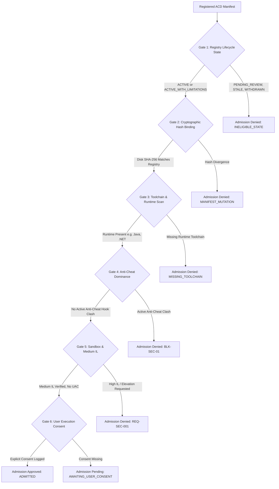
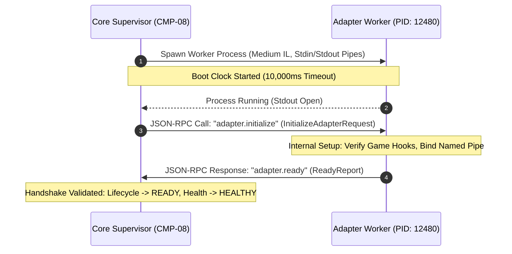

# Adapter Admission, Initialization, and Readiness Contract Specification

**Document Identifier:** `NLE-CON-AIR-001`  
**Phase:** Phase 5 — Universal Adapter SDK & Capability System  
**Step:** Step 40 of 100 — Adapter Lifecycle, Initialization & Health-State Contract Specification  
**Status:** Approved Architectural Contract  
**Classification:** Admission Gates, Protocol Handshake & Readiness Protocols  
**Repository Path:** `docs/adapters/ADAPTER_ADMISSION_INITIALIZATION_AND_READINESS_CONTRACT.md`  

---

## 1. Executive Summary & Purpose

### 1.1 Purpose
This specification establishes the formal data contracts, security gates, handshake protocols, and timing bounds for transitioning an adapter from an unadmitted state on disk to an operational, ready state within the NexLudic Engine.

It operationalizes:
1. **Runtime Admission:** The pre-flight verification gates that determine whether an adapter is legally and technically eligible to spawn a worker process.
2. **Process Initialization:** The JSON-RPC 2.0 handshake protocol dispatched across standard I/O channels upon process creation.
3. **Readiness Determination:** The concrete criteria that must be satisfied before an adapter is declared `READY` to receive capability invocations.

---

## 2. Runtime Admission Verification Gates

Registration in the Capability Registry (`NLE-SPC-VCR-001`) verifies only static metadata syntax. Before an adapter can be admitted to the runtime process supervisor (`CMP-08`), it must clear six (6) mandatory admission gates:



### 2.1 Admission Gate Definitions

| Gate ID | Dimension | Evaluation Logic | Failure Consequence |
|:---|:---|:---|:---|
| **ADM-GAT-001** | **Registry State** | Candidate `lifecycleState` in registry must be `ACTIVE` or `ACTIVE_WITH_LIMITATIONS`. | Rejection with `ERR_ADMISSION_INELIGIBLE_REGISTRY_STATE`. |
| **ADM-GAT-002** | **Hash Binding** | Computed SHA-256 of `manifest.json` on disk must equal `manifestSha256` in registry record. | Rejection with `ERR_ADMISSION_HASH_DIVERGENCE`. |
| **ADM-GAT-003** | **Toolchain Scan** | Host environment must possess required runtime (e.g., Java JRE $\ge$ 21, .NET $\ge$ 8.0, Python $\ge$ 3.11). | Rejection with `ERR_ADMISSION_MISSING_TOOLCHAIN`. |
| **ADM-GAT-004** | **Anti-Cheat Scan** | Target game's active process list and service registry must be clean of anti-cheat drivers if adapter hooks memory. | Fatal rejection under `BLK-SEC-01`. |
| **ADM-GAT-005** | **Medium IL Verify**| Process creation token explicitly configured without administrative elevation (`REQ-SEC-001`). | Immediate rejection if manifest requests High IL. |
| **ADM-GAT-006** | **User Consent** | Project execution authorization logged in project configuration (`DEC-002`). | Admission held in `ADMISSION_PENDING` until user confirms in UI. |

---

## 3. Worker Process Spawning & Channel Establishment

Once admitted, the supervisor launches the out-of-process worker:
1. **Process Creation:** Spawned via Win32 `CreateProcess` (or OS equivalent) with standard user token (Medium IL).
2. **Channel Redirection:**
   - Standard Input (`stdin`): Redirected anonymous pipe driven by Core Supervisor.
   - Standard Output (`stdout`): Redirected anonymous pipe read by Core Supervisor.
   - Standard Error (`stderr`): Redirected to supervisor diagnostic ring buffer on Volume D.
3. **Control Protocol:** JSON-RPC 2.0 framing over `stdin/stdout`.
4. **Data Stream Channel:** Dedicated Windows Named Pipe (`\\.\pipe\nexludic_<adapterId>_<pid>`) bound for high-throughput 60Hz telemetry and coordinate streams (`NLE-MSG-PRT-001`).

---

## 4. Initialization Handshake Protocol

Immediately upon process spawning, the supervisor and worker execute a two-way initialization handshake:



### 4.1 `InitializeAdapterRequest` Schema (`NLE-SCH-AIR-001`)

```json
{
  "$schema": "https://json-schema.org/draft/2020-12/schema",
  "$id": "https://schemas.nexludic.internal/v1/initialize-adapter-request.json",
  "title": "InitializeAdapterRequest",
  "description": "Initialization payload dispatched by the Universal Core to an adapter worker process.",
  "type": "object",
  "required": [
    "requestId",
    "adapterId",
    "manifestSha256",
    "targetGameContext",
    "negotiatedConfiguration",
    "resourceBudgets",
    "bootTimeoutMs"
  ],
  "properties": {
    "requestId": { "type": "string", "format": "uuid" },
    "adapterId": { "type": "string" },
    "manifestSha256": { "type": "string", "pattern": "^[a-f0-9]{64}$" },
    "targetGameContext": {
      "type": "object",
      "required": ["canonicalGameId", "installedVersion", "installationPath"],
      "properties": {
        "canonicalGameId": { "type": "string" },
        "installedVersion": { "type": "string" },
        "installationPath": { "type": "string" },
        "environmentProfile": { "type": "string" }
      }
    },
    "negotiatedConfiguration": {
      "type": "object",
      "description": "Resolved parameter values negotiated in Step 39."
    },
    "resourceBudgets": {
      "type": "object",
      "required": ["maxMemoryWorkingSetMb", "maxInvocationTimeoutMs"],
      "properties": {
        "maxMemoryWorkingSetMb": { "type": "integer", "default": 512 },
        "maxInvocationTimeoutMs": { "type": "integer", "default": 10000 }
      }
    },
    "bootTimeoutMs": { "type": "integer", "default": 10000 }
  }
}
```

### 4.2 `ReadyReport` Schema (`NLE-SCH-ARD-001`)

```json
{
  "$schema": "https://json-schema.org/draft/2020-12/schema",
  "$id": "https://schemas.nexludic.internal/v1/adapter-ready-report.json",
  "title": "ReadyReport",
  "description": "Readiness confirmation emitted by an adapter worker upon successful initialization.",
  "type": "object",
  "required": [
    "reportId",
    "adapterId",
    "workerPid",
    "initializationDurationMs",
    "boundChannels",
    "activeCapabilities",
    "initialHealthState"
  ],
  "properties": {
    "reportId": { "type": "string", "format": "uuid" },
    "adapterId": { "type": "string" },
    "workerPid": { "type": "integer", "minimum": 1 },
    "initializationDurationMs": { "type": "number", "minimum": 0 },
    "boundChannels": {
      "type": "object",
      "required": ["controlChannel", "dataChannelPipeName"],
      "properties": {
        "controlChannel": { "type": "string", "const": "stdin/stdout" },
        "dataChannelPipeName": { "type": "string", "pattern": "^\\\\\\\\\\.\\\\pipe\\\\.+" }
      }
    },
    "activeCapabilities": {
      "type": "array",
      "items": { "type": "string" }
    },
    "initialHealthState": {
      "type": "string",
      "enum": ["HEALTHY", "DEGRADED"]
    },
    "knownLimitations": {
      "type": "array",
      "items": { "type": "string" }
    }
  }
}
```

---

## 5. Readiness Determination & Failure Handling

### 5.1 Readiness Acceptance Criteria
An adapter is transitioned to `READY` if and only if:
1. The worker process emits a valid `ReadyReport` matching schema `NLE-SCH-ARD-001`.
2. The report is received within **10,000 milliseconds** of process spawn.
3. All mandatory capabilities negotiated in Step 39 are listed in `activeCapabilities`.
4. The Named Pipe specified in `dataChannelPipeName` is verified as open and connectable.

### 5.2 Boot Timeout & Early Exit Failures
- **Boot Timeout:** If the 10,000ms window expires before `ReadyReport` arrives, the supervisor sends `SIGKILL` / `TerminateProcess`, transitions lifecycle state to `FAILED`, and logs diagnostic `ERR_INITIALIZATION_TIMEOUT`.
- **Early Exit:** If the worker process exits prematurely (e.g., missing native DLL or uncaught C++ exception), the supervisor records return code, transitions to `FAILED`, and flags diagnostic `ERR_WORKER_EARLY_EXIT`.

---

## 6. Traceability and Cross-Reference Anchors

- `UNIVERSAL_ADAPTER_CONTRACT_SPECIFICATION.md` (`NLE-SPC-ADP-001`): Phase 2 Step 12 contract baseline.
- `ADAPTER_LIFECYCLE_STATE_MACHINE_AND_TRANSITION_RULES.md` (`NLE-MOD-LSM-001`): State transitions.
- `CAPABILITY_NEGOTIATION_RESULT_AND_EXPLAINABILITY_CONTRACT.md` (`NLE-CON-NRE-001`): Negotiated parameters.
- `ADR-0002`: Out-of-Process Adapter Execution Mode.
- `DEC-002`: Windows Medium Integrity Level.
- `BLK-SEC-01`: Platform Anti-Cheat Dominance Guarantee.
