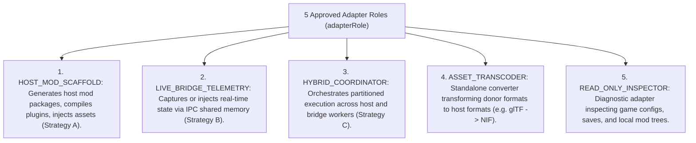
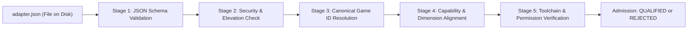

# Adapter Contract Baseline and Metadata Requirements

**Document ID:** `NLE-CAT-ACM-001`  
**Version:** 1.0.0  
**Phase:** 5 of 12 — Universal Adapter SDK & Capability System  
**Step:** 34 of 100 — Universal Adapter SDK Foundation & Contract Reconciliation Specification  
**Classification:** Adapter Descriptor Schema & Contract Invariants Catalog  
**Status:** Approved Specification  
**Authoritative Reference:** `NLE-SPC-SDK-001`, `NLE-SPC-ADP-001`, `NLE-CAT-RIA-001`, `NLE-MOD-GCD-001`

---

## 1. Specification Purpose & Catalog Scope

This catalog formally defines the **Adapter Descriptor Schema (`adapter.json`)**, field dictionaries, requiredness rules, validation criteria, and contract invariants that govern every game adapter within NexLudic Engine.

Every adapter package must supply an `adapter.json` file in its root directory. This manifest serves as the primary declarative contract inspected by the **Adapter Catalog Service** (`CMP-07`) during discovery, qualification, and project binding.

---

## 2. Formal JSON Schema Specification (`adapter.json`)

```json
{
  "$schema": "https://schemas.nexludic.org/v1/adapter-manifest.json",
  "adapterId": "adapter-skyrimse-skse-host",
  "name": "Skyrim Special Edition SKSE64 Host Integration Adapter",
  "version": "1.2.0",
  "contractVersion": "1.0.0",
  "maintainer": {
    "name": "NexLudic Modding Architecture Group",
    "contact": "adapters@nexludic.org",
    "url": "https://github.com/nexludic/adapter-skyrimse-skse"
  },
  "adapterRole": "HOST_MOD_SCAFFOLD",
  "targetGame": {
    "canonicalGameId": "game-tesv-skyrimse",
    "targetPlatform": "windows-x64",
    "supportedVersionRanges": [
      {
        "minimumVersion": "1.5.97",
        "maximumVersion": "1.6.640",
        "testedBuildHash": "sha256:7f83b1657ff1fc53b92dc18148a1d65dfc2d4b1fa3d677284b"
      }
    ]
  },
  "executionMode": "OutOfProcessWorker",
  "requiredToolchain": {
    "type": "Native_Cpp_MSVC",
    "minimumRuntimeVersion": "v143 (VS 2022)",
    "buildToolVersion": "MSBuild 17.0"
  },
  "capabilitiesDeclared": [
    {
      "capabilityId": "CAP-SKSE-DLL-INJECT",
      "dimension": "MEMORY_HOOKING",
      "declaredSupportLevel": "SUPPORTED",
      "epistemicMaturity": "TIER_2_DOCUMENTED",
      "prerequisites": ["FRAMEWORK-SKSE64 >= 2.0.20"]
    },
    {
      "capabilityId": "CAP-HAVOK-MESH-CONVERT",
      "dimension": "ASSET_PIPELINE",
      "declaredSupportLevel": "CONDITIONALLY_SUPPORTED",
      "epistemicMaturity": "TIER_1_REPRODUCED",
      "prerequisites": ["TOOL-HAVOK-FBX-IMPORTER"]
    }
  ],
  "requiredPermissions": {
    "fileSystem": "ScopedProjectStaging",
    "processElevation": "None",
    "networkAccess": "LoopbackOnly"
  },
  "resourceBudgets": {
    "maxMemoryBytes": 268435456,
    "maxThreadCount": 4,
    "startupTimeoutMs": 10000
  }
}
```

---

## 3. Manifest Field Dictionary & Requiredness Contracts

| Field Path | Data Type | Requiredness | Validation Rule & Constraints | Authoritative Owner |
|:---|:---|:---|:---|:---|
| `adapterId` | `String` (Regex) | **REQUIRED** | Lowercase alphanumeric + hyphens (`^[a-z0-9-]+$`). Max 64 chars. Globally unique. | Adapter Author |
| `name` | `String` | **REQUIRED** | Human-readable title (3–100 chars). Rendered in UI. | Adapter Author |
| `version` | `SemVer` | **REQUIRED** | Standard Semantic Versioning (`MAJOR.MINOR.PATCH`). E.g., `1.2.0`. | Adapter Author |
| `contractVersion` | `SemVer` | **REQUIRED** | Must match an approved SDK contract release (e.g., `1.0.0`). | NexLudic SDK |
| `maintainer.name` | `String` | **REQUIRED** | Organization or author identifier (max 100 chars). | Adapter Author |
| `adapterRole` | `Enum` | **REQUIRED** | Must be one of 5 approved roles: `HOST_MOD_SCAFFOLD`, `LIVE_BRIDGE_TELEMETRY`, `HYBRID_COORDINATOR`, `ASSET_TRANSCODER`, `READ_ONLY_INSPECTOR`. | SDK Architecture |
| `targetGame.canonicalGameId` | `String` | **REQUIRED** | Must resolve to a valid `CanonicalGameIdentity` in the Universal Catalog (`Step 25`). | Universal Catalog |
| `targetGame.targetPlatform` | `String` | **REQUIRED** | Must be `windows-x64` or `windows-x86`. Currently restricted to Windows Medium IL. | SDK Architecture |
| `targetGame.supportedVersionRanges`| `List<Range>`| **REQUIRED** | List of version bounds (`minimumVersion`, `maximumVersion`). Max version must be $\ge$ min. | Adapter Author |
| `executionMode` | `Enum` | **REQUIRED** | Must strictly equal `OutOfProcessWorker`. Any other value is rejected (`ADR-0002`). | SDK Architecture |
| `requiredToolchain.type` | `String` | **REQUIRED** | Identifier of build/runtime tool (e.g. `JavaGradle`, `Native_Cpp_MSVC`, `DotNetMono`). | Adapter Author |
| `capabilitiesDeclared` | `List<Capability>`| **REQUIRED** | Array of declared capability objects. Must declare at least one capability. | Adapter Author |
| `capabilitiesDeclared[].dimension` | `Enum` | **REQUIRED** | Must match one of the 8 approved dimensions from `NLE-CAT-DRC-001`. | Compatibility Model |
| `capabilitiesDeclared[].declaredSupportLevel` | `Enum` | **REQUIRED** | `SUPPORTED`, `CONDITIONALLY_SUPPORTED`, `UNSUPPORTED`. | Compatibility Model |
| `requiredPermissions.processElevation` | `Enum` | **REQUIRED** | Must strictly equal `"None"`. Value `"UAC_Elevated"` is rejected (`REQ-SEC-001`). | Security Policy |
| `requiredPermissions.fileSystem` | `Enum` | **REQUIRED** | `ScopedProjectStaging` or `ReadOnlyGameDirectory`. Unbounded writes rejected. | Security Policy |
| `resourceBudgets.maxMemoryBytes` | `Integer` | OPTIONAL | Default: `536870912` (512 MB). Hard ceiling for worker process RAM footprint. | System Supervisor |
| `resourceBudgets.startupTimeoutMs` | `Integer` | OPTIONAL | Default: `10000` (10 seconds). Timeout for initial IPC handshake. | System Supervisor |

---

## 4. Mandatory Adapter Roles (The 5 Approved Archetypes)

To prevent unconstrained interface proliferation, every adapter must classify itself under one of **five approved operational roles**:



---

## 5. Foundational Contract Invariants

Every compliant adapter must strictly satisfy the following **six architectural invariants**:

### Invariant 1: Immutable Identity Stability
The combination of `(adapterId, version)` is globally immutable. An adapter package once published cannot alter its declared capabilities, dependencies, or permissions without bumping its Semantic Version.

### Invariant 2: Truthful Capability Declarations
An adapter is strictly prohibited from declaring a capability as `SUPPORTED` if it lacks the underlying game-specific mechanism. Declaring a capability that repeatedly returns `Unsupported_Operation` at runtime triggers automatic adapter quarantine.

### Invariant 3: Explicit Dependency Transparency
All third-party tools, compilers, mod loaders, and runtime libraries must be explicitly declared in `requiredToolchain` and `prerequisites`. An adapter cannot assume an undeclared SDK is present on the user's computer.

### Invariant 4: Non-Bypassable Permission Boundaries
An adapter cannot grant itself permissions. Declarations in `requiredPermissions` represent *requested access*. The universal core validates these requests against the project security policy; ungranted permissions result in operational rejection.

### Invariant 5: Read-Only Safety Default
All discovery, capability inspection, and diagnostic operations must execute without modifying game files on disk. State-mutating operations require explicit user confirmation (`CMP-045`).

### Invariant 6: Storage Isolation on Volume D (`DEC-009`)
All temporary build outputs, decompiled scripts, and intermediate assets produced by an adapter must reside within its designated project staging directory (`D:\NexLudic\Projects\<id>\Adapters\<adapterId>\`). Writing to system directories is a fatal policy violation.

---

## 6. Manifest Parsing & Validation Pipeline

When the Adapter Catalog (`CMP-07`) inspects an `adapter.json` file, it executes the following five-stage validation pipeline:



- **Rejection Trigger 1 (Security):** `processElevation != "None"` -> Emits `ERR-ADP-SEC-01: Elevation Prohibited`.
- **Rejection Trigger 2 (Execution):** `executionMode != "OutOfProcessWorker"` -> Emits `ERR-ADP-EXE-01: In-Process Execution Prohibited`.
- **Rejection Trigger 3 (Identity):** `canonicalGameId` unresolvable in catalog -> Emits `ERR-ADP-IDN-01: Unknown Canonical Game`.
- **Rejection Trigger 4 (Dimension):** Capability declares invalid dimension -> Emits `ERR-ADP-CAP-01: Dimension Mismatch`.

