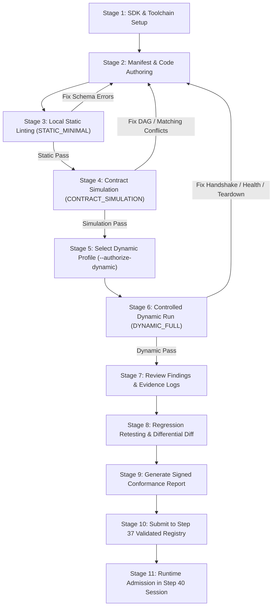

# ADAPTER DEVELOPER VALIDATION AND REMEDIATION WORKFLOW
**Document ID:** `NLE-PRO-DVR-001`  
**Version:** 1.0.0  
**Phase:** Phase 5 (Universal Adapter SDK & Capability System)  
**Step:** Step 41 of 100  
**Status:** Approved Architectural Standard  
**Authors:** Developer Tooling Engineer, Senior Software Architect, QA Automation Specialist, Developer Experience Lead  
**Classification:** Developer Guidance & Process Specification  

---

## 1. PURPOSE AND WORKFLOW OBJECTIVES

### 1.1 Purpose
This specification establishes the standardized, end-to-end workflow through which a game adapter developer authoring code for NexLudic Engine validates an adapter, discovers and remediates contract violations, verifies regression safety, and prepares a validated submission for registry admission.

The workflow provides clear, actionable feedback at every step of development—from rapid local syntax checks during authoring to automated CI/CD gates and formal pre-release lifecycle verification.

---

## 2. THE COMPLETE DEVELOPER JOURNEY (11 STAGES)



### Stage 1: SDK Installation and Toolchain Baseline
The developer acquires the official NexLudic Adapter SDK and CLI conformance tooling (`nexludic-sdk`). The developer verifies toolchain compatibility against the target game platform.

### Stage 2: Manifest and Code Authoring
The developer authors `adapter.json` and implements the adapter worker executable adhering to the JSON-RPC 2.0 wire protocol (`NLE-SPC-SDK-001`).

### Stage 3: Local Static Linting (`STATIC_MINIMAL`)
Before compiling or packaging, the developer runs fast, non-executing static linting to verify manifest syntax, required fields, and path safety:
```bash
nexludic-conformance check --profile static ./my_adapter/
```

### Stage 4: Contract Simulation (`CONTRACT_SIMULATION`)
The developer exercises the simulation suite to evaluate canonical taxonomy compliance, Kahn DAG cycle detection, and synthetic matching/negotiation doubles:
```bash
nexludic-conformance check --profile simulation ./my_adapter/
```

### Stage 5: Execution Profile Selection & Authorization
To test real multi-process interactions, the developer explicitly authorizes dynamic execution:
```bash
nexludic-conformance check --profile dynamic-full --authorize-dynamic-execution ./my_adapter/
```

### Stage 6: Controlled Dynamic Process Verification (`DYNAMIC_FULL`)
The harness spawns the adapter worker inside a Win32 Job Object at Medium IL (`DEC-002`), testing:
- Handshake completion within 10,000 ms (`T_BOOT_MAX`).
- Asynchronous `ReadyReport` emission (`NLE-SCH-ARD-001`).
- Active ping/pong latency ($< 50\text{ ms}$).
- Orderly teardown buffer flushing within 5,000 ms (`T_SHUTDOWN_GRACE`).

### Stage 7: Diagnostic Finding Interpretation
The developer inspects the human-readable Markdown summary or queries the CLI for structured remediation advice.

### Stage 8: Targeted Remediation & Regression Retesting
The developer addresses flagged errors, re-running targeted test suites using test ID flags:
```bash
nexludic-conformance check --test CONF-LFC-003 ./my_adapter/
```

### Stage 9: Tamper-Evident Report Packaging
Upon achieving `FULLY_CONFORMANT` status, the harness packages the machine-readable `conformance_report.json` and seals the SHA-256 rolling audit digest on Volume D (`DEC-009`).

### Stage 10: Submission to Validated Declaration Registry (Step 37)
The developer presents the verified conformance report and binary package to the Validated Capability Declaration Registry (`NLE-SPC-VCR-001`).

### Stage 11: Runtime Admission (Step 40)
During an active mashup session, the Core Supervisor (`CMP-08`) admits the registered adapter after confirming runtime hash binding and active anti-cheat status (`BLK-SEC-01`).

---

## 3. REMEDIATION PLAYBOOKS FOR TOP FAILURE SCENARIOS

### Playbook A: Circular Capability Dependency (`ERR_CAP_CYCLIC_DEPENDENCY`)
- **Root Cause:** Capability A declares a dependency on Capability B, while B directly or transitively depends on A.
- **Remediation:** 
  1. Inspect the DAG cycle path reported in the finding's `observed` property (e.g. `physics.mesh -> rendering.overlay -> physics.mesh`).
  2. Decouple the bidirectional dependency by splitting shared data structs into a separate canonical telemetry capability.
  3. Re-run `CONF-CAP-004`.

### Playbook B: Handshake Boot Timeout (`ERR_LFC_HANDSHAKE_TIMEOUT`)
- **Root Cause:** Adapter worker failed to return `adapter.initialize` response within 10,000 ms.
- **Remediation:**
  1. Check worker startup logic for blocking file I/O or network calls before acknowledging the handshake.
  2. Move expensive game memory scanning or asset unpacking to background threads post-initialization.
  3. Verify that standard I/O pipe stdout is flushed immediately after sending the response.

### Playbook C: Memory Ceiling Violation (`ERR_SEC_MEMORY_LIMIT_EXCEEDED`)
- **Root Cause:** Worker exceeded the 512 MB hard private working set commit limit.
- **Remediation:**
  1. Reduce in-memory telemetry ring buffer allocations.
  2. Stream large geometry or texture dumps via shared memory sections rather than heap buffers.
  3. Profile native memory leaks using memory analysis tools.

### Playbook D: UAC Elevation Violation (`CRIT_SEC_UAC_MANIFEST_BANNED`)
- **Root Cause:** Binary manifest requests `requireAdministrator` or `highestAvailable`.
- **Remediation:**
  1. Update the application manifest to specify `asInvoker` (`<requestedExecutionLevel level="asInvoker" uiAccess="false"/>`).
  2. Ensure the adapter does not attempt to access protected Windows registry keys or system directories.

---

## 4. REGISTRY HANDOFF INVARIANTS

1. **Conformance Is Not Automatic Publication:** Achieving a passing conformance report does NOT automatically register or distribute an adapter. Downstream registration remains governed exclusively by the Step 37 Registry Pipeline (`NLE-SPC-VCR-001`).
2. **Hash Invariance:** If the developer recompiles or modifies any binary file in the adapter package after running conformance, the cryptographic hash binding breaks, requiring a full conformance rerun.

---
*End of Workflow — Document `NLE-PRO-DVR-001`.*
