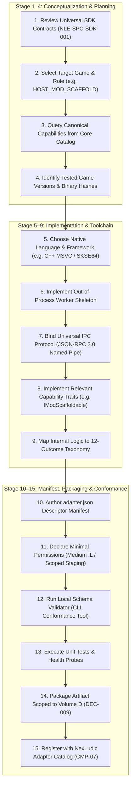

# Adapter Developer Workflow and Conformance Requirements

**Document ID:** `NLE-SPC-ADW-001`  
**Version:** 1.0.0  
**Phase:** 5 of 12 — Universal Adapter SDK & Capability System  
**Step:** 34 of 100 — Universal Adapter SDK Foundation & Contract Reconciliation Specification  
**Classification:** Developer Experience, Workflow & Conformance Testing Specification  
**Status:** Approved Specification  
**Authoritative Reference:** `NLE-SPC-SDK-001`, `NLE-CAT-ACM-001`, `NLE-SPC-ATF-001`, `ADR-0002`

---

## 1. Adapter Author Experience & Ergonomics Philosophy

The NexLudic Universal Adapter SDK is designed to make game adapter development straightforward, predictable, and robust. Modern game modders and reverse engineers already face steep technical hurdles when working with game-specific binaries. The universal platform must not add needless bureaucratic overhead or complex framework lock-in.

### 1.1 Guiding Ergonomic Principles
- **Small Mandatory Surface:** An adapter author only needs to implement `IGameAdapterContract` (health check and shutdown) and author an `adapter.json` manifest to qualify as a valid adapter.
- **Language Freedom:** Write in C++, C#, Java, Python, or Rust. The only requirement is speaking standard JSON-RPC 2.0 over an OS IPC pipe.
- **Actionable Diagnostics:** When a descriptor fails validation, the engine emits exact field paths, line numbers, and resolution suggestions.
- **Zero Proprietary Binary Redistribution:** Adapter packages contain only open-source adapter logic, manifests, and scripts. Distributing proprietary game assets or copyrighted binaries is strictly forbidden.

---

## 2. The 15-Stage Adapter Developer Workflow

The following conceptual lifecycle guides a developer from initial concept to an admitted, fully qualified adapter:



---

## 3. Minimum Documentation Standards for Adapter Authors

Every published adapter package must provide a standardized `README.md` and `DOCUMENTATION.md` detailing:
1. **Target Game Context:** Canonical title, supported edition, and verified version ranges.
2. **Operational Role:** Clear statement of role (`HOST_MOD_SCAFFOLD`, `LIVE_BRIDGE_TELEMETRY`, etc.).
3. **Declared Capabilities:** Detailed descriptions of what the adapter can and cannot do.
4. **Toolchain Prerequisites:** Clear instructions on required local tools (e.g. "Requires JDK 21 and Gradle 8.8 installed on system PATH").
5. **Known Limitations & Edge Cases:** Explicit disclosure of technical boundaries (e.g. "Physics telemetry limited to 30 Hz in multiplayer lobbies").
6. **Licensing & Source References:** Open-source license (MIT, Apache 2.0, GPL) and GitHub repository links.

---

## 4. Conformance Testing Boundaries: 7-Level Verification

Passing a schema check does not prove an integration works. The SDK establishes a **7-tier conformance boundary**:

```
+----------------------------------------------------------------------------------------------------+
|                                  THE 7 CONFORMANCE VERIFICATION TIERS                             |
+----+--------------------------------+--------------------------------------------------------------+
| Tier| Conformance Dimension          | Verification Criteria & Responsible Component                |
+----+--------------------------------+--------------------------------------------------------------+
| T1 | **Manifest Validation**        | `adapter.json` matches JSON schema; required fields present. |
+----+--------------------------------+--------------------------------------------------------------+
| T2 | **Security Compliance**        | `processElevation == "None"`; Medium IL; paths scoped.       |
+----+--------------------------------+--------------------------------------------------------------+
| T3 | **Lifecycle & Health Handshake**| Worker spawns; completes IPC handshake within 10s budget.    |
+----+--------------------------------+--------------------------------------------------------------+
| T4 | **Protocol Conformance**       | Accurately encodes and decodes JSON-RPC 2.0 envelopes.       |
+----+--------------------------------+--------------------------------------------------------------+
| T5 | **Outcome Taxonomy Compliance**| Invocations return valid codes from 12-Outcome Taxonomy.     |
+----+--------------------------------+--------------------------------------------------------------+
| T6 | **Local Version Match**        | Target game on user computer falls within declared range.    |
+----+--------------------------------+--------------------------------------------------------------+
| T7 | **End-to-End Operational**     | Real game modding or bridge communication validated.         |
+----+--------------------------------+--------------------------------------------------------------+
```

### 4.1 Conformance Status Classification
Based on conformance test results, `CMP-07` assigns one of four formal states:
- **`CONFORMANT`:** Passes Tiers 1 through 5. Eligible for project binding and capability evaluation.
- **`PROVISIONAL`:** Passes Tiers 1 through 4, but some declared capabilities lack conformance test fixtures.
- **`NON_CONFORMANT`:** Fails syntax, lifecycle handshake, or outcome taxonomy validation. Rejected from registration.
- **`QUARANTINED`:** Triggers a security policy violation, unhandled process crash, or repeated timeout. Immediately suspended.

