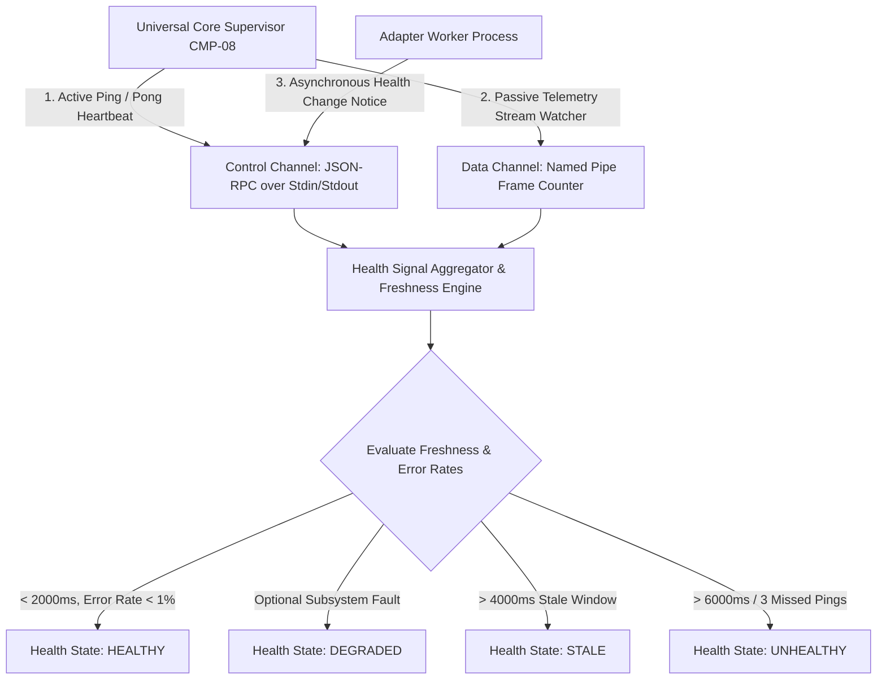
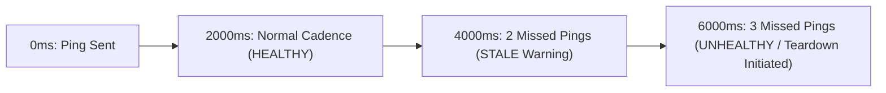
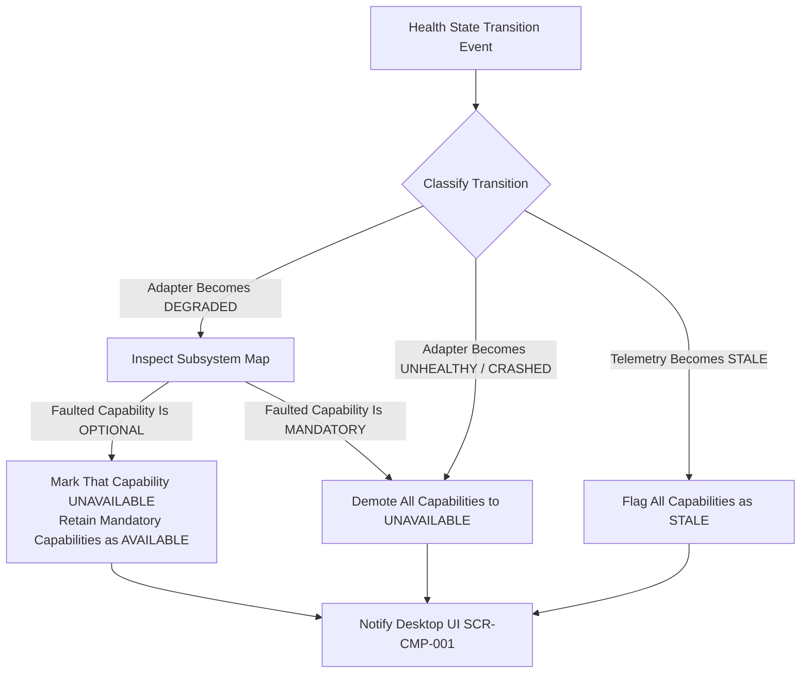

# Adapter Health Signal Freshness and Capability Availability Policy

**Document Identifier:** `NLE-POL-HSF-001`  
**Phase:** Phase 5 — Universal Adapter SDK & Capability System  
**Step:** Step 40 of 100 — Adapter Lifecycle, Initialization & Health-State Contract Specification  
**Status:** Approved Platform Policy  
**Classification:** Health Monitoring Protocol, Telemetry Freshness & Capability Degradation  
**Repository Path:** `docs/adapters/ADAPTER_HEALTH_SIGNAL_FRESHNESS_AND_CAPABILITY_AVAILABILITY_POLICY.md`  

---

## 1. Executive Summary & Policy Scope

### 1.1 Purpose
This policy establishes the formal protocols, timing thresholds, observation schemas, and capability availability implications for monitoring the **Operational Health** of active adapter worker processes within the NexLudic Engine.

In distributed, cross-process game integration environments, adapters can encounter silent deadlocks, game process crashes, or partial subsystem failures. This specification defines how the universal core platform observes adapter vitality in real time, detects stale telemetry, isolates degraded optional features, and updates contextual capability availability (`NLE-MOD-CAN-001`) without relying on naive assumptions or unverified self-reports.

### 1.2 Anti-Deception & Observability Invariants
- **Absence of Telemetry Is Not Health:** A lack of error logs or missed heartbeats is **never** interpreted as evidence that an adapter is healthy. If health signals cease, health transitions strictly to `STALE` or `UNKNOWN`.
- **Health Is Not Functional Correctness:** An adapter may be fully alive and responding to pings in 2ms while emitting logically corrupted coordinates or failing an unmonitored game hook. Health signifies **process vitality and operational readiness**, not empirical game mashup correctness.
- **Granular Subsystem Isolation:** Failure of an optional capability does not mandate terminating the entire adapter worker. If an optional feature faults while mandatory synchronization continues, the adapter enters `DEGRADED` health, allowing the core mashup to proceed with documented limitations.

---

## 2. Multi-Channel Health Observation Architecture

The Core Supervisor (`CMP-08`) monitors adapter health via three distinct, complementary channels:



### 2.1 The Three Observation Channels

| Channel Mechanism | Transport Protocol | Directionality | Cadence | Evaluated Metrics |
|:---|:---|:---:|:---:|:---|
| **1. Active Heartbeat** | JSON-RPC 2.0 (`adapter.ping` / `adapter.pong`) over `stdin/stdout` | Core $\rightarrow$ Worker $\rightarrow$ Core | Every 2,000 ms | Response latency, process responsiveness, memory working set. |
| **2. Stream Liveness** | Asynchronous Named Pipe (`\\.\pipe\nexludic_*`) | Worker $\rightarrow$ Core | 60 Hz streaming | Monotonically incrementing frame sequence numbers; buffer overflow. |
| **3. Health Notifications** | JSON-RPC Notification (`adapter.healthChanged`) | Worker $\rightarrow$ Core | Event-driven (on fault) | Internal subsystem exceptions, disconnected game hooks. |

---

## 3. Freshness Thresholds & Latency Degradation Rules

To prevent stale telemetry from being consumed as current truth, the engine enforces strict temporal boundaries:



### 3.1 Freshness Evaluation Thresholds

| Observed Metric | Boundary Value | Health State Assignment | Platform Consequence |
|:---|:---:|:---:|:---|
| **Round-Trip Ping Latency** | $\le 100\text{ ms}$ | `HEALTHY` | Normal operation. |
| **Elevated Ping Latency** | $100\text{ ms} < \Delta t \le 1000\text{ ms}$ | `DEGRADED` | Advisory warning logged; high process contention detected. |
| **Ping Timeout (Single Miss)**| $\Delta t > 1000\text{ ms}$ | `HEALTHY` (1 Warning) | Warning incremented; retry ping dispatched immediately. |
| **Stale Telemetry Horizon** | $\Delta t > 4000\text{ ms}$ (2 Missed Pings) | `STALE` | Capabilities flagged as stale; UI surfaces warning. |
| **Fatal Heartbeat Loss** | $\Delta t > 6000\text{ ms}$ (3 Missed Pings) | `UNHEALTHY` | Worker presumed hung. Supervisor initiates teardown/restart. |
| **Stream Counter Stall** | Stream frozen for $> 500\text{ ms}$ at 60Hz | `DEGRADED` | Data pipe reset commanded over control channel. |

---

## 4. Adapter-Level vs. Capability-Level Health Mapping

An adapter worker may manage multiple capabilities simultaneously. The health observation model distinguishes between whole-process failures and capability-specific degradations:

### 4.1 `HealthObservationRecord` Schema (`NLE-SCH-HOR-001`)

```json
{
  "$schema": "https://json-schema.org/draft/2020-12/schema",
  "$id": "https://schemas.nexludic.internal/v1/health-observation-record.json",
  "title": "HealthObservationRecord",
  "description": "Standardized health telemetry payload emitted during adapter supervision.",
  "type": "object",
  "required": [
    "observationId",
    "adapterId",
    "workerPid",
    "timestamp",
    "overallHealth",
    "pingLatencyMs",
    "subsystemStates"
  ],
  "properties": {
    "observationId": { "type": "string", "format": "uuid" },
    "adapterId": { "type": "string" },
    "workerPid": { "type": "integer" },
    "timestamp": { "type": "string", "format": "date-time" },
    "overallHealth": {
      "type": "string",
      "enum": ["HEALTHY", "DEGRADED", "UNHEALTHY", "UNKNOWN", "STALE"]
    },
    "pingLatencyMs": { "type": "number", "minimum": 0 },
    "memoryWorkingSetMb": { "type": "integer" },
    "subsystemStates": {
      "type": "object",
      "additionalProperties": {
        "type": "object",
        "required": ["capabilityId", "status"],
        "properties": {
          "capabilityId": { "type": "string" },
          "status": { "type": "string", "enum": ["OPERATIONAL", "DEGRADED", "FAILED"] },
          "lastError": { "type": ["string", "null"] }
        }
      }
    }
  }
}
```

---

## 5. Capability Availability Dynamic Cascades

When an adapter's health state changes, the Core Supervisor immediately pushes an availability cascade to the **Contextual Availability Engine** (`NLE-MOD-CAN-001`):



### 5.1 Impact on Active Mashup Workflows
1. **Optional Degradation:** If an optional capability fails, the mashup continues executing. The Desktop UI displays an advisory badge (`SCR-CMP-001`).
2. **Mandatory Failure:** If a mandatory capability fails, the entire cross-game integration session is placed in a **Safe Pause** state. Capability invocations are suspended until recovery succeeds or the user halts the session.

---

## 6. Traceability and Cross-Reference Anchors

- `UNIVERSAL_ADAPTER_CONTRACT_SPECIFICATION.md` (`NLE-SPC-ADP-001`): Phase 2 Step 12 trait baseline (`CheckHealthAsync`).
- `ADAPTER_LIFECYCLE_STATE_MACHINE_AND_TRANSITION_RULES.md` (`NLE-MOD-LSM-001`): Health state definitions.
- `CAPABILITY_CONTEXTUAL_AVAILABILITY_AND_NEGOTIATION_STATE_MODEL.md` (`NLE-MOD-CAN-001`): Contextual availability states.
- `ADAPTER_SHUTDOWN_CLEANUP_AND_RECOVERY_SPECIFICATION.md` (`NLE-SPC-SCR-001`): Teardown triggers on unhealthy state.
