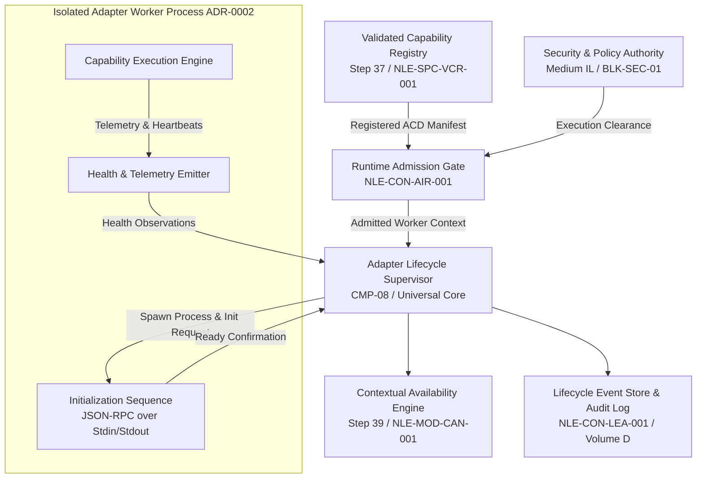
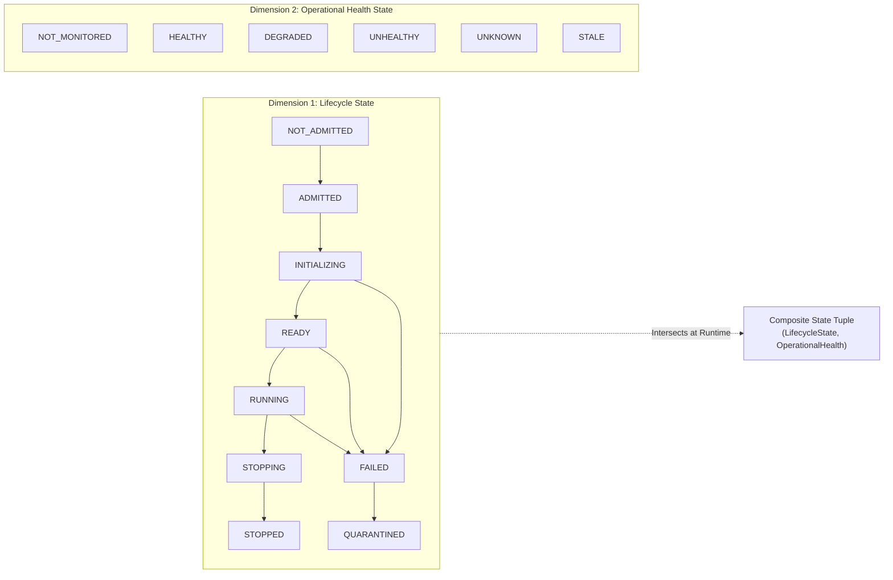
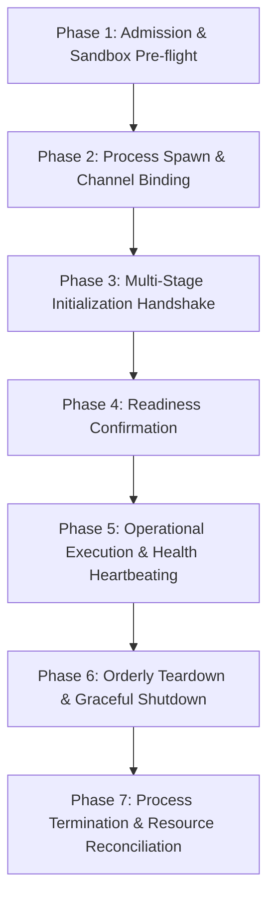

# Adapter Lifecycle and Operational State Specification

**Document Identifier:** `NLE-SPC-ALC-001`  
**Phase:** Phase 5 — Universal Adapter SDK & Capability System  
**Step:** Step 40 of 100 — Adapter Lifecycle, Initialization & Health-State Contract Specification  
**Status:** Approved Architectural Specification  
**Classification:** Universal Core Specification & Lifecycle Architecture  
**Repository Path:** `docs/adapters/ADAPTER_LIFECYCLE_AND_OPERATIONAL_STATE_SPECIFICATION.md`  

---

## 1. Executive Summary & Purpose

### 1.1 Purpose
This specification establishes the authoritative architecture, state boundaries, operational contracts, and supervisory responsibilities for managing the **Adapter Lifecycle and Operational Health States** within the NexLudic Engine.

Building upon Phase 2 Step 12 (`UNIVERSAL_ADAPTER_CONTRACT_SPECIFICATION.md`, `NLE-SPC-ADP-001`) and Phase 5 Step 34 (`UNIVERSAL_ADAPTER_SDK_FOUNDATION_SPECIFICATION.md`, `NLE-SPC-SDK-001`), this document operationalizes how the universal core platform:
1. Reconciles static registration eligibility (Step 37) with dynamic runtime admission.
2. Coordinates multi-stage process initialization, protocol handshakes, and readiness gating.
3. Observes and evaluates ongoing operational health signals (liveness, readiness, heartbeats).
4. Determines how adapter health dynamics affect contextual capability availability (`NLE-MOD-CAN-001`).
5. Executes deterministic teardown, graceful shutdown, and crash recovery without corrupting game environments.

### 1.2 Non-Negotiable Lifecycle Invariants
- **Reconciliation with Phase 2 Step 12:** Step 40 refines and operationalizes the approved `NLE-SPC-ADP-001` lifecycle model. It does **not** create a competing lifecycle architecture.
- **Strict Separation of Lifecycle State from Operational Health:** Lifecycle position (e.g., `RUNNING`, `STOPPING`) and operational condition (e.g., `HEALTHY`, `DEGRADED`, `UNKNOWN`) are orthogonal dimensions. They are never collapsed into a single ambiguous status field.
- **Registration Is Not Runtime Admission:** Having an active declaration in the capability registry (`NLE-SPC-VCR-001`) certifies solely that an adapter's static metadata is conformant. It does **not** grant permission to execute or guarantee runtime viability.
- **Readiness Is Not Functional Correctness:** Reporting `READY` certifies that the adapter worker process has spawned, completed initial handshakes, and bound communication channels. It does **not** prove that complex game hooks will operate without crashes under all gameplay conditions.
- **No Inferred Health:** Missing, delayed, or unmonitored health signals are **never** interpreted as proof that an adapter is healthy. Absence of telemetry evaluates strictly to `UNKNOWN` or `STALE`.
- **Security & Sandbox Primacy:** Adapters execute strictly as out-of-process workers (`ADR-0002`) under Windows Medium Integrity Level (`REQ-SEC-001`, `DEC-002`). Routine recovery or retry logic can **never** bypass an anti-cheat block (`BLK-SEC-01`) or security quarantine.

---

## 2. Architectural Positioning & Ownership Model

The adapter lifecycle subsystem is governed by the Universal Core's **Adapter Lifecycle Supervisor** (`CMP-08`, per `CORE_COMPONENT_ARCHITECTURE.md`), coordinating with the Registry (Step 37) and Contextual Availability (Step 39):

### 2.1 Ownership and Responsibility Matrix

| Subsystem Component | Primary Document | Authority & Lifecycle Responsibilities Owned | Explicit Boundaries / Prohibitions |
|:---|:---|:---|:---|
| **Universal Core Supervisor (`CMP-08`)** | `NLE-SPC-ALC-001` | Spawning adapter worker processes; enforcing timeouts; tracking lifecycle state; receiving health signals; commanding shutdown; managing quarantine. | Does not execute game-specific hook logic internally. |
| **Adapter Worker Process** | `NLE-SPC-ADP-001`, SDK | Internal initialization; acquiring game modding hooks within approved scope; executing capabilities; emitting health reports; executing clean teardown. | **Cannot elevate privileges; cannot self-authorize; cannot bypass core supervisor commands.** |
| **Capability Registry** | `NLE-SPC-VCR-001` | Authoritative storage of static declarations and manifest revisions. | Does not monitor live process health or track running PIDs. |
| **Contextual Availability Engine** | `NLE-MOD-CAN-001` | Maps operational health states to capability availability (`AVAILABLE`, `UNAVAILABLE`, `STALE`). | Does not issue process kill commands or restart adapters directly. |
| **Security Policy Authority** | `docs/architecture/` | UAC denial, anti-cheat detection, Medium IL enforcement (`DEC-002`). | Does not manage individual capability parameters or IPC framing. |

---

## 3. The Dual-Dimension Operational Architecture

To eliminate ambiguity across edge cases (e.g., an adapter is running but its optional camera sync has crashed, or an adapter is shutting down while its last telemetry was valid), the runtime models two orthogonal dimensions:

### 3.1 Composite State Semantics Examples
- `(RUNNING, HEALTHY)`: Adapter process is active, telemetry heartbeats arrive on schedule, all declared capabilities are fully operational.
- `(RUNNING, DEGRADED)`: Adapter process is active, but an optional capability (e.g., audio extraction) has faulted while core state sync continues.
- `(STOPPING, HEALTHY)`: Adapter has received an orderly teardown command and is flushing in-flight buffers before process exit.
- `(FAILED, UNHEALTHY)`: Adapter worker encountered an unhandled exception or process crash (`0xC0000005`) and terminated abnormally.
- `(READY, UNKNOWN)`: Adapter successfully initialized, but initial live capability telemetry has not yet been received.

---

## 4. End-to-End Operational Workflow

The adapter lifecycle executes across seven sequential phases:

### 4.1 Phase Overview
1. **Admission & Sandbox Pre-flight:** Verifies registration eligibility, manifest SHA-256 hash binding, Volume D directory anchoring (`DEC-009`), and anti-cheat dominance (`BLK-SEC-01`).
2. **Process Spawn & Channel Binding:** Launches out-of-process worker (`ADR-0002`) under Windows Medium Integrity Level. Establishes `stdin/stdout` JSON-RPC control channel and Named Pipe data channel (`NLE-MSG-PRT-001`).
3. **Multi-Stage Initialization Handshake:** Dispatches `InitializeAdapterRequest` with negotiated configuration. Validates internal mod hooks and toolchains.
4. **Readiness Confirmation:** Receives and validates `ReadyReport`. Transitions lifecycle state to `READY`.
5. **Operational Execution & Health Heartbeating:** Supervises capability invocations, monitors periodic liveness pings, and updates capability availability in real time.
6. **Orderly Teardown & Graceful Shutdown:** Dispatches `ShutdownRequest` upon user action, project close, or fatal dependency failure. Flushes IPC queues and releases locks.
7. **Process Termination & Resource Reconciliation:** Verifies worker process exit (clean return code `0`). If worker hangs past timeout (5,000ms), executes forced termination and cleans up temporary staging artifacts.

---

## 5. Traceability and Cross-Reference Anchors

- `UNIVERSAL_ADAPTER_CONTRACT_SPECIFICATION.md` (`NLE-SPC-ADP-001`): Phase 2 Step 12 baseline specification.
- `UNIVERSAL_ADAPTER_SDK_FOUNDATION_SPECIFICATION.md` (`NLE-SPC-SDK-001`): Step 34 foundation contract.
- `VALIDATED_CAPABILITY_DECLARATION_REGISTRY_SPECIFICATION.md` (`NLE-SPC-VCR-001`): Step 37 registry boundary.
- `CAPABILITY_CONTEXTUAL_AVAILABILITY_AND_NEGOTIATION_STATE_MODEL.md` (`NLE-MOD-CAN-001`): Step 39 availability states.
- `CORE_COMPONENT_ARCHITECTURE.md`: Adapter Lifecycle Supervisor (`CMP-08`).
- `ADR-0002`: Out-of-Process Adapter Execution Mode.
- `DEC-002`, `REQ-SEC-001`: Windows Medium Integrity Level.
- `DEC-009`: Workspace filesystem anchoring on Volume D.
- `BLK-SEC-01`: Platform Anti-Cheat Dominance Guarantee.
