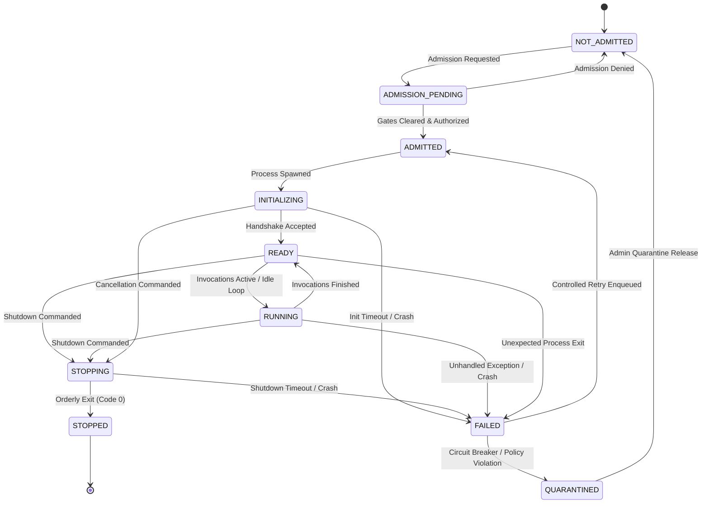
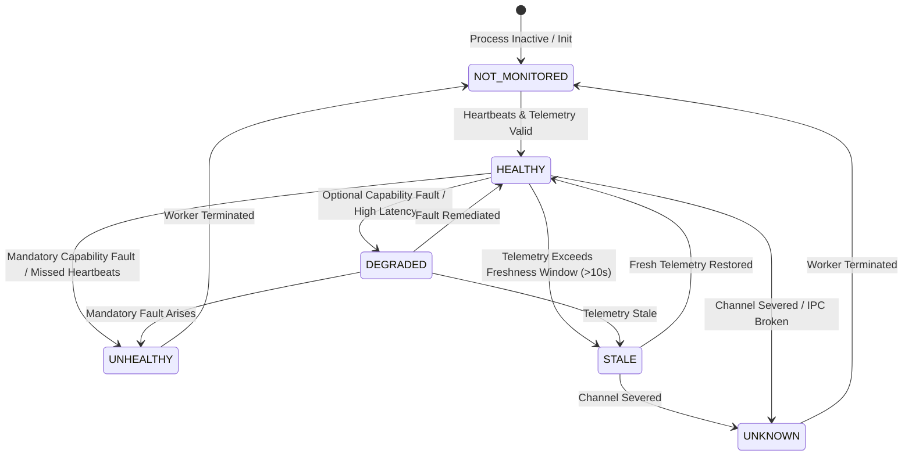

# Adapter Lifecycle State Machine and Transition Rules

**Document Identifier:** `NLE-MOD-LSM-001`  
**Phase:** Phase 5 — Universal Adapter SDK & Capability System  
**Step:** Step 40 of 100 — Adapter Lifecycle, Initialization & Health-State Contract Specification  
**Status:** Approved Architectural Model  
**Classification:** State Machine Architecture, Transition Invariants & Illegal Transition Catalog  
**Repository Path:** `docs/adapters/ADAPTER_LIFECYCLE_STATE_MACHINE_AND_TRANSITION_RULES.md`  

---

## 1. Executive Summary & Step 12 Reconciliation

### 1.1 Purpose
This specification establishes the formal state machine, state transition rules, transition authorities, and illegal transition prohibitions for managing adapter worker processes within the NexLudic Engine.

### 1.2 Reconciliation with Phase 2 Step 12
Phase 2 Step 12 (`UNIVERSAL_ADAPTER_CONTRACT_SPECIFICATION.md`, `NLE-SPC-ADP-001` Section 5) established the foundational adapter lifecycle states: `Discovered`, `Qualified`, `Authorized`, `Initializing`, `ActiveReady`, `BusyExecuting`, `Degraded`, `Crashed`, `Stopping`, and `Stopped`.

Step 40 refines this model into a **two-dimensional architecture** that cleanly separates process lifecycle milestones from runtime health observations, providing strict formal state transitions and explicit transition ownership.

---

## 2. Formal Lifecycle State Definitions

The platform defines ten (10) mutually exclusive lifecycle states:

### 2.1 State Catalog

| Lifecycle State | Description | Authoritative Owner | Process Status | Permitted Operations |
|:---|:---|:---:|:---:|:---|
| `NOT_ADMITTED` | Manifest exists in registry, but adapter is not cleared for runtime execution. | Core Supervisor (`CMP-08`) | No process running | Static discovery, inspection |
| `ADMISSION_PENDING` | Security, permission, and environment pre-admission gates are executing. | Security & Admission Gate | No process running | Pre-flight security scans |
| `ADMITTED` | Pre-flight cleared; adapter authorized to spawn worker process. | Core Supervisor | No process running | Process spawning |
| `INITIALIZING` | Worker process spawned; JSON-RPC handshake and internal setup in progress. | Worker & Core Supervisor | Process spawned (PID assigned) | Handshake protocol only |
| `READY` | Initialization handshake accepted; ready to serve capability invocations. | Core Supervisor | Process active, channels bound | Invocation dispatch |
| `RUNNING` | Actively processing capability requests or maintaining live game IPC pipes. | Worker & Core Supervisor | Process active, pipes streaming | Live capability execution |
| `STOPPING` | Shutdown command received; in-flight buffers flushing; teardown in progress. | Core Supervisor | Process tearing down | Flush & disconnect only |
| `STOPPED` | Worker process terminated cleanly with return code `0`. Resources released. | Core Supervisor | Process terminated | Post-mortem audit, restart |
| `FAILED` | Worker crashed (`exit code != 0`), handshake timed out, or channel severed. | Core Supervisor | Process dead or hung | Crash logging, recovery triage |
| `QUARANTINED` | Suspended due to repeated crash circuit-breaker, anti-cheat detection, or UAC violation. | Security Authority | Process forcibly terminated | Administrative audit only |

---

## 3. Formal Operational Health State Definitions

Operational health represents the currently observed reliability of an admitted adapter:

### 3.1 Health State Catalog

| Health State | Definition | Evidentiary Requirement | Impact on Capabilities |
|:---|:---|:---|:---|
| `NOT_MONITORED` | Adapter is not in an active running state (e.g., `STOPPED`, `NOT_ADMITTED`, `INITIALIZING`). | Lifecycle state $\notin \{\texttt{READY}, \texttt{RUNNING}\}$. | All capabilities unavailable. |
| `HEALTHY` | Worker process alive, heartbeats arriving $\le 2000\text{ms}$, error rate $< 1\%$. | Periodic JSON-RPC `ping/pong` and Named Pipe stream active. | All capabilities available. |
| `DEGRADED` | Worker is alive and mandatory capabilities operate, but an optional capability has faulted or latency $> 100\text{ms}$. | Telemetry reports optional subsystem failure; mandatory channel operational. | Mandatory capabilities available; optional capabilities degraded. |
| `UNHEALTHY` | Mandatory capability has crashed, memory leak detected, or consecutive heartbeats missed. | 3 consecutive missed pings ($>6000\text{ms}$) or fatal internal exception. | All capabilities marked `UNAVAILABLE`. Supervised teardown triggered. |
| `UNKNOWN` | Telemetry pipe disconnected or telemetry buffer unverified. | Incomplete observation records or broken pipe notification. | Capabilities downgraded to `UNKNOWN`. |
| `STALE` | Last valid health observation exceeds freshness threshold ($>10,000\text{ms}$). | Wall-clock time minus `lastObservationTimestamp` $> 10\text{s}$. | Capabilities flagged with `STALE` warning. |

---

## 4. Permitted State Transition Matrix

| Current State | Target State | Permitted Trigger / Event | Authoritative Actor | Mandatory Preconditions | Resulting Action |
|:---:|:---:|:---|:---:|:---|:---|
| `NOT_ADMITTED` | `ADMISSION_PENDING` | Admission request submitted | Core Supervisor | Registered ACD manifest exists in registry | Initiates Stage 1 Pre-admission gates |
| `ADMISSION_PENDING` | `ADMITTED` | All admission gates pass | Security Authority | Medium IL verified, anti-cheat clean, user consent logged | Authorizes worker process execution |
| `ADMISSION_PENDING` | `NOT_ADMITTED` | Admission gate fails | Security Authority | Policy rejection, missing toolchain, or UAC request | Emits admission failure diagnostic |
| `ADMITTED` | `INITIALIZING` | Spawn worker command | Core Supervisor | Staging directory ready on Volume D | Spawns process (`ADR-0002`), starts 10s timeout |
| `INITIALIZING` | `READY` | `ReadyReport` received | Adapter Worker | Handshake accepted, internal hooks verified | Transitions health to `HEALTHY`, channels open |
| `INITIALIZING` | `FAILED` | Boot timeout or early exit | Core Supervisor | 10,000ms clock expires or process exits code != 0 | Logs `ERR_INITIALIZATION_TIMEOUT`, kills PID |
| `INITIALIZING` | `STOPPING` | Cancellation request | User / Supervisor | Teardown issued before ready handshake completes | Aborts handshake, sends SIGTERM |
| `READY` | `RUNNING` | Invocation dispatched | Core Supervisor | Valid capability request envelope | Sets execution timer, monitors telemetry |
| `RUNNING` | `READY` | Invocation completed | Adapter Worker | Return outcome emitted, buffers flushed | Restores idle monitoring state |
| `RUNNING` | `STOPPING` | Orderly shutdown command | Core Supervisor | Project close, game exit, or user stop | Dispatches `ShutdownRequest` with 5s timeout |
| `READY` | `STOPPING` | Orderly shutdown command | Core Supervisor | Idle adapter teardown requested | Dispatches `ShutdownRequest` with 5s timeout |
| `STOPPING` | `STOPPED` | Worker process exit code 0 | Core Supervisor | Worker process exits within 5,000ms | Releases Named Pipe, cleans temp buffers |
| `STOPPING` | `FAILED` | Shutdown timeout or crash | Core Supervisor | Process hangs past 5,000ms or crashes | Forces `TerminateProcess`, logs clean failure |
| `RUNNING` | `FAILED` | Process crash / pipe broken | Core Supervisor | Win32 process exit code != 0 or pipe severed | Logs crash dump, demotes availability |
| `FAILED` | `ADMITTED` | Controlled recovery retry | Core Supervisor | Retry budget remaining (< 3 attempts) | Cleans state, enqueues fresh spawn |
| `FAILED` | `QUARANTINED` | Crash circuit breaker fired | Security Authority | $\ge 3$ consecutive crashes within 60 seconds | Locks adapter, flags UI notification |
| `QUARANTINED` | `NOT_ADMITTED` | Admin quarantine release | Administrator | Manual developer inspection / patch applied | Clears circuit breaker count |

---

## 5. Prohibited Illegal State Transitions

To guarantee system stability, any attempt to execute an unlisted transition is intercepted and rejected with `ERR_ILLEGAL_LIFECYCLE_TRANSITION`:
1. **No Leapfrogging to Ready:** `NOT_ADMITTED` $\rightarrow$ `READY` or `INITIALIZING` $\rightarrow$ `RUNNING` without completing the handshake is strictly impossible.
2. **No Self-Revival from Quarantine:** An adapter in `QUARANTINED` can **never** transition directly to `ADMITTED`, `READY`, or `RUNNING`. It requires explicit administrative release.
3. **No Resurrection from Failed:** `FAILED` cannot transition directly to `READY` or `RUNNING`. Recovery must cycle through `ADMITTED` $\rightarrow$ `INITIALIZING` to establish fresh communication channels.
4. **No Bypassing Shutdown:** A `RUNNING` adapter cannot transition directly to `STOPPED`. It must pass through `STOPPING` to flush buffers and release file locks.

---

## 6. Traceability and Cross-Reference Anchors

- `UNIVERSAL_ADAPTER_CONTRACT_SPECIFICATION.md` (`NLE-SPC-ADP-001`): Phase 2 Step 12 state baseline.
- `ADAPTER_LIFECYCLE_AND_OPERATIONAL_STATE_SPECIFICATION.md` (`NLE-SPC-ALC-001`): Primary lifecycle contract.
- `ADAPTER_ADMISSION_INITIALIZATION_AND_READINESS_CONTRACT.md` (`NLE-CON-AIR-001`): Admission and initialization details.
- `ADAPTER_SHUTDOWN_CLEANUP_AND_RECOVERY_SPECIFICATION.md` (`NLE-SPC-SCR-001`): Teardown and circuit breaker rules.
- `ADR-0002`: Out-of-Process Adapter Execution Mode.
- `DEC-002`: Windows Medium Integrity Level.
- `BLK-SEC-01`: Platform Anti-Cheat Dominance Guarantee.
