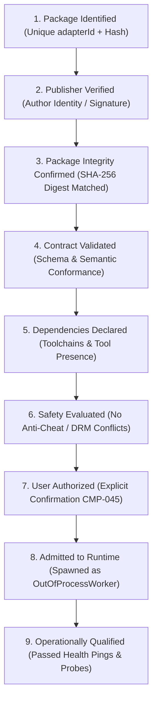
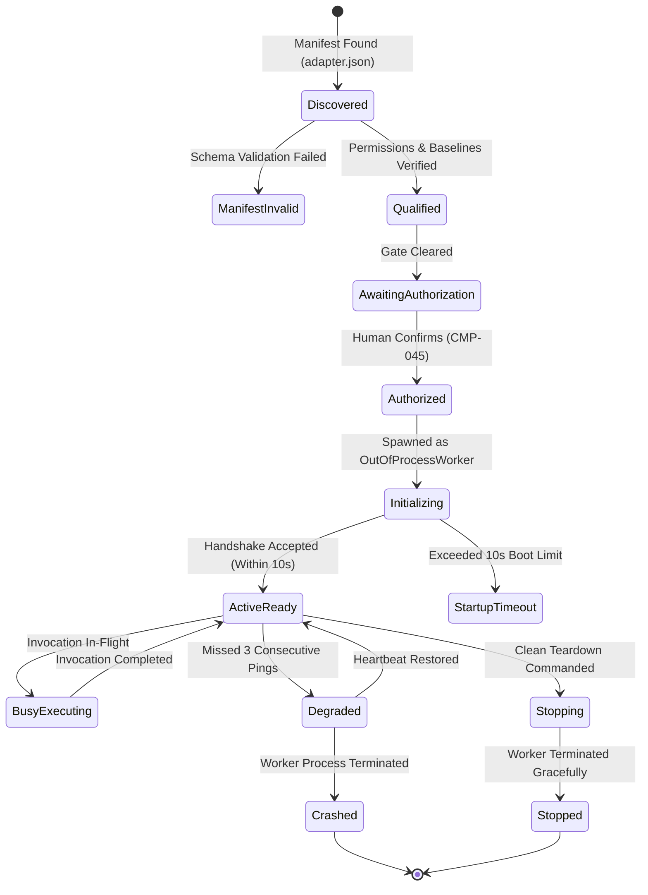

# Adapter Trust, Permissions, and Failure Contract Requirements

**Document ID:** `NLE-SPC-ATF-001`  
**Version:** 1.0.0  
**Phase:** 5 of 12 — Universal Adapter SDK & Capability System  
**Step:** 34 of 100 — Universal Adapter SDK Foundation & Contract Reconciliation Specification  
**Classification:** Security Architecture, Permission Model & Failure Taxonomy  
**Status:** Approved Specification  
**Authoritative Reference:** `NLE-SPC-SDK-001`, `NLE-SPC-ADP-001`, `REQ-SEC-001`, `REQ-SAFE-001`, `DEC-009`

---

## 1. Trust Hierarchy & Epistemic Distinctions

A foundational security principle of NexLudic Engine is that **a valid contract does not imply trust, and trust does not imply authorization**. The platform strictly rejects monolithic "trusted" boolean flags.

Instead, an adapter must advance through **nine discrete verification gates**:



---

## 2. Permission Model & Resource Governance

Adapters operate under the **Principle of Least Privilege**. Permissions must be explicitly requested in `adapter.json` under `requiredPermissions` and approved by the core platform.

### 2.1 Permission Categories

| Permission Dimension | Allowed Values | Prohibited / Fatal Values | Enforcement Mechanism |
|:---|:---|:---|:---|
| **Process Elevation** | `"None"` (Windows Medium IL) | `"UAC_Elevated"`, `"Administrator"`, `"SYSTEM"` | Immediate descriptor rejection at registration (`REQ-SEC-001`). |
| **Filesystem Access** | `"ScopedProjectStaging"`, `"ReadOnlyGameDirectory"` | `"Unrestricted_C_Drive"`, `"WindowsSystemWrite"` | Win32 file security descriptors; Volume D scoping (`DEC-009`). |
| **Network Access** | `"LoopbackOnly"` (127.0.0.1), `"None"` | `"RawSocketAccess"`, `"UnrestrictedOutbound"` | Windows Firewall rule injection per worker process. |
| **Process Memory** | `"LoopbackSharedMemory"` (Named pipes, IPC ring) | `"OpenProcess_Write"`, `"DebugPrivilege"`, `"KernelHook"` | Win32 access masks; attempts to attach debuggers trigger `ERR-SEC-02`. |
| **Game State Mutation**| `"GuardedWorkspaceBuild"` (Staging directory only) | `"DirectGameFolderPatching"` (Without backup) | Atomic file operations with automatic rollback log. |

### 2.2 Strict Anti-Self-Authorization Invariant
An adapter **cannot grant itself permissions**. Writing `"fileSystem": "Unrestricted"` in `adapter.json` results in immediate validation failure. Permissions are granted exclusively through project policies confirmed by the human user (`CMP-045 ApprovalSummaryCard`).

---

## 3. The 12-Outcome Invocation Taxonomy

When the Universal Core commands an adapter operation, the response must conform to the standardized **12-Outcome Invocation Taxonomy** established in `NLE-SPC-ADP-001`:

```
+----------------------------------------------------------------------------------------------------+
|                                    INVOCATION OUTCOME TAXONOMY                                     |
+----+-----------------------------+-----------------------------------------------------------------+
| #  | Outcome Code                | Domain Meaning & System Response                                |
+----+-----------------------------+-----------------------------------------------------------------+
| 01 | `Accepted_Queued`           | Request validated and queued in adapter execution buffer.       |
| 02 | `Completed_Success`         | Operation completed fully; output matches verified postcondition|
| 03 | `Completed_Partial`         | Operation completed partially with explicit reported limitations|
| 04 | `Rejected_PreconditionFail` | Preconditions not met (e.g. game not in single-player mode).    |
| 05 | `Failed_BeforeSideEffects`  | Failed before any file, memory, or state mutation occurred.     |
| 06 | `Failed_AfterSideEffects`   | Partial failure after mutation; triggers automated rollback.    |
| 07 | `TimedOut_OutcomeKnown`     | Operation exceeded budget; state confirmed unchanged.           |
| 08 | `TimedOut_OutcomeUnknown`   | Operation timed out; state uncertain; requires manual audit.    |
| 09 | `Cancelled_ByUser`          | Operation safely aborted before side effects took effect.       |
| 10 | `Unsupported_Operation`     | Adapter does not support the requested operation variant.       |
| 11 | `Permission_Denied`         | Requested operation violates security quota or IL boundary.     |
| 12 | `Fatal_ProcessCrash`        | Adapter worker process crashed during invocation (0xC0000005).  |
+----+-----------------------------+-----------------------------------------------------------------+
```

### 3.1 Idempotency & The Non-Retry Mandate
- If an operation returns `TimedOut_OutcomeUnknown` or `Failed_AfterSideEffects`, the engine is **strictly prohibited from performing automatic retries**.
- Retrying an unconfirmed state mutation (e.g. injecting a patch or writing an asset index) could cause fatal file corruption or duplicate memory entities. Manual state verification or automated rollback is mandatory.

---

## 4. Adapter Lifecycle State Machine

Every adapter worker process transitions through an explicit lifecycle supervised by `CMP-08`:



---

## 5. Prohibited Behaviors & Hard Security Barriers

The Universal Adapter SDK strictly prohibits the following behaviors; any detected occurrence results in immediate process termination and security quarantine:

1. **Kernel Anti-Cheat Circumvention (`BLK-SEC-01`):** Any attempt to bypass, disable, hook, or tamper with kernel-level anti-cheat drivers (Vanguard, EAC, BattlEye).
2. **DRM Circumvention (`BLK-SEC-02`):** Any attempt to bypass digital rights management, crack executables, or tamper with licensing verification.
3. **Arbitrary Code Downloading:** Downloading and executing unverified executable binaries or scripts from external URLs without explicit cryptographic manifest registration.
4. **Elevation Exploitation:** Attempting to elevate process tokens or invoke Win32 APIs requiring administrative privileges.
5. **Direct Binary Memory Tampering:** Attempting to write directly to running game executables without an approved mod loader framework (`REQ-SAFE-001`).

