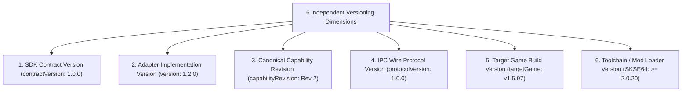

# Adapter Versioning, Runtime, and Interoperability Boundaries

**Document ID:** `NLE-SPC-AVR-001`  
**Version:** 1.0.0  
**Phase:** 5 of 12 — Universal Adapter SDK & Capability System  
**Step:** 34 of 100 — Universal Adapter SDK Foundation & Contract Reconciliation Specification  
**Classification:** Versioning Matrix, Runtime Isolation & Wire Protocol Specification  
**Status:** Approved Specification  
**Authoritative Reference:** `NLE-SPC-SDK-001`, `UNIVERSAL_MESSAGE_PROTOCOL_SPECIFICATION.md`, `PROTOCOL_VERSIONING_AND_VALIDATION_PLAN.md`, `ADR-0002`

---

## 1. Multi-Dimensional Versioning Matrix

A frequent point of failure in game modding platforms is collapsing distinct technical versions into a single ambiguous "version" field. In NexLudic Engine, cross-game interoperability involves **six independent, loosely coupled versioning dimensions**:



### 1.1 Field Differentiations & Semantics

| Version Dimension | Schema Representation | Governance Authority | Example Value | Change Impact & Invalidation Scope |
|:---|:---|:---|:---|:---|
| **1. SDK Contract Version** | `contractVersion` | Universal SDK Board | `1.0.0` | Breaking changes bump MAJOR version; older adapters rejected unless backward-compatibility layer active. |
| **2. Adapter Package Version**| `version` | Adapter Author | `1.2.4` | Bug fixes bump PATCH; new capability implementations bump MINOR; breaking config changes bump MAJOR. |
| **3. Capability Revision** | `revision` | Capability Catalog | `Rev 3` | Core updates parameter schemas; adapters must update mappings or remain pinned to historical revision. |
| **4. Wire Protocol Version** | `protocolVersion` | Engine IPC Subsystem | `1.0.0` | Wire framing, JSON-RPC envelope changes; host and adapter must negotiate identical MAJOR protocol. |
| **5. Target Game Version** | `supportedVersionRanges`| Game Developer / Publisher| `1.5.97` | Executable patch level; invalidates memory offsets and binary hooks (`ASSESSMENT_STALE_VERSION`). |
| **6. Toolchain / Framework**| `requiredToolchain` | Framework Developer | `SKSE64 2.0.20`| Mod loader API changes; breaking changes halt adapter initialization until user updates framework. |

---

## 2. Version Mismatch Handling & Admission Policies

When an adapter is evaluated against an active project, the engine performs sequential version checks:

```
+----------------------------------------------------------------------------------------------------+
|                                  VERSION MISMATCH RESOLUTION MATRIX                                |
+----+-----------------------------+-------------------------------+---------------------------------+
| #  | Mismatch Condition          | Diagnostic Error Code         | System Behavior & Safe Response |
+----+-----------------------------+-------------------------------+---------------------------------+
| 01 | SDK Contract Unsupported    | `ERR-ADP-VER-01`              | Adapter rejected at admission;  |
|    | (`contractVersion > Host`)  |                               | cannot bind to project.         |
+----+-----------------------------+-------------------------------+---------------------------------+
| 02 | Target Game Version Unknown | `WRN-ADP-VER-02`              | Warning rendered; adapter runs  |
|    | (Outside declared range)    |                               | in unverified read-only mode.   |
+----+-----------------------------+-------------------------------+---------------------------------+
| 03 | Wire Protocol Incompatible  | `ERR-PROTO-001`               | Process handshake aborted;      |
|    | (`MAJOR` protocol mismatch) |                               | worker terminated immediately.  |
+----+-----------------------------+-------------------------------+---------------------------------+
| 04 | Toolchain Prerequisite Out  | `ERR-ADP-DEP-01`              | Marked missing prerequisite;    |
|    | of Date (e.g. SKSE old)     |                               | capability marked UNSUPPORTED.  |
+----+-----------------------------+-------------------------------+---------------------------------+
| 05 | Game Binary Hash Mismatch   | `WRN-ADP-VER-03`              | Marked unverified build; flags  |
|    | (PE hash differs from test) |                               | potential offset drift.         |
+----+-----------------------------+-------------------------------+---------------------------------+
```

---

## 3. Language and Runtime Neutrality Architecture

### 3.1 The Contract vs. Binding Separation
NexLudic Engine guarantees that no adapter author is forced to rewrite their game tools in C# or Electron. The architecture enforces a strict separation:
- **Language-Neutral Wire Contract:** Standard JSON-RPC 2.0 messages transmitted over Win32 Named Pipes or Loopback TCP sockets.
- **Language-Specific SDK Bindings:** Thin wrapper libraries provided for major modding languages:
  - `NexLudic.SDK.Native` (C++20 / MSVC & Clang)
  - `NexLudic.SDK.DotNet` (C# .NET 8 / Mono)
  - `NexLudic.SDK.Java` (Java 21 / Gradle Fabric/Forge)
  - `NexLudic.SDK.Python` (Python 3.11+ / PySide / Lua CET)

### 3.2 Out-of-Process Worker Model (`ADR-0002`)
All adapters execute as separate OS processes:
- **No Shared Process Memory:** The engine host process and adapter processes maintain distinct virtual address spaces. Memory corruption in an adapter cannot corrupt the host database or UI.
- **Resource Containment:** Windows Job Objects constrain worker process CPU quotas, thread counts, and memory footprints (`maxMemoryBytes` default: 512 MB).

---

## 4. Universal Message Protocol & IPC Boundaries

Communication between the Universal Core and Adapter Worker processes strictly adheres to the **Universal Message Protocol Specification** (`Step 13`):

### 4.1 Message Envelope Schema
Every IPC message conforms to standard JSON-RPC 2.0 framing:
```json
{
  "jsonrpc": "2.0",
  "id": "inv-8492-a1f0",
  "method": "adapter.invokeCapability",
  "params": {
    "correlationId": "cor-9021-3b4c",
    "capabilityId": "CAP-HAVOK-MESH-CONVERT",
    "targetGameId": "game-tesv-skyrimse",
    "parameters": {
      "sourceAssetPath": "<ProjectRoot>/staging/vehicle.fbx",
      "outputFormat": "NIF_BETHESDA_SKYRIMSE"
    },
    "timeoutMs": 5000
  }
}
```

### 4.2 Standard Communication Invariants
1. **Explicit Request-Response Correlation:** Every invocation carries a monotonic `id` and a distributed `correlationId` preserved across all log streams.
2. **Deterministic Timeouts:** Invocations have strict execution deadlines (`timeoutMs`). If a worker does not respond within the allocated budget, the core engine triggers `TimedOut_OutcomeUnknown` and cancels the invocation.
3. **Bounded Data Payloads:** Large binary assets (meshes, textures, game archives) are **never passed over the JSON-RPC pipe**. The pipe transmits only filesystem path references within Volume D (`DEC-009`); data transfer occurs via direct streaming from disk.
4. **Heartbeat & Liveness Pings:** The core sends periodic `adapter.ping` requests (every 2000ms). If an adapter fails to reply to 3 consecutive pings, it is transitioned to `Degraded` status and restarted if unrecoverable.

