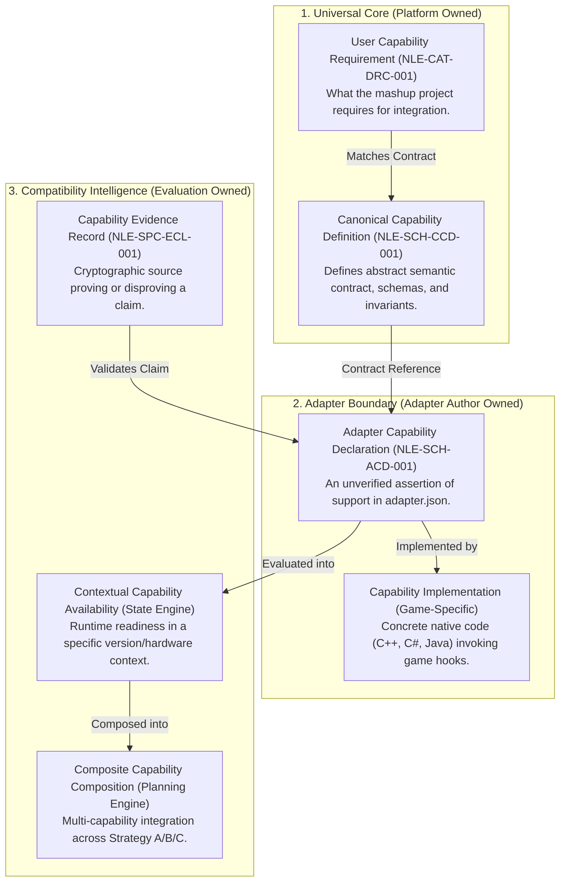

# Canonical Capability Taxonomy and Domain Model

**Document ID:** `NLE-MOD-CCT-001`  
**Version:** 1.0.0  
**Phase:** 5 of 12 — Universal Adapter SDK & Capability System  
**Step:** 35 of 100 — Canonical Capability Taxonomy & Declaration Schema Specification  
**Classification:** Foundational Domain Model & Capability Taxonomy Specification  
**Status:** Approved Specification  
**Authoritative Reference:** `NLE-DOM-CAP-001` (Phase 2 Capability Model), `NLE-CAT-DRC-001` (8 Compatibility Dimensions), `NLE-SPC-SDK-001` (Universal Adapter SDK Foundation), `NLE-CAT-RIA-001` (Rule Input Contracts)

---

## 1. Executive Summary & Domain Purpose

In **NexLudic Engine**, a **Capability** represents an atomic, testable unit of technical functionality that can be requested by a user objective, declared by an adapter, verified by evidence, and orchestrated across game runtimes.

Capabilities are the essential bridge between:
- **What the user wants to achieve** (e.g. "Inject custom vehicle physics into Skyrim").
- **What the platform assesses as feasible** across Strategy A (Host Mod), Strategy B (Live Bridge), or Strategy C (Hybrid).
- **What an adapter claims it can execute** in its `adapter.json` descriptor manifest.
- **What has been empirically proven** through cryptographic evidence records.

This specification establishes the **Canonical Capability Domain Model** and **Taxonomy**. It defines common semantic contracts without requiring every game-specific adapter to use the same programming language, modding framework, internal hooks, or binary representations.

> [!IMPORTANT]
> **Core Architectural Invariant:**  
> A canonical capability definition defines **shared meaning, contract schemas, and invariants**. It does **NOT** assert that any specific game supports the capability, that similarly named engine functions behave identically, or that two valid capabilities can be composed without independent integration validation.

---

## 2. Core Capability Domain Concepts & Boundaries

To eliminate ambiguity across discovery, assessment, and execution, the domain model strictly separates seven interrelated concepts:



### 2.1 Formal Concept Definitions

1. **Canonical Capability Definition (`CCD`):** A platform-governed semantic specification describing a recognized technical function (e.g., `CAP-HOOK-DETOUR-NATIVE`), its inputs, outputs, side effects, required permissions, and constraints.
2. **Adapter Capability Declaration (`ACD`):** An explicit claim published by an adapter author in `adapter.json` asserting that the adapter provides a canonical capability for an identified game, version range, and execution context.
3. **Capability Requirement (`UCR`):** A functional prerequisite demanded by a project mashup goal (e.g., "Must stream vehicle telemetry at $\ge 60\text{ Hz}$").
4. **Capability Implementation (`ACI`):** The concrete game-specific code, memory hook, script mod, or IPC worker through which an adapter fulfills a capability.
5. **Contextual Capability Availability (`AVA`):** An evaluated state determining whether a capability can function on the user's specific local game build, environment profile, and permission quota.
6. **Capability Evidence (`EVD`):** Sourced, cryptographically hashed documentation or test records substantiating a capability claim (`NLE-SPC-ECL-001`).
7. **Capability Composition (`CMP`):** The coordinated execution of multiple capabilities to achieve an integration strategy (e.g., combining `CAP-HOOK-DETOUR` with `CAP-IPC-SHAREDMEM` to achieve live telemetry bridging).

---

## 3. The 10 Canonical Capability Taxonomy Categories

To prevent arbitrary capability sprawl while accommodating heterogeneous game engines (C++, Java, Unity C#, Unreal, proprietary script VMs), the capability catalog is structured into **10 Canonical Taxonomy Categories**. 

Every canonical capability belongs to exactly one category, which maps directly to one of the **8 Assessment Dimensions** established in Phase 4 (`NLE-CAT-DRC-001`):

```
+----------------------------------------------------------------------------------------------------+
|                               THE 10 CANONICAL CAPABILITY CATEGORIES                               |
+----+-----------------------+---------------------------+-------------------+-----------------------+
| #  | Category Key          | Category Name             | Mapped Dimension  | Primary Focus Area    |
+----+-----------------------+---------------------------+-------------------+-----------------------+
| 01 | `CAT-DISCOVERY`       | Discovery & Identification| `ASSET_PIPELINE`  | Version, build, and   |
|    |                       |                           |                   | mod manifest detection|
+----+-----------------------+---------------------------+-------------------+-----------------------+
| 02 | `CAT-ASSET`           | Content & Asset Access    | `ASSET_PIPELINE`  | Mesh, texture, audio  |
|    |                       |                           |                   | extraction & transcode|
+----+-----------------------+---------------------------+-------------------+-----------------------+
| 03 | `CAT-EXTENSION`       | Scripting & Mod Loaders   | `MEMORY_HOOKING`  | SKSE, Fabric, BepInEx,|
|    |                       |                           |                   | CET plugin invocation |
+----+-----------------------+---------------------------+-------------------+-----------------------+
| 04 | `CAT-OBSERVATION`     | Runtime State Observation | `TELEMETRY_IPC`   | Memory offset polling,|
|    |                       |                           |                   | telemetry event hooks |
+----+-----------------------+---------------------------+-------------------+-----------------------+
| 05 | `CAT-CONTROL`         | Runtime Command & Control | `INPUT_CONTROL`   | Synthetic input, game |
|    |                       |                           |                   | command execution     |
+----+-----------------------+---------------------------+-------------------+-----------------------+
| 06 | `CAT-EXCHANGE`        | State & Event Exchange    | `STATE_SYNC`      | Player transforms, lap|
|    |                       |                           |                   | counters, quest flags |
+----+-----------------------+---------------------------+-------------------+-----------------------+
| 07 | `CAT-MAPPING`         | Cross-Game Translation    | `PHYSICS`         | Havok-to-PhysX maps,  |
|    |                       |                           |                   | coordinate conversion |
+----+-----------------------+---------------------------+-------------------+-----------------------+
| 08 | `CAT-INTEROP`         | Live Interoperability     | `TELEMETRY_IPC`   | High-speed shared     |
|    |                       |                           |                   | memory rings, sockets |
+----+-----------------------+---------------------------+-------------------+-----------------------+
| 09 | `CAT-DIAGNOSTIC`      | Diagnostics & Probing     | `RENDER_HOOK`     | Viewport blitting,    |
|    |                       |                           |                   | performance benchmarks|
+----+-----------------------+---------------------------+-------------------+-----------------------+
| 10 | `CAT-RECOVERY`        | Reversibility & Rollback  | `AUDIO` / ALL     | Workspace cleanups,   |
|    |                       |                           |                   | file restoration logs |
+----+-----------------------+---------------------------+-------------------+-----------------------+
```

---

## 4. Category Boundaries & Scope Rules

### 4.1 Category 1: Discovery & Identification (`CAT-DISCOVERY`)
- **Included:** Inspecting local game files, reading mod manifests (e.g. `fabric.mod.json`, Skyrim `.plugins.txt`), extracting game executable build numbers, detecting installed DLCs.
- **Excluded:** Privileged system-wide filesystem scanning (owned by Universal Core Step 27).
- **Security Scope:** Strictly read-only; scoped to verified game directories.

### 4.2 Category 2: Content & Asset Access (`CAT-ASSET`)
- **Included:** Reading proprietary game archives (Bethesda `.bsa`/`.ba2`, Minecraft `.jar`, Unreal `.pak`), extracting textures, converting skeletal meshes (glTF to `.nif`), audio bank extraction.
- **Excluded:** Direct in-memory asset replacement while the game is running.
- **Licensing Constraint:** Must strictly respect copyright; adapters are prohibited from redistributing raw proprietary game assets.

### 4.3 Category 3: Scripting & Mod Loaders (`CAT-EXTENSION`)
- **Included:** Interfacing with native mod loaders (Fabric, Forge, BepInEx, SKSE64, RED4ext, UE4SS), compiling mod scaffold projects, deploying C++ DLL plugins into mod directories.
- **Excluded:** Direct memory patching without a loader; bypass of loader safety hooks.

### 4.4 Category 4: Runtime State Observation (`CAT-OBSERVATION`)
- **Included:** Hooking game telemetry routines, listening to game events via loader APIs, reading read-only shared memory telemetry buffers (e.g. SimHub / OutGauge protocol).
- **Excluded:** Attaching external kernel debuggers or invoking `OpenProcess` with write privileges.

### 4.5 Category 5: Runtime Command & Control (`CAT-CONTROL`)
- **Included:** Injecting controller/keyboard inputs via Win32 `SendInput` or game input queues, executing console commands via official game developer consoles.
- **Excluded:** Bypassing anti-cheat input validation or automated macro execution in multiplayer environments.

### 4.6 Category 6: State & Event Exchange (`CAT-EXCHANGE`)
- **Included:** Serializing game state into JSON/Protobuf formats, publishing discrete event notifications (e.g., "Player Entered Vehicle", "Health Reduced"), synchronizing inventory arrays.
- **Excluded:** Low-level lock-step memory mirroring between two unsynchronized game threads.

### 4.7 Category 7: Cross-Game Translation (`CAT-MAPPING`)
- **Included:** Converting coordinate spaces (Y-up vs. Z-up, left-handed vs. right-handed), translating physics friction models (Havok sub-stepping to PhysX curves), unit conversions.
- **Excluded:** Assuming translation preserves exact game feel without empirical tuning.

### 4.8 Category 8: Live Interoperability (`CAT-INTEROP`)
- **Included:** Initializing high-speed circular memory buffers, managing Named Pipe sessions, synchronizing process tick loops across Strategy B bridges.
- **Excluded:** Full multi-game orchestration planning (owned by Phase 6 Universal IPC Broker).

### 4.9 Category 9: Diagnostics & Probing (`CAT-DIAGNOSTIC`)
- **Included:** Measuring IPC round-trip latency, reporting memory footprint overhead, verifying DirectX overlay hook compatibility.
- **Excluded:** Overriding universal platform security findings or falsifying health pings.

### 4.10 Category 10: Reversibility & Rollback (`CAT-RECOVERY`)
- **Included:** Generating staging diffs, restoring original configuration files from backup, tracking created files for atomic uninstallation.
- **Excluded:** Reversing memory mutations after a running game process has crashed.

---

## 5. Canonical Identifier Strategy

Every canonical capability is identified by a **globally unique, immutable identifier** following a strict hyphenated syntax:

$$\text{Identifier} = \texttt{CAP-}\{\text{CATEGORY\_SHORT}\}\texttt{-}\{\text{SEMANTIC\_DESCRIPTOR}\}\texttt{-}\{\text{NUMERIC\_KEY}\}$$

### 5.1 Formal Identifier Invariants
- **Immutability:** Once published in a released catalog version (`v1.0.0`), a `CapabilityId` is permanently immutable. Its semantic meaning cannot be altered.
- **Game Neutrality:** Canonical capability IDs must never contain game-specific marketing titles (e.g., `CAP-SKYRIM-SWORD` is strictly prohibited; the canonical equivalent is `CAP-ASSET-MESH-SKELETAL-001`). Game specificity belongs to the *declaration*, not the *canonical capability definition*.
- **Category Short Codes:**
  `DISC` (Discovery), `ASSET` (Asset), `EXT` (Extension), `OBS` (Observation), `CTRL` (Control), `XCHG` (Exchange), `MAP` (Mapping), `INTOP` (Interop), `DIAG` (Diagnostic), `RECOV` (Recovery).
- **Example Canonical Identifiers:**
  - `CAP-DISC-VERSION-MANIFEST-001`: Inspect and extract version metadata from local game manifests.
  - `CAP-ASSET-MESH-SKELETAL-001`: Transcode skeletal mesh and bone hierarchy data.
  - `CAP-EXT-HOOK-DETOUR-001`: Inject runtime function detours via native extension framework.
  - `CAP-OBS-TELEMETRY-TRANSFORM-001`: Stream entity transform coordinates (position, rotation, velocity).
  - `CAP-CTRL-INPUT-FORWARD-001`: Dispatch synthetic input events to the target game window.

