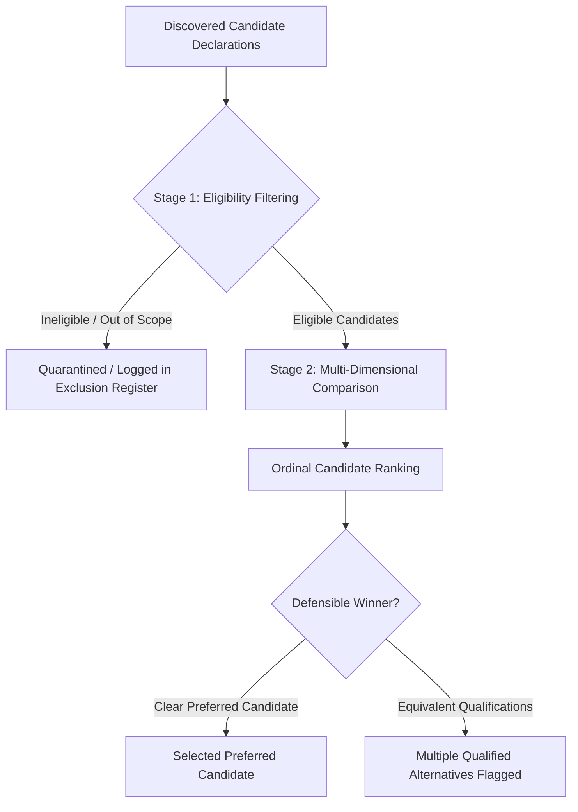

# Capability Candidate Comparison and Resolution Policy

**Document Identifier:** `NLE-POL-CCR-001`  
**Phase:** Phase 5 — Universal Adapter SDK & Capability System  
**Step:** Step 38 of 100 — Capability Matching & Requirement Resolution Specification  
**Status:** Approved Platform Policy  
**Classification:** Candidate Comparison, Multi-Candidate Selection & Tie-Breaking Governance  
**Repository Path:** `docs/adapters/CAPABILITY_CANDIDATE_COMPARISON_AND_RESOLUTION_POLICY.md`  

---

## 1. Executive Summary & Policy Objectives

### 1.1 Purpose
This policy establishes the formal rules, criteria, and governance for comparing multiple eligible candidate adapter declarations when more than one candidate matches a given `CapabilityRequirement` within the NexLudic Engine.

In an open adapter ecosystem, community developers and tool authors may publish competing adapters targeting the same game capability (e.g., both an SKSE plugin and an external memory bridge may claim `world.environment.weather_sync`). The matching engine must evaluate and rank these alternatives objectively, deterministically, and transparently—without relying on unverified claims, opaque heuristics, or arbitrary numerical scoring.

### 1.2 Anti-Scoring & Objectivity Invariants
- **Absolute Ban on Arbitrary Percentages:** The engine must **never** compute or present arbitrary numerical "compatibility scores" or confidence percentages (e.g., "87% Compatible"). Compatibility is an empirical, discrete state governed by technical constraints, not an opaque statistical probability.
- **Eligibility Precedes Preference:** A candidate adapter must pass all mandatory eligibility gates (`NLE-POL-REL-001`) before any preference comparison can occur. A candidate with a critical security blocker or unresolved mandatory dependency can never be selected over an eligible alternative, regardless of secondary feature richness.
- **Deterministic Tie-Breaking (No Random Selection):** When two or more candidates possess identical technical qualifications, the engine does not arbitrarily pick a winner based on retrieval order, author fame, or display name. Instead, it presents both qualified alternatives to the user/planner with an explicit trade-off summary.

---

## 2. Two-Stage Candidate Resolution Architecture

Candidate evaluation proceeds through two discrete, strictly separated stages:



### 2.1 Stage 1: Eligibility Filtering
Every candidate must pass the following binary gates before proceeding to Stage 2:
1. **Target Game Scope:** Must match the requested `targetGameId` (`MTR-CTX-001`).
2. **Version Bounds:** The installed game version must fall within candidate `[minVersion, maxVersion]` (`MTR-CTX-002`).
3. **Platform Compatibility:** Candidate must support host architecture (`windows-x64`) (`MTR-CTX-005`).
4. **Anti-Cheat Dominance:** Must not assert memory injection against games with active anti-cheat (`MTR-OUT-001`, `BLK-SEC-01`).
5. **Sandbox Compliance:** Must execute `OUT_OF_PROCESS` under Windows Medium Integrity Level (`REQ-SEC-001`, `ADR-0002`).

Any candidate failing any gate is moved to the **Exclusion Register** with an explicit diagnostic code explaining the disqualification.

---

## 3. Stage 2: Multi-Dimensional Comparison Criteria

Eligible candidates are compared across six (6) hierarchical, discrete technical dimensions:

| Dimension Priority | Evaluation Dimension | Technical Criteria & Preference Rule | Rationale |
|:---:|:---|:---|:---|
| **Tier 1** | **Target Version Specificity** | Exact version match > Narrow SemVer range > Broad SemVer range. | Adapters built and tested against the exact installed build have lower regression risk. |
| **Tier 2** | **Verification State Maturity** | `EMPIRICALLY_VALIDATED` > `EVIDENCED_COMPATIBLE` > `CONTRACT_VERIFIED` > `STRUCTURALLY_CONFORMANT` > `DECLARED_ONLY`. | Empirical evidence collected in the local environment is strictly superior to unevidenced author claims (`NLE-MOD-CDV-001`). |
| **Tier 3** | **Dependency Footprint** | Fewer external prerequisites > More external prerequisites. Zero unresolved optional dependencies > Unresolved optional dependencies. | Simpler dependency trees reduce integration fragility and configuration failure points. |
| **Tier 4** | **Privilege & Intrusion Level** | Non-invasive IPC bridge > Script framework hook > Native memory injection. | Non-invasive integration preserves game stability and avoids anti-virus false positives. |
| **Tier 5** | **Freshness & Invalidation Risk** | Current evidence > Evidence near expiration horizon. Current rule catalog > Older catalog revision. | Fresher evidence guarantees higher operational confidence. |
| **Tier 6** | **Declared Limitation Scope** | Zero declared limitations > Advisory limitations > Conditional limitations. | Unrestricted capabilities provide smoother end-to-end composition. |

---

## 4. Deterministic Tie-Breaking & Ambiguity Governance

### 4.1 Equivalent Qualifications Scenario
If two or more candidates achieve identical rankings across all six tiers:
1. **No Arbitrary Choice:** The matching engine does **not** pick a winner based on file hash, registry insertion order, or adapter display name.
2. **Flagged as Multiple Qualified Alternatives:** The requirement resolution is recorded as:
   $$\texttt{resolutionState: "RESOLVED\_MULTIPLE\_ALTERNATIVES"}$$
3. **UI Handoff (`SCR-CMP-001`):** The Desktop UI presents the candidates side-by-side with an explicit comparison card highlighting differences (e.g., author, project release date, supported optional features), prompting the user to select their preferred adapter for project binding.

---

## 5. Candidate Exclusion Register & Auditability

To ensure complete transparency and assist developers in troubleshooting, every disqualified candidate is recorded in the `excludedCandidates` array within the match payload:

```json
{
  "adapterId": "adapter.bethesda.skyrim_old_skse",
  "registryRecordId": "b1e2c3d4-0000-0000-0000-000000000001",
  "exclusionReason": "VERSION_OUT_OF_BOUNDS",
  "diagnosticCode": "MTR-CTX-002",
  "message": "Candidate supports versions up to 1.5.97; installed game version is 1.6.640."
}
```

Disqualified candidates are **never** silently erased; their exclusion rationale is preserved for auditability and diagnostic explainability.

---

## 6. Traceability and Cross-Reference Anchors

- `NLE-SPC-CMR-001`: Primary Capability Matching Specification.
- `NLE-CAT-MTR-001`: Matching Rule Catalog & Decision Tables.
- `NLE-MOD-CDV-001`: 7-State Verification Model.
- `NLE-CON-MRE-001`: Match Result & Explainability Contract.
- `SCR-CMP-001`: Desktop UI Compatibility Assessment View.
