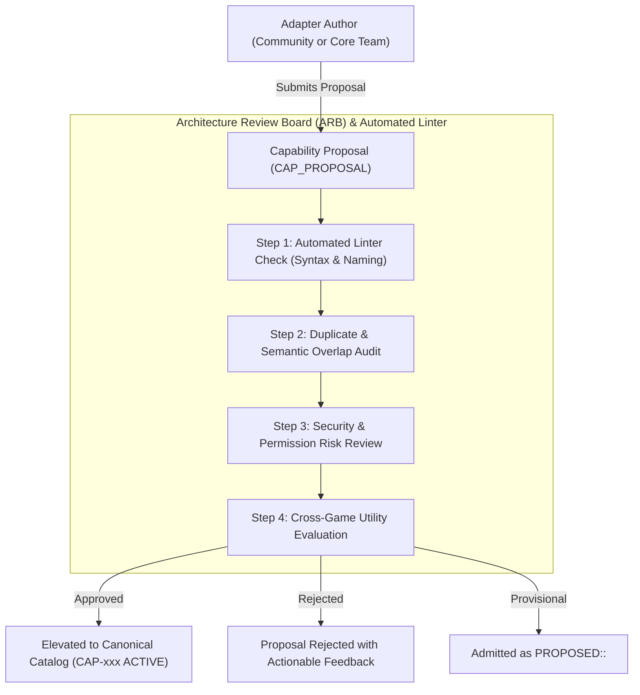

# Capability Catalog Governance and Custom Capability Policy

**Document ID:** `NLE-POL-CCG-001`  
**Version:** 1.0.0  
**Phase:** 5 of 12 — Universal Adapter SDK & Capability System  
**Step:** 35 of 100 — Canonical Capability Taxonomy & Declaration Schema Specification  
**Classification:** Catalog Governance, Proposal Review & Custom Capability Policy  
**Status:** Approved Specification  
**Authoritative Reference:** `NLE-MOD-CCT-001`, `NLE-SCH-CCD-001`, `NLE-SCH-ACD-001`

---

## 1. Catalog Governance Architecture & Principles

The **Canonical Capability Catalog** is the single authoritative source of truth for technical capabilities recognized by NexLudic Engine. To remain extensible across hundreds of diverse game titles without descending into fragmented, incompatible vocabularies, the catalog operates under a structured **Governance Lifecycle**.



---

## 2. Capability Proposal Schema (`capability-proposal.json`)

When an adapter developer invents a novel modding technique or discovers a new cross-game interoperability pattern, they author a formal **Capability Proposal**:

```json
{
  "$schema": "https://schemas.nexludic.org/v1/capability-proposal.json",
  "proposalId": "prop-2026-directx-overlay-blending",
  "proposedIdentifier": "CAP-DIAG-RENDER-OVERLAY-001",
  "proposedName": "Hardware-Accelerated Viewport Overlay Blending",
  "problemStatement": "Required to display live guest telemetry HUD directly over host DirectX 11/12 game swapchains without window focus loss.",
  "semanticDefinition": "Injects an in-memory DirectX render hook to blend RGBA shared-memory framebuffers into the presentation backbuffer.",
  "targetTaxonomyCategory": "CAT-DIAGNOSTIC",
  "targetAssessmentDimension": "RENDER_HOOK",
  "intendedAdapterRoles": ["HOST_MOD_SCAFFOLD", "HYBRID_COORDINATOR"],
  "operationalContracts": {
    "inputParameters": ["swapchainHandle", "framebufferSharedMemoryName", "blendAlpha"],
    "outputResults": ["hookStatus", "currentRenderFps"],
    "sideEffectClassification": "EPHEMERAL_MEMORY"
  },
  "securityAndPermissionAnalysis": {
    "requiresElevation": false,
    "integrityLevel": "Windows_Medium_IL",
    "antiCheatImpact": "Prohibited in games with active kernel anti-cheat (triggers BLK-SEC-01 check)."
  },
  "validationScenarios": [
    "Verify DirectX 11 swapchain present hook returns Completed_Success.",
    "Verify overlay automatically disconnects if host game window is minimized."
  ],
  "authorMetadata": {
    "adapterId": "adapter-skyrimse-hud-overlay",
    "maintainer": "Community Graphics SIG",
    "submissionDate": "2026-11-18"
  }
}
```

---

## 3. Duplicate Detection & Overlap Review Rules

To prevent semantic redundancy (e.g. three different authors creating `CAP-HOOK-01`, `CAP-DETOUR-01`, and `CAP-INJECT-01` for the same operation), the Architecture Review Board enforces **four anti-duplication rules**:

1. **Semantic Equivalence Rule:** If a proposed capability performs an identical operation to an existing canonical capability—even if implemented via a different library—the proposal is rejected and the author is directed to declare the existing canonical `CapabilityId`.
2. **Game-Neutrality Enforcement:** If a proposal contains game-specific marketing names in its identifier or parameter schemas (e.g. `CAP-SKYRIM-DRAGON-REND`), the proposal is rejected. The author must generalize the concept (e.g. `CAP-CTRL-ENTITY-ANIM-OVERRIDE`) or maintain it as an adapter-local custom capability.
3. **Excessive Granularity Rule:** Capabilities must represent cohesive, testable technical boundaries. Micro-operations (e.g. "Read Byte at Offset X") are rejected; they belong within the implementation of a cohesive observation capability (`CAP-OBS-TELEMETRY`).
4. **Security Veto Rule:** Any proposed capability requiring Windows UAC Administrator elevation or kernel-level code execution is **permanently rejected** (`REQ-SEC-001`).

---

## 4. Custom & Provisional Capabilities Policy

The platform recognizes that game modding thrives on rapid community experimentation. Requiring prior architecture board approval for every prototype would stifle innovation. 

The SDK therefore supports **Custom Provisional Capabilities** under strict containment boundaries:

### 4.1 Naming & Namespace Scoping
Custom capabilities must be namespaced using the explicit `PROPOSED:` prefix:

$$\texttt{PROPOSED:}\{\text{adapterId}\}\texttt{:}\{\text{capabilityName}\}$$

*Example:* `PROPOSED:adapter-mcjava-fabric:redstone-wire-tap`

### 4.2 Strict Operational Restrictions
Provisional capabilities are subject to four inviolable containment rules:
1. **Zero Global Impact:** A provisional capability cannot be published in the universal core catalog or referenced by unrelated adapters.
2. **Advisory Report Exclusion:** The Compatibility Rule Engine (`NLE-SPC-CRD-001`) treats all provisional capabilities as **unverified hypotheses** (`OUTCOME_INSUFFICIENT_EVIDENCE`). A provisional capability is **strictly prohibited from fulfilling mandatory user requirements** in compatibility reports.
3. **No Security Exemptions:** Provisional capabilities must comply with standard Windows Medium Integrity Level, Volume D storage isolation, and non-elevation rules.
4. **Explicit UI Disclaimers:** In report views and diagnostic inspectors, provisional capabilities render with an amber dashed outline and disclaimer: *"Experimental Provisional Capability: Not validated by NexLudic Canonical Catalog."*

