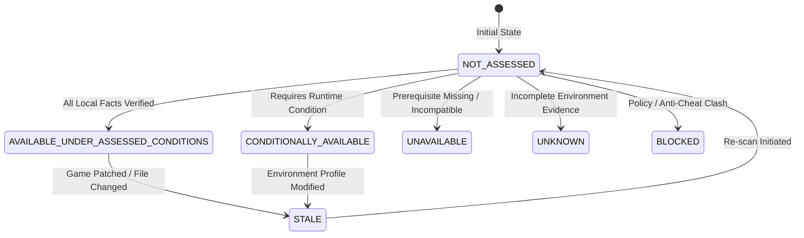
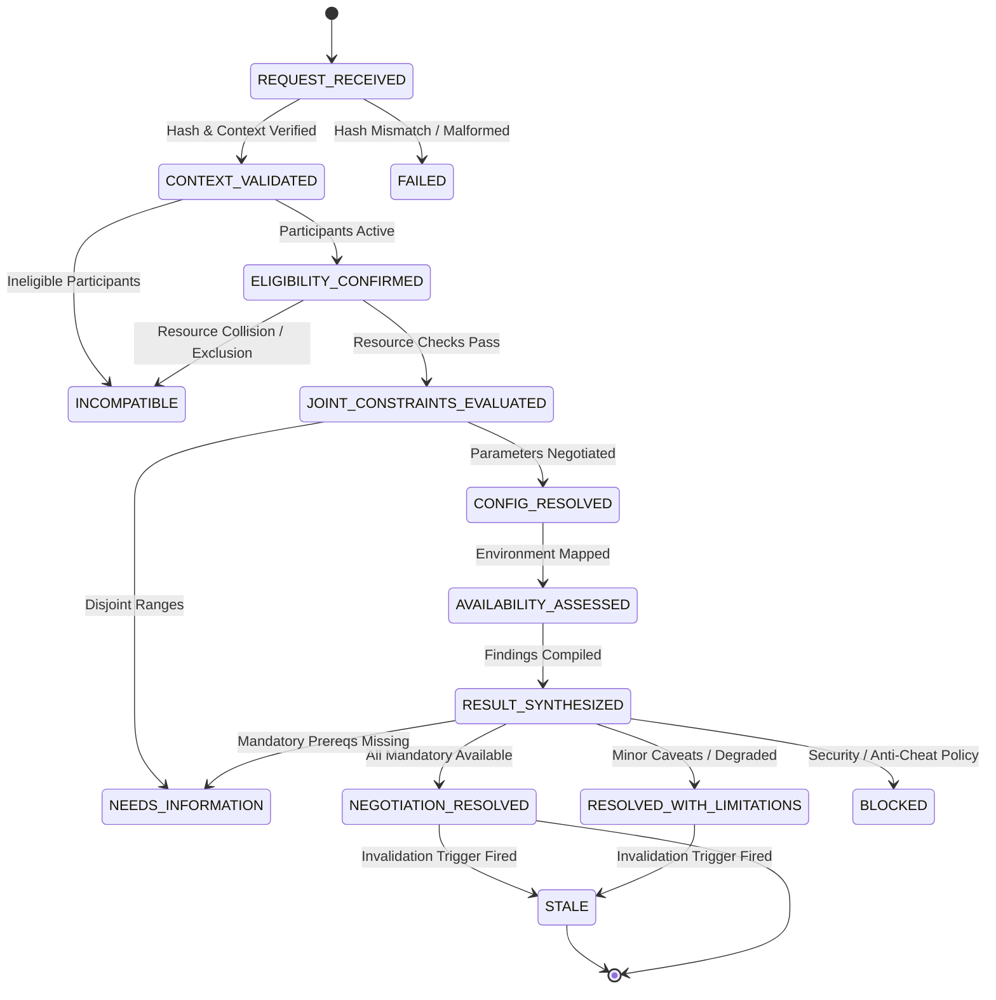

# Capability Contextual Availability and Negotiation State Model

**Document Identifier:** `NLE-MOD-CAN-001`  
**Phase:** Phase 5 — Universal Adapter SDK & Capability System  
**Step:** Step 39 of 100 — Capability Negotiation & Contextual Availability Resolution Specification  
**Status:** Approved Architectural Model  
**Classification:** State Machine Architecture, Availability Taxonomy & Transition Invariants  
**Repository Path:** `docs/adapters/CAPABILITY_CONTEXTUAL_AVAILABILITY_AND_NEGOTIATION_STATE_MODEL.md`  

---

## 1. Executive Summary & Domain Scope

### 1.1 Purpose
This specification establishes the formal domain model, state machines, and transition invariants for **Contextual Capability Availability** and the **Negotiation Lifecycle** within the NexLudic Engine.

It provides unambiguous technical definitions that distinguish between:
1. An adapter's static declaration of capability support.
2. The joint compatibility of multiple adapters in a mashup proposal.
3. The real-world operational availability of those capabilities in the user's specific local environment.

---

## 2. Contextual Availability State Taxonomy

An adapter capability may be structurally valid and jointly compatible, yet remain contextually unavailable because the host machine lacks a required mod loader, runs an unverified game patch, or lacks necessary permissions.

The platform defines seven (7) mutually exclusive contextual availability states:

### 2.1 State Definitions & Evidentiary Thresholds

| Availability State | Description | Required Evidentiary Proof | Mashup Planning Consequence |
|:---|:---|:---|:---|
| `AVAILABLE_UNDER_ASSESSED_CONDITIONS` | All required local environment facts, installed game builds, mod loaders, and libraries are verified present and compatible. | Validated local file paths, verified game build hash, and detected mod loader matching required version. | Full availability. Eligible for launch planning. |
| `CONDITIONALLY_AVAILABLE` | The capability can be realized, but depends on an unverified runtime condition (e.g., host game in borderless window mode). | Documented condition expression; prerequisite tools present. | Available with caveats. UI surfaces user prompt (`SCR-CMP-001`). |
| `UNAVAILABLE` | A mandatory environment prerequisite (e.g., SKSE64, specific DLC, runtime library) is confirmed missing on the host machine. | Environment scan confirmed tool absence or version failure. | Unavailable. Mashup cannot proceed until tool is installed. |
| `UNKNOWN` | Local environment facts are incomplete or uninspected (e.g., game installation detected but version not scanned). | Absence of empirical environment profile record. | Preserved as unknown. Triggers prompt to scan local installation. |
| `STALE` | Previously confirmed availability has expired due to a detected game patch, adapter edit, or evidence expiration. | Trigger `TRG-MAT-003` or `TRG-REV-001` fired. | Hidden from active planning until refreshed. |
| `BLOCKED` | Capability barred by platform security policy, Medium IL boundary, or active anti-cheat protection (`BLK-SEC-01`). | Game flagged with active anti-cheat; capability asserts hooking. | Hard block. Disallowed unconditionally. |
| `NOT_ASSESSED` | Availability evaluation has not yet been executed for this local context. | Initial uninspected state. | Enqueued for evaluation. |

---

## 3. The Negotiation State Machine

The negotiation lifecycle transitions through fourteen (14) discrete states from request intake to final resolution:

### 3.1 Transition Invariants
1. **No Leapfrogging:** The state machine cannot transition to `NEGOTIATION_RESOLVED` without traversing all antecedent verification states (`CONTEXT_VALIDATED`, `ELIGIBILITY_CONFIRMED`, `CONFIG_RESOLVED`, `AVAILABILITY_ASSESSED`).
2. **Mandatory Gatekeeping:** If any mandatory capability resolves to `UNAVAILABLE`, `UNKNOWN`, or `BLOCKED`, the overall negotiation state is barred from entering `NEGOTIATION_RESOLVED`.
3. **Immutability of Terminal Outcomes:** Once reaching a terminal outcome (`NEGOTIATION_RESOLVED`, `INCOMPATIBLE`, `BLOCKED`), the result payload is immutable. Upstream changes generate a new negotiation request revision rather than mutating the existing record in place.

---

## 4. Overall Negotiation Outcome Enumeration

| Overall Outcome | Severity Rank | Description | Downstream Platform Action |
|:---|:---:|:---|:---|
| `RESOLVED` | 1 (Best) | All mandatory capabilities successfully selected, parameter-configured, and contextually available. | Eligible for runtime test harness execution (Step 40). |
| `RESOLVED_WITH_LIMITATIONS` | 2 | All mandatory capabilities available, but non-essential optional features were degraded or omitted. | Eligible for execution with documented limitations. |
| `PARTIALLY_RESOLVED` | 3 | Some capabilities available, but critical secondary capabilities remain unresolved. | Requires developer review or fallback strategy selection. |
| `NEEDS_INFORMATION` | 4 | Environment facts unverified or parameter ranges require user input. | Triggers user prompt in Desktop UI (`SCR-CMP-001`). |
| `INCOMPATIBLE` | 5 | Inherent technical deadlock, mutually exclusive resource locks, or disjoint contract versions. | Mashup proposal rejected; fundamental redesign required. |
| `BLOCKED` | 6 | Policy violation, anti-cheat conflict, or privilege elevation attempt. | Rejected unconditionally under platform security policy. |
| `STALE` | 7 | Previously resolved negotiation invalidated by game update or file edit. | Re-negotiation required. |
| `CANCELLED` | 8 | Evaluation aborted by user or timed out (>2000ms). | Operation cancelled cleanly; zero partial state persisted. |
| `FAILED` | 9 (Worst) | Internal process failure or corrupted input payload. | Diagnostic logged; investigation required. |

---

## 5. Traceability and Cross-Reference Anchors

- `NLE-SPC-CNA-001`: Primary Capability Negotiation Specification.
- `NLE-CON-CNC-001`: Negotiation Context & Input Contract.
- `NLE-RUL-JSC-001`: Joint Selection & Constraint Resolution Rules.
- `NLE-SPC-CCN-001`: Contract Compatibility & Configuration Negotiation.
- `NLE-CON-NRE-001`: Negotiation Result & Explainability Contract.
- `BLK-SEC-01`: Platform Anti-Cheat Dominance Guarantee.
- `DEC-002`: Windows Medium Integrity Level.
