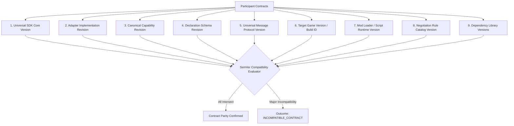
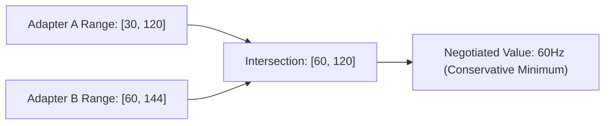

# Capability Contract Compatibility and Configuration Negotiation

**Document Identifier:** `NLE-SPC-CCN-001`  
**Phase:** Phase 5 — Universal Adapter SDK & Capability System  
**Step:** Step 39 of 100 — Capability Negotiation & Contextual Availability Resolution Specification  
**Status:** Approved Architectural Specification  
**Classification:** Contract Version Matrix & Parameter Negotiation Protocol  
**Repository Path:** `docs/adapters/CAPABILITY_CONTRACT_COMPATIBILITY_AND_CONFIGURATION_NEGOTIATION.md`  

---

## 1. Executive Summary & Purpose

### 1.1 Purpose
This specification establishes the formal protocols for resolving **Contract-Version Compatibility** and executing **Configuration Parameter Negotiation** across participating adapters and platform runtimes within the NexLudic Engine.

When multiple adapters collaborate in a cross-game integration, they must operate over compatible SDK interfaces, schema revisions, and message protocol envelopes. Furthermore, where capabilities expose configurable operational parameters (e.g., synchronization frequency, spatial boundaries, texture formats), the negotiation engine must reconcile these parameters into an unambiguous, mutually agreeable runtime configuration.

### 1.2 Fundamental Invariants
- **Bounded Parameter Scope:** Configuration negotiation is strictly confined to parameters formally declared in the Canonical Capability Schema (`NLE-MOD-CCT-001`). Adapters cannot introduce arbitrary, undocumented configuration keys.
- **No Fabricated Defaults:** If participating adapters assert disjoint parameter ranges (e.g., Adapter A requires refresh rate $\ge$ 60Hz, while Adapter B supports only 30Hz), the engine **never** invents an unsupported compromise. The negotiation outcome evaluates strictly to `INCOMPATIBLE`.
- **Non-Self-Elevation:** An adapter cannot alter its sandboxing tier, request elevated privileges, or disable anti-cheat checks through configuration parameters.

---

## 2. Multi-Dimensional Contract Compatibility Matrix

The negotiation engine reconciles nine (9) independent contract dimensions across participants:

### 2.1 Dimension Compatibility Rules

| Dimension | Version Format | Compatibility Rule | Incompatibility Consequence |
|:---|:---:|:---|:---|
| **1. Universal SDK Core** | SemVer 2.0.0 | Backward compatible across same major version (`^1.0.0`). | Rejection with `ERR_SDK_VERSION_INCOMPATIBLE`. |
| **2. Adapter Revision** | SemVer 2.0.0 | Specific to adapter release; higher revisions preferred. | Evaluates newer revision; older marked superseded. |
| **3. Capability Revision** | SemVer 2.0.0 | Must match canonical taxonomy definition revision. | Deprecated revisions emit warning; retired revisions rejected. |
| **4. Declaration Schema** | SemVer 2.0.0 | Must conform to `NLE-SCH-ACD-001` v1.x. | Mismatch triggers `ERR_UNSUPPORTED_SCHEMA_REVISION`. |
| **5. Message Protocol** | SemVer 2.0.0 | Framing protocol (`NLE-MSG-PRT-001`) must share identical major version. | Mismatch halts bridge initialization. |
| **6. Target Game Build** | SemVer / Build ID | Exact build hash or SemVer intersection per Step 28. | Out-of-bounds triggers `ERR_GAME_VERSION_MISMATCH`. |
| **7. Mod Loader Hook** | SemVer 2.0.0 | Host environment must satisfy adapter minimum mod loader build. | Missing loader demotes candidate availability. |
| **8. Rule Catalog** | SemVer 2.0.0 | Must match active negotiation rule catalog version. | Stale catalog triggers re-evaluation. |
| **9. External Libs** | SemVer 2.0.0 | Shared native C-ABI libraries must have identical soname/major. | Mismatch triggers `ERR_NATIVE_ABI_CONFLICT`. |

---

## 3. Configuration Parameter Negotiation Mechanics

When a capability exposes configurable operational parameters, the negotiation engine computes the mutual intersection:

### 3.1 Numerical Range Intersection
For continuous or discrete numerical parameters (e.g., `refreshRateHz`, `maxBatchSize`):
$$\text{Negotiated Range} = [\max(\text{Min}_A, \text{Min}_B), \min(\text{Max}_A, \text{Max}_B)]$$

- If $\max(\text{Min}_A, \text{Min}_B) \le \min(\text{Max}_A, \text{Max}_B)$, the range is valid.
- The negotiated default is set to the **conservative boundary** (e.g., minimum viable refresh rate: 60Hz) to maximize system stability.
- If the intersection is empty ($\max(\text{Min}) > \min(\text{Max})$), negotiation fails with `ERR_PARAMETER_RANGE_DISJOINT`.

### 3.2 Enumeration Set Intersection
For discrete capability options (e.g., `supportedColorSpaces: ["sRGB", "DisplayP3", "HDR10"]`):
$$\text{Negotiated Enums} = \text{Enums}_A \cap \text{Enums}_B$$
- If the intersection contains at least one common format, the intersection is adopted.
- If the intersection is empty, negotiation fails with `ERR_ENUM_FORMAT_DISJOINT`.

### 3.3 User & Strategy Overrides
If the user or mashup strategy specifies an explicit configuration override in `CapabilityNegotiationRequest.configurationOverrides`:
- The override value is validated against the negotiated range.
- If the override falls within $[\text{Min}_{\text{neg}}, \text{Max}_{\text{neg}}]$, the override is adopted.
- If the override violates the negotiated range, the override is rejected with `ERR_OVERRIDE_OUT_OF_BOUNDS`, and the conservative default is retained.

---

## 4. Traceability and Cross-Reference Anchors

- `NLE-SPC-CNA-001`: Primary Capability Negotiation Specification.
- `NLE-CON-CNC-001`: Negotiation Context & Input Contract.
- `NLE-MOD-CCT-001`: Canonical Capability Taxonomy & Parameter Contracts.
- `docs/architecture/`: Inter-Process Communication & Message Protocol Design (`NLE-MSG-PRT-001`).
- `docs/game-discovery/`: Step 28 Game Version & Environment Mapping.
