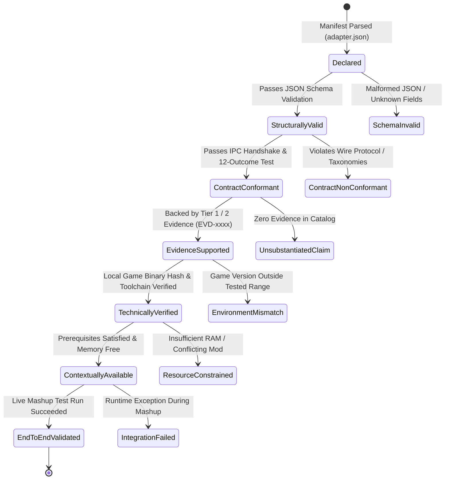

# Capability Declaration and Verification State Model

**Document ID:** `NLE-MOD-CDV-001`  
**Version:** 1.0.0  
**Phase:** 5 of 12 — Universal Adapter SDK & Capability System  
**Step:** 35 of 100 — Canonical Capability Taxonomy & Declaration Schema Specification  
**Classification:** State Machine & Epistemic Verification Model  
**Status:** Approved Specification  
**Authoritative Reference:** `NLE-MOD-CCT-001`, `NLE-DOM-CAP-001`, `NLE-SPC-ECL-001`, `NLE-CAT-RIA-001`

---

## 1. Executive Summary & Epistemic Separation

A fundamental design failure in legacy modding and plugin systems is treating an author's claim of capability support as synonymous with verified operational readiness. 

NexLudic Engine enforces a strict, multi-tiered **Capability Verification State Model**. A capability progresses through seven discrete, observable verification states before it can be executed in an active game mashup:



---

## 2. The 7 Verification States

```
+----------------------------------------------------------------------------------------------------+
|                               THE 7 CAPABILITY VERIFICATION STATES                                 |
+----+-----------------------------+-----------------------------------------------------------------+
| #  | Verification State          | Epistemic Meaning & Verification Scope                          |
+----+-----------------------------+-----------------------------------------------------------------+
| 01 | **Declared**                | An assertion in `adapter.json`. Author intent only.             |
+----+-----------------------------+-----------------------------------------------------------------+
| 02 | **Structurally Valid**      | Passes JSON schema; fields well-formed; references canonical ID.|
+----+-----------------------------+-----------------------------------------------------------------+
| 03 | **Contract-Conformant**     | Adapter worker passes synthetic mock tests; respects wire IPC. |
+----+-----------------------------+-----------------------------------------------------------------+
| 04 | **Evidence-Supported**      | Backed by Tier 1 (Reproduced) or Tier 2 (Documented) evidence.  |
+----+-----------------------------+-----------------------------------------------------------------+
| 05 | **Technically Verified**    | User local game build matches declared range and PE build hash. |
+----+-----------------------------+-----------------------------------------------------------------+
| 06 | **Contextually Available**  | Prerequisite capabilities satisfied; memory headroom available. |
+----+-----------------------------+-----------------------------------------------------------------+
| 07 | **End-to-End Validated**    | Empirical multi-game integration test succeeded in Phase 6/7.   |
+----+-----------------------------+-----------------------------------------------------------------+
```

---

## 3. Comprehensive State Mapping & Epistemic Boundaries

| Verification State | What Establishes It | What It Does NOT Establish | What It Authorizes | Next Required Action |
|:---|:---|:---|:---|:---|
| **1. Declared** | Presence of declaration in `adapter.json`. | Does not prove manifest is valid or game supports it. | Informs catalog ingestion only. | Execute JSON schema validator. |
| **2. Structurally Valid** | Passes Draft-07 JSON Schema check (`NLE-SCH-ACD-001`). | Does not prove adapter binary exists or can launch. | Permits scheduling for conformance suite. | Run worker lifecycle handshake. |
| **3. Contract-Conformant** | Passes synthetic mock invocations; returns valid 12-outcome codes. | Does not prove capability works on real game binary. | Qualifies adapter for catalog listing. | Query evidence catalog for citations. |
| **4. Evidence-Supported** | Cryptographic evidence record (`EVD-xxxx`) linked to claim. | Does not prove user has compatible game version installed. | Permits requirement coverage evaluation. | Inspect local game installation. |
| **5. Technically Verified** | Step 27/28 local discovery verifies game binary hash & loader. | Does not prove runtime has enough RAM or no mod conflicts. | Unlocks strategy recommendation in report. | Check prerequisite capabilities. |
| **6. Contextually Available** | Prerequisites met; memory within headroom; user confirmed (`CMP-045`). | Does not prove complex cross-game timing will succeed. | Authorizes spawning worker for project build. | Execute integration pipeline. |
| **7. End-to-End Validated** | Successful live integration test execution in Phase 6/7. | Does not guarantee success on different hardware/OS. | Fully certified for automated mashup play. | Continuous regression monitoring. |

---

## 4. Anti-Deception Invariants & Enforcement Rules

The compatibility assessment and report subsystems strictly enforce the following **epistemic rules**:

### Invariant 1: No Synthetic Green Checkmarks
The Compatibility Report (`NAV-PRJ-FEA`, Step 32) is **strictly prohibited from rendering a capability row as `COVERAGE_SATISFIED` if the state is merely `Declared` or `Structurally Valid`**. A green checkmark requires a minimum state of **`Evidence-Supported`** with a verified local game match.

### Invariant 2: Incomplete != Incompatible
If an adapter declaration lacks local verification because the user has not installed the game or file access was denied, the system assigns status **`Technically Unverified`** (`INPUT_UNKNOWN`). The engine must **never label an unverified capability as `UNSUPPORTED`**.

### Invariant 3: Availability != Authorization
Even if a capability reaches **`Contextually Available`**, the engine cannot invoke it without explicit human user authorization (`CMP-045`) if the capability declares side-effects of `PERSISTENT_STAGING` or `GAME_STATE_MUTATION`.

### Invariant 4: Component Support != Composite Viability
If Capability A (`CAP-ASSET-MESH-SKELETAL`) and Capability B (`CAP-EXT-HOOK-DETOUR`) are both `Technically Verified`, this does **NOT** prove that the composite mashup will execute without frame drops or physics desynchronization. Composite integration requires independent end-to-end validation.

