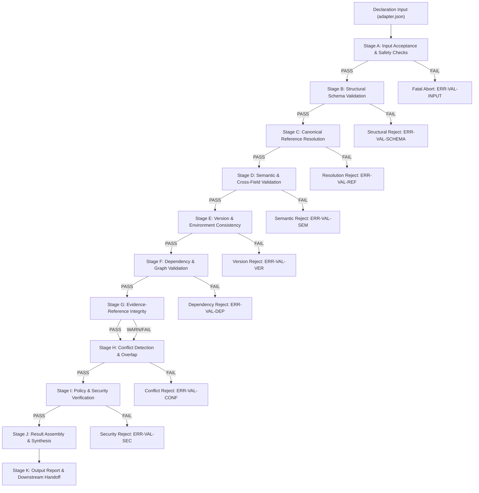

# Capability Declaration Validation and Conformance Specification

**Document ID:** `NLE-SPC-CVC-001`  
**Version:** 1.0.0  
**Phase:** 5 of 12 — Universal Adapter SDK & Capability System  
**Step:** 36 of 100 — Capability Declaration Validation & Conformance Rules Specification  
**Classification:** Foundational Architecture & Validation Contract Specification  
**Status:** Approved Specification  
**Authoritative Reference:** `NLE-SPC-SDK-001` (SDK Foundation), `NLE-MOD-CCT-001` (Taxonomy & Domain Model), `NLE-SCH-ACD-001` (Declaration Schema), `NLE-MOD-CDV-001` (State Model), `NLE-CAT-RIA-001` (Rule Inputs)

---

## 1. Executive Summary & Purpose

The **Capability Declaration Validation and Conformance Specification** establishes the authoritative, staged validation pipeline and decision rules through which NexLudic Engine evaluates, qualifies, and admits **Adapter Capability Declarations (`ACD`)**.

In NexLudic Engine, an adapter author publishes assertions of game support via `adapter.json`. These declarations represent **untrusted assertions** of technical capability across host modification (Strategy A), live interoperability bridging (Strategy B), or hybrid coordination (Strategy C).

A foundational design requirement is that **structural validity must never be confused with empirical capability support**:
- A declaration that perfectly adheres to the JSON schema may claim support for a game patch that fundamentally breaks modding hooks.
- An adapter may declare mutual compatibility with an engine that it has never been tested against.
- An adapter may declare dependencies that introduce circular graph locks or demand administrative privileges.

This specification defines the formal **11-Stage Sequential Validation Pipeline (Stages A through K)**, validation boundaries, authority mappings, and failure semantics required to ensure that only syntactically sound, semantically coherent, version-scoped, and evidence-traceable capability claims are admitted into the engine's downstream compatibility evaluation pipeline (`Step 31 / Step 32`).

> [!IMPORTANT]
> **Core Architectural Invariant:**  
> Validation is strictly a **diagnostic and contract-qualification process**. Passing declaration validation assigns status **`Structurally Valid`** or **`Contract-Conformant`** (`NLE-MOD-CDV-001`). It does **NOT** establish that the capability is **`Evidence-Supported`**, **`Technically Verified`**, or **`Contextually Available`**, nor does it authorize code execution or binary modifications.

---

## 2. Validation Scope, Authority & Boundary Invariants

### 2.1 Validation Subjects
The validation pipeline operates on the following core entities:
1. **The Adapter Manifest (`adapter.json`):** Root descriptor, identity, versioning, toolchains, and permissions (`NLE-CAT-ACM-001`).
2. **The Capability Declaration (`ACD`):** Individual capability claims, target version scopes, support levels, and dependencies (`NLE-SCH-ACD-001`).
3. **Canonical Reference Links:** Pointers to the Canonical Capability Catalog (`NLE-SCH-CCD-001`), Universal Game Catalog (`Step 25`), and Evidence Catalog (`Step 30`).
4. **Dependency Graphs:** Directed relationships among declared capabilities, loaders, and external SDKs (`NLE-CON-CDC-001`).

### 2.2 Rule Authority & Subsystem Ownership Matrix
To prevent duplicate validators or conflicting rules, rule authority is strictly assigned to authoritative owning subsystems:

| Validation Domain | Authoritative Rule Owner | Governing Contract | Validator Responsibility |
|:---|:---|:---|:---|
| **Syntax & JSON Typing** | Capability Declaration Schema | `NLE-SCH-ACD-001` | Structural validation against Draft-07 JSON Schema. |
| **Canonical Identifiers** | Universal Capability Catalog | `NLE-MOD-CCT-001` | Entity resolution; checks active vs. deprecated status. |
| **Game & Edition Scope** | Universal Game Catalog | `NLE-SPC-GDC-001` | Verifies `canonicalGameId` exists and matches edition. |
| **Version Bounds** | Version Compatibility Model | `NLE-SPC-VEC-001` | Validates range syntax; checks PE hash format. |
| **Dependency Graphs** | Capability Composition Contract | `NLE-CON-CDC-001` | Enforces DAG semantics; runs Kahn's cycle detection. |
| **Evidence Association** | Compatibility Evidence Model | `NLE-SPC-ECL-001` | Verifies `EVD-xxxx` records; checks cryptographic digests. |
| **Security & Permissions**| Security & Sandboxing Policy | `REQ-SEC-001`, `ADR-0002` | Enforces Medium IL; rejects UAC elevation & in-process DLLs. |

### 2.3 Non-Bypassable Validation Invariants
1. **Never Infer Support:** The validator must never assume an unmentioned version or platform is supported. Unmentioned scopes are strictly `UNSUPPORTED`.
2. **Explicit Unknowns Preserved:** If an adapter marks a condition as unknown (`INPUT_UNKNOWN`), the validator must preserve that state rather than substituting a default favorable value.
3. **No Self-Authorization:** An adapter cannot validate or authorize its own declarations. Validation is executed exclusively by the Universal Core's **Adapter Catalog Service (`CMP-07`)**.
4. **Deterministic Repeatability:** Validating identical declaration manifests against identical canonical catalog revisions must yield identical diagnostic records and outcome codes.

---

## 3. The 11-Stage Sequential Validation Pipeline (Stages A–K)

The validation engine processes declarations through an ordered, 11-stage pipeline with strict short-circuit failure boundaries:

---

## 4. Pipeline Stage Specifications

### 4.1 Stage A: Input Acceptance and Safety Checks
- **Objective:** Protect the engine from oversized, malformed, or hostile input payloads prior to schema parsing.
- **Input Boundaries:** Maximum payload size: **2 MB** per `adapter.json`; maximum string length: **65,536 characters**; maximum array items: **256 capabilities**.
- **Sanitization:** AST Markdown parsing strips executable HTML/script tags (`<script>`, `<iframe>`, `javascript:`).
- **Short-Circuit:** Payloads exceeding limits or containing null-byte injections are rejected immediately with `ERR-VAL-INP-01`.

### 4.2 Stage B: Structural Validation
- **Objective:** Verify syntactic compliance against the official Draft-07 JSON Schema (`NLE-SCH-ACD-001`).
- **Validations:** Presence of all mandatory fields (`adapterId`, `version`, `contractVersion`, `capabilityId`, `targetContext`, `supportScope`); type checking; enum value constraints.
- **Outcome:** Fails with `ERR-VAL-STR-01` if syntax violates schema.

### 4.3 Stage C: Canonical Reference Resolution
- **Objective:** Verify that external entities referenced by the declaration exist in authoritative platform catalogs.
- **Validations:**
  - `capabilityId` resolves to an active or deprecated canonical capability in `NLE-SCH-CCD-001` (or valid `PROPOSED:` namespace).
  - `canonicalGameId` resolves to a registered title in the Universal Game Catalog (`Step 25`).
  - `contractVersion` matches a supported SDK contract revision (`1.0.0`).
- **Outcome:** Unresolved canonical references emit `ERR-VAL-REF-01`.

### 4.4 Stage D: Semantic and Cross-Field Validation
- **Objective:** Ensure declaration fields are logically coherent and do not contradict each other.
- **Validations:**
  - `adapterRole` compatibility (e.g. `ASSET_TRANSCODER` cannot declare `CAT-EXTENSION` hooks).
  - `CONDITIONALLY_SUPPORTED` declarations must supply non-empty `partialScopeDescription`.
  - Stated operational conditions do not negate the primary capability definition.
- **Outcome:** Emits `ERR-VAL-SEM-01` on logical contradiction.

### 4.5 Stage E: Version and Environment Consistency
- **Objective:** Validate that declared version ranges and target platforms are structurally sound and realistic.
- **Validations:**
  - `minimumVersion <= maximumVersion` under semantic version comparison.
  - Target platform matches supported OS architectures (`windows-x64`, `windows-x86`).
  - Tested build hashes conform to SHA-256 formatting.
- **Outcome:** Emits `ERR-VAL-VER-01` on invalid range or unsupported platform.

### 4.6 Stage F: Dependency and Constraint Validation
- **Objective:** Validate that the capability's dependency tree is structurally sound and deadlock-free.
- **Validations:**
  - All referenced dependent capabilities exist.
  - Dependency relationships conform to the 6 approved types (`NLE-CON-CDC-001`).
  - **Kahn's Topological Sort** executes; cycle presence halts validation with `ERR-VAL-DEP-01`.
  - Mutually exclusive capabilities (`MUTUALLY_EXCLUSIVE`) are not co-declared.
- **Outcome:** Emits `ERR-VAL-DEP-01` on cyclic or mutually exclusive dependency.

### 4.7 Stage G: Evidence-Reference Integrity
- **Objective:** Verify that cited evidence records exist and apply to the declared scope.
- **Validations:**
  - Cited `EVD-xxxx` records resolve in the Compatibility Evidence Catalog (`Step 30`).
  - Evidence scope matches target game ID and does not contradict declared build ranges.
  - Evidence records are inspected for staleness (`ASSESSMENT_STALE_EVIDENCE`).
- **Outcome:** Missing or mismatched evidence does not invalidate structural syntax, but flags the claim as unverified (`WRN-VAL-EVD-01`), preventing a green checkmark.

### 4.8 Stage H: Declaration Consistency and Conflict Detection
- **Objective:** Detect self-contradictions and overlapping declarations across the adapter package.
- **Validations:**
  - An adapter cannot declare the same `capabilityId` multiple times for identical version ranges.
  - Declarations cannot claim full support while declaring a required dependency as `UNSUPPORTED`.
- **Outcome:** Emits `ERR-VAL-CNF-01` on duplicate or conflicting declarations.

### 4.9 Stage I: Policy and Security Verification
- **Objective:** Ensure the declaration complies with non-negotiable security ADRs and legal boundaries.
- **Validations:**
  - `requiredPermissions.processElevation` strictly equals `"None"` (`REQ-SEC-001`).
  - `executionMode` strictly equals `"OutOfProcessWorker"` (`ADR-0002`).
  - Target game passes kernel anti-cheat check (`BLK-SEC-01`) and DRM circumvention check (`BLK-SEC-02`).
- **Outcome:** Security violations emit `ERR-VAL-SEC-01` and trigger immediate adapter quarantine.

### 4.10 Stage J: Result Assembly
- **Objective:** Aggregate findings from Stages A through I into a unified, deterministic outcome.
- **Outcomes:** `VALID`, `VALID_WITH_WARNINGS`, `INVALID`, `INCOMPLETE`, `REVIEW_REQUIRED`, `INCOMPATIBLE`, `STALE`, or `CANCELLED`.

### 4.11 Stage K: Output and Downstream Handoff
- **Objective:** Serialize the `CapabilityValidationReport` and deliver it to the Adapter Catalog (`CMP-07`) and Compatibility Rule Engine (`NLE-SPC-CRD-001`).
- **Downstream Invariant:** A declaration achieving `VALID` is marked **`Structurally Valid`**. It is eligible for Stage E rule evaluation in Phase 4, but cannot satisfy user requirements without Tier 1 or Tier 2 evidence records.
