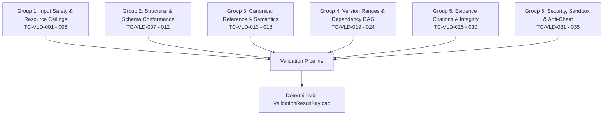

# Capability Declaration Validation Test and Traceability Plan

**Document Identifier:** `NLE-PLN-DVT-001`  
**Phase:** Phase 5 — Universal Adapter SDK & Capability System  
**Step:** Step 36 of 100 — Capability Declaration Validation & Conformance Rules Specification  
**Status:** Approved Quality Assurance Specification  
**Classification:** Verification Test Plan & Traceability Framework  
**Repository Path:** `docs/adapters/CAPABILITY_DECLARATION_VALIDATION_TEST_AND_TRACEABILITY_PLAN.md`  

---

## 1. Executive Summary & Verification Strategy

### 1.1 Purpose
This test plan defines the formal quality assurance and verification strategy for the NexLudic Engine capability declaration validation pipeline. It establishes thirty-five (35) design-level test specifications categorized into six (6) rigorous test groups.

The objectives of this test plan are:
1. Ensure every validation rule in `NLE-CAT-VRC-001`, `NLE-RUL-RVD-001`, and `NLE-RUL-EDC-001` has explicit test coverage.
2. Validate the security and resource boundaries defined in `NLE-SPC-VSR-001`.
3. Verify that the diagnostic payload contract (`NLE-CON-VRD-001`) emits deterministic, schema-compliant outputs.
4. Guarantee that zero false positives or false negatives corrupt compatibility assessments.

---

## 2. Test Group Architecture & Coverage Matrix

| Test Group | Identifier Scope | Test Count | Pipeline Stages Evaluated | Primary Focus |
|:---|:---:|:---:|:---:|:---|
| **Group 1: Input Safety & Parsing** | `TC-VLD-001` – `006` | 6 | Stage A | File limits, nesting caps, ReDoS, memory, timeout, static safety |
| **Group 2: Structural Conformance** | `TC-VLD-007` – `012` | 6 | Stage B | JSON schemas, SemVer, isolation modes, regexes, extra keys |
| **Group 3: Reference & Semantics** | `TC-VLD-013` – `018` | 6 | Stages C, D | Taxonomy references, deprecations, custom prefixes, conditions |
| **Group 4: Versions & DAG** | `TC-VLD-019` – `024` | 6 | Stages E, F | Bounds, platforms, missing nodes, Kahn cycles, mutual exclusions |
| **Group 5: Evidence & Integrity** | `TC-VLD-025` – `030` | 6 | Stages G, H | Evidence existence, scope, freshness, SHA-256, absence downgrade |
| **Group 6: Security & Policy** | `TC-VLD-031` – `035` | 5 | Stages I, J, K | Anti-cheat clashes, UAC denial, traversal, XSS sanitization, repeatability |

---

## 3. Formal Test Case Specifications

### 3.1 Group 1: Input Safety, Parsing, and Resource Ceiling Tests

#### `TC-VLD-001`: Payload File Size Ceiling (2.0 MB Limit)
- **Objective:** Verify that manifests exceeding 2,097,152 bytes are rejected prior to full AST parsing.
- **Stage & Rule:** Stage A (`VLD-STR-001`, `NLE-SPC-VSR-001`).
- **Preconditions:** Test harness configured with standard 2MB limit.
- **Input Fixture:** An ACD file padded with valid whitespace/comments to 2,097,153 bytes.
- **Execution:** Pass fixture to validation engine.
- **Expected Outcome:** Pipeline aborts immediately. Overall outcome: `CANCELLED`. Diagnostic: `ERR_PAYLOAD_TOO_LARGE` at Stage A. Zero further rules evaluated.
- **Pass/Fail:** PASS if rejected in < 10ms with zero memory spike. FAIL if parsed.
- **Traceability:** `NLE-SPC-VSR-001 Sec 2.1`.

#### `TC-VLD-002`: Maximum Object Nesting Depth Limit (10 Levels)
- **Objective:** Confirm recursive descent parser halts when JSON object/array depth exceeds 10.
- **Stage & Rule:** Stage A (`NLE-SPC-VSR-001`).
- **Input Fixture:** Valid JSON containing an object nested 11 levels deep inside a condition block.
- **Expected Outcome:** Overall outcome: `CANCELLED`. Diagnostic code: `ERR_NESTING_DEPTH_EXCEEDED`.
- **Pass/Fail:** PASS if parser aborts gracefully without stack overflow.
- **Traceability:** `NLE-SPC-VSR-001 Sec 2.1`.

#### `TC-VLD-003`: ReDoS Catastrophic Backtracking Immunity
- **Objective:** Ensure regex evaluation on maliciously crafted identifier strings does not hang the engine.
- **Stage & Rule:** Stage A / B (`VLD-STR-004`).
- **Input Fixture:** Identifier string `"a" * 1000 + "!"` evaluated against identifier regex pattern.
- **Expected Outcome:** Evaluation terminates in < 50ms with validation error `VLD-STR-004`. Engine does not stall.
- **Pass/Fail:** PASS if execution time < 50ms. FAIL if execution exceeds 500ms.
- **Traceability:** `NLE-SPC-VSR-001 Sec 2.2`.

#### `TC-VLD-004`: Validation Execution Timeout (5,000ms Ceiling)
- **Objective:** Verify that an artificially stalled validation pipeline times out cleanly.
- **Stage & Rule:** Stage A (`NLE-SPC-VSR-001 Sec 4.3`).
- **Input Fixture:** Synthetic fixture with simulated network/disk delay injected into evidence resolver.
- **Expected Outcome:** Engine aborts exactly at 5,000ms. Overall outcome: `CANCELLED`. Diagnostic: `ERR_VALIDATION_TIMEOUT`.
- **Pass/Fail:** PASS if process terminates cleanly with diagnostic record emitted.
- **Traceability:** `NLE-SPC-VSR-001 Sec 4.3`.

#### `TC-VLD-005`: Memory Working Set Cap (128 MB Limit)
- **Objective:** Ensure parser does not exceed 128MB RAM when processing maximum-sized (2MB) manifest with 500 capabilities.
- **Stage & Rule:** Stage A (`NLE-SPC-VSR-001 Sec 4.3`).
- **Input Fixture:** 1.95MB manifest defining exactly 500 capabilities with full dependency arrays.
- **Expected Outcome:** Validation completes without exceeding 128MB resident working set.
- **Pass/Fail:** PASS if peak memory allocation < 128MB.
- **Traceability:** `NLE-SPC-VSR-001 Sec 4.3`.

#### `TC-VLD-006`: Pure Static Analysis & Zero Execution Guarantee
- **Objective:** Confirm validator performs pure data analysis and never loads or executes adapter binaries.
- **Stage & Rule:** Stage A (`REQ-SAFE-001`).
- **Input Fixture:** Adapter package containing an executable stub script designed to touch a canary file if executed.
- **Expected Outcome:** Manifest validated. Canary file is never created. Zero child processes spawned.
- **Pass/Fail:** PASS if process monitoring confirms zero process creation or DLL loading.
- **Traceability:** `REQ-SAFE-001`, `ADR-0002`.

---

### 3.2 Group 2: Structural and Schema Conformance Tests

#### `TC-VLD-007`: Mandatory Top-Level Fields Presence (`VLD-STR-001`)
- **Objective:** Detect omission of required manifest fields (`adapterId`, `manifestVersion`, `targetGameId`, etc.).
- **Stage & Rule:** Stage B (`VLD-STR-001`).
- **Input Fixture:** Manifest missing `targetGameId`.
- **Expected Outcome:** Outcome: `INVALID`. Diagnostic: `VLD-STR-001`, Severity: `ERROR`, JSONPath: `""`, Message: `"Missing required property 'targetGameId'"`.
- **Pass/Fail:** PASS if correctly flagged and rejected.

#### `TC-VLD-008`: Semantic Versioning Conformance (`VLD-STR-002`)
- **Objective:** Verify that non-SemVer version strings are rejected.
- **Stage & Rule:** Stage B (`VLD-STR-002`).
- **Input Fixture:** Manifest declaring `"manifestVersion": "v1.0-final"`.
- **Expected Outcome:** Outcome: `INVALID`. Diagnostic: `VLD-STR-002`, JSONPath: `"/manifestVersion"`, Remediation: `"Provide strict SemVer (e.g., '1.0.0')"`.

#### `TC-VLD-009`: Mandatory Out-Of-Process Isolation Enforcement (`VLD-STR-003`)
- **Objective:** Enforce that `executionMode` must be `OUT_OF_PROCESS`.
- **Stage & Rule:** Stage B (`VLD-STR-003`, `ADR-0002`).
- **Input Fixture:** Manifest declaring `"executionMode": "IN_PROCESS_DLL"`.
- **Expected Outcome:** Outcome: `INVALID`. Diagnostic: `VLD-STR-003`, Severity: `ERROR`.
- **Pass/Fail:** PASS if rejected with explicit reference to `ADR-0002`.

#### `TC-VLD-010`: Capability Identifier Formatting (`VLD-STR-004`)
- **Objective:** Validate capability naming grammar (`category.subcategory.name`).
- **Stage & Rule:** Stage B (`VLD-STR-004`).
- **Input Fixture:** Capability declared with ID `"Player_Position!"`.
- **Expected Outcome:** Outcome: `INVALID`. Diagnostic: `VLD-STR-004`, JSONPath: `"/capabilities/0/capabilityId"`.

#### `TC-VLD-011`: Support Level Enumeration Conformance (`VLD-STR-005`)
- **Objective:** Validate that only recognized support levels are accepted.
- **Stage & Rule:** Stage B (`VLD-STR-005`).
- **Input Fixture:** Capability declared with `"supportLevel": "PARTIAL_MAYBE"`.
- **Expected Outcome:** Outcome: `INVALID`. Diagnostic: `VLD-STR-005`.

#### `TC-VLD-012`: Unknown Properties Rejection (`VLD-STR-007`)
- **Objective:** Ensure schema prohibits extraneous undocumented properties.
- **Stage & Rule:** Stage B (`VLD-STR-007`).
- **Input Fixture:** Manifest containing `"customDebugBackdoor": true` at top-level.
- **Expected Outcome:** Outcome: `INVALID`. Diagnostic: `VLD-STR-007`, JSONPath: `"/customDebugBackdoor"`.

---

### 3.3 Group 3: Canonical Reference and Semantic Consistency Tests

#### `TC-VLD-013`: Canonical Capability Existence Check (`VLD-REF-001`)
- **Objective:** Ensure referenced capability exists in official taxonomy (`NLE-MOD-CCT-001`).
- **Stage & Rule:** Stage C (`VLD-REF-001`).
- **Input Fixture:** Capability ID `"teleportation.hyperdrive.quantum"`.
- **Expected Outcome:** Outcome: `INVALID`. Diagnostic: `VLD-REF-001`, Severity: `ERROR`.

#### `TC-VLD-014`: Deprecated Capability Reference Warning (`VLD-REF-002`)
- **Objective:** Flag advisory warning when adapter references a deprecated canonical capability.
- **Stage & Rule:** Stage C (`VLD-REF-002`).
- **Input Fixture:** Capability ID marked `DEPRECATED` in taxonomy.
- **Expected Outcome:** Outcome: `VALID_WITH_WARNINGS`. Diagnostic: `VLD-REF-002`, Severity: `WARNING`, remediation links to successor capability.

#### `TC-VLD-015`: Custom Capability Prefix Requirement (`VLD-REF-003`)
- **Objective:** Enforce `PROPOSED:` prefix for custom unstandardized capabilities.
- **Stage & Rule:** Stage C (`VLD-REF-003`).
- **Input Fixture:** Custom capability ID `"custom_laser_beam"` without prefix.
- **Expected Outcome:** Outcome: `INVALID`. Diagnostic: `VLD-REF-003`, Remediation: `"Prefix custom capability with 'PROPOSED:'"`.

#### `TC-VLD-016`: Role-Capability Compatibility Enforcement (`VLD-SEM-001`)
- **Objective:** Ensure capability category matches adapter declared role (SOURCE vs TARGET).
- **Stage & Rule:** Stage D (`VLD-SEM-001`).
- **Input Fixture:** Target adapter declaring state-extraction capability without write support.
- **Expected Outcome:** Outcome: `INVALID` or `REVIEW_REQUIRED`. Diagnostic: `VLD-SEM-001`.

#### `TC-VLD-017`: Mandatory Condition Description for CONDITIONAL (`VLD-SEM-002`)
- **Objective:** Reject declarations claiming `CONDITIONAL` support with empty description.
- **Stage & Rule:** Stage D (`VLD-SEM-002`).
- **Input Fixture:** `"supportLevel": "CONDITIONAL", "condition": ""`.
- **Expected Outcome:** Outcome: `INCOMPLETE`. Diagnostic: `VLD-SEM-002`, Severity: `ERROR`.

#### `TC-VLD-018`: Condition Non-Negation Check (`VLD-SEM-003`)
- **Objective:** Prevent conditional descriptions asserting total impossibility.
- **Stage & Rule:** Stage D (`VLD-SEM-003`).
- **Input Fixture:** `"supportLevel": "CONDITIONAL", "condition": "Never works under any circumstance"`.
- **Expected Outcome:** Outcome: `INVALID`. Diagnostic: `VLD-SEM-003`, Remediation: `"Use UNSUPPORTED instead of CONDITIONAL with contradictory negation"`.

---

### 3.4 Group 4: Version Range and Dependency DAG Tests

#### `TC-VLD-019`: Inverted Version Range Detection (`VLD-VER-001`)
- **Objective:** Detect when `minVersion` > `maxVersion`.
- **Stage & Rule:** Stage E (`VLD-VER-001`).
- **Input Fixture:** `"minVersion": "2.0.0", "maxVersion": "1.0.0"`.
- **Expected Outcome:** Outcome: `INVALID`. Diagnostic: `VLD-VER-001`, Severity: `ERROR`.

#### `TC-VLD-020`: Platform Architecture Validation (`VLD-VER-002`)
- **Objective:** Ensure supported platforms are restricted to approved desktop runtimes.
- **Stage & Rule:** Stage E (`VLD-VER-002`).
- **Input Fixture:** `"supportedPlatforms": ["linux-arm64"]`.
- **Expected Outcome:** Outcome: `INCOMPATIBLE`. Diagnostic: `VLD-VER-002`.

#### `TC-VLD-021`: Missing Prerequisite Node in Manifest (`VLD-DEP-001`)
- **Objective:** Flag when a declared capability depends on a nonexistent capability.
- **Stage & Rule:** Stage F (`VLD-DEP-001`).
- **Input Fixture:** Capability A requires Capability B, but B is omitted from manifest and taxonomy.
- **Expected Outcome:** Outcome: `INCOMPLETE`. Diagnostic: `VLD-DEP-001`, Severity: `ERROR`.

#### `TC-VLD-022`: Dependency Graph Cycle Detection via Kahn's Algorithm (`VLD-DEP-003`)
- **Objective:** Detect cyclic dependencies (A $\rightarrow$ B $\rightarrow$ C $\rightarrow$ A) statically.
- **Stage & Rule:** Stage F (`VLD-DEP-003`).
- **Input Fixture:** Tri-node circular dependency manifest.
- **Expected Outcome:** Outcome: `INVALID`. Diagnostic: `VLD-DEP-003`, Severity: `ERROR`, Context: `{"cycle": ["A", "B", "C", "A"]}`.
- **Pass/Fail:** PASS if Kahn's algorithm reports topological sort cycle.

#### `TC-VLD-023`: Mutual Exclusion Enforcement (`VLD-DEP-004`)
- **Objective:** Reject declarations claiming mutually incompatible capabilities concurrently.
- **Stage & Rule:** Stage F (`VLD-DEP-004`).
- **Input Fixture:** Declares both Direct Memory Injection and Pure File-Watcher Bridge.
- **Expected Outcome:** Outcome: `INCOMPATIBLE`. Diagnostic: `VLD-DEP-004`.

#### `TC-VLD-024`: Prerequisite Condition Explanation Requirement (`VLD-DEP-005`)
- **Objective:** Ensure dependencies with `CONDITIONAL` relationship type have explicit condition strings.
- **Stage & Rule:** Stage F (`VLD-DEP-005`).
- **Input Fixture:** Prerequisite dependency marked conditional with null description.
- **Expected Outcome:** Outcome: `INCOMPLETE`. Diagnostic: `VLD-DEP-005`.

---

### 3.5 Group 5: Evidence Citation and Integrity Tests

#### `TC-VLD-025`: Nonexistent Evidence Citation Check (`VLD-EVD-001`)
- **Objective:** Detect references to unrecorded evidence IDs (`EVD-xxxx`).
- **Stage & Rule:** Stage G (`VLD-EVD-001`).
- **Input Fixture:** Citation `"EVD-9999-9999"` not present in evidence registry.
- **Expected Outcome:** Outcome: `INVALID`. Diagnostic: `VLD-EVD-001`, Severity: `ERROR`.

#### `TC-VLD-026`: Evidence Target Game Scope Mismatch (`VLD-EVD-002`)
- **Objective:** Ensure cited evidence belongs to the declared target game.
- **Stage & Rule:** Stage G (`VLD-EVD-002`).
- **Input Fixture:** Adapter for Game X cites evidence collected for Game Y.
- **Expected Outcome:** Outcome: `INVALID`. Diagnostic: `VLD-EVD-002`.

#### `TC-VLD-027`: Expired Evidence Warning & Downgrade (`VLD-EVD-003`)
- **Objective:** Flag evidence records that have exceeded their retention/freshness window.
- **Stage & Rule:** Stage G (`VLD-EVD-003`).
- **Input Fixture:** Cites evidence older than freshness horizon.
- **Expected Outcome:** Outcome: `STALE` or `VALID_WITH_WARNINGS`. Diagnostic: `VLD-EVD-003`, assigned verification state: `UNVERIFIED`.

#### `TC-VLD-028`: Evidence Artifact SHA-256 Digest Mismatch (`VLD-EVD-004`)
- **Objective:** Detect tampered or corrupted evidence artifacts.
- **Stage & Rule:** Stage G (`VLD-EVD-004`).
- **Input Fixture:** Evidence artifact file modified on disk after hash registration.
- **Expected Outcome:** Outcome: `INVALID`. Diagnostic: `VLD-EVD-004`, Severity: `ERROR`.

#### `TC-VLD-029`: Absence of Evidence Claim Downgrade (`VLD-EVD-005`)
- **Objective:** Downgrade unevidenced `SUPPORTED` claims to `DECLARED_ONLY` / `INPUT_UNKNOWN`.
- **Stage & Rule:** Stage G (`VLD-EVD-005`).
- **Input Fixture:** Declares `SUPPORTED` with empty `evidenceCitations` array.
- **Expected Outcome:** Outcome: `VALID_WITH_WARNINGS`. Capability verdict assigned state: `STRUCTURALLY_CONFORMANT` (never `EMPIRICALLY_VALIDATED`). Warning diagnostic emitted.

#### `TC-VLD-030`: Conflicting Overlapping Adapter Detection (`VLD-CNF-004`)
- **Objective:** Detect when another active adapter in the same project claims exclusive control over identical capability.
- **Stage & Rule:** Stage H (`VLD-CNF-004`).
- **Input Fixture:** Two adapters in same project claiming exclusive camera control for same game instance.
- **Expected Outcome:** Outcome: `REVIEW_REQUIRED`. Diagnostic: `VLD-CNF-004`.

---

### 3.6 Group 6: Security, Sandbox, and Anti-Cheat Boundary Tests

#### `TC-VLD-031`: Anti-Cheat Conflict Dominance Rejection (`VLD-SEC-001`, `BLK-SEC-01`)
- **Objective:** Enforce automatic rejection of memory manipulation capabilities for games with active anti-cheat.
- **Stage & Rule:** Stage I (`VLD-SEC-001`, `BLK-SEC-01`).
- **Input Fixture:** Adapter targeting game with `antiCheatActive: true`, declaring `core.interop.memory_bridge`.
- **Expected Outcome:** Outcome: `INCOMPATIBLE`. Diagnostic: `VLD-SEC-001`, Severity: `FATAL`, Message: `"Capability disallowed: target game uses active anti-cheat protection"`.

#### `TC-VLD-032`: Privilege Elevation Rejection (`VLD-SEC-002`, `REQ-SEC-001`)
- **Objective:** Reject any manifest declaring or requesting administrative/High Integrity privileges.
- **Stage & Rule:** Stage I (`VLD-SEC-002`, `REQ-SEC-001`).
- **Input Fixture:** `"requiredPrivilegeLevel": "ADMINISTRATOR"`.
- **Expected Outcome:** Outcome: `INVALID`. Diagnostic: `VLD-SEC-002`, Severity: `FATAL`.

#### `TC-VLD-033`: Filesystem Path Traversal Prevention (`VLD-SEC-003`, `DEC-009`)
- **Objective:** Detect path traversal sequences (`../`, UNC paths) in citation URLs or artifact references.
- **Stage & Rule:** Stage I (`VLD-SEC-003`, `DEC-009`).
- **Input Fixture:** Manifest containing `"documentationUrl": "file:///../../Windows/System32/calc.exe"`.
- **Expected Outcome:** Outcome: `INVALID`. Diagnostic: `ERR_PATH_TRAVERSAL_DETECTED`.

#### `TC-VLD-034`: UI Content Injection & HTML Tag Stripping (`VLD-SEC-004`)
- **Objective:** Reject payloads containing `"`.
- **Expected Outcome:** Outcome: `INVALID`. Diagnostic: `VLD-SEC-004`, Severity: `FATAL`.

#### `TC-VLD-035`: Deterministic Repeatability Test
- **Objective:** Verify that evaluating the identical manifest 100 consecutive times yields byte-identical payloads.
- **Stage & Rule:** Stage K (`NLE-CON-VRD-001`).
- **Input Fixture:** Standard complex adapter manifest with 20 capabilities, dependencies, and evidence links.
- **Execution:** Execute validation 100 times in loop.
- **Expected Outcome:** All 100 emitted JSON strings have identical SHA-256 hashes (excluding unique `validationId` and timestamp).
- **Pass/Fail:** PASS if 100% deterministic repeatability confirmed.

---

## 4. Traceability and Cross-Reference Anchors

- `NLE-SPC-CVC-001`: Sequential 11-stage pipeline specification.
- `NLE-CAT-VRC-001`: Structural and semantic rule catalog.
- `NLE-RUL-RVD-001`: Reference, version, and Kahn DAG dependency rules.
- `NLE-RUL-EDC-001`: Evidence and conflict consistency rules.
- `NLE-CON-VRD-001`: Diagnostic outcome schemas.
- `NLE-SPC-VSR-001`: Security, resource, and anti-cheat boundaries.
- `NLE-POL-VRG-001`: Governance and revalidation policy.
