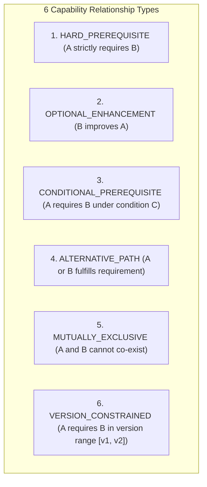
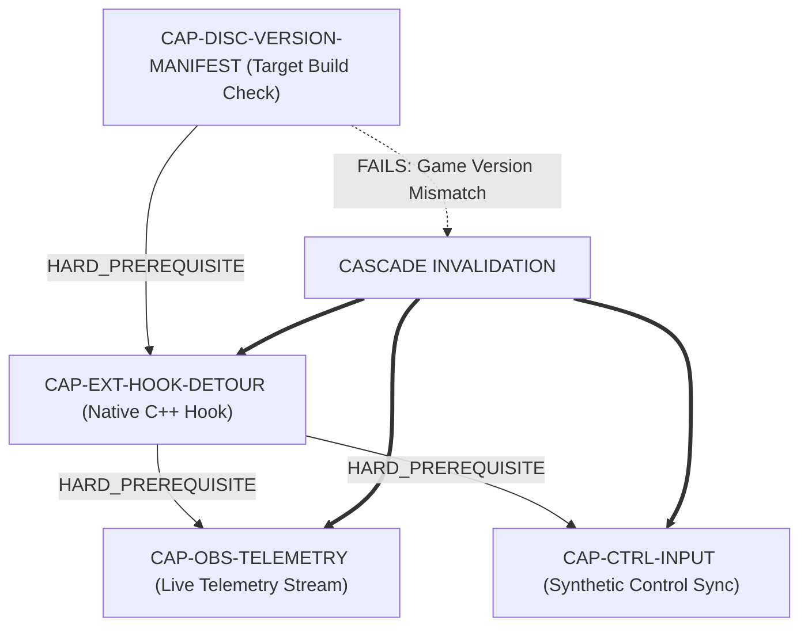

# Capability Dependency and Composition Contract

**Document ID:** `NLE-CON-CDC-001`  
**Version:** 1.0.0  
**Phase:** 5 of 12 — Universal Adapter SDK & Capability System  
**Step:** 35 of 100 — Canonical Capability Taxonomy & Declaration Schema Specification  
**Classification:** Dependency Graph Architecture & Composition Semantics Specification  
**Status:** Approved Specification  
**Authoritative Reference:** `NLE-MOD-CCT-001`, `NLE-SCH-ACD-001`, `COMPATIBILITY_RULE_DEPENDENCY_AND_CONFLICT_RESOLUTION_SPECIFICATION.md`

---

## 1. Capability Relationship Architecture

Capabilities in NexLudic Engine rarely operate in isolation. A complex game-mashup feature (e.g. streaming player transforms from a guest racing game into a host open-world engine) requires a coherent chain of foundational capabilities: memory detours, transform serializers, shared-memory IPC rings, and coordinate projection mappers.

To ensure deterministic evaluation and avoid runtime deadlocks, the capability system formalizes **six explicit relationship types** governed by directed graph semantics.

---

## 2. The 6 Formal Capability Relationship Types

### 2.1 Formal Relationship Definitions & Failure Behaviors

| Relationship Type | Direction | Formal Definition | System Behavior on Target Failure | Example Scenario |
|:---|:---:|:---|:---|:---|
| **`HARD_PREREQUISITE`** | $A \to B$ | Capability $A$ cannot initialize or execute unless Capability $B$ is verified and active. | If $B$ is unverified or fails, $A$ immediately evaluates to `UNSUPPORTED`. | `CAP-EXT-HOOK-DETOUR` requires `CAP-DISC-VERSION-MANIFEST`. |
| **`OPTIONAL_ENHANCEMENT`** | $A \to B$ | Capability $B$ improves $A$'s fidelity or throughput, but $A$ can operate without $B$. | If $B$ is unavailable, $A$ executes in baseline mode; emits informational hint. | Physics interpolation enhances 30 Hz telemetry to 60 Hz display. |
| **`CONDITIONAL_PREREQUISITE`** | $A \xrightarrow{C} B$ | Capability $A$ requires $B$ if and only if evaluated context condition $C$ is true. | Evaluates condition $C$. If true and $B$ fails, $A$ evaluates to `UNSUPPORTED`. | Address Library required only for Skyrim Anniversary Edition (v1.6+). |
| **`ALTERNATIVE_PATH`** | $A \lor B$ | Either $A$ or $B$ can satisfy a parent requirement through different mechanisms. | If $A$ fails, engine falls back to $B$. Requirement fails only if both fail. | Telemetry via Shared Memory (Fast) vs. Named Pipes (Fallback). |
| **`MUTUALLY_EXCLUSIVE`** | $A \otimes B$ | $A$ and $B$ cannot be loaded simultaneously in the same game process. | Attempting to bind both triggers `ERR-CAP-EXCL-01` and halts staging. | Two conflicting DLL injection frameworks hooking identical offsets. |
| **`VERSION_CONSTRAINED`** | $A \xrightarrow{[v_1, v_2]} B$ | Capability $A$ requires Capability $B$ within a strict semantic version boundary. | If $B$'s version falls outside range, $A$ evaluates to `INCOMPATIBLE_VERSION`. | Adapter requires `CAP-INTOP-SHAREDMEM` contract revision $\ge 2$. |

---

## 3. Dependency Graph Invariants & Cycle Detection

### 3.1 Directed Acyclic Graph (DAG) Invariant
The dependency relationships between capabilities must form a **strictly Directed Acyclic Graph (DAG)**. Circular dependencies are logically invalid and represent a fundamental architectural defect.

$$\text{Cycles are prohibited: } A \to B \to \dots \to A \implies \text{FATAL ERROR}$$

### 3.2 Kahn's Algorithm Cycle Verification
During adapter descriptor validation (`CMP-07`), the engine constructs the dependency graph for all declared capabilities and executes **Kahn's Topological Sort**:
1. Compute the in-degree for every capability node.
2. Initialize a queue with all nodes having $\text{in-degree} = 0$.
3. While the queue is non-empty, dequeue node $u$, append to visited list, and decrement in-degree of all target neighbors $v$.
4. If a neighbor reaches $\text{in-degree} = 0$, enqueue it.
5. If the count of visited nodes is less than the total node count, **a cycle exists**.
- **System Response:** Manifest registration is immediately rejected with error code **`ERR-CAP-CYC-01: Circular Dependency Detected in Capability Manifest`**, listing the cyclic path (e.g. `CAP-01 -> CAP-02 -> CAP-01`).

---

## 4. Failure Propagation Cascades

To ensure deterministic evaluation without wasting computational resources on doomed execution paths, the capability engine implements **Fail-Fast Cascading Invalidation**:

- When a root prerequisite fails (e.g. game build mismatch detects unknown executable offsets), the engine marks the root as `UNSUPPORTED`.
- All downstream dependent nodes ($Node B, Node C, Node D$) immediately inherit `UNSUPPORTED` with reason: *"Prerequisite CAP-DISC-VERSION-MANIFEST failed."* Zero runtime probes or memory attaching routines are executed for dependent nodes.

---

## 5. Composition Semantics: Why Component Support != Integration Viability

A critical principle codified across Phase 4 and Phase 5 is that **a collection of individually verified capabilities does not guarantee a functioning mashup**:

1. **Rate & Throughput Mismatches:** Guest game exports telemetry at 30 Hz; Host game physics loop expects 60 Hz. Both capabilities are verified, but composition requires an interpolator or encounters stutter.
2. **Coordinate & Unit Translation Losses:** Guest game uses left-handed centimeter units; Host game uses right-handed Havok units. Without a validated mapping capability (`CAT-MAPPING`), spatial orientation collapses.
3. **Resource Saturation:** Strategy B executes two high-end game engines concurrently. Each game's memory hook capability functions perfectly in isolation, but combined RAM consumption exceeds system headroom, causing OS paging and frame drops.

### Architectural Mandate:
Passing capability-level validation establishes **Component Conformance**. It does **NOT** certify **Mashup Viability**. Full mashup certification requires live end-to-end integration validation in Phase 6/7.

