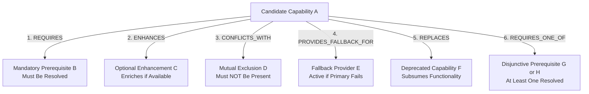
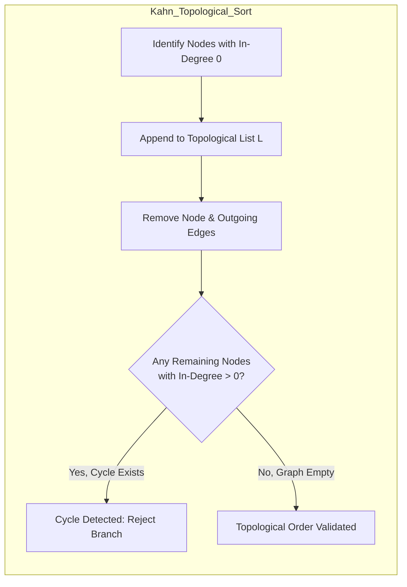
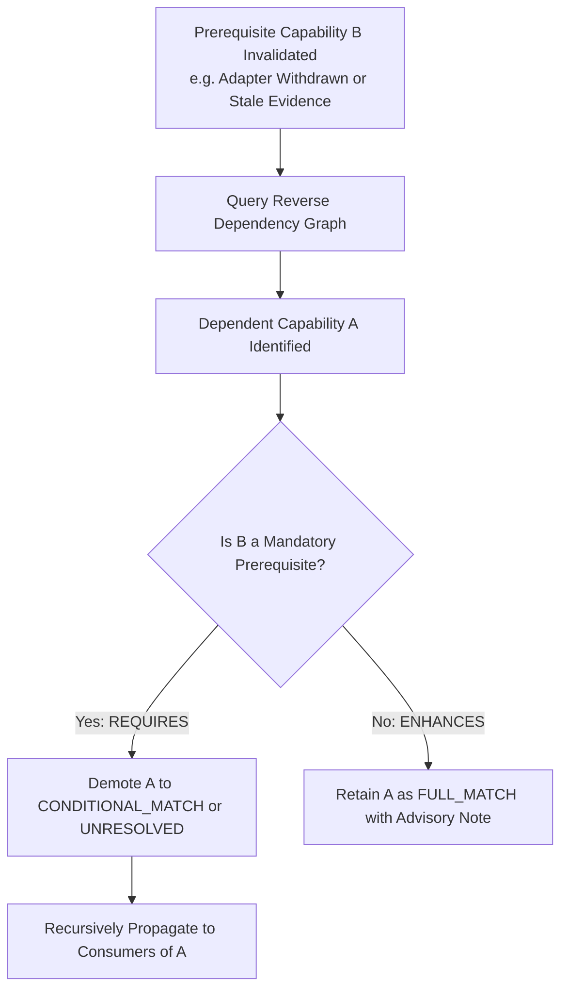

# Capability Dependency Resolution and Composition Rules

**Document Identifier:** `NLE-RUL-CDR-001`  
**Phase:** Phase 5 — Universal Adapter SDK & Capability System  
**Step:** Step 38 of 100 — Capability Matching & Requirement Resolution Specification  
**Status:** Approved Architectural Rules  
**Classification:** Dependency Graph Logic, Kahn DAG Resolution & Composition Constraints  
**Repository Path:** `docs/adapters/CAPABILITY_DEPENDENCY_RESOLUTION_AND_COMPOSITION_RULES.md`  

---

## 1. Executive Summary & Resolution Principles

### 1.1 Purpose
This specification establishes the formal rules, graph traversal algorithms, cycle detection mechanisms, and composition constraints for resolving capability dependencies during the capability matching process.

A candidate adapter declaration rarely operates in complete isolation; it often depends on prerequisite runtime services, shared memory buffers, mod loaders, or secondary adapters (`NLE-CON-CDC-001`). The matching engine must recursively evaluate these dependencies to ensure that a capability requirement is not marked as resolved when its mandatory prerequisites are absent, cyclic, or incompatible.

### 1.2 Core Dependency Invariants
- **No Isolated Resolution:** A capability candidate cannot achieve `FULL_MATCH` status unless **all** its mandatory prerequisite capabilities (`REQUIRES`) are simultaneously resolvable within the current project environment.
- **Topological Acyclicity (Kahn's Algorithm):** The resolved capability dependency graph must form a strict Directed Acyclic Graph (DAG). Any circular dependency ($A \rightarrow B \rightarrow A$) triggers immediate rejection of the affected candidate branch.
- **Dependency Invalidation Propagation:** If a prerequisite capability becomes `STALE`, `WITHDRAWN`, or `INCOMPATIBLE`, all downstream dependent capability findings are immediately demoted or invalidated.
- **Hybrid Composition Boundary:** Successfully matching a host-mod capability in Game A and a live-bridge capability in Game B does **not** certify that the hybrid integration functions end-to-end. End-to-end composition verification is strictly deferred to Step 39 (`Capability Composition`).

---

## 2. Dependency Taxonomy & Evaluation Semantics

The matching engine processes six (6) distinct relationship types defined in `NLE-CON-CDC-001`:

### 2.1 Relationship Evaluation Matrix

| Relationship Type | Definition | Prerequisite State | Impact on Candidate A Outcome |
|:---|:---|:---:|:---|
| `REQUIRES` | Mandatory technical prerequisite. Candidate A cannot execute without B. | `RESOLVED` `UNRESOLVED` `BLOCKED` | Candidate A remains `FULL_MATCH`. Candidate A demoted to `CONDITIONAL_MATCH` (unmet prerequisite). Candidate A evaluated as `BLOCKED`. |
| `ENHANCES` | Optional non-blocking feature enhancement. | `RESOLVED` `UNRESOLVED` | Candidate A retains `FULL_MATCH` with enhancement enabled. Candidate A retains `FULL_MATCH` with enhancement disabled. |
| `CONFLICTS_WITH` | Mutual exclusion. Candidate A cannot coexist with D. | `ACTIVE` `INACTIVE` | Candidate A evaluated as `INCOMPATIBLE`. Candidate A retains `FULL_MATCH`. |
| `REQUIRES_ONE_OF` | Disjunctive prerequisite set ($\text{Prereq}_1 \lor \text{Prereq}_2$). | At least 1 resolved Zero resolved | Candidate A retains `FULL_MATCH`. Candidate A demoted to `UNRESOLVED`. |
| `PROVIDES_FALLBACK_FOR`| Standby alternative activated if primary capability fails. | Primary failed | Candidate A promoted to active candidate. |
| `REPLACES` | Explicit modern replacement for deprecated capability. | Present | Automatically supersedes older capability in match graph. |

---

## 3. Dependency Graph Construction & Kahn's Algorithm

To resolve multi-tier dependencies without infinite recursion or stack overflow, the matching engine constructs an in-memory Dependency DAG and executes **Kahn's Topological Sort Algorithm**:

### 3.1 Traversal & Cycle Detection Rules
1. **Maximum Recursion Depth:** The dependency resolution worker traverses to a maximum depth of **10 levels**. If a dependency chain exceeds 10 edges, the traversal is halted and flagged with `ERR_DEPENDENCY_DEPTH_EXCEEDED`.
2. **Kahn's Algorithm Execution:**
   - Let $G = (V, E)$ be the directed dependency graph where vertices $V$ represent candidate capabilities and directed edges $E = (u, v)$ represent "$u$ requires $v$".
   - Compute in-degree for all vertices.
   - Initialize queue $S$ with all vertices having in-degree 0.
   - While $S$ is non-empty:
     - Remove vertex $n$ from $S$; append to list $L$.
     - For each outgoing edge $e = (n, m)$:
       - Remove edge $e$ from $G$.
       - If $m$ has no other incoming edges, insert $m$ into $S$.
   - If the graph has edges remaining ($|E| > 0$):
     - **A cycle exists.** The cycle path is extracted and logged.
     - All candidates participating in the cycle are assigned outcome `BLOCKED` with diagnostic `ERR_CYCLIC_DEPENDENCY`.
   - If $|E| == 0$:
     - The graph is a valid DAG. List $L$ defines the exact prerequisite initialization order.

---

## 4. Invalidation Propagation Protocol

When an upstream environment change or lifecycle event occurs, the matching engine propagates invalidations along the dependency graph:

1. **Immediate Demotion:** If capability $B$ was a mandatory prerequisite for $A$, and $B$ transitions to `STALE`, `WITHDRAWN`, or `INCOMPATIBLE`, $A$'s match finding is immediately demoted from `FULL_MATCH` to `CONDITIONAL_MATCH` (if $B$ can be recovered) or `UNRESOLVED` (if $B$ is unrecoverable).
2. **Downward Cascade:** Demotion cascades transitively to any higher-tier capabilities depending on $A$.
3. **Audit Explanation:** The diagnostic record explicitly logs the root cause: `"Demoted due to upstream invalidation of prerequisite B (Reason: Evidence Expired)"`.

---

## 5. Hybrid Composition & Strategy Boundaries

When a mashup requirement requires a **Hybrid Integration Strategy** (e.g., combining a host-game mod in Skyrim with an IPC bridge in OpenMW):
1. **Isolated Component Verification:** The matching engine independently verifies that Skyrim satisfies its host-mod requirements and OpenMW satisfies its bridge requirements.
2. **Strategy Composition Limitation:** Successfully matching both components does **NOT** certify that:
   - The two adapters share a compatible wire protocol format.
   - Latency between the processes is within acceptable interactive limits (<16ms).
   - Coordinate spaces or physics ticks are harmonized.
3. **Downstream Handoff:** The matching engine outputs a `HybridComponentMatch` finding, explicitly recording caveat: `"Individual components matched; end-to-end live composition feasibility requires Step 39 Composition Analysis."`

---

## 6. Traceability and Cross-Reference Anchors

- `NLE-SPC-CMR-001`: Primary Capability Matching Specification.
- `NLE-CON-CDC-001`: Capability Dependency and Composition Contract.
- `NLE-CAT-MTR-001`: Matching Rule Catalog & Decision Tables.
- `NLE-SPC-DRF-001`: Discovery Result & Freshness Invalidation Triggers.
- `docs/game-discovery/`: Step 28 Game Version & Environment Mapping.
