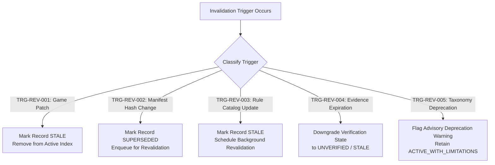

# Capability Discovery Result and Freshness Specification

**Document Identifier:** `NLE-SPC-DRF-001`  
**Phase:** Phase 5 — Universal Adapter SDK & Capability System  
**Step:** Step 37 of 100 — Validated Capability Declaration Registry & Discovery Workflow Specification  
**Status:** Approved Architectural Specification  
**Classification:** Result Data Schema, Explainable Discovery & Freshness Invariants  
**Repository Path:** `docs/adapters/CAPABILITY_DISCOVERY_RESULT_AND_FRESHNESS_SPECIFICATION.md`  

---

## 1. Executive Summary & Result Semantics

### 1.1 Purpose
This specification establishes the standardized data payload, relevance explanation model, and cache freshness guarantees for capability discovery operations within the NexLudic Engine.

When a platform subsystem queries the registry via `NLE-CON-CDQ-001`, the discovery engine returns a structured, explainable `DiscoveryResultPayload`. This payload provides consumers with sufficient technical context to evaluate adapter suitability while explicitly disclosing uncertainties, limitations, and verification states.

### 1.2 Anti-Deception Invariants
- **Transparency of Verification Confidence:** Every discovered capability record carries its authoritative `assignedVerificationState` (per `NLE-MOD-CDV-001`). Discovered records are never promoted to higher confidence tiers simply because they matched a query.
- **Explainable Match Rationale:** Every result explicitly states **why** it was returned (e.g., exact game version match, capability ID intersection) and **what** caveats apply (e.g., conditional support description, unevidenced claim).
- **Explicit Freshness Disclosure:** If any underlying dependency, evidence record, or rule catalog has changed, the result is explicitly flagged as `STALE_WARNING` or `PARTIAL`, preventing stale findings from masquerading as verified current facts.

---

## 2. Discovery Result Payload Schema

The top-level container emitted by the discovery service is serialized as a `DiscoveryResultPayload` document.

### 2.1 JSON Schema Definition (`NLE-SCH-DRP-001`)

```json
{
  "$schema": "https://json-schema.org/draft/2020-12/schema",
  "$id": "https://schemas.nexludic.internal/v1/discovery-result-payload.json",
  "title": "DiscoveryResultPayload",
  "description": "Output payload emitted by the NexLudic Capability Discovery Subsystem.",
  "type": "object",
  "required": [
    "queryId",
    "evaluatedAt",
    "freshnessStatus",
    "executionDurationMs",
    "totalMatches",
    "returnedCount",
    "results"
  ],
  "properties": {
    "queryId": { "type": "string", "format": "uuid" },
    "evaluatedAt": { "type": "string", "format": "date-time" },
    "freshnessStatus": {
      "type": "string",
      "enum": ["CURRENT", "STALE_WARNING", "PARTIAL", "HISTORICAL_SNAPSHOT"]
    },
    "executionDurationMs": { "type": "number", "minimum": 0 },
    "totalMatches": { "type": "integer", "minimum": 0 },
    "returnedCount": { "type": "integer", "minimum": 0 },
    "pagination": {
      "type": "object",
      "required": ["limit", "offset", "hasMore"],
      "properties": {
        "limit": { "type": "integer" },
        "offset": { "type": "integer" },
        "hasMore": { "type": "boolean" }
      }
    },
    "results": {
      "type": "array",
      "items": { "$ref": "#/$defs/DiscoveredCapabilityRecord" }
    }
  },
  "$defs": {
    "DiscoveredCapabilityRecord": {
      "type": "object",
      "required": [
        "registryRecordId",
        "adapterId",
        "adapterRevision",
        "capabilityId",
        "declaredSupportLevel",
        "assignedVerificationState",
        "targetGameId",
        "versionScope",
        "matchRationale"
      ],
      "properties": {
        "registryRecordId": { "type": "string", "format": "uuid" },
        "adapterId": { "type": "string" },
        "adapterRevision": { "type": "string" },
        "adapterRole": {
          "type": "string",
          "enum": ["SOURCE", "TARGET", "BIDIRECTIONAL"]
        },
        "capabilityId": { "type": "string" },
        "category": { "type": "string" },
        "declaredSupportLevel": {
          "type": "string",
          "enum": ["SUPPORTED", "CONDITIONAL", "DEGRADED", "UNSUPPORTED"]
        },
        "assignedVerificationState": {
          "type": "string",
          "enum": [
            "DECLARED_ONLY",
            "STRUCTURALLY_CONFORMANT",
            "CONTRACT_VERIFIED",
            "EVIDENCED_COMPATIBLE",
            "EMPIRICALLY_VALIDATED",
            "UNVERIFIED",
            "DISPROVEN"
          ]
        },
        "targetGameId": { "type": "string" },
        "versionScope": {
          "type": "object",
          "required": ["minVersion", "maxVersion"],
          "properties": {
            "minVersion": { "type": "string" },
            "maxVersion": { "type": "string" },
            "isExactMatch": { "type": "boolean" }
          }
        },
        "limitations": {
          "type": "array",
          "items": { "type": "string" }
        },
        "conditionText": { "type": ["string", "null"] },
        "evidenceCitations": {
          "type": "array",
          "items": { "type": "string" }
        },
        "matchRationale": {
          "type": "object",
          "required": ["matchedCriteria", "confidenceSummary"],
          "properties": {
            "matchedCriteria": {
              "type": "array",
              "items": { "type": "string" }
            },
            "confidenceSummary": { "type": "string" },
            "caveats": {
              "type": "array",
              "items": { "type": "string" }
            }
          }
        }
      }
    }
  }
}
```

---

## 3. Freshness Status Taxonomy

Every discovery payload includes an overall `freshnessStatus` field indicating the currency of the evaluated data:

| Status Value | Meaning | Consumer Action |
|:---|:---|:---|
| `CURRENT` | All matched registry records and index projections are verified against current manifest hashes, current rule catalogs, and active evidence. | Safe for immediate consumption by Compatibility Assessment Engine. |
| `STALE_WARNING` | One or more matched records rely on evidence near expiration or an older rule catalog minor revision, but remain structurally sound. | Admitted with advisory warning; UI displays refresh notice. |
| `PARTIAL` | Query hit the 250ms execution timeout or an unindexed workspace adapter, returning an incomplete subset of matching candidates. | Caller must paginate or narrow search filters to obtain complete data. |
| `HISTORICAL_SNAPSHOT` | Query explicitly requested historical records (`allowedStates: ["SUPERSEDED", "WITHDRAWN"]`). Results reflect past state. | Used solely for audit diffing; **prohibited** from active mashup planning. |

---

## 4. Freshness Invalidation Triggers & Propagation Rules

To guarantee that changes in the local environment or core platform immediately invalidate stale discovery views, the registry implements strict invalidation propagation:



### 4.1 Invalidation Trigger Matrix

| Trigger ID | Source Event | Invalidation Scope | Immediate Registry Action | Discovery Impact |
|:---|:---|:---|:---|:---|
| `TRG-REV-001` | **Game Patch Detected** (Game Discovery Subsystem) | All records targeting `targetGameId` whose `maxVersion` < new build. | Transition record state to `STALE`. | Record hidden from standard discovery queries. |
| `TRG-REV-002` | **Manifest Hash Mismatch** (Filesystem Watcher) | Specific `adapterId` record. | Transition record state to `SUPERSEDED`. | Old record hidden; new manifest must complete revalidation. |
| `TRG-REV-003` | **Rule Catalog Version Bump** (Universal Core Engine) | All registered records evaluated under prior rule catalog major version. | Flag records as `STALE`. Schedule revalidation queue. | Payloads return `STALE_WARNING` until revalidation finishes. |
| `TRG-REV-004` | **Evidence Expiration / Revocation** (Evidence Registry) | All capability declarations citing affected `EVD-xxxx` IDs. | Downgrade capability `assignedVerificationState` to `UNVERIFIED`. | Discovered records reflect downgraded confidence; unevidenced claims marked. |
| `TRG-REV-005` | **Taxonomy Capability Deprecated** (Governance Board) | All records referencing deprecated `capabilityId`. | Retain `ACTIVE_WITH_LIMITATIONS`; append migration notice. | Record discoverable, but match rationale notes deprecation. |

---

## 5. Traceability and Cross-Reference Anchors

- `NLE-CON-CDQ-001`: Discovery Query and Filter Contract.
- `NLE-MOD-RRM-001`: Registry Record and Source of Truth Model.
- `NLE-MOD-CDV-001`: 7-Stage Verification State Model.
- `NLE-POL-VRG-001`: Validation Rule Catalog Governance & Reassessment Policy.
- `docs/game-discovery/`: Evidence Provenance and Freshness Rules (`EVD-xxxx`).
