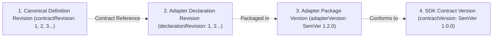
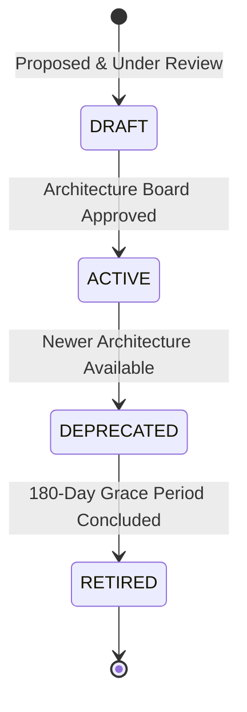

# Capability Identifier, Versioning, and Evolution Policy

**Document ID:** `NLE-POL-CVE-001`  
**Version:** 1.0.0  
**Phase:** 5 of 12 — Universal Adapter SDK & Capability System  
**Step:** 35 of 100 — Canonical Capability Taxonomy & Declaration Schema Specification  
**Classification:** Identifier Governance, Semantic Versioning & Deprecation Policy  
**Status:** Approved Specification  
**Authoritative Reference:** `NLE-MOD-CCT-001`, `NLE-SCH-CCD-001`, `COMPATIBILITY_RULE_VERSIONING_GOVERNANCE_AND_REASSESSMENT_POLICY.md`

---

## 1. Identifier Governance & Immutability Rules

Canonical Capability Identifiers (`CapabilityId`) are the bedrock of NexLudic Engine's cross-game compatibility intelligence. They provide stable anchors for compatibility rules, evidence records, user requirements, and adapter manifests.

### 1.1 Structural Syntax Standard
Every canonical capability identifier conforms strictly to the following syntax:

$$\texttt{CAP-}\{\text{CAT}\}\texttt{-}\{\text{DESCRIPTOR}\}\texttt{-}\{\text{NUM}\}$$

- `CAP`: Mandatory static domain prefix.
- `CAT`: 3-5 character uppercase category code (`DISC`, `ASSET`, `EXT`, `OBS`, `CTRL`, `XCHG`, `MAP`, `INTOP`, `DIAG`, `RECOV`).
- `DESCRIPTOR`: 2–4 hyphen-separated uppercase semantic terms (e.g. `HOOK-DETOUR-NATIVE`, `MESH-SKELETAL-CONVERT`).
- `NUM`: 3-digit zero-padded sequence number (`001`, `002`).

### 1.2 The Absolute Immutability Rule
Once a canonical capability definition is published in an official catalog release with status `ACTIVE`, **its identifier and semantic core are permanently immutable**. 
- An identifier cannot be renamed, repurposed, or assigned to a different technical operation.
- If a capability's operational behavior changes fundamentally, the existing capability is deprecated and a brand-new identifier is minted.

---

## 2. Versioning Matrix & Multi-Dimensional Decoupling

To prevent version conflation, the capability system explicitly decouples four independent version streams:



- **`contractRevision` (Capability Definition):** Monotonic integer incremented when a canonical definition receives backward-compatible editorial or schema updates.
- **`declarationRevision` (Adapter Declaration):** Monotonic integer incremented by an adapter author when updating notes, limitations, or tested build hashes for a capability.
- **`adapterVersion` (Adapter Package):** Semantic version (`MAJOR.MINOR.PATCH`) governing the adapter worker binary and manifest as a whole.
- **`contractVersion` (SDK Contract):** Semantic version governing the universal SDK and wire protocol.

---

## 3. Compatible vs. Breaking Changes

### 3.1 Non-Breaking (Compatible) Changes
A change is classified as **Compatible** if and only if existing adapter workers and historical evaluation traces continue to function without modification:
1. Editorial improvements, typos, and Markdown formatting in `definitionMarkdown`.
2. Clarifying descriptions in `shortDescription` without altering behavioral guarantees.
3. Adding optional fields or non-mandatory parameter attributes to `inputSchema` or `outputSchema`.
4. Adding optional diagnostic hints or reference documentation links.
- **Governance Action:** Increments `contractRevision` ($\text{Rev } n \to \text{Rev } n+1$); status remains `ACTIVE`.

### 3.2 Breaking Changes
A change is classified as **Breaking** if it alters the operational contract, invalidates existing adapter implementations, or disrupts historical traces:
1. Modifying the data type, requiredness, or semantics of existing parameters in `inputSchema`.
2. Modifying the structure, return types, or outcome codes in `outputSchema`.
3. Escalating required permissions (e.g. demanding write access where read-only was specified).
4. Changing the side-effect classification (e.g. from `EPHEMERAL_MEMORY` to `GAME_STATE_MUTATION`).
5. Altering invariants, preconditions, or postconditions.
6. Narrowing supported platforms or runtime architectures.
- **Governance Action:** **Strictly Prohibited on Existing Identifiers**. The existing capability is deprecated; a new capability identifier is created (e.g., `CAP-EXT-HOOK-DETOUR-002`).

---

## 4. Deprecation, Retirement, and Replacement Policy



### 4.1 Lifecycle States
- **`DRAFT`:** Proposed capability undergoing catalog review. Cannot satisfy mandatory requirements.
- **`ACTIVE`:** Authoritative canonical contract. Fully supported across the platform.
- **`DEPRECATED`:** Superseded by a newer contract. Still valid for existing projects, but emits warnings.
- **`RETIRED`:** No longer admitted for new project creation. Preserved strictly for historical audit inspection.

### 4.2 Deprecation Contract Schema
When a capability transitions to `DEPRECATED`, its definition is updated with explicit migration metadata:
```json
{
  "lifecycleStatus": "DEPRECATED",
  "deprecationMetadata": {
    "deprecatedAt": "2026-11-18T12:00:00Z",
    "effectiveRetirementDate": "2027-05-18T12:00:00Z",
    "deprecationReason": "Superseded by memory-mapped circular buffer protocol.",
    "supersededBy": "CAP-INTOP-RINGBUFFER-002",
    "migrationGuideUrl": "https://docs.nexludic.org/migration/CAP-INTOP-001-to-002.md"
  }
}
```

### 4.3 Historical Trace Preservation Invariant
Deprecating or retiring a capability **never alters or invalidates historical compatibility evaluation traces (`NLE-SPC-EET-001`)**. A project evaluated in 2026 under `CAP-EXT-HOOK-DETOUR-001` retains its exact decision history, with UI tooltips noting: *"Evaluated under Revision 1 (Deprecated; superseded by CAP-EXT-HOOK-DETOUR-002)."*

