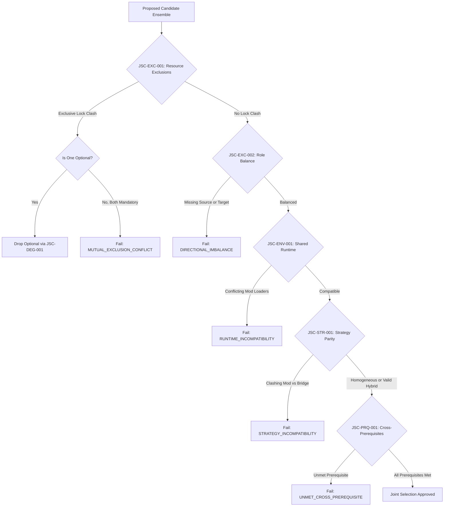

# Capability Joint Selection and Constraint Resolution Rules

**Document Identifier:** `NLE-RUL-JSC-001`  
**Phase:** Phase 5 — Universal Adapter SDK & Capability System  
**Step:** Step 39 of 100 — Capability Negotiation & Contextual Availability Resolution Specification  
**Status:** Approved Architectural Rules  
**Classification:** Joint Selection Logic, Multi-Adapter Constraint Solving & Conflict Resolution  
**Repository Path:** `docs/adapters/CAPABILITY_JOINT_SELECTION_AND_CONSTRAINT_RESOLUTION_RULES.md`  

---

## 1. Executive Summary & Resolution Principles

### 1.1 Purpose
This specification establishes the formal rules, decision logic, and constraint-solving algorithms for determining whether multiple candidate adapter declarations can be **jointly selected** into a coherent capability configuration.

While capability matching evaluates an adapter declaration against a single requirement in isolation, joint selection evaluates the entire ensemble of selected adapters against shared system resources, runtime environments, communication topologies, and mutual exclusion constraints.

### 1.2 Core Joint Selection Invariants
- **No Resource Contention:** Two adapters cannot be jointly selected if both claim exclusive write access, exclusive process hooking, or conflicting memory locks on the same game subsystem.
- **Mandatory Integrity Dominance:** A joint selection cannot omit or degrade a mandatory capability (`MANDATORY`) to resolve a conflict. If a conflict involves a mandatory capability, the non-mandatory competitor is dropped or the entire selection is evaluated as `INCOMPATIBLE`.
- **Directional Balance:** Cross-game mashup objectives requiring data synchronization must establish a balanced pipeline containing at least one valid `SOURCE` (extractor) and one valid `TARGET` (consumer/injector).
- **Graceful Degradation:** If an optional capability (`OPTIONAL`) introduces a resource conflict or dependency deadlock with a mandatory capability, the optional capability is automatically omitted from the joint configuration, and the selection is classified as `RESOLVED_WITH_LIMITATIONS`.

---

## 2. Joint Selection Rule Catalog (`JSC-*`)

### 2.1 Rule Definitions

| Rule ID | Rule Name | Description & Evaluation Logic | Failure Consequence |
|:---|:---|:---|:---|
| `JSC-EXC-001` | **Cross-Adapter Resource Lock Exclusion** | If Adapter A and Adapter B both assert exclusive write access or native function hooks on the same game memory segment or camera subsystem, they cannot be active simultaneously. | Triggers `MUTUAL_EXCLUSION_CONFLICT`. Handled via `JSC-DEG-001` or candidate disqualification. |
| `JSC-EXC-002` | **Directional Role Balance** | For any cross-game synchronization requirement, the joint selection must pair a `SOURCE` or `BIDIRECTIONAL` capability in Game A with a `TARGET` or `BIDIRECTIONAL` capability in Game B. | Triggers `DIRECTIONAL_IMBALANCE`. Evaluated as `INCOMPLETE_CONFIGURATION`. |
| `JSC-ENV-001` | **Shared Runtime & Framework Parity** | If both adapters run in the same host game process environment (e.g., two SKSE plugins in Skyrim), their required runtime versions and script engine hooks must be mutually compatible. | Triggers `RUNTIME_INCOMPATIBILITY`. Evaluated as `INCOMPATIBLE`. |
| `JSC-STR-001` | **Strategy Alignment & Hybrid Validity** | All selected adapters must align with the requested `integrationStrategy`. In a `HYBRID` strategy, the boundary between the host-mod component and live-bridge component must be explicitly declared. | Triggers `STRATEGY_INCOMPATIBILITY`. Evaluated as `INCOMPATIBLE`. |
| `JSC-DEG-001` | **Graceful Degradation of Optional Contenders** | If an `OPTIONAL` capability conflicts with a `MANDATORY` capability under `JSC-EXC-001`, the optional capability is automatically omitted from the active configuration. | Configuration accepted with outcome `RESOLVED_WITH_LIMITATIONS`. Caveat logged. |
| `JSC-PRQ-001` | **Cross-Participant Prerequisite Fulfillment** | If Adapter A requires Capability C, and Capability C is declared and provided by Adapter B across the bridge, the dependency is resolved as cross-fulfilled. | If cross-prerequisite cannot be fulfilled, evaluated as `UNMET_CROSS_PREREQUISITE`. |

---

## 3. Conflict Resolution & Candidate Trade-off Decision Tables

When competing candidates create multi-adapter conflicts, resolution is determined using the following deterministic truth table:

| Contender 1 Criticality | Contender 2 Criticality | Conflict Dimension | Contender 1 Verification | Contender 2 Verification | Joint Resolution Outcome |
|:---:|:---:|:---:|:---:|:---:|:---|
| `MANDATORY` | `OPTIONAL` | `JSC-EXC-001` Lock Clash | Any | Any | **Contender 1 Retained, Contender 2 Omitted** (`RESOLVED_WITH_LIMITATIONS`) |
| `OPTIONAL` | `OPTIONAL` | `JSC-EXC-001` Lock Clash | Verified | Unverified | **Contender 1 Retained, Contender 2 Omitted** |
| `MANDATORY` | `MANDATORY` | `JSC-EXC-001` Lock Clash | Any | Any | **Fatal Clash:** Outcome `INCOMPATIBLE` (`ERR_MANDATORY_RESOURCE_COLLISION`) |
| `MANDATORY` | `MANDATORY` | `JSC-ENV-001` Runtime Clash | Any | Any | **Fatal Clash:** Outcome `INCOMPATIBLE` (`ERR_SHARED_RUNTIME_CONFLICT`) |
| Any | Any | `JSC-EXC-002` Missing Role | Any | Any | **Incomplete:** Outcome `NEEDS_INFORMATION` (`ERR_DIRECTIONAL_IMBALANCE`) |
| `MANDATORY` | `MANDATORY` | Zero Resource Collisions | Verified | Verified | **Full Approval:** Outcome `RESOLVED` |

---

## 4. Cross-Game Tick & Coordinate Space Harmonization

In cross-game real-time interoperability (`LIVE_BRIDGE` and `HYBRID` strategies), joint selection verifies that participants can harmonize operational rates:
1. **Tick Rate Harmonization:** If Game A operates at 60Hz state extraction and Game B operates at 30Hz simulation, the joint configuration inserts an approved state interpolation or downsampling filter.
2. **Coordinate Normalization:** If Game A uses right-handed Z-up coordinates and Game B uses left-handed Y-up coordinates, the joint selection requires an explicit coordinate transformation capability (`world.spatial.transform`) to bridge the participants.

---

## 5. Traceability and Cross-Reference Anchors

- `NLE-SPC-CNA-001`: Primary Capability Negotiation Specification.
- `NLE-CON-CNC-001`: Negotiation Context and Input Contract.
- `NLE-MOD-CRM-001`: Capability Requirement Model & Criticality Taxonomy.
- `NLE-RUL-CDR-001`: Capability Dependency Resolution & Composition Rules.
- `NLE-CON-CDC-001`: Capability Dependency & Composition Contract.
- `BLK-SEC-01`: Platform Anti-Cheat Dominance Guarantee.
