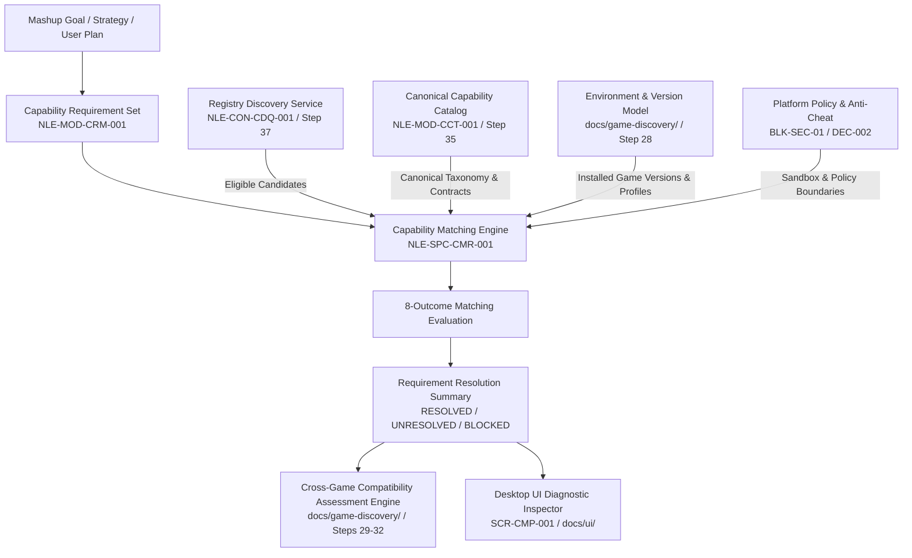
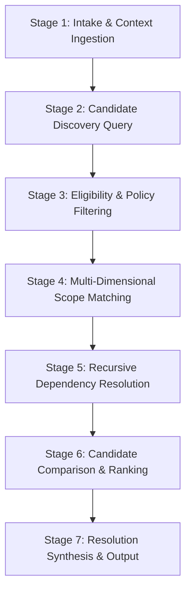

# Capability Matching and Requirement Resolution Specification

**Document Identifier:** `NLE-SPC-CMR-001`  
**Phase:** Phase 5 — Universal Adapter SDK & Capability System  
**Step:** Step 38 of 100 — Capability Matching & Requirement Resolution Specification  
**Status:** Approved Architectural Specification  
**Classification:** Universal Core Specification & Matching Architecture  
**Repository Path:** `docs/adapters/CAPABILITY_MATCHING_AND_REQUIREMENT_RESOLUTION_SPECIFICATION.md`  

---

## 1. Executive Summary & Purpose

### 1.1 Purpose
This specification establishes the authoritative architecture, operational boundaries, and evaluation contracts for the **Capability Matching and Requirement Resolution Subsystem** within the NexLudic Engine.

The matching subsystem serves as the analytical bridge connecting high-level mashup requirements (defined by user goals, gameplay objectives, or integration strategies) with validated, registered adapter capability declarations (`RegistryRecord`, per `NLE-MOD-RRM-001`, discovered via `NLE-CON-CDQ-001`).

Its core responsibilities include:
1. Ingesting structured sets of capability requirements with explicit criticality (`MANDATORY`, `OPTIONAL`, `CONDITIONAL`, `ALTERNATIVE`).
2. Querying the capability registry for eligible candidate declarations matching target games, versions, and platforms.
3. Performing deterministic, multi-dimensional compatibility matching across canonical identity, SemVer scope, and environment profiles.
4. Recursively resolving capability prerequisites and dependency Directed Acyclic Graphs (DAGs).
5. Comparing alternative candidate declarations without arbitrary numerical scoring or opaque heuristic weights.
6. Emitting fully explainable, machine-readable match findings and requirement resolution summaries for the Cross-Game Compatibility Assessment Engine (`docs/game-discovery/`) and Desktop UI (`SCR-CMP-001`).

### 1.2 Anti-Deception & Non-Execution Invariants
- **A Capability Match Is Not End-to-End Compatibility:** Identifying an eligible adapter declaration that matches a capability requirement certifies solely that a component exists claiming support for that specific function under stated constraints. **A match does NOT prove that two games can interoperate, does NOT verify runtime stability, and does NOT certify overall mashup feasibility.**
- **Matching Is Not Execution Authorization:** Performing capability matching is a pure read-only evaluation. Matching an adapter candidate does **not** grant permission to load, inject, hook, or execute adapter code. Execution authorization remains strictly governed by separate security policies, sandbox controls (`ADR-0002`), Windows Medium Integrity Level constraints (`DEC-002`), and explicit user consent.
- **Strict Identity Matching (No Keyword Guessing):** Matches are established strictly via canonical capability identifiers (`NLE-MOD-CCT-001`) and approved semantic extension mappings. Natural language similarity, display-name matching, keyword overlaps, or AI hallucinations are strictly prohibited from establishing equivalence.
- **Preservation of Explicit Unknowns:** If version scope, environment data, or empirical evidence is missing, the match outcome is explicitly recorded as `UNKNOWN` or `UNVERIFIED`. The system never synthesizes speculative or deceptive green checkmarks.
- **No Concealment of Critical Blockers:** An optional requirement match or secondary feature match can **never** compensate for, mask, or override an unmet mandatory requirement.

---

## 2. Architectural Positioning & Subsystem Boundaries

The capability matching subsystem operates downstream of the Registry Discovery service (Step 37) and upstream of the Mashup Composition Planner (Step 39) and Compatibility Assessment Engine (Phase 4):

### 2.1 Subsystem Responsibility Matrix

| Subsystem Domain | Primary Document | Data & Authority Owned | Explicit Boundary / Excluded Authority |
|:---|:---|:---|:---|
| **Canonical Capability Catalog** | `NLE-MOD-CCT-001` | Official taxonomy, canonical capability identifiers (`category.sub.name`), semantic schemas. | Does not track which adapters implement capabilities. |
| **Capability Declaration Registry** | `NLE-SPC-VCR-001`, `NLE-MOD-RRM-001` | Registered declaration revisions, lifecycle states (`ACTIVE`, `STALE`), discovery queries. | Does not evaluate user requirements or select best adapters. |
| **Declaration Validator** | `NLE-SPC-CVC-001`, `NLE-CON-VRD-001` | Static validation rules (`VLD-*`), diagnostic payloads, schema compliance. | Does not evaluate pairwise mashups or requirement coverage. |
| **Capability Matching Subsystem** | `NLE-SPC-CMR-001` | Compares requirements against candidate declarations; resolves prerequisites; compares alternatives. | **Does not assess end-to-end game mashup feasibility; does not execute code; does not grant permissions.** |
| **Compatibility Assessment Engine** | `docs/game-discovery/`, Steps 29–32 | Pairwise game compatibility evaluations, strategy selection (Bridge vs. Mod), end-to-end viability. | Does not author adapter declarations or manage registry records. |
| **Desktop UI** | `docs/ui/`, `SCR-CMP-001` | Visualizes match results, resolution trees, caveats, and user selection prompts. | Does not evaluate matching rules or bypass security checks. |

---

## 3. End-to-End Capability Matching Workflow

The capability matching subsystem executes a seven-stage deterministic evaluation pipeline:

### 3.1 Pipeline Stages

| Stage | Name | Description | Gate / Failure Consequence |
|:---:|:---|:---|:---|
| **1** | **Intake & Context Ingestion** | Ingests `CapabilityRequirementSet` and target game-pair context (`gameA`, `gameB`, versions, platform, strategy). | Rejects malformed requirements or unresolvable canonical game IDs. |
| **2** | **Candidate Discovery Query** | Dispatches context-filtered discovery query (`NLE-CON-CDQ-001`) to registry for candidate declarations. | Empty discovery returns `NO_MATCH` for affected requirements; does not crash. |
| **3** | **Eligibility & Policy Filtering** | Verifies candidates are `ACTIVE` or `ACTIVE_WITH_LIMITATIONS`, pass Medium IL (`DEC-002`), and satisfy anti-cheat dominance (`BLK-SEC-01`). | Disqualified candidates flagged as `BLOCKED` or `INELIGIBLE` with explicit rationale. |
| **4** | **Scope Matching** | Evaluates canonical identity match, SemVer range intersection per Step 28, and environment profile compatibility. | Assigns candidate match outcome (`FULL_MATCH`, `PARTIAL_MATCH`, `CONDITIONAL_MATCH`, `UNKNOWN`, `INCOMPATIBLE`). |
| **5** | **Recursive Dependency Resolution** | Traverses prerequisite DAG; evaluates whether declared dependencies (`REQUIRES`, `ENHANCES`) are satisfied by other candidates. | Detects DAG cycles via Kahn's algorithm; unfulfilled mandatory prerequisites demote match state. |
| **6** | **Candidate Comparison & Ranking** | Compares multiple eligible candidates across objective dimensions (exact version fit, verification maturity, dependency footprint). | Deterministic tie-breaking; avoids arbitrary numerical scores. |
| **7** | **Resolution Synthesis & Output** | Aggregates per-requirement findings into `RequirementResolutionSummary`; emits explainable `CapabilityMatchResultPayload`. | Outputs structured machine-readable result payload for downstream consumption. |

---

## 4. Fundamental Matching Invariants

1. **Deterministic Repeatability:** Given identical requirement sets, identical candidate declaration snapshots, and identical environment inputs, the matching engine produces byte-identical resolution payloads.
2. **Criticality Dominance:** Mandatory requirements (`MANDATORY`) govern resolution status. A mashup with 99 optional capabilities resolved and 1 mandatory capability unresolved is evaluated as `UNRESOLVED`.
3. **No Phantom Substitutions:** One capability cannot satisfy another capability requirement unless an explicit, authoritative substitution mapping is formally defined in `NLE-MOD-CCT-001`.
4. **No Runtime Guessing:** Absence of evidence is never equated with verified support or technical impossibility. It is recorded strictly as `UNKNOWN` or `UNVERIFIED`.
5. **Traceable Lineage:** Every match finding references the exact `registryRecordId`, `manifestSha256`, requirement revision, and rule catalog revision that generated it.

---

## 5. Traceability and Cross-Reference Anchors

- `NLE-MOD-CCT-001`: Canonical Capability Taxonomy & Domain Model.
- `NLE-SCH-ACD-001`: Adapter Capability Declaration Schema.
- `NLE-SPC-VCR-001`: Validated Capability Declaration Registry Specification.
- `NLE-CON-CDQ-001`: Discovery Query and Filter Contract.
- `NLE-SPC-DRF-001`: Discovery Result & Freshness Specification.
- `NLE-MOD-CDV-001`: 7-State Capability Verification Model.
- `docs/game-discovery/`: Step 28 Game Version & Environment Mapping rules.
- `ADR-0002`: Out-of-Process Adapter Execution Mode.
- `DEC-002`: Windows Medium Integrity Level.
- `BLK-SEC-01`: Platform Anti-Cheat Dominance Guarantee.
