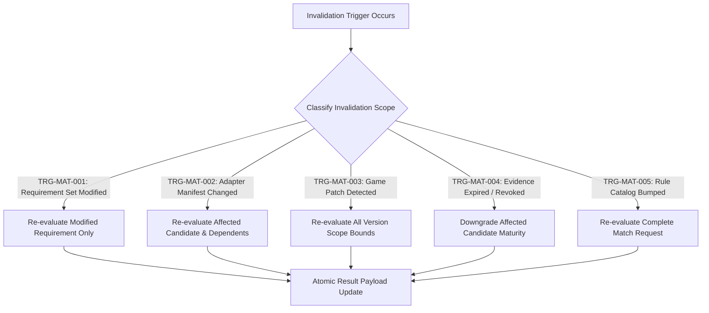

# Capability Matching Freshness, Security, and Failure Policy

**Document Identifier:** `NLE-POL-MFS-001`  
**Phase:** Phase 5 — Universal Adapter SDK & Capability System  
**Step:** Step 38 of 100 — Capability Matching & Requirement Resolution Specification  
**Status:** Approved Platform Policy  
**Classification:** Cache Freshness, Security Sandbox & 36-Scenario Failure Protocol  
**Repository Path:** `docs/adapters/CAPABILITY_MATCHING_FRESHNESS_SECURITY_AND_FAILURE_POLICY.md`  

---

## 1. Executive Summary & Policy Scope

### 1.1 Purpose
This policy establishes the formal invalidation rules, security boundaries, resource ceilings, and disaster recovery protocols for the Capability Matching Subsystem within the NexLudic Engine.

The matching engine is a decision-support and analysis service. It must operate securely under Windows Medium Integrity Level (`DEC-002`), handle untrusted third-party metadata safely, invalidate cached findings when upstream dependencies or game environments change, and provide deterministic recovery across thirty-six (36) identified failure modes and edge cases.

---

## 2. Invalidation Triggers & Incremental Reassessment

When local game installations, adapter files, or evidence records evolve, cached `CapabilityMatchResultPayload` instances must be invalidated to prevent stale findings from corrupting compatibility reports.

### 2.1 Invalidation Trigger Matrix

| Trigger ID | Source Event | Invalidation Scope | Matching Engine Response |
|:---|:---|:---|:---|
| `TRG-MAT-001` | **Requirement Set Modified** | Specific `requirementId`. | Re-evaluates only the added/modified requirement and its dependent nodes. Unaffected requirements remain cached. |
| `TRG-MAT-002` | **Adapter Manifest Hash Divergence** | All requirements matching `adapterId`. | Re-queries registry for new candidate declaration revision; re-evaluates affected matches. |
| `TRG-MAT-003` | **Local Game Patch Detected** | All requirements targeting `targetGameId`. | Re-evaluates SemVer bounds (`MTR-CTX-002`); flags candidates whose `maxVersion` < new build as `INCOMPATIBLE`. |
| `TRG-MAT-004` | **Evidence Expiration / Revocation** | Candidates citing affected `EVD-xxxx`. | Downgrades verification state to `UNVERIFIED`; demotes candidate from `FULL_MATCH` to `UNKNOWN`. |
| `TRG-MAT-005` | **Matching Rule Catalog Bump** | Entire project match cache. | Invalidates cached payload; enqueues complete re-evaluation. |

---

## 3. Security Boundaries & Resource Ceilings

### 3.1 Untrusted Input Sanitization
- **Metadata Tag Stripping:** Requirement purpose strings, condition expressions, and adapter notes are sanitized against HTML/script injection (`<script>`, `<iframe>`). Any raw script tag triggers rejection with `VLD-SEC-004`.
- **DFA Regex Matching:** All identifier, SemVer, and version comparison routines use linear-time regex engines with strict backtracking caps to prevent ReDoS attacks.

### 3.2 Quantitative Resource Ceilings
- **Max Requirements per Request:** 500 requirements.
- **Max Traversal Recursion Depth:** 10 levels in dependency DAG.
- **Execution Timeout:** 2,000 milliseconds (2.0s) per matching request (configurable up to 10,000ms for massive batch projects). If timeout is exceeded, execution terminates cleanly with `ERR_MATCHING_TIMEOUT` and emits a partial result payload.
- **Memory Ceiling:** 128 MB maximum resident memory for matching worker process.
- **Sandbox Conformance:** Pure static evaluation; zero process creation, zero DLL injection, zero UAC elevation (`REQ-SEC-001`, `DEC-002`).

---

## 4. Comprehensive 36-Scenario Failure Protocol

The platform establishes explicit, deterministic recovery protocols for thirty-six (36) failure modes and edge cases:

| # | Scenario Description | Preconditions | Expected Finding | Expected Explanation | Safe Next Action |
|:---:|:---|:---|:---:|:---|:---|
| **1** | No Eligible Declarations for Mandatory Requirement | Mandatory requirement submitted; registry query returns 0 candidates. | `UNRESOLVED` | `"No eligible adapter found in registry for canonical capability X on target game Y."` | Author/install missing adapter; mashup blocked. |
| **2** | Declaration Excluded by Lifecycle State | Candidate exists but is in `SUSPENDED` or `WITHDRAWN` state. | `UNRESOLVED` | `"Candidate adapter is currently suspended/withdrawn; excluded from matching."` | Re-enable adapter in UI or find alternative. |
| **3** | Valid Declaration Targets Wrong Game Version | Installed version is 1.6.640; candidate supports 1.5.0 to 1.5.97. | `INCOMPATIBLE` | `"Version out of bounds (Installed: 1.6.640, Supported: 1.5.0-1.5.97)."` | Downgrade game or wait for adapter update. |
| **4** | Target Game Version Unknown | Local installation detected but version string cannot be verified. | `UNKNOWN` | `"Cannot match version scope; local game installation version is unverified."` | Re-scan game installation in Game Discovery. |
| **5** | Requirement References Unknown Canonical ID | Requirement cites capability ID not present in `NLE-MOD-CCT-001`. | `BLOCKED` | `"Canonical capability ID not recognized in official taxonomy."` | Correct requirement definition. |
| **6** | Canonical Capability Deprecated | Candidate references deprecated canonical capability. | `RESOLVED_WITH_LIMITATIONS` | `"Candidate satisfies requirement but capability is deprecated; migration advised."` | Plan migration to successor capability. |
| **7** | Unapproved Semantic Substitution Attempted | Candidate has different ID; no mapping exists in taxonomy. | `NO_MATCH` | `"Capabilities are semantically distinct; no approved substitution exists."` | Use exact canonical capability. |
| **8** | Unresolved Semantic Conformance Findings | Candidate has validation warnings regarding conditional descriptions. | `CONDITIONAL_MATCH` | `"Candidate has conditional constraints that require runtime validation."` | Review adapter condition caveats. |
| **9** | Mandatory Prerequisite Unavailable | Candidate A requires B, but no candidate resolves B. | `UNRESOLVED` | `"Mandatory prerequisite B is missing; candidate A cannot be utilized."` | Install adapter satisfying prerequisite B. |
| **10** | Optional Prerequisite Unavailable | Candidate A enhances with C, but C is absent. | `RESOLVED` | `"Optional enhancement C unavailable; candidate A resolved with baseline functionality."` | Proceed; enhancement disabled. |
| **11** | Environment Prerequisite Unknown | Candidate requires SKSE, but host profile has not scanned mod loaders. | `UNKNOWN` | `"Environment profile incomplete; presence of required mod loader unconfirmed."` | Run environment profile detection tool. |
| **12** | Conditional Requirement Cannot Be Evaluated | Expression references game variable not yet observed. | `CONDITIONAL_MATCH` | `"Condition cannot be evaluated statically; deferred to runtime pre-flight."` | Defer evaluation to live launch pre-flight. |
| **13** | Optional Requirement Has No Match | Optional requirement submitted; 0 candidates found. | `NOT_RESOLVED_OPTIONAL` | `"Optional feature has no candidate; does not block overall resolution."` | Proceed without optional feature. |
| **14** | Mandatory Requirement Has Only Partial Match | Candidate declared support is `DEGRADED`. | `RESOLVED_WITH_LIMITATIONS` | `"Candidate satisfies requirement partially with documented functional limitations."` | User must accept degraded functionality. |
| **15** | Several Declarations Match Requirement | Two equally qualified candidates found. | `RESOLVED_MULTIPLE_ALTERNATIVES` | `"Multiple qualified adapters available; user selection required."` | Prompt user in UI (`SCR-CMP-001`) to choose. |
| **16** | Equivalent Declarations Have Different Limitations | Candidate A has memory limits; Candidate B requires specific loader. | `RESOLVED_MULTIPLE_ALTERNATIVES` | `"Alternative candidates present distinct operational trade-offs."` | User selects preferred trade-off. |
| **17** | Candidates Conflict for Overlapping Scope | Two candidates claim exclusive hooking hooks. | `RESOLVED_WITH_LIMITATIONS` | `"Mutual exclusion conflict detected between candidate adapters."` | Select one adapter; deactivate the other. |
| **18** | Candidate Is Stale | Evidence cited by candidate has expired. | `STALE` | `"Candidate evidence expired; reassessment or revalidation required."` | Trigger adapter revalidation. |
| **19** | Evidence Records Unavailable on Disk | Evidence file deleted from `.audit/` folder. | `UNKNOWN` | `"Evidence file missing from disk; capability confidence downgraded."` | Re-collect evidence artifact. |
| **20** | Validation Result Belongs to Old Revision | Manifest hash differs from validation payload. | `INELIGIBLE` | `"Manifest revision divergence detected; validation payload out of date."` | Run declaration validator on new manifest. |
| **21** | Dependency Graph Contains Cycle | Candidate A requires B; B requires A. | `BLOCKED` | `"Cyclic dependency detected via Kahn's algorithm (Cycle: A -> B -> A)."` | Break cycle in adapter declarations. |
| **22** | Dependency Changes During Matching | Concurrent file modification during matching run. | `REASSESSMENT_REQUIRED` | `"Underlying dependency modified during matching; re-evaluating."` | Engine automatically restarts match run. |
| **23** | Candidate Blocked by Anti-Cheat Restriction | Memory hook requested on Easy Anti-Cheat game. | `BLOCKED` | `"Capability barred: target game enforces active anti-cheat (BLK-SEC-01)."` | Memory hooking prohibited; mashup blocked. |
| **24** | Available for One Strategy, Not Another | Candidate supports Host Mod, but user selected Live Bridge. | `INCOMPATIBLE` | `"Candidate integration strategy does not match selected mashup strategy."` | Change strategy or use alternative adapter. |
| **25** | Hybrid Components Match, Live Unverified | Host mod and IPC bridge matched individually. | `RESOLVED_WITH_LIMITATIONS` | `"Individual components matched; live communication unverified (Step 39 required)."` | Proceed to Step 39 Composition Analysis. |
| **26** | Registry Returns Partial Results | Discovery query timed out after returning 50 items. | `PARTIAL_EVALUATION` | `"Registry returned partial candidate list; matching may be incomplete."` | Narrow discovery query scope. |
| **27** | Discovery Retrieval Fails | Disk error while reading registry index. | `INCOMPLETE_EVALUATION` | `"Failed to retrieve candidate declarations from registry."` | Rebuild local registry projection. |
| **28** | User Modifies Requirement Mid-Matching | New requirement added via UI while matcher is running. | `CANCELLED` | `"Evaluation cancelled due to incoming requirement set modification."` | Restart matching with new requirement set. |
| **29** | Inconsistent Findings Across Consecutive Runs | Identical inputs produce different hashes. | `ASSERTION_FAILURE` | `"Non-deterministic evaluation detected; execution aborted."` | Critical defect logged for core engine. |
| **30** | Matched Declaration Withdrawn Post-Match | Adapter uninstalled after matching completes. | `STALE` | `"Selected candidate has been withdrawn from workspace."` | Trigger incremental reassessment (`TRG-MAT-002`).|
| **31** | Disjunctive Alternatives with Equal Merit | Two alternative capability paths both fully resolved. | `RESOLVED_MULTIPLE_ALTERNATIVES` | `"Both approved alternative paths resolved; user choice required."` | User selects active path in UI. |
| **32** | Matching Cancelled by User | User cancels assessment in UI. | `CANCELLED` | `"Matching evaluation cancelled by user."` | Abort cleanly; discard intermediate state. |
| **33** | External / AI Unapproved Substitution | Requirement proposes non-canonical mapping. | `BLOCKED` | `"Unapproved substitution rejected; must use canonical taxonomy."` | Enforce canonical capability taxonomy. |
| **34** | Matching Result Stale Due to Rule Catalog Bump | Rule catalog updated to new major version. | `STALE` | `"Matching rules updated; re-evaluation required."` | Re-run matching against new catalog. |
| **35** | Phase 4 Assessment Contract Incomplete | Step 33 gate conditions unverified. | `PROVISIONAL` | `"Running in provisional mode; upstream gate conditions unclosed."` | Maintain provisional flag in report. |
| **36** | Steps 34–37 Foundation Artifacts Missing | Repository files missing or corrupted. | `FATAL_ERROR` | `"Required foundational specifications missing from docs/adapters/."` | Restore repository documentation baseline. |

---

## 5. Traceability and Cross-Reference Anchors

- `NLE-SPC-CMR-001`: Primary Capability Matching Specification.
- `NLE-MOD-CRM-001`: Capability Requirement Model & Input Contract.
- `NLE-CAT-MTR-001`: Matching Rule Catalog & Decision Tables.
- `NLE-RUL-CDR-001`: Capability Dependency Resolution & Composition Rules.
- `NLE-CON-MRE-001`: Match Result & Explainability Contract.
- `BLK-SEC-01`: Platform Anti-Cheat Dominance Guarantee.
- `DEC-002`, `DEC-009`: Windows Medium IL and Volume D Project Anchoring.
