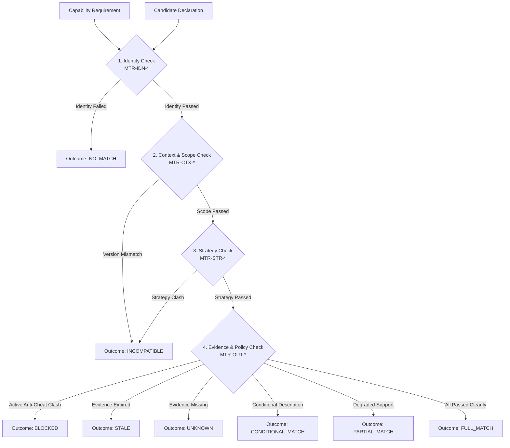

# Capability Matching Rule Catalog and Decision Tables Specification

**Document Identifier:** `NLE-CAT-MTR-001`  
**Phase:** Phase 5 — Universal Adapter SDK & Capability System  
**Step:** Step 38 of 100 — Capability Matching & Requirement Resolution Specification  
**Status:** Approved Architectural Catalog  
**Classification:** Rule Catalog, Decision Logic & Evaluation Truth Tables  
**Repository Path:** `docs/adapters/CAPABILITY_MATCHING_RULE_CATALOG_AND_DECISION_TABLES.md`  

---

## 1. Executive Summary & Rule Architecture

### 1.1 Purpose
This specification establishes the authoritative, deterministic catalog of matching rules and evaluation decision tables for comparing `CapabilityRequirement` specifications against registered `DiscoveredCapabilityRecord` candidates within the NexLudic Engine.

### 1.2 Evaluation Invariants
- **Zero Heuristic Guessing:** Matching is a formal, rule-driven evaluation. No fuzzy string matching, keyword scoring, or natural language approximations are permitted.
- **Hierarchical Gating:** Evaluation follows a strict four-layer sequence: Identity $\rightarrow$ Context/Scope $\rightarrow$ Strategy $\rightarrow$ Evidence/Policy. A failure at any gate halts progression for that candidate.

---

## 2. Capability Matching Rule Catalog

### 2.1 Identity & Taxonomy Matching Rules (`MTR-IDN-*`)

| Rule ID | Rule Name | Description | Gate / Failure Consequence |
|:---|:---|:---|:---|
| `MTR-IDN-001` | **Exact Canonical Identity Match** | Candidate `capabilityId` must match requirement `canonicalCapabilityId` character-for-character. | If mismatch and no approved substitution, evaluates to `NO_MATCH`. |
| `MTR-IDN-002` | **Approved Semantic Substitution** | If IDs differ, candidate is permitted only if an explicit substitution mapping is formally registered in `NLE-MOD-CCT-001` with approved bidirectional equivalence. | Unauthorized substitution is strictly prohibited; evaluates to `NO_MATCH`. |
| `MTR-IDN-003` | **Keyword / Display Name Ban** | Evaluator must never use title, summary, or description keywords to infer capability correspondence. | Violation triggers architectural assertion failure. |
| `MTR-IDN-004` | **Adapter Role Compatibility** | Candidate `adapterRole` (`SOURCE`, `TARGET`, `BIDIRECTIONAL`) must satisfy requirement `requiredRole`. | Mismatch evaluates to `INCOMPATIBLE` (e.g., pure `SOURCE` adapter cannot fulfill `TARGET` write requirement). |

### 2.2 Contextual & Scope Matching Rules (`MTR-CTX-*`)

| Rule ID | Rule Name | Description | Gate / Failure Consequence |
|:---|:---|:---|:---|
| `MTR-CTX-001` | **Target Game Parity** | Candidate `targetGameId` must equal requirement `targetGameId`. | Mismatch evaluates to `NO_MATCH`. |
| `MTR-CTX-002` | **SemVer Range Intersection** | Target game's installed version $V$ must satisfy $\texttt{minVersion} \le V \le \texttt{maxVersion}$ per Step 28 rules. | Version out of bounds evaluates to `INCOMPATIBLE`. |
| `MTR-CTX-003` | **Excluded Version Disqualification** | If target game version $V \in \texttt{excludedVersions}$, candidate is disqualified. | Evaluates to `INCOMPATIBLE`. Diagnostic records explicit exclusion reason. |
| `MTR-CTX-004` | **Non-Comparable Build Hash Match** | If game version uses non-SemVer build hashes (e.g., Unity build IDs), hashes must match identically. | Interpolation across non-comparable builds is forbidden; evaluates to `INCOMPATIBLE`. |
| `MTR-CTX-005` | **Platform Architecture Match** | Target platform architecture (`windows-x64`, `windows-x86`) must match candidate supported platform. | Platform mismatch evaluates to `INCOMPATIBLE`. |
| `MTR-CTX-006` | **Environment Profile Prerequisite** | If candidate requires specific mod loader (e.g., SKSE, UE4SS), host profile must verify loader presence. | Missing loader evaluates to `CONDITIONAL_MATCH` or `UNVERIFIED_ENVIRONMENT`. |

### 2.3 Integration Strategy Matching Rules (`MTR-STR-*`)

| Rule ID | Rule Name | Description | Gate / Failure Consequence |
|:---|:---|:---|:---|
| `MTR-STR-001` | **Strategy Alignment** | Candidate integration mode (`HOST_MOD`, `LIVE_BRIDGE`, `HYBRID`) must be compatible with requirement `integrationStrategy`. | Strategy conflict evaluates to `INCOMPATIBLE`. |
| `MTR-STR-002` | **Strategy Substitution Ban** | An IPC bridge cannot satisfy a host-mod requirement (or vice versa) unless `integrationStrategy: "ANY"` was requested. | Evaluates to `INCOMPATIBLE`. |

### 2.4 Evidence, Policy & Security Rules (`MTR-OUT-*`)

| Rule ID | Rule Name | Description | Gate / Failure Consequence |
|:---|:---|:---|:---|
| `MTR-OUT-001` | **Anti-Cheat Dominance (`BLK-SEC-01`)** | If target game has active anti-cheat and candidate asserts memory manipulation or hooking, candidate is barred. | Evaluates to `BLOCKED`. Severity: `CRITICAL`. |
| `MTR-OUT-002` | **Medium IL Sandbox Boundary (`REQ-SEC-001`)** | Candidate requiring administrative elevation (High IL) is barred. | Evaluates to `BLOCKED`. |
| `MTR-OUT-003` | **Evidence Maturity Floor** | Candidate `assignedVerificationState` must meet or exceed requirement `minimumEvidenceMaturity`. | If candidate is unevidenced (`DECLARED_ONLY`), evaluates to `UNKNOWN` or `PARTIAL_MATCH`. |
| `MTR-OUT-004` | **Evidence Freshness Check** | If cited evidence is expired or stale, candidate is flagged. | Evaluates to `STALE`. |
| `MTR-OUT-005` | **Conditional Description Check** | If declared support is `CONDITIONAL`, condition string must be non-empty and non-negating. | Evaluates to `CONDITIONAL_MATCH`. Condition text preserved in caveats. |
| `MTR-OUT-006` | **Degraded Support Check** | If declared support is `DEGRADED`, candidate is classified as a partial match. | Evaluates to `PARTIAL_MATCH`. Limitations recorded in match rationale. |

---

## 3. Deterministic Decision Table for Candidate Outcomes

The eight (8) mutually exclusive candidate match outcomes are resolved deterministically using the following truth table:

| Identity (`MTR-IDN`) | Scope (`MTR-CTX`) | Strategy (`MTR-STR`) | Anti-Cheat (`BLK-SEC-01`) | Support Level | Verification State | Final Candidate Match Outcome |
|:---:|:---:|:---:|:---:|:---:|:---:|:---:|
| Mismatch | Any | Any | Any | Any | Any | **`NO_MATCH`** |
| Match | Out of Bounds | Any | Any | Any | Any | **`INCOMPATIBLE`** |
| Match | In Scope | Clash | Any | Any | Any | **`INCOMPATIBLE`** |
| Match | In Scope | Aligned | **Active Clash** | Any | Any | **`BLOCKED`** |
| Match | In Scope | Aligned | Compliant | Any | `STALE` | **`STALE`** |
| Match | In Scope | Aligned | Compliant | Any | `DECLARED_ONLY` / `UNVERIFIED` | **`UNKNOWN`** |
| Match | In Scope | Aligned | Compliant | `CONDITIONAL` | Verified | **`CONDITIONAL_MATCH`** |
| Match | In Scope | Aligned | Compliant | `DEGRADED` | Verified | **`PARTIAL_MATCH`** |
| Match | In Scope | Aligned | Compliant | `SUPPORTED` | Verified ($\ge$ `CONTRACT_VERIFIED`) | **`FULL_MATCH`** |

---

## 4. Traceability and Cross-Reference Anchors

- `NLE-SPC-CMR-001`: Primary Capability Matching Specification.
- `NLE-MOD-CRM-001`: Capability Requirement Model & Input Contract.
- `NLE-MOD-CCT-001`: Canonical Capability Taxonomy.
- `NLE-MOD-CDV-001`: 7-State Verification Model.
- `docs/game-discovery/`: Step 28 Game Version & Environment Mapping rules.
- `BLK-SEC-01`: Platform Anti-Cheat Dominance Guarantee.
