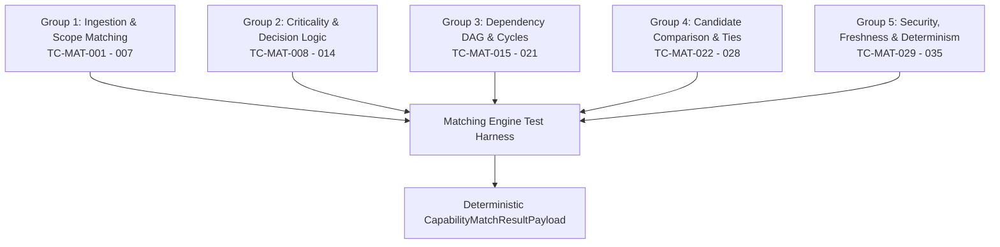

# Capability Matching Test and Traceability Plan

**Document Identifier:** `NLE-PLN-CMT-001`  
**Phase:** Phase 5 — Universal Adapter SDK & Capability System  
**Step:** Step 38 of 100 — Capability Matching & Requirement Resolution Specification  
**Status:** Approved Quality Assurance Plan  
**Classification:** Verification Test Plan & Traceability Framework  
**Repository Path:** `docs/adapters/CAPABILITY_MATCHING_TEST_AND_TRACEABILITY_PLAN.md`  

---

## 1. Executive Summary & Verification Strategy

### 1.1 Purpose
This test plan defines the formal quality assurance, verification strategy, and design-level test specifications for the Capability Matching and Requirement Resolution subsystem within the NexLudic Engine.

The objectives of this test plan are:
1. Ensure all matching rules in `NLE-CAT-MTR-001` execute deterministically and objectively.
2. Verify that Kahn's DAG algorithm detects dependency cycles and enforces prerequisite chains (`NLE-RUL-CDR-001`).
3. Confirm that multiple-candidate comparisons follow the hierarchical preference tiers without arbitrary scoring (`NLE-POL-CCR-001`).
4. Validate that the 12-question explainability standard (`NLE-CON-MRE-001`) and security boundaries (`NLE-POL-MFS-001`) are strictly upheld.

---

## 2. Test Architecture & Coverage Matrix

| Test Group | Identifier Scope | Test Count | Target Document / Specification | Primary Focus |
|:---|:---:|:---:|:---|:---|
| **Group 1: Scope Matching** | `TC-MAT-001` – `007` | 7 | `NLE-CAT-MTR-001` | Canonical identity, SemVer bounds, exclusions, build hashes, roles. |
| **Group 2: Criticality & Logic** | `TC-MAT-008` – `014` | 7 | `NLE-MOD-CRM-001`, `NLE-CAT-MTR-001` | Mandatory vs optional, conditions, alternatives, partial/unknown states. |
| **Group 3: Dependency DAG** | `TC-MAT-015` – `021` | 7 | `NLE-RUL-CDR-001` | Kahn DAG, cycles, missing prerequisites, mutual exclusions, depth limits. |
| **Group 4: Candidate Comparison** | `TC-MAT-022` – `028` | 7 | `NLE-POL-CCR-001` | Version specificity, verification maturity, tie-breaking, anti-scoring. |
| **Group 5: Security & Freshness** | `TC-MAT-029` – `035` | 7 | `NLE-POL-MFS-001` | Anti-cheat dominance, Medium IL, ReDoS, timeouts, 100% determinism. |

---

## 3. Formal Test Case Specifications

### 3.1 Group 1: Requirement Ingestion and Scope Matching Tests

#### `TC-MAT-001`: Exact Canonical Capability Identity Match (`MTR-IDN-001`)
- **Objective:** Verify candidate is matched when candidate `capabilityId` matches requirement `canonicalCapabilityId` exactly.
- **Input Fixture:** Requirement `canonicalCapabilityId: "world.environment.weather_sync"`. Candidate declares identical ID.
- **Expected Outcome:** Rule `MTR-IDN-001` passes. Identity established.
- **Pass/Fail Criteria:** PASS if exact identity match progresses to scope evaluation.
- **Traceability:** `NLE-CAT-MTR-001 Sec 2.1`.

#### `TC-MAT-002`: Approved Semantic Substitution Mapping (`MTR-IDN-002`)
- **Objective:** Verify approved substitution mapping in taxonomy is accepted.
- **Input Fixture:** Requirement specifies `world.time.time_of_day_sync`. Candidate declares `world.time.astronomy_sync` which has a registered bidirectional substitution mapping in `NLE-MOD-CCT-001`.
- **Expected Outcome:** Rule `MTR-IDN-002` passes with advisory substitution caveat.
- **Pass/Fail Criteria:** PASS if candidate is matched with explicit substitution note in match rationale.
- **Traceability:** `NLE-CAT-MTR-001 Sec 2.1`.

#### `TC-MAT-003`: Rejection of Unapproved Keyword Similarity (`MTR-IDN-003`)
- **Objective:** Reject match when IDs differ and no taxonomy mapping exists, even if descriptions share identical keywords.
- **Input Fixture:** Requirement `world.physics.gravity_scale`. Candidate `world.spatial.scale_sync` with identical description "adjusts game world scale".
- **Expected Outcome:** Rule `MTR-IDN-003` enforces rejection. Outcome: `NO_MATCH`.
- **Pass/Fail Criteria:** PASS if fuzzy matching / keyword similarity is strictly prevented.
- **Traceability:** `NLE-CAT-MTR-001 Sec 2.1`.

#### `TC-MAT-004`: Adapter Role Compatibility Check (`MTR-IDN-004`)
- **Objective:** Detect when adapter declared role cannot satisfy requirement required role.
- **Input Fixture:** Requirement specifies `requiredRole: "TARGET"` (write capability). Candidate adapter declares `adapterRole: "SOURCE"` (read only).
- **Expected Outcome:** Rule `MTR-IDN-004` fails. Candidate outcome: `INCOMPATIBLE`.
- **Pass/Fail Criteria:** PASS if pure read adapter is rejected for write requirement.
- **Traceability:** `NLE-CAT-MTR-001 Sec 2.1`.

#### `TC-MAT-005`: SemVer Range Inclusion Match (`MTR-CTX-002`)
- **Objective:** Confirm version match when target installed version falls within candidate range.
- **Input Fixture:** Candidate supports `minVersion: "1.5.0", maxVersion: "1.6.640"`. Installed version is `1.6.318`.
- **Expected Outcome:** Rule `MTR-CTX-002` passes. Scope match confirmed.
- **Pass/Fail Criteria:** PASS if candidate progresses to strategy evaluation.
- **Traceability:** `NLE-CAT-MTR-001 Sec 2.2`.

#### `TC-MAT-006`: Excluded Version Disqualification (`MTR-CTX-003`)
- **Objective:** Disqualify candidate when target version matches range but is explicitly listed in `excludedVersions`.
- **Input Fixture:** Scope is `1.5.0` to `1.6.640`, with `excludedVersions: ["1.6.318"]`. Installed version is `1.6.318`.
- **Expected Outcome:** Rule `MTR-CTX-003` disqualifies candidate. Outcome: `INCOMPATIBLE`. Exclusion reason: `"Version explicitly excluded due to known memory regression"`.
- **Pass/Fail Criteria:** PASS if excluded version is rejected immediately.
- **Traceability:** `NLE-CAT-MTR-001 Sec 2.2`.

#### `TC-MAT-007`: Non-Comparable Build Hash Exact Match (`MTR-CTX-004`)
- **Objective:** Verify non-SemVer build hashes require 100% exact equality.
- **Input Fixture:** Installed game version is Unity build hash `a1b2c3d4`. Candidate specifies supported build `a1b2c3d4`.
- **Expected Outcome:** Rule `MTR-CTX-004` passes.
- **Pass/Fail Criteria:** PASS if candidate with hash `a1b2c3d5` is rejected with `INCOMPATIBLE`.
- **Traceability:** `NLE-CAT-MTR-001 Sec 2.2`.

---

### 3.2 Group 2: Criticality, Alternatives, and Decision Logic Tests

#### `TC-MAT-008`: Mandatory Requirement Dominance
- **Objective:** Verify that an unresolved mandatory requirement prevents overall project resolution.
- **Input Fixture:** Requirement set with 9 optional requirements resolved and 1 mandatory requirement unresolved.
- **Expected Outcome:** Overall state: `UNRESOLVED_MANDATORY_GAPS`. `summaryMetrics.allMandatoryResolved: false`.
- **Pass/Fail Criteria:** PASS if optional resolution cannot mask mandatory failure.
- **Traceability:** `NLE-SPC-CMR-001 Sec 4`.

#### `TC-MAT-009`: Optional Requirement Failure Isolation
- **Objective:** Ensure optional requirement failure does not invalidate overall mashup resolution.
- **Input Fixture:** All mandatory requirements resolved; 1 optional requirement has 0 candidates.
- **Expected Outcome:** Overall state: `FULLY_RESOLVED` (or `RESOLVED_WITH_LIMITATIONS`). Optional requirement status: `UNRESOLVED_OPTIONAL`.
- **Pass/Fail Criteria:** PASS if mashup remains feasible without optional feature.
- **Traceability:** `NLE-MOD-CRM-001 Sec 2.1`.

#### `TC-MAT-010`: Conditional Requirement Deactivation
- **Objective:** Verify conditional requirement evaluates to `NOT_APPLICABLE` when condition is false.
- **Input Fixture:** Requirement with `conditionExpression: "hasDLC(Dawnguard)"`. Host profile indicates Dawnguard is absent.
- **Expected Outcome:** Resolution status: `NOT_APPLICABLE`. Excluded from mandatory gap count.
- **Pass/Fail Criteria:** PASS if unmet condition does not block overall resolution.
- **Traceability:** `NLE-MOD-CRM-001 Sec 2.1`.

#### `TC-MAT-011`: Disjunctive Alternative Branch Resolution
- **Objective:** Confirm requirement with `criticality: "ALTERNATIVE"` resolves if any one alternative matches.
- **Input Fixture:** Alternative group with Path A (Hook) and Path B (File Watcher). Path A is blocked; Path B is fully matched.
- **Expected Outcome:** Requirement resolves successfully via Path B.
- **Pass/Fail Criteria:** PASS if single resolved alternative branch satisfies requirement.
- **Traceability:** `NLE-MOD-CRM-001 Sec 2.1`.

#### `TC-MAT-012`: Degraded Support Partial Match Assignment (`MTR-OUT-006`)
- **Objective:** Assign `PARTIAL_MATCH` when candidate declared support is `DEGRADED`.
- **Input Fixture:** Candidate declared support level is `DEGRADED` with note "only syncs rain and clear weather".
- **Expected Outcome:** Candidate outcome: `PARTIAL_MATCH`. Requirement resolution: `RESOLVED_WITH_LIMITATIONS`.
- **Pass/Fail Criteria:** PASS if limitations are preserved in match caveats.
- **Traceability:** `NLE-CAT-MTR-001 Sec 2.4`.

#### `TC-MAT-013`: Conditional Description Match Assignment (`MTR-OUT-005`)
- **Objective:** Assign `CONDITIONAL_MATCH` when declared support is `CONDITIONAL`.
- **Input Fixture:** Candidate support is `CONDITIONAL` with description "requires host game borderless window mode".
- **Expected Outcome:** Candidate outcome: `CONDITIONAL_MATCH`. Caveats record condition string.
- **Pass/Fail Criteria:** PASS if condition is surfaced in `nextSafeAction`.
- **Traceability:** `NLE-CAT-MTR-001 Sec 2.4`.

#### `TC-MAT-014`: Unevidenced Declaration Downgrade (`MTR-OUT-003`)
- **Objective:** Ensure unevidenced declaration (`DECLARED_ONLY`) evaluates to `UNKNOWN` when empirical evidence is requested.
- **Input Fixture:** Requirement specifies `minimumEvidenceMaturity: "CONTRACT_VERIFIED"`. Candidate is `DECLARED_ONLY`.
- **Expected Outcome:** Candidate outcome: `UNKNOWN`. Requirement resolution: `UNRESOLVED`.
- **Pass/Fail Criteria:** PASS if unevidenced claims cannot satisfy verified requirements.
- **Traceability:** `NLE-CAT-MTR-001 Sec 2.4`.

---

### 3.3 Group 3: Dependency Resolution and Cycle Detection Tests

#### `TC-MAT-015`: Multi-Tier Dependency DAG Resolution
- **Objective:** Verify successful resolution of a 3-tier linear dependency chain (A $\rightarrow$ B $\rightarrow$ C).
- **Input Fixture:** Candidate A requires B; Candidate B requires C; C has 0 dependencies. All candidates exist and match.
- **Expected Outcome:** Dependency graph resolved. Kahn topological order: `[C, B, A]`. Candidate A outcome: `FULL_MATCH`.
- **Pass/Fail Criteria:** PASS if all prerequisites are verified and ordered topologically.
- **Traceability:** `NLE-RUL-CDR-001 Sec 3`.

#### `TC-MAT-016`: Missing Mandatory Prerequisite Demotion
- **Objective:** Demote candidate match outcome when a mandatory prerequisite cannot be resolved.
- **Input Fixture:** Candidate A requires Capability B. No candidate in registry matches Capability B.
- **Expected Outcome:** Candidate A outcome demoted to `CONDITIONAL_MATCH` (unresolved prerequisite).
- **Pass/Fail Criteria:** PASS if missing prerequisite halts full resolution.
- **Traceability:** `NLE-RUL-CDR-001 Sec 2.1`.

#### `TC-MAT-017`: Missing Optional Enhancement Isolation
- **Objective:** Confirm missing `ENHANCES` dependency does not demote candidate from `FULL_MATCH`.
- **Input Fixture:** Candidate A enhances with Capability C. Capability C has 0 candidates.
- **Expected Outcome:** Candidate A remains `FULL_MATCH`. Match rationale notes enhancement is disabled.
- **Pass/Fail Criteria:** PASS if optional enhancement failure does not compromise core match.
- **Traceability:** `NLE-RUL-CDR-001 Sec 2.1`.

#### `TC-MAT-018`: Mutual Exclusion Conflict Rejection (`CONFLICTS_WITH`)
- **Objective:** Disqualify candidate when a mutually exclusive capability is already active in the project.
- **Input Fixture:** Candidate A declares `CONFLICTS_WITH: ["capability.hook.memory_injector"]`. Injected hook is active.
- **Expected Outcome:** Candidate A outcome: `INCOMPATIBLE`. Diagnostic flags mutual exclusion.
- **Pass/Fail Criteria:** PASS if conflicting candidate is barred.
- **Traceability:** `NLE-RUL-CDR-001 Sec 2.1`.

#### `TC-MAT-019`: Dependency Cycle Detection via Kahn's Algorithm
- **Objective:** Detect and reject a circular dependency chain ($A \rightarrow B \rightarrow C \rightarrow A$).
- **Input Fixture:** Tri-node cyclic dependency manifest set.
- **Expected Outcome:** Kahn's algorithm halts. Cycle detected: `[A, B, C, A]`. All candidates assigned `BLOCKED` with `ERR_CYCLIC_DEPENDENCY`.
- **Pass/Fail Criteria:** PASS if circular graph is aborted without infinite loop.
- **Traceability:** `NLE-RUL-CDR-001 Sec 3.1`.

#### `TC-MAT-020`: Recursion Depth Ceiling Enforcement (10 Levels)
- **Objective:** Abort traversal when dependency chain exceeds 10 levels.
- **Input Fixture:** Synthetic linear dependency chain of 11 consecutive nodes ($A_1 \rightarrow A_2 \rightarrow \dots \rightarrow A_{11}$).
- **Expected Outcome:** Traversal halts at level 10 with `ERR_DEPENDENCY_DEPTH_EXCEEDED`. Candidate flagged `BLOCKED`.
- **Pass/Fail Criteria:** PASS if recursion depth limit prevents call stack exhaustion.
- **Traceability:** `NLE-RUL-CDR-001 Sec 3.1`.

#### `TC-MAT-021`: Downward Invalidation Propagation
- **Objective:** Verify that revoking prerequisite B immediately invalidates dependent A.
- **Execution:** Candidate A initially `FULL_MATCH` based on B. Prerequisite B is transitioned to `WITHDRAWN`.
- **Expected Outcome:** Invalidation cascades. Candidate A demoted to `UNRESOLVED`. Diagnostic records root cause.
- **Pass/Fail Criteria:** PASS if downstream dependent is invalidated immediately.
- **Traceability:** `NLE-RUL-CDR-001 Sec 4`.

---

### 3.4 Group 4: Candidate Comparison, Multi-Candidate Selection, and Ties

#### `TC-MAT-022`: Target Version Specificity Preference (Tier 1)
- **Objective:** Select candidate with exact version match over candidate with broad SemVer range.
- **Input Fixture:** Candidate 1 supports exact build `1.6.640`. Candidate 2 supports range `1.5.0` to `1.6.640`. Installed is `1.6.640`.
- **Expected Outcome:** Candidate 1 ranked higher. Selected as preferred candidate.
- **Pass/Fail Criteria:** PASS if exact build match takes precedence.
- **Traceability:** `NLE-POL-CCR-001 Sec 3`.

#### `TC-MAT-023`: Verification State Maturity Preference (Tier 2)
- **Objective:** Select `EMPIRICALLY_VALIDATED` candidate over `DECLARED_ONLY` candidate.
- **Input Fixture:** Both candidates support identical versions. Candidate 1 is `EMPIRICALLY_VALIDATED`; Candidate 2 is `DECLARED_ONLY`.
- **Expected Outcome:** Candidate 1 selected as preferred candidate.
- **Pass/Fail Criteria:** PASS if empirical verification dominates unevidenced declaration.
- **Traceability:** `NLE-POL-CCR-001 Sec 3`.

#### `TC-MAT-024`: Dependency Footprint Preference (Tier 3)
- **Objective:** Prefer candidate with 0 external dependencies over candidate requiring 3 external tools.
- **Input Fixture:** Both candidates verified. Candidate 1 has 0 dependencies; Candidate 2 requires SKSE, AddressLibrary, and SkyUI.
- **Expected Outcome:** Candidate 1 selected due to smaller dependency footprint.
- **Pass/Fail Criteria:** PASS if lower configuration fragility is preferred.
- **Traceability:** `NLE-POL-CCR-001 Sec 3`.

#### `TC-MAT-025`: Privilege Level Preference (Tier 4)
- **Objective:** Prefer non-invasive IPC bridge over native process hooking injector.
- **Input Fixture:** Candidate 1 is IPC bridge (`HOST_MOD` via file/socket); Candidate 2 uses native memory hooking.
- **Expected Outcome:** Candidate 1 selected; Candidate 2 ranked lower due to higher intrusion level.
- **Pass/Fail Criteria:** PASS if least intrusive integration mechanism is preferred.
- **Traceability:** `NLE-POL-CCR-001 Sec 3`.

#### `TC-MAT-026`: Deterministic Tie-Breaking with Multiple Qualified Candidates
- **Objective:** When two candidates are identically qualified across all tiers, flag multiple alternatives without picking an arbitrary winner.
- **Input Fixture:** Two independent adapters with identical version scopes, verified evidence, zero dependencies, and IPC modes.
- **Expected Outcome:** Status: `RESOLVED_MULTIPLE_ALTERNATIVES`. Both candidates returned with trade-off comparison.
- **Pass/Fail Criteria:** PASS if engine refrains from making an arbitrary choice.
- **Traceability:** `NLE-POL-CCR-001 Sec 4.1`.

#### `TC-MAT-027`: Disqualified Candidate Exclusion Register Auditability
- **Objective:** Ensure disqualified candidates are preserved in `excludedCandidates` array with clear diagnostic codes.
- **Input Fixture:** Candidate disqualified due to version mismatch (`MTR-CTX-002`).
- **Expected Outcome:** Candidate recorded in `excludedCandidates` with diagnostic code and human-readable explanation.
- **Pass/Fail Criteria:** PASS if disqualified candidate is not silently erased.
- **Traceability:** `NLE-POL-CCR-001 Sec 5`.

#### `TC-MAT-028`: Absolute Ban on Arbitrary Numerical Scoring
- **Objective:** Verify result payload contains zero synthetic percentage scores.
- **Execution:** Inspect emitted `CapabilityMatchResultPayload`.
- **Expected Outcome:** Zero instances of percentage scores (e.g., "87%"). All metrics are discrete counts (`mandatoryResolved`, `mandatoryUnresolved`).
- **Pass/Fail Criteria:** PASS if anti-scoring invariant is 100% maintained.
- **Traceability:** `NLE-POL-CCR-001 Sec 1.2`.

---

### 3.5 Group 5: Security, Freshness, Performance, and Determinism Tests

#### `TC-MAT-029`: Anti-Cheat Dominance Rejection (`BLK-SEC-01`, `MTR-OUT-001`)
- **Objective:** Enforce immediate `BLOCKED` outcome for memory hooking on games with active anti-cheat.
- **Input Fixture:** Target game has `antiCheatActive: true`. Candidate declares memory manipulation capability.
- **Expected Outcome:** Candidate outcome: `BLOCKED`. Diagnostic: `MTR-OUT-001`. Severity: `CRITICAL`.
- **Pass/Fail Criteria:** PASS if anti-cheat clash is blocked unconditionally.
- **Traceability:** `NLE-CAT-MTR-001 Sec 2.4`, `BLK-SEC-01`.

#### `TC-MAT-030`: Windows Medium Integrity Level Boundary Enforcement (`REQ-SEC-001`)
- **Objective:** Bar candidates declaring requirement for Administrator / High IL privileges.
- **Input Fixture:** Candidate declares `"requiredPrivilegeLevel": "ADMINISTRATOR"`.
- **Expected Outcome:** Candidate outcome: `BLOCKED`. Diagnostic: `MTR-OUT-002`.
- **Pass/Fail Criteria:** PASS if privilege elevation requests are rejected.
- **Traceability:** `DEC-002`, `REQ-SEC-001`.

#### `TC-MAT-031`: HTML / Script Tag Sanitization in Match Explanations
- **Objective:** Ensure description fields containing ``.
- **Expected Outcome:** Script tag stripped or rejected with `VLD-SEC-004`. Emitted finding is clean plaintext.
- **Pass/Fail Criteria:** PASS if unescaped HTML tags never appear in output JSON.
- **Traceability:** `NLE-POL-MFS-001 Sec 3.1`.

#### `TC-MAT-032`: Matching Execution Timeout Ceiling (2,000ms Limit)
- **Objective:** Abort matching evaluation cleanly if processing exceeds 2,000ms.
- **Input Fixture:** Synthetic fixture simulating stalled network/disk resolver during discovery query.
- **Expected Outcome:** Evaluation halts at 2,000ms with `ERR_MATCHING_TIMEOUT`. Emits partial result payload.
- **Pass/Fail Criteria:** PASS if execution times out cleanly without worker hang.
- **Traceability:** `NLE-POL-MFS-001 Sec 3.2`.

#### `TC-MAT-033`: Incremental Reassessment on Game Patch (`TRG-MAT-003`)
- **Objective:** Verify that detecting a new game patch invalidates version-constrained matches while preserving unaffected matches.
- **Execution:** Game patched from 1.5.97 to 1.6.640. Candidate A (maxVersion 1.5.97) invalidated. Candidate B (maxVersion 1.7.0) preserved.
- **Expected Outcome:** Candidate A transitions to `INCOMPATIBLE`. Candidate B remains `FULL_MATCH`.
- **Pass/Fail Criteria:** PASS if fine-grained incremental reassessment operates correctly.
- **Traceability:** `NLE-POL-MFS-001 Sec 2.1`.

#### `TC-MAT-034`: Evidence Expiration Confidence Downgrade (`TRG-MAT-004`)
- **Objective:** Confirm evidence record expiration downgrades candidate from `FULL_MATCH` to `UNKNOWN`.
- **Execution:** Cited evidence `EVD-2026-0001` reaches expiration horizon. Re-evaluate requirement.
- **Expected Outcome:** Candidate outcome transitions to `UNKNOWN`. Caveats note expired evidence.
- **Pass/Fail Criteria:** PASS if absence of active evidence is transparently disclosed.
- **Traceability:** `NLE-POL-MFS-001 Sec 2.1`.

#### `TC-MAT-035`: 100% Deterministic Repeatability Verification
- **Objective:** Verify evaluating identical requirement set 100 consecutive times yields byte-identical output payloads.
- **Execution:** Run matching engine 100 times in loop with identical inputs.
- **Expected Outcome:** All 100 emitted JSON strings have identical SHA-256 hashes (excluding unique `requestId` and timestamp).
- **Pass/Fail Criteria:** PASS if 100% deterministic repeatability is verified.
- **Traceability:** `NLE-SPC-CMR-001 Sec 4`.

---

## 4. Traceability and Cross-Reference Anchors

- `NLE-SPC-CMR-001`: Primary Capability Matching Specification.
- `NLE-MOD-CRM-001`: Capability Requirement Model & Input Contract.
- `NLE-CAT-MTR-001`: Matching Rule Catalog & Decision Tables.
- `NLE-RUL-CDR-001`: Capability Dependency Resolution & Composition Rules.
- `NLE-POL-CCR-001`: Candidate Comparison & Resolution Policy.
- `NLE-CON-MRE-001`: Match Result & Explainability Contract.
- `NLE-POL-MFS-001`: Freshness, Security & Failure Policy.
