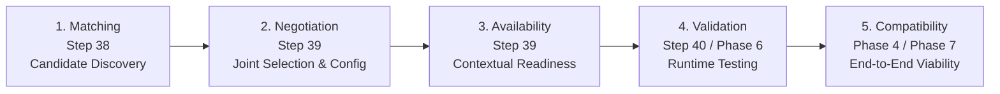
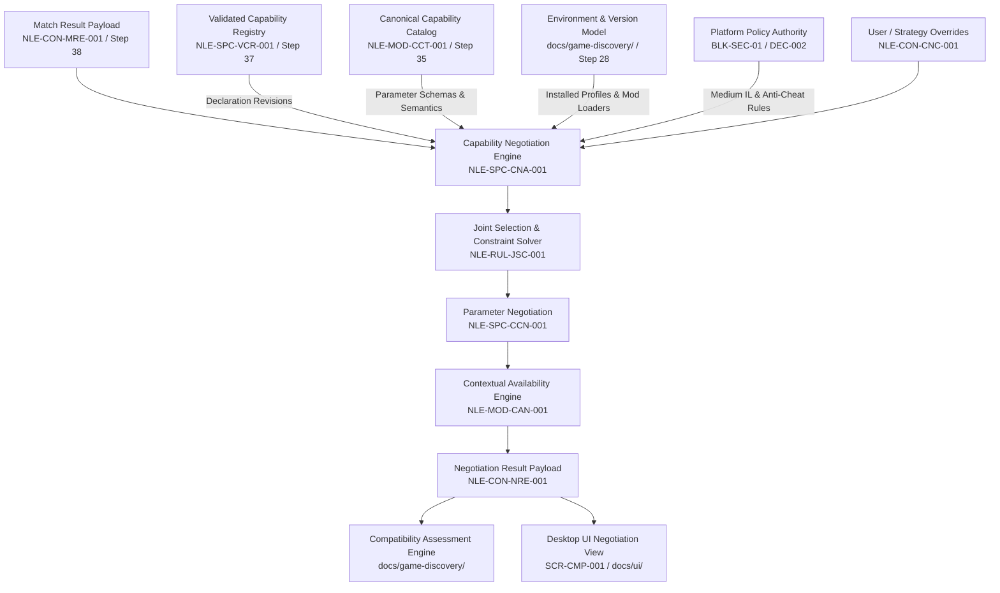
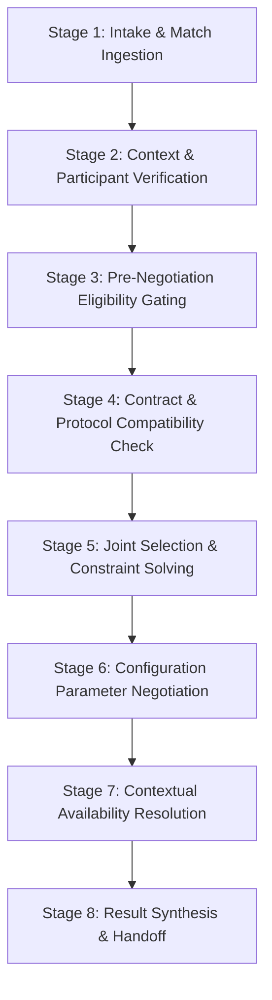

# Capability Negotiation and Contextual Availability Resolution Specification

**Document Identifier:** `NLE-SPC-CNA-001`  
**Phase:** Phase 5 — Universal Adapter SDK & Capability System  
**Step:** Step 39 of 100 — Capability Negotiation & Contextual Availability Resolution Specification  
**Status:** Approved Architectural Specification  
**Classification:** Universal Core Specification & Negotiation Protocol  
**Repository Path:** `docs/adapters/CAPABILITY_NEGOTIATION_AND_AVAILABILITY_RESOLUTION_SPECIFICATION.md`  

---

## 1. Executive Summary & Purpose

### 1.1 Purpose
This specification establishes the authoritative architecture, data contracts, and constraint-resolution protocols for the **Capability Negotiation and Contextual Availability Resolution Subsystem** within the NexLudic Engine.

While Step 38 (*Capability Matching*) evaluated whether individual candidate adapter declarations corresponded to isolated capability requirements, Step 39 determines whether a proposed ensemble of matched capabilities can be **jointly selected**, **parameter-configured**, and **contextually realized** for a specific game pair and local environment without contradiction, resource collision, or security violations.

### 1.2 The Five-Tier Lifecycle Separation Invariant
To prevent unearned confidence and deceptive compatibility reporting, the platform strictly segregates the five phases of capability resolution:

1. **Matching (Step 38):** Identifies candidate declarations that declare individual capability requirements under stated constraints.
2. **Negotiation (Step 39):** Determines whether matched candidates can be selected together across participants, reconciling protocol versions, shared resources, and parameter configurations without conflict.
3. **Contextual Availability Resolution (Step 39):** Determines whether the required local environment conditions (installed game builds, mod loaders, framework dependencies, system profiles) are satisfied to make the negotiated configuration operationally available.
4. **Runtime Validation (Step 40 / Phase 6):** Dynamically verifies that running adapter processes perform the requested operations correctly under test harnesses.
5. **End-to-End Compatibility Assessment (Phase 4 / Phase 7):** Determines whether the complete cross-game mashup achieves overall functional, aesthetic, and gameplay success.

**A successful negotiation and availability resolution confirms solely that a compatible, coherent capability configuration has been established for the current context. It does NOT prove runtime behavior, does NOT grant execution authorization, and does NOT certify overall mashup success.**

---

## 2. Architectural Positioning & Subsystem Boundaries

The capability negotiation subsystem operates downstream of Capability Matching (Step 38) and upstream of Cross-Adapter Runtime Orchestration (Step 40) and Compatibility Reporting (Step 32):

### 2.1 Subsystem Source-of-Truth Matrix

| Subsystem Domain | Primary Document | Authority & Data Owned | Boundary / Explicitly Excluded Authority |
|:---|:---|:---|:---|
| **Capability Matching Subsystem** | `NLE-SPC-CMR-001` | Candidate declaration correspondence to isolated requirements. | Does not evaluate joint composition or parameter configuration. |
| **Capability Registry & Discovery** | `NLE-SPC-VCR-001` | Authoritative declaration records, lifecycle states, discovery queries. | Does not resolve multi-adapter conflicts or negotiate parameters. |
| **Canonical Capability Catalog** | `NLE-MOD-CCT-001` | Canonical capability definitions, parameter schemas, taxonomy. | Does not track adapter combinations or local host configurations. |
| **Capability Negotiation Subsystem** | `NLE-SPC-CNA-001` | Joint candidate selection, contract parity, parameter resolution, availability. | **Does not launch adapters; does not execute code; does not grant permissions.** |
| **Message Protocol & IPC** | `docs/architecture/` (`NLE-MSG-PRT-001`) | Message envelope formats, channel transports, framing. | Does not decide which capabilities should be enabled. |
| **Security & Platform Policy** | `docs/architecture/` (`BLK-SEC-01`, `DEC-002`) | Windows Medium IL boundary, UAC denial, Anti-cheat dominance. | Does not author capability requirements or resolve parameters. |

---

## 3. End-to-End Negotiation & Availability Workflow

The negotiation process executes an eight-stage deterministic pipeline:

### 3.1 Pipeline Stages

| Stage | Name | Description | Gate / Failure Consequence |
|:---:|:---|:---|:---|
| **1** | **Intake & Match Ingestion** | Ingests `CapabilityMatchingRequest` and `CapabilityMatchResultPayload` (`NLE-CON-MRE-001`). Verifies input hash integrity. | Rejects stale, cancelled, or missing matching inputs (`ERR_STALE_MATCH_RESULT`). |
| **2** | **Context & Participant Verification** | Identifies target game pair, installed builds, participant adapter declarations, and requested integration strategy. | Halts if participant declarations cannot be resolved from registry. |
| **3** | **Eligibility Gating** | Confirms participant declarations are `ACTIVE` or `ACTIVE_WITH_LIMITATIONS` and pass platform security policies. | Ineligible participants trigger `INELIGIBLE_CANDIDATE` diagnostic. |
| **4** | **Contract & Protocol Parity** | Reconciles SDK versions, capability schema revisions, and message protocol versions (`NLE-SPC-CCN-001`). | Incompatible major contract versions trigger `INCOMPATIBLE_CONTRACT`. |
| **5** | **Joint Constraint Solving** | Evaluates mutual exclusions, shared memory locks, and cross-game coordination rules (`NLE-RUL-JSC-001`). | Unresolvable resource collisions trigger `MUTUAL_EXCLUSION_CONFLICT`. |
| **6** | **Parameter Negotiation** | Intersects capability parameter ranges, resolves defaults, and validates unit normalizations (`NLE-SPC-CCN-001`). | Disjoint parameter constraints trigger `UNRESOLVED_CONFIGURATION`. |
| **7** | **Availability Resolution** | Evaluates local environment facts (mod loaders, runtimes, file permissions) to assign contextual availability states (`NLE-MOD-CAN-001`). | Missing environment prerequisites assign `UNAVAILABLE` or `CONDITIONALLY_AVAILABLE`. |
| **8** | **Synthesis & Handoff** | Assembles `CapabilityNegotiationResultPayload` (`NLE-CON-NRE-001`) with explicit limitations, caveats, and next safe actions. | Outputs structured machine-readable result payload for downstream consumption. |

---

## 4. Fundamental Negotiation Invariants

1. **No Forced Resolution:** Mandatory requirements (`MANDATORY`) cannot be weakened, omitted, or reclassified to achieve a successful outcome. If a mandatory capability cannot be jointly selected or configured, the negotiation outcome is strictly `UNRESOLVED` or `INCOMPATIBLE`.
2. **Approved Parameter Scope Only:** Configuration negotiation is strictly bounded to configurable parameters explicitly defined in canonical capability schemas (`NLE-MOD-CCT-001`). Adapters cannot introduce arbitrary unvetted configuration keys.
3. **Non-Self-Elevation:** An adapter cannot broaden its permissions, bypass anti-cheat restrictions (`BLK-SEC-01`), or alter platform security levels through proposed configuration values.
4. **Deterministic Repeatability:** Equivalent input context snapshots, identical matching inputs, and identical rule catalogs yield byte-identical negotiation result payloads.
5. **Traceable Provenance:** Every negotiated capability record references the exact `registryRecordId`, `manifestSha256`, requirement ID, parameter values, and rule catalog revision that authorized it.

---

## 5. Traceability and Cross-Reference Anchors

- `NLE-SPC-CMR-001`: Capability Matching Specification (Upstream Input).
- `NLE-MOD-CRM-001`: Capability Requirement Model & Input Contract.
- `NLE-CON-MRE-001`: Capability Match Result & Explainability Contract.
- `NLE-SPC-VCR-001`: Validated Capability Declaration Registry.
- `NLE-MOD-CCT-001`: Canonical Capability Taxonomy & Parameter Contracts.
- `docs/game-discovery/`: Step 28 Game Version & Environment Mapping.
- `ADR-0002`: Out-of-Process Adapter Execution Mode.
- `DEC-002`: Windows Medium Integrity Level.
- `BLK-SEC-01`: Platform Anti-Cheat Dominance Guarantee.
