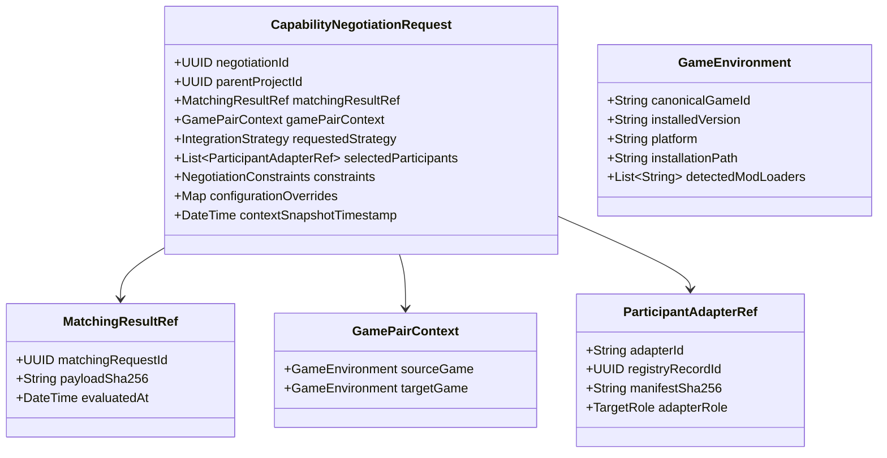

# Capability Negotiation Context and Input Contract Specification

**Document Identifier:** `NLE-CON-CNC-001`  
**Phase:** Phase 5 — Universal Adapter SDK & Capability System  
**Step:** Step 39 of 100 — Capability Negotiation & Contextual Availability Resolution Specification  
**Status:** Approved Architectural Contract  
**Classification:** Input Data Schema, Context Modeling & Participant Specification  
**Repository Path:** `docs/adapters/CAPABILITY_NEGOTIATION_CONTEXT_AND_INPUT_CONTRACT.md`  

---

## 1. Executive Summary & Purpose

### 1.1 Purpose
This specification establishes the formal input contract and context model for initiating a capability negotiation and contextual availability evaluation within the NexLudic Engine.

The `CapabilityNegotiationRequest` encapsulates:
1. An immutable reference to an upstream `CapabilityMatchResultPayload` (`NLE-CON-MRE-001`).
2. The specific local environment context for the target game pair (installed game versions, mod loaders, script runtimes).
3. The proposed participant adapter declarations and their cryptographic revision hashes.
4. User-selected or strategy-mandated configuration constraints and overrides.

---

## 2. Negotiation Context Entity & Participant Architecture

A negotiation evaluation operates over a strictly bounded, revision-aware context snapshot:



### 2.1 Context Immutability & Hash Binding
To guarantee deterministic execution, the negotiation engine binds to the exact binary state of its inputs:
- If the on-disk manifest of any participant adapter diverges from `manifestSha256`, the request is rejected with `ERR_MANIFEST_REVISION_MISMATCH`.
- If the upstream matching payload hash diverges from `payloadSha256`, the request is rejected with `ERR_STALE_MATCH_RESULT`.
- The negotiation context remains an immutable snapshot throughout evaluation. Any runtime file watcher event occurring during evaluation triggers a clean restart rather than mid-flight mutation.

---

## 3. Formal JSON Schema (`NLE-SCH-CNR-001`)

```json
{
  "$schema": "https://json-schema.org/draft/2020-12/schema",
  "$id": "https://schemas.nexludic.internal/v1/capability-negotiation-request.json",
  "title": "CapabilityNegotiationRequest",
  "description": "Input payload submitting candidate adapter declarations and local environment context for capability negotiation.",
  "type": "object",
  "required": [
    "negotiationId",
    "parentProjectId",
    "matchingResultRef",
    "gamePairContext",
    "requestedStrategy",
    "selectedParticipants",
    "contextSnapshotTimestamp"
  ],
  "properties": {
    "negotiationId": {
      "type": "string",
      "format": "uuid"
    },
    "parentProjectId": {
      "type": "string",
      "format": "uuid"
    },
    "matchingResultRef": {
      "type": "object",
      "required": ["matchingRequestId", "payloadSha256", "evaluatedAt"],
      "properties": {
        "matchingRequestId": { "type": "string", "format": "uuid" },
        "payloadSha256": { "type": "string", "pattern": "^[a-f0-9]{64}$" },
        "evaluatedAt": { "type": "string", "format": "date-time" }
      }
    },
    "gamePairContext": {
      "type": "object",
      "required": ["sourceGame", "targetGame"],
      "properties": {
        "sourceGame": { "$ref": "#/$defs/GameEnvironmentSnapshot" },
        "targetGame": { "$ref": "#/$defs/GameEnvironmentSnapshot" }
      }
    },
    "requestedStrategy": {
      "type": "string",
      "enum": ["HOST_MOD", "LIVE_BRIDGE", "HYBRID"]
    },
    "selectedParticipants": {
      "type": "array",
      "minItems": 1,
      "items": { "$ref": "#/$defs/ParticipantAdapterRef" }
    },
    "negotiationConstraints": {
      "type": "object",
      "properties": {
        "enforceStrictContractParity": { "type": "boolean", "default": true },
        "allowGracefulDegradation": { "type": "boolean", "default": true },
        "maxMemoryBudgetMb": { "type": "integer", "default": 1024 },
        "maxLatencyBudgetMs": { "type": "integer", "default": 16 }
      }
    },
    "configurationOverrides": {
      "type": "object",
      "additionalProperties": true
    },
    "contextSnapshotTimestamp": {
      "type": "string",
      "format": "date-time"
    }
  },
  "additionalProperties": false,
  "$defs": {
    "GameEnvironmentSnapshot": {
      "type": "object",
      "required": ["canonicalGameId", "installedVersion", "platform", "installationPath"],
      "properties": {
        "canonicalGameId": { "type": "string", "pattern": "^[a-z0-9_]+(\\.[a-z0-9_]+)+$" },
        "installedVersion": { "type": "string" },
        "installedBuildId": { "type": ["string", "null"] },
        "platform": { "type": "string", "enum": ["windows-x64", "windows-x86"] },
        "installationPath": { "type": "string" },
        "detectedModLoaders": {
          "type": "array",
          "items": { "type": "string" }
        },
        "environmentProfile": { "type": "string" }
      }
    },
    "ParticipantAdapterRef": {
      "type": "object",
      "required": ["adapterId", "registryRecordId", "manifestSha256", "adapterRole"],
      "properties": {
        "adapterId": { "type": "string", "pattern": "^[a-z0-9_]+(\\.[a-z0-9_]+)+$" },
        "registryRecordId": { "type": "string", "format": "uuid" },
        "manifestSha256": { "type": "string", "pattern": "^[a-f0-9]{64}$" },
        "adapterRole": { "type": "string", "enum": ["SOURCE", "TARGET", "BIDIRECTIONAL"] }
      }
    }
  }
}
```

---

## 4. Traceability and Cross-Reference Anchors

- `NLE-SPC-CNA-001`: Primary Capability Negotiation Specification.
- `NLE-CON-MRE-001`: Capability Match Result & Explainability Contract.
- `NLE-MOD-RRM-001`: Registry Record & Discovery Schemas.
- `docs/game-discovery/`: Step 28 Game Version & Environment Mapping.
- `DEC-002`, `DEC-009`: Windows Medium IL and Volume D Project Anchoring.
