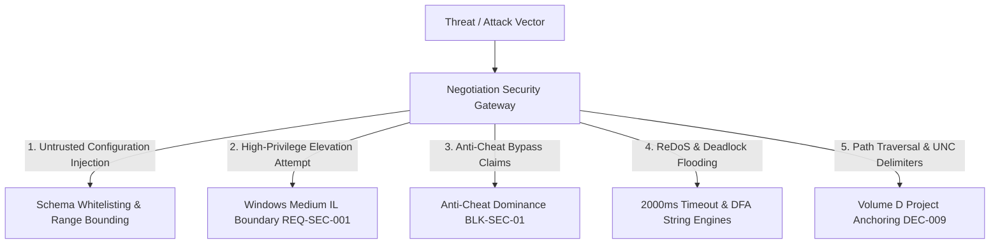

# Capability Negotiation Security, Failure, and Recovery Policy

**Document Identifier:** `NLE-POL-NSF-001`  
**Phase:** Phase 5 — Universal Adapter SDK & Capability System  
**Step:** Step 39 of 100 — Capability Negotiation & Contextual Availability Resolution Specification  
**Status:** Approved Platform Policy  
**Classification:** Security Architecture, Sandboxing & 30-Scenario Failure Protocol  
**Repository Path:** `docs/adapters/CAPABILITY_NEGOTIATION_SECURITY_FAILURE_AND_RECOVERY_POLICY.md`  

---

## 1. Executive Summary & Security Objectives

### 1.1 Purpose
This policy establishes the formal security constraints, sandboxing rules, untrusted input defenses, resource ceilings, and recovery protocols for the Capability Negotiation Subsystem within the NexLudic Engine.

The negotiation engine operates strictly as a decision-support and constraint-resolution service. It does not launch games, execute adapter binaries, or grant elevated system privileges. This specification ensures that hostile configuration payloads, corrupted dependencies, or resource deadlocks cannot compromise host security or produce deceptive compatibility findings.

---

## 2. Threat Model & Security Boundaries

### 2.1 Defense Matrix

| Threat Vector | Attack Scenario | Enforced Countermeasure |
|:---|:---|:---|
| **Privilege Escalation** | Adapter attempts to negotiate a configuration parameter requiring Administrator / High IL privileges. | Immediate rejection under rule `MTR-OUT-002`; negotiation engine operates exclusively under Windows Medium IL (`REQ-SEC-001`, `DEC-002`). |
| **Anti-Cheat Deception** | Joint configuration proposes memory hooking on a game protected by BattlEye or Easy Anti-Cheat. | Anti-cheat dominance rule (`BLK-SEC-01`) forces outcome `BLOCKED` with severity `CRITICAL`. |
| **Configuration Injection** | Untrusted author injects `<script>` tags or prototype mutation keys (`__proto__`) into configuration overrides. | AST sanitization, dictionary-mode JSON parsing, and tag stripping (`VLD-SEC-004`). |
| **Path Traversal Probing** | Configuration parameter overrides specify relative paths (`../../Windows/System32`). | Path canonicalization restricted to `D:\NexLudic\Projects\<id>\` (`DEC-009`). Remote and UNC paths rejected. |
| **Resource Deadlock Flooding** | Circular or combinatorial parameter ranges designed to cause exponential backtracking. | Strict 2,000ms timeout ceiling and 128MB RAM limit. |

---

## 3. Quantitative Resource Ceilings

To preserve desktop responsiveness during complex multi-adapter negotiations:
- **Maximum Participants:** 20 adapter declarations per negotiation request.
- **Maximum Capabilities Evaluated:** 500 capabilities per request.
- **Maximum Dependency Recursion Depth:** 10 levels in the dependency DAG.
- **Execution Timeout:** 2,000 milliseconds (2.0s). Exceeding this boundary terminates evaluation with outcome `CANCELLED` and diagnostic `ERR_NEGOTIATION_TIMEOUT`.
- **Memory Working Set:** 128 MB maximum resident memory.
- **Zero Binary Execution Invariant:** Pure static constraint satisfaction; zero process spawning, zero dynamic library loading (`LoadLibrary`).

---

## 4. Comprehensive 30-Scenario Failure Protocol

The platform establishes explicit, deterministic recovery protocols for thirty (30) failure scenarios across negotiation, configuration, and contextual availability resolution:

| # | Scenario Description | Preconditions | Expected Outcome | Expected Finding & Explanation | Safe Recovery Action |
|:---:|:---|:---|:---:|:---|:---|
| **1** | Matching Results Missing | Request omits matching payload reference. | `FAILED` | `"Missing upstream matching result reference."` | Caller must execute Step 38 matching first. |
| **2** | Matching Results Stale | Matching payload hash differs from disk. | `STALE` | `"Matching result payload hash divergence; re-matching required."` | Re-run matching engine (`NLE-SPC-CMR-001`). |
| **3** | Candidate Declaration Withdrawn | Participant adapter uninstalled post-match. | `INELIGIBLE` | `"Participant adapter has been withdrawn from registry."` | Select alternative candidate adapter. |
| **4** | Declaration Fails Validation | Manifest modified; fails schema check. | `INELIGIBLE` | `"Participant declaration failed structural validation."` | Re-validate manifest in Step 36. |
| **5** | Canonical Capability Missing | Referenced capability ID retired from taxonomy. | `INCOMPATIBLE` | `"Canonical capability definition retired from catalog."` | Update requirement to active capability. |
| **6** | Incompatible SDK Contracts | Participant requires SDK v2; core is v1. | `INCOMPATIBLE` | `"Unsupported Universal SDK major contract revision."` | Upgrade platform core or adapter SDK. |
| **7** | Incompatible Capability Revisions | Breaking semantic changes between revisions. | `INCOMPATIBLE` | `"Breaking capability contract revision mismatch."` | Harmonize capability revisions. |
| **8** | Game Version Unknown | Local game build unverified on disk. | `NEEDS_INFORMATION` | `"Target game version unverified; availability cannot be assessed."` | Run Game Discovery detection scanner. |
| **9** | Environment Profile Missing | Host profile has not scanned mod loaders. | `NEEDS_INFORMATION` | `"Environment profile missing; mod loader status unconfirmed."` | Scan host environment in Game Discovery. |
| **10** | Mandatory Dependency Unsatisfied | Prerequisite B required by A is missing. | `UNRESOLVED` | `"Mandatory prerequisite B cannot be fulfilled."` | Add adapter satisfying prerequisite B. |
| **11** | Optional Dependency Unavailable | Optional enhancement C is absent. | `RESOLVED_WITH_LIMITATIONS` | `"Optional dependency C unavailable; proceeding with baseline."` | Proceed with limitation caveat. |
| **12** | Two Capabilities Conflict (Lock Clash) | Adapters A and B claim exclusive write locks. | `INCOMPATIBLE` | `"Mutual exclusion resource lock clash (JSC-EXC-001)."` | Apply graceful degradation or pick one. |
| **13** | Condition Cannot Be Evaluated | Runtime condition expression unresolvable. | `RESOLVED_WITH_LIMITATIONS` | `"Condition cannot be evaluated statically; deferred to launch."` | Surface condition caveat in UI. |
| **14** | Parameter Ranges Disjoint | A requires [60, 120]Hz; B requires [30, 45]Hz. | `INCOMPATIBLE` | `"Disjoint parameter ranges; no mutual intersection exists."` | Refactor configuration or change adapters. |
| **15** | Substitution Not Approved | Proposing unapproved alternative capability. | `BLOCKED` | `"Unapproved substitution rejected; taxonomy mapping missing."` | Enforce canonical taxonomy mapping. |
| **16** | Authorization Unresolved | Permission required but consent not logged. | `NEEDS_INFORMATION` | `"User consent required for requested capability configuration."` | Prompt user for authorization in UI. |
| **17** | Mandatory Policy Block (Anti-Cheat) | Memory hook on competitive online game. | `BLOCKED` | `"Capability barred: target game uses active anti-cheat (BLK-SEC-01)."` | Disallow memory hooking unconditionally. |
| **18** | Registry Returns Partial Information | Discovery query hit 50-item limit. | `PARTIALLY_RESOLVED` | `"Candidate discovery was truncated; negotiation may be partial."` | Narrow discovery query scope. |
| **19** | Downstream Policy Service Down | Policy check worker timed out. | `FAILED` | `"Policy verification service unavailable."` | Retry request after service recovery. |
| **20** | Evidence Stale Mid-Process | Evidence record expired during negotiation. | `STALE` | `"Underlying evidence expired during evaluation."` | Trigger adapter revalidation. |
| **21** | Rule Catalog Updated Mid-Process | Rule catalog bumped during evaluation. | `STALE` | `"Negotiation rule catalog updated; re-evaluation mandated."` | Re-run negotiation with new catalog. |
| **22** | Cancelled During Traversal | User cancels negotiation evaluation in UI. | `CANCELLED` | `"Evaluation cancelled by user."` | Abort cleanly; zero partial state saved. |
| **23** | Negotiation Operation Times Out | Evaluation exceeds 2,000ms limit. | `CANCELLED` | `"Negotiation operation exceeded 2000ms execution budget."` | Narrow participant set or dependencies. |
| **24** | Diagnostic Generation Failure | Serialization error formatting error code. | `FAILED` | `"Failed to compile diagnostic payload."` | Internal engine bug logged. |
| **25** | Result Cannot Be Saved to Disk | Disk full error writing payload to `.audit/`. | `FAILED` | `"Filesystem write error: Volume D storage full."` | Free disk space on Volume D. |
| **26** | Updated Input Invalidates Result | Manifest file modified on disk post-negotiation. | `STALE` | `"Context modified; cached negotiation payload invalidated."` | Enqueue incremental re-negotiation. |
| **27** | Participant Adapter State Changes | Adapter uninstalled concurrently during run. | `REASSESSMENT_REQUIRED` | `"Participant state changed mid-flight; restarting evaluation."` | Engine restarts negotiation snapshot. |
| **28** | Repeated Identical Request | Same request submitted twice consecutively. | `RESOLVED` | `"Idempotent evaluation: identical inputs return cached payload."` | Return cached payload immediately. |
| **29** | Structural Success, Live Unverified | Negotiation resolves, but live runtime unverified. | `RESOLVED` | `"Configuration resolved structurally; live runtime unverified."` | Proceed to Step 40 Test Harness. |
| **30** | Steps 34–38 Baseline Missing | Foundational specifications missing in repo. | `FAILED` | `"Prerequisite architecture specifications missing from repository."` | Restore repository baseline. |

---

## 5. Traceability and Cross-Reference Anchors

- `NLE-SPC-CNA-001`: Primary Capability Negotiation Specification.
- `NLE-CON-CNC-001`: Negotiation Context & Input Contract.
- `NLE-RUL-JSC-001`: Joint Selection & Constraint Resolution Rules.
- `NLE-SPC-CCN-001`: Contract Compatibility & Configuration Negotiation.
- `NLE-MOD-CAN-001`: Contextual Availability & Negotiation State Model.
- `NLE-CON-NRE-001`: Negotiation Result & Explainability Contract.
- `BLK-SEC-01`: Platform Anti-Cheat Dominance Guarantee.
- `DEC-002`, `DEC-009`: Windows Medium IL and Volume D Project Anchoring.
