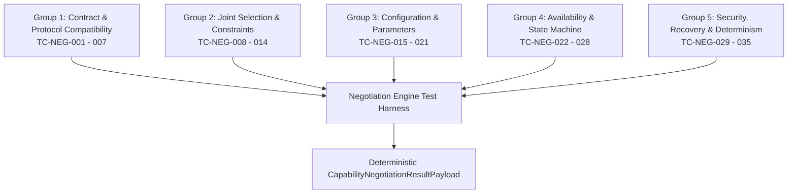

# Capability Negotiation Test and Traceability Plan

**Document Identifier:** `NLE-PLN-CNT-001`  
**Phase:** Phase 5 — Universal Adapter SDK & Capability System  
**Step:** Step 39 of 100 — Capability Negotiation & Contextual Availability Resolution Specification  
**Status:** Approved Quality Assurance Plan  
**Classification:** Verification Test Plan & Traceability Framework  
**Repository Path:** `docs/adapters/CAPABILITY_NEGOTIATION_TEST_AND_TRACEABILITY_PLAN.md`  

---

## 1. Executive Summary & Verification Strategy

### 1.1 Purpose
This test plan defines the formal quality assurance, verification strategy, and design-level test specifications for the Capability Negotiation and Contextual Availability Resolution subsystem within the NexLudic Engine.

The objectives of this test plan are:
1. Verify that multi-contract compatibility matrices execute deterministically without version drift (`NLE-SPC-CCN-001`).
2. Ensure joint selection constraint rules detect resource lock collisions and apply graceful degradation (`NLE-RUL-JSC-001`).
3. Validate parameter range intersection and override governance without fabricated compromises (`NLE-SPC-CCN-001`).
4. Confirm contextual availability mappings and the 14-state negotiation lifecycle machine (`NLE-MOD-CAN-001`).
5. Guarantee platform sandboxing, Medium IL constraints (`REQ-SEC-001`), and anti-cheat dominance (`BLK-SEC-01`).

---

## 2. Test Architecture & Coverage Matrix

| Test Group | Identifier Scope | Test Count | Target Document / Specification | Primary Focus |
|:---|:---:|:---:|:---|:---|
| **Group 1: Contract Compatibility** | `TC-NEG-001` – `007` | 7 | `NLE-SPC-CCN-001` | SemVer parity, protocol framing, schema revisions, game builds. |
| **Group 2: Joint Selection** | `TC-NEG-008` – `014` | 7 | `NLE-RUL-JSC-001` | Resource locks, role balance, graceful degradation, cross-dependencies. |
| **Group 3: Configuration Negotiation** | `TC-NEG-015` – `021` | 7 | `NLE-SPC-CCN-001` | Range intersection, enum sets, override validation, no fabricated defaults. |
| **Group 4: Contextual Availability** | `TC-NEG-022` – `028` | 7 | `NLE-MOD-CAN-001` | Environment profile verification, mod loaders, state transitions, idempotency. |
| **Group 5: Security & Determinism** | `TC-NEG-029` – `035` | 7 | `NLE-POL-NSF-001` | Anti-cheat dominance, Medium IL, ReDoS, timeouts, 100% determinism. |

---

## 3. Formal Test Case Specifications

### 3.1 Group 1: Contract and Protocol Compatibility Tests

#### `TC-NEG-001`: Universal SDK Major Contract Parity Check
- **Objective:** Verify candidate is accepted when its declared SDK contract version matches core major revision (`1.x.x`).
- **Input Fixture:** Adapter declares `sdkVersion: "1.2.0"`; core engine is `1.4.0`.
- **Expected Outcome:** Contract parity confirmed. Stage 4 evaluation passes.
- **Pass/Fail Criteria:** PASS if minor version difference is accepted as backward compatible.
- **Traceability:** `NLE-SPC-CCN-001 Sec 2.1`.

#### `TC-NEG-002`: Unsupported Major SDK Revision Rejection
- **Objective:** Reject participant declaring an incompatible major SDK contract revision.
- **Input Fixture:** Adapter declares `sdkVersion: "2.0.0"`; core engine is `1.4.0`.
- **Expected Outcome:** Stage 4 fails. Candidate disqualified with `ERR_SDK_VERSION_INCOMPATIBLE`. Overall outcome: `INCOMPATIBLE`.
- **Pass/Fail Criteria:** PASS if major version mismatch is rejected immediately.
- **Traceability:** `NLE-SPC-CCN-001 Sec 2.1`.

#### `TC-NEG-003`: Deprecated Capability Revision Advisory Handling
- **Objective:** Verify adapter referencing a deprecated capability revision is admitted with an advisory warning.
- **Input Fixture:** Candidate declares capability revision marked `DEPRECATED` in taxonomy.
- **Expected Outcome:** Stage 4 passes with advisory caveat: `"Capability revision deprecated; migration recommended."`
- **Pass/Fail Criteria:** PASS if admitted with explicit deprecation caveat in result payload.
- **Traceability:** `NLE-SPC-CCN-001 Sec 2.1`.

#### `TC-NEG-004`: Message Protocol Framing Version Match
- **Objective:** Verify participants in a live bridge share compatible message protocol versions (`NLE-MSG-PRT-001`).
- **Input Fixture:** Adapter A declares protocol `1.0.0`; Adapter B declares protocol `2.0.0`.
- **Expected Outcome:** Bridge framing validation fails. Outcome: `INCOMPATIBLE` (`ERR_PROTOCOL_FRAMING_MISMATCH`).
- **Pass/Fail Criteria:** PASS if incompatible wire protocol is caught at negotiation time.
- **Traceability:** `NLE-SPC-CCN-001 Sec 2.1`.

#### `TC-NEG-005`: Declaration Schema Version Conformance
- **Objective:** Enforce that manifest schema version conforms to `NLE-SCH-ACD-001`.
- **Input Fixture:** Participant manifest declares `"manifestVersion": "0.8.0-alpha"`.
- **Expected Outcome:** Rejected with `ERR_UNSUPPORTED_SCHEMA_REVISION`.
- **Pass/Fail Criteria:** PASS if unsupported manifest schema halts progression.
- **Traceability:** `NLE-SPC-CCN-001 Sec 2.1`.

#### `TC-NEG-006`: Target Game SemVer Range Out-of-Bounds Rejection
- **Objective:** Reject candidate when installed target game version violates candidate version bounds.
- **Input Fixture:** Installed Skyrim version is `1.6.640`; candidate supports `1.5.0` to `1.5.97`.
- **Expected Outcome:** Disqualified with `ERR_GAME_VERSION_MISMATCH`. Outcome: `INCOMPATIBLE`.
- **Pass/Fail Criteria:** PASS if version mismatch disqualifies candidate from joint selection.
- **Traceability:** `NLE-SPC-CCN-001 Sec 2.1`.

#### `TC-NEG-007`: Non-Comparable Build Hash Exact Equality Check
- **Objective:** Verify non-SemVer build IDs require byte-exact hash equality.
- **Input Fixture:** Game build ID is Unity hash `c1d2e3f4`; candidate specifies `c1d2e3f4`.
- **Expected Outcome:** Match confirmed. Stage 4 passes.
- **Pass/Fail Criteria:** PASS if candidate with hash `c1d2e3f5` is rejected.
- **Traceability:** `NLE-SPC-CCN-001 Sec 2.1`.

---

### 3.2 Group 2: Joint Selection and Constraint Resolution Tests

#### `TC-NEG-008`: Standard Multi-Adapter Joint Selection (Happy Path)
- **Objective:** Successfully negotiate a joint configuration with two compatible adapters and zero conflicts.
- **Input Fixture:** Adapter A (`SOURCE`, weather extractor) and Adapter B (`TARGET`, weather injector) with disjoint resources.
- **Expected Outcome:** All joint rules (`JSC-*`) pass. Overall outcome: `RESOLVED`.
- **Pass/Fail Criteria:** PASS if joint selection is approved without errors.
- **Traceability:** `NLE-RUL-JSC-001 Sec 2.1`.

#### `TC-NEG-009`: Cross-Adapter Resource Lock Exclusion (`JSC-EXC-001`)
- **Objective:** Detect and reject mutual exclusion conflict when two adapters claim exclusive write locks on the same resource.
- **Input Fixture:** Both Adapter A and Adapter B claim exclusive write access to game camera controls. Both are `MANDATORY`.
- **Expected Outcome:** Conflict detected. Overall outcome: `INCOMPATIBLE` (`ERR_MANDATORY_RESOURCE_COLLISION`).
- **Pass/Fail Criteria:** PASS if resource deadlock is detected and rejected.
- **Traceability:** `NLE-RUL-JSC-001 Sec 2.1`.

#### `TC-NEG-010`: Graceful Degradation of Conflicting Optional Capability (`JSC-DEG-001`)
- **Objective:** Automatically drop an optional capability to resolve a resource lock conflict with a mandatory capability.
- **Input Fixture:** Adapter A (Mandatory camera control) vs Adapter B (Optional cinematic camera effect).
- **Expected Outcome:** Adapter A retained; Adapter B's optional capability omitted. Overall outcome: `RESOLVED_WITH_LIMITATIONS`.
- **Pass/Fail Criteria:** PASS if optional contender is dropped and recorded in `omittedOptionalCapabilities`.
- **Traceability:** `NLE-RUL-JSC-001 Sec 2.1`.

#### `TC-NEG-011`: Directional Role Balance Verification (`JSC-EXC-002`)
- **Objective:** Detect directional imbalance when synchronization lacks a valid Target (consumer).
- **Input Fixture:** Both participants declare `adapterRole: "SOURCE"`.
- **Expected Outcome:** Evaluated as `INCOMPLETE_CONFIGURATION` with diagnostic `ERR_DIRECTIONAL_IMBALANCE`.
- **Pass/Fail Criteria:** PASS if pure extractor pair without consumer is blocked.
- **Traceability:** `NLE-RUL-JSC-001 Sec 2.1`.

#### `TC-NEG-012`: Shared Mod Loader Runtime Parity (`JSC-ENV-001`)
- **Objective:** Detect incompatible mod loader version requirements between two in-process host plugins.
- **Input Fixture:** Plugin A requires SKSE64 build 2.2.3; Plugin B requires legacy SKSE64 build 2.0.20.
- **Expected Outcome:** Evaluated as `INCOMPATIBLE` (`ERR_SHARED_RUNTIME_CONFLICT`).
- **Pass/Fail Criteria:** PASS if runtime collision in same game process is halted.
- **Traceability:** `NLE-RUL-JSC-001 Sec 2.1`.

#### `TC-NEG-013`: Cross-Participant Prerequisite Fulfillment (`JSC-PRQ-001`)
- **Objective:** Successfully fulfill Adapter A's prerequisite via capability provided by Adapter B across the bridge.
- **Input Fixture:** Adapter A requires `core.state.player_transform`; Adapter B provides `core.state.player_transform`.
- **Expected Outcome:** Cross-prerequisite fulfilled. Evaluated as `RESOLVED`.
- **Pass/Fail Criteria:** PASS if cross-adapter dependency is resolved cleanly.
- **Traceability:** `NLE-RUL-JSC-001 Sec 2.1`.

#### `TC-NEG-014`: Hybrid Composition Strategy Boundary Verification
- **Objective:** Ensure a hybrid composition records explicit caveats that live communication remains unverified.
- **Input Fixture:** Hybrid request pairing Skyrim SKSE plugin with OpenMW IPC bridge.
- **Expected Outcome:** Outcome: `RESOLVED`. Caveat explicitly logged: `"Live communication unverified; Step 40 Test Harness required."`
- **Pass/Fail Criteria:** PASS if composition boundary caveats are preserved.
- **Traceability:** `NLE-RUL-JSC-001 Sec 5`.

---

### 3.3 Group 3: Configuration Negotiation and Parameter Resolution Tests

#### `TC-NEG-015`: Numerical Parameter Range Intersection
- **Objective:** Reconcile overlapping numerical ranges into conservative negotiated default.
- **Input Fixture:** Adapter A supports `refreshRateHz: [30, 120]`; Adapter B supports `[60, 144]`.
- **Expected Outcome:** Negotiated range: `[60, 120]`. Negotiated default: `60Hz`.
- **Pass/Fail Criteria:** PASS if intersection is calculated accurately with conservative minimum default.
- **Traceability:** `NLE-SPC-CCN-001 Sec 3.1`.

#### `TC-NEG-016`: Disjoint Parameter Range Rejection
- **Objective:** Reject negotiation when candidate parameter ranges have zero intersection.
- **Input Fixture:** Adapter A requires `bufferSize: [1024, 2048]`; Adapter B supports max `bufferSize: [256, 512]`.
- **Expected Outcome:** Outcome: `INCOMPATIBLE` (`ERR_PARAMETER_RANGE_DISJOINT`).
- **Pass/Fail Criteria:** PASS if disjoint ranges fail without fabricating compromise.
- **Traceability:** `NLE-SPC-CCN-001 Sec 3.1`.

#### `TC-NEG-017`: Enumeration Set Intersection
- **Objective:** Intersect discrete capability format options across participants.
- **Input Fixture:** Adapter A supports `["BC7", "DXT5"]`; Adapter B supports `["BC7", "RGBA8"]`.
- **Expected Outcome:** Negotiated formats: `["BC7"]`. Negotiated selection: `"BC7"`.
- **Pass/Fail Criteria:** PASS if common enumeration format is resolved.
- **Traceability:** `NLE-SPC-CCN-001 Sec 3.2`.

#### `TC-NEG-018`: Disjoint Enumeration Set Rejection
- **Objective:** Reject negotiation when participants share zero common formats.
- **Input Fixture:** Adapter A supports `["Vulkan"]`; Adapter B supports `["DirectX11", "DirectX12"]`.
- **Expected Outcome:** Outcome: `INCOMPATIBLE` (`ERR_ENUM_FORMAT_DISJOINT`).
- **Pass/Fail Criteria:** PASS if incompatible rendering/protocol enums are rejected.
- **Traceability:** `NLE-SPC-CCN-001 Sec 3.2`.

#### `TC-NEG-019`: Valid User Configuration Override Adoption
- **Objective:** Adopt user-specified parameter override that falls within the negotiated range.
- **Input Fixture:** Negotiated range is `[60, 120]Hz`. User override specifies `90Hz`.
- **Expected Outcome:** Parameter adopted as `90Hz`. Recorded in `negotiatedParameters`.
- **Pass/Fail Criteria:** PASS if valid user override overrides default.
- **Traceability:** `NLE-SPC-CCN-001 Sec 3.3`.

#### `TC-NEG-020`: Out-of-Bounds User Override Rejection
- **Objective:** Reject user override that falls outside the negotiated valid range.
- **Input Fixture:** Negotiated range is `[60, 120]Hz`. User override specifies `144Hz`.
- **Expected Outcome:** User override rejected with `ERR_OVERRIDE_OUT_OF_BOUNDS`. Default `60Hz` retained.
- **Pass/Fail Criteria:** PASS if invalid override is rejected safely.
- **Traceability:** `NLE-SPC-CCN-001 Sec 3.3`.

#### `TC-NEG-021`: Rejection of Fabricated Defaults or Arbitrary Keys
- **Objective:** Ensure engine never accepts undocumented configuration keys.
- **Input Fixture:** Override attempts to inject `"bypassSandbox": true`.
- **Expected Outcome:** Key rejected with `ERR_UNKNOWN_CONFIGURATION_PARAMETER`.
- **Pass/Fail Criteria:** PASS if unauthorized configuration parameters are barred.
- **Traceability:** `NLE-SPC-CCN-001 Sec 1.2`.

---

### 3.4 Group 4: Contextual Availability and State Transition Tests

#### `TC-NEG-022`: Full Contextual Availability Confirmation
- **Objective:** Confirm `AVAILABLE_UNDER_ASSESSED_CONDITIONS` when all environment facts match.
- **Input Fixture:** Game build verified, mod loader present, libraries valid on host.
- **Expected Outcome:** Capability state: `AVAILABLE_UNDER_ASSESSED_CONDITIONS`. Overall outcome: `RESOLVED`.
- **Pass/Fail Criteria:** PASS if full availability is confirmed.
- **Traceability:** `NLE-MOD-CAN-001 Sec 2.1`.

#### `TC-NEG-023`: Missing Mod Loader Demotes to UNAVAILABLE
- **Objective:** Verify missing required mod loader marks capability `UNAVAILABLE`.
- **Input Fixture:** Adapter requires SKSE64 v2.2.3. Environment profile confirms SKSE is not installed.
- **Expected Outcome:** Capability state: `UNAVAILABLE`. Overall outcome: `NEEDS_INFORMATION`.
- **Pass/Fail Criteria:** PASS if missing tool blocks availability.
- **Traceability:** `NLE-MOD-CAN-001 Sec 2.1`.

#### `TC-NEG-024`: Incomplete Environment Scans Evaluated as UNKNOWN
- **Objective:** Preserve explicit unknown when host environment profile has not been scanned.
- **Input Fixture:** Environment profile is null / uninspected.
- **Expected Outcome:** Capability state: `UNKNOWN`. UI prompts user to run detection scanner.
- **Pass/Fail Criteria:** PASS if uninspected environment is not assumed available.
- **Traceability:** `NLE-MOD-CAN-001 Sec 2.1`.

#### `TC-NEG-025`: Runtime Condition Assigned CONDITIONALLY_AVAILABLE
- **Objective:** Mark capability `CONDITIONALLY_AVAILABLE` when static facts pass but runtime condition applies.
- **Input Fixture:** Candidate declares condition "requires host game borderless window mode".
- **Expected Outcome:** State: `CONDITIONALLY_AVAILABLE`. Caveats record condition string.
- **Pass/Fail Criteria:** PASS if runtime condition is surfaced transparently.
- **Traceability:** `NLE-MOD-CAN-001 Sec 2.1`.

#### `TC-NEG-026`: Illegal Lifecycle Leapfrogging Prevention
- **Objective:** Ensure state machine cannot transition to `NEGOTIATION_RESOLVED` without prior validation.
- **Input Fixture:** State transition request attempting `REQUEST_RECEIVED` $\rightarrow$ `NEGOTIATION_RESOLVED`.
- **Expected Outcome:** Rejected with `ERR_ILLEGAL_STATE_TRANSITION`.
- **Pass/Fail Criteria:** PASS if state progression rules are enforced strictly.
- **Traceability:** `NLE-MOD-CAN-001 Sec 3.1`.

#### `TC-NEG-027`: Invalidation Transition to STALE
- **Objective:** Confirm game update event transitions resolved negotiation record to `STALE`.
- **Execution:** Trigger `TRG-MAT-003` (Game patch detected).
- **Expected Outcome:** Negotiation record state transitions to `STALE`.
- **Pass/Fail Criteria:** PASS if stale findings are suppressed from active planning.
- **Traceability:** `NLE-MOD-CAN-001 Sec 2.1`.

#### `TC-NEG-028`: Idempotent Repeated Evaluation Check
- **Objective:** Verify submitting identical negotiation request returns identical payload with zero state mutation.
- **Execution:** Submit identical request fixture twice consecutively.
- **Expected Outcome:** Returns identical `CapabilityNegotiationResultPayload` (matching SHA-256).
- **Pass/Fail Criteria:** PASS if 100% idempotency is verified.
- **Traceability:** `NLE-MOD-CAN-001 Sec 3.1`.

---

### 3.5 Group 5: Security, Failure, Recovery, and Determinism Tests

#### `TC-NEG-029`: Anti-Cheat Dominance Enforcement (`BLK-SEC-01`)
- **Objective:** Bar joint configurations proposing memory hooking on games with active anti-cheat.
- **Input Fixture:** Target game has active BattlEye anti-cheat. Joint configuration includes memory hook.
- **Expected Outcome:** Outcome: `BLOCKED`. Diagnostic: `ERR_ANTI_CHEAT_VIOLATION`. Severity: `CRITICAL`.
- **Pass/Fail Criteria:** PASS if anti-cheat dominance is upheld unconditionally.
- **Traceability:** `NLE-POL-NSF-001 Sec 2.1`.

#### `TC-NEG-030`: Windows Medium Integrity Level Boundary Check (`REQ-SEC-001`)
- **Objective:** Bar candidates declaring requirement for High IL / Administrator privileges.
- **Input Fixture:** Participant declares `"requiredPrivilegeLevel": "ADMINISTRATOR"`.
- **Expected Outcome:** Outcome: `BLOCKED` (`ERR_PRIVILEGE_ELEVATION_PROHIBITED`).
- **Pass/Fail Criteria:** PASS if administrative elevation requests are rejected immediately.
- **Traceability:** `NLE-POL-NSF-001 Sec 2.1`.

#### `TC-NEG-031`: Configuration Override Script Injection Defense
- **Objective:** Sanitize or reject ``.
- **Expected Outcome:** Rejected with `VLD-SEC-004` or sanitized plaintext.
- **Pass/Fail Criteria:** PASS if unescaped HTML tags never appear in output JSON.
- **Traceability:** `NLE-POL-NSF-001 Sec 2.1`.

#### `TC-NEG-032`: Negotiation Execution Timeout Ceiling (2,000ms Limit)
- **Objective:** Abort evaluation cleanly if negotiation processing exceeds 2,000ms.
- **Input Fixture:** Simulated combinatorial parameter conflict creating exponential solver loop.
- **Expected Outcome:** Evaluation aborts at 2,000ms with `ERR_NEGOTIATION_TIMEOUT`. Outcome: `CANCELLED`.
- **Pass/Fail Criteria:** PASS if worker terminates cleanly without system freeze.
- **Traceability:** `NLE-POL-NSF-001 Sec 3`.

#### `TC-NEG-033`: Dependency Recursion Depth Ceiling (10 Levels)
- **Objective:** Enforce 10-level recursion cap during cross-participant prerequisite resolution.
- **Input Fixture:** Synthetic 11-level cross-adapter dependency chain.
- **Expected Outcome:** Halted at level 10 with `ERR_DEPENDENCY_DEPTH_EXCEEDED`.
- **Pass/Fail Criteria:** PASS if recursion depth limit prevents call stack exhaustion.
- **Traceability:** `NLE-POL-NSF-001 Sec 3`.

#### `TC-NEG-034`: Incremental Re-Negotiation on Manifest Hash Change (`TRG-MAT-002`)
- **Objective:** Verify that editing a manifest file invalidates its negotiation record and triggers re-negotiation.
- **Execution:** Modify manifest on disk; trigger re-negotiation.
- **Expected Outcome:** Previous payload marked `STALE`; new payload generated with updated manifest hash.
- **Pass/Fail Criteria:** PASS if incremental invalidation updates accurately.
- **Traceability:** `NLE-POL-NSF-001 Sec 2.1`.

#### `TC-NEG-035`: 100% Deterministic Repeatability Verification
- **Objective:** Verify that evaluating an identical negotiation request 100 consecutive times yields byte-identical output payloads.
- **Execution:** Run negotiation engine 100 times in loop with identical inputs.
- **Expected Outcome:** All 100 emitted JSON strings have identical SHA-256 hashes (excluding unique `negotiationId` and timestamp).
- **Pass/Fail Criteria:** PASS if 100% deterministic repeatability is verified.
- **Traceability:** `NLE-SPC-CNA-001 Sec 4`.

---

## 4. Traceability and Cross-Reference Anchors

- `NLE-SPC-CNA-001`: Primary Capability Negotiation Specification.
- `NLE-CON-CNC-001`: Negotiation Context & Input Contract.
- `NLE-RUL-JSC-001`: Joint Selection & Constraint Resolution Rules.
- `NLE-SPC-CCN-001`: Contract Compatibility & Configuration Negotiation.
- `NLE-MOD-CAN-001`: Contextual Availability & State Model.
- `NLE-CON-NRE-001`: Negotiation Result & Explainability Contract.
- `NLE-POL-NSF-001`: Security, Failure & Recovery Policy.
