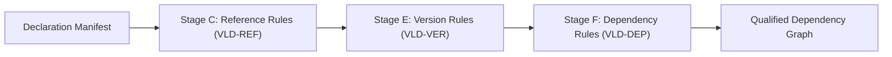

# Capability Reference, Version, and Dependency Validation Rules

**Document ID:** `NLE-RUL-RVD-001`  
**Version:** 1.0.0  
**Phase:** 5 of 12 — Universal Adapter SDK & Capability System  
**Step:** 36 of 100 — Capability Declaration Validation & Conformance Rules Specification  
**Classification:** Reference Resolution, Versioning & Dependency Graph Rule Catalog  
**Status:** Approved Specification  
**Authoritative Reference:** `NLE-SPC-CVC-001`, `NLE-MOD-CCT-001`, `NLE-CON-CDC-001`, `NLE-SPC-AVR-001`

---

## 1. Catalog Scope & Architecture

This catalog defines the formal, deterministic validation rules executed during **Stage C (Canonical Reference Resolution)**, **Stage E (Version and Environment Consistency)**, and **Stage F (Dependency and Constraint Validation)** of the Capability Declaration Validation Pipeline.



---

## 2. Stage C: Canonical Reference Resolution Rules (`VLD-REF`)

Stage C verifies that all external identifiers referenced by the declaration exist in authoritative platform catalogs.

```
+----------------------------------------------------------------------------------------------------+
|                                    STAGE C: REFERENCE RULES SUMMARY                                |
+-------------+------------------------------------+----------+------------------+-------------------+
| Rule ID     | Rule Title                         | Severity | Blocks Admission | Diagnostic Code   |
+-------------+------------------------------------+----------+------------------+-------------------+
| VLD-REF-001 | Canonical Capability Existence     | ERROR    | YES              | `ERR-VAL-REF-001` |
| VLD-REF-002 | Deprecated Capability Usage Warning| WARNING  | NO               | `WRN-VAL-REF-002` |
| VLD-REF-003 | Provisional Namespace Enforcement  | ERROR    | YES              | `ERR-VAL-REF-003` |
| VLD-REF-004 | Canonical Game Identity Resolution | ERROR    | YES              | `ERR-VAL-REF-004` |
| VLD-REF-005 | SDK Contract Parity Check          | FATAL    | YES              | `ERR-VAL-REF-005` |
+-------------+------------------------------------+----------+------------------+-------------------+
```

### 2.1 Rule `VLD-REF-001`: Canonical Capability Existence
- **Purpose:** Ensure the capability declared by the adapter is recognized by the universal platform.
- **Authority:** `NLE-MOD-CCT-001` (Taxonomy & Domain Model); `NLE-SCH-CCD-001`.
- **Target Field:** `capabilityId`.
- **Validation Logic:** Query Canonical Capability Catalog. Assert that `capabilityId` exists with status `ACTIVE` or `DEPRECATED`. If not found and lacks `PROPOSED:` prefix, emit error.
- **Severity:** `ERROR` (Blocks qualification).
- **Diagnostic Code:** `ERR-VAL-REF-001`
- **Error Message:** *"Capability '{capabilityId}' does not exist in the Canonical Capability Catalog."*
- **Remediation:** Verify capability identifier against the official catalog or submit proposal for review (`NLE-POL-CCG-001`).
- **Test ID:** `TC-CAP-VAL-014`

### 2.2 Rule `VLD-REF-002`: Deprecated Capability Usage Warning
- **Purpose:** Alert authors when an adapter targets a capability that has been superseded.
- **Authority:** `NLE-POL-CVE-001` Section 4.
- **Target Field:** `capabilityId`.
- **Validation Logic:** If canonical capability has `lifecycleStatus == "DEPRECATED"`, emit warning diagnostic containing `supersededBy` migration link.
- **Severity:** `WARNING` (Non-blocking).
- **Diagnostic Code:** `WRN-VAL-REF-002`
- **Warning Message:** *"Capability '{capabilityId}' is deprecated. Migration recommended to '{supersededBy}'."*
- **Remediation:** Update adapter implementation to use the superseding capability contract.
- **Test ID:** `TC-CAP-VAL-015`

### 2.3 Rule `VLD-REF-003`: Provisional Namespace Enforcement
- **Purpose:** Prevent unreviewed custom capabilities from impersonating canonical contracts.
- **Authority:** `NLE-POL-CCG-001` Section 4.
- **Target Field:** `capabilityId`.
- **Validation Logic:** If `capabilityId` does not exist in the canonical catalog, assert that it matches the regex `^PROPOSED:[a-z0-9-]+:[a-z0-9-]+$`.
- **Severity:** `ERROR` (Blocks qualification).
- **Diagnostic Code:** `ERR-VAL-REF-003`
- **Error Message:** *"Custom capability '{capabilityId}' lacks mandatory 'PROPOSED:<adapterId>:<name>' namespace prefix."*
- **Remediation:** Prefix experimental custom capabilities with `PROPOSED:<your-adapter-id>:`.
- **Test ID:** `TC-CAP-VAL-016`

### 2.4 Rule `VLD-REF-004`: Canonical Game Identity Resolution
- **Purpose:** Ensure adapter targets a valid, recognized game title in the Universal Game Catalog.
- **Authority:** `NLE-SPC-GDC-001` (Step 25 Canonical Identity).
- **Target Field:** `targetContext.canonicalGameId`.
- **Validation Logic:** Query Universal Game Catalog. Assert that `canonicalGameId` exists as a registered `CanonicalGame` entity.
- **Severity:** `ERROR` (Blocks qualification).
- **Diagnostic Code:** `ERR-VAL-REF-004`
- **Error Message:** *"Target game identity '{canonicalGameId}' cannot be resolved in Universal Game Catalog."*
- **Remediation:** Select valid canonical game identifier from catalog (e.g. `game-tesv-skyrimse`).
- **Test ID:** `TC-CAP-VAL-017`

### 2.5 Rule `VLD-REF-005`: SDK Contract Parity Check
- **Purpose:** Verify that adapter contract matches the host engine's supported SDK revision.
- **Authority:** `NLE-SPC-AVR-001` Section 1.
- **Target Field:** `contractVersion`.
- **Validation Logic:** Assert that `contractVersion.MAJOR == HostSDK.MAJOR` (Currently `1.0.0`).
- **Severity:** `FATAL` (Blocks admission).
- **Diagnostic Code:** `ERR-VAL-REF-005`
- **Error Message:** *"Adapter contract version '{contractVersion}' is incompatible with host SDK '{hostVersion}'."*
- **Remediation:** Recompile or update adapter against current Universal Adapter SDK contract.
- **Test ID:** `TC-CAP-VAL-018`

---

## 3. Stage E: Version and Environment Consistency Rules (`VLD-VER`)

Stage E verifies that version ranges, release boundaries, and platform targets are internally sound.

```
+----------------------------------------------------------------------------------------------------+
|                                    STAGE E: VERSION RULES SUMMARY                                  |
+-------------+------------------------------------+----------+------------------+-------------------+
| Rule ID     | Rule Title                         | Severity | Blocks Admission | Diagnostic Code   |
+-------------+------------------------------------+----------+------------------+-------------------+
| VLD-VER-001 | Valid Version Range Bounds         | ERROR    | YES              | `ERR-VAL-VER-001` |
| VLD-VER-002 | Platform Target Compatibility      | FATAL    | YES              | `ERR-VAL-VER-002` |
| VLD-VER-003 | Capability Revision Alignment      | ERROR    | YES              | `ERR-VAL-VER-003` |
+-------------+------------------------------------+----------+------------------+-------------------+
```

### 3.1 Rule `VLD-VER-001`: Valid Version Range Bounds
- **Purpose:** Prevent inverted or impossible game version ranges.
- **Authority:** `NLE-SPC-VEC-001` (Version Compatibility Mapping).
- **Target Field:** `targetContext.supportedVersionRanges[]`.
- **Validation Logic:** For every range, parse `minimumVersion` and `maximumVersion`. Assert that `minimumVersion <= maximumVersion` under semantic/lexicographical comparison.
- **Severity:** `ERROR` (Blocks qualification).
- **Diagnostic Code:** `ERR-VAL-VER-001`
- **Error Message:** *"Inverted version range: minimumVersion '{min}' is greater than maximumVersion '{max}'."*
- **Remediation:** Ensure minimum version is less than or equal to maximum version.
- **Test ID:** `TC-CAP-VAL-019`

### 3.2 Rule `VLD-VER-002`: Platform Target Compatibility
- **Purpose:** Ensure adapter targets a supported operating system architecture.
- **Authority:** `NLE-CAT-ACM-001` Section 3.
- **Target Field:** `targetContext.targetPlatform`.
- **Validation Logic:** Assert that `targetPlatform` is in `["windows-x64", "windows-x86"]`.
- **Severity:** `FATAL` (Blocks admission).
- **Diagnostic Code:** `ERR-VAL-VER-002`
- **Error Message:** *"Target platform '{targetPlatform}' is unsupported. Only 'windows-x64' and 'windows-x86' are permitted."*
- **Remediation:** Target a supported Windows desktop architecture under Medium Integrity Level.
- **Test ID:** `TC-CAP-VAL-020`

### 3.3 Rule `VLD-VER-003`: Capability Revision Alignment
- **Purpose:** Ensure adapter references a compatible contract revision of the canonical capability.
- **Authority:** `NLE-POL-CVE-001` Section 2.
- **Target Field:** `capabilityRevision`.
- **Validation Logic:** Assert that `capabilityRevision <= CanonicalCapability.contractRevision`.
- **Severity:** `ERROR` (Blocks qualification).
- **Diagnostic Code:** `ERR-VAL-VER-003`
- **Error Message:** *"Declared capabilityRevision '{declRev}' exceeds canonical definition revision '{canonRev}'."*
- **Remediation:** Set `capabilityRevision` to match an existing canonical release revision.
- **Test ID:** `TC-CAP-VAL-021`

---

## 4. Stage F: Dependency and Graph Validation Rules (`VLD-DEP`)

Stage F validates that capability dependencies conform to the 6 approved relationship types and are strictly deadlock-free.

```
+----------------------------------------------------------------------------------------------------+
|                                    STAGE F: DEPENDENCY RULES SUMMARY                               |
+-------------+------------------------------------+----------+------------------+-------------------+
| Rule ID     | Rule Title                         | Severity | Blocks Admission | Diagnostic Code   |
+-------------+------------------------------------+----------+------------------+-------------------+
| VLD-DEP-001 | Dependent Capability Existence     | ERROR    | YES              | `ERR-VAL-DEP-001` |
| VLD-DEP-002 | Approved Relationship Enum         | ERROR    | YES              | `ERR-VAL-DEP-002` |
| VLD-DEP-003 | Kahn's DAG Cycle Rejection         | FATAL    | YES              | `ERR-VAL-DEP-003` |
| VLD-DEP-004 | Mutual Exclusion Enforcement       | ERROR    | YES              | `ERR-VAL-DEP-004` |
| VLD-DEP-005 | Conditional Clause Non-Empty       | ERROR    | YES              | `ERR-VAL-DEP-005` |
+-------------+------------------------------------+----------+------------------+-------------------+
```

### 4.1 Rule `VLD-DEP-001`: Dependent Capability Existence
- **Purpose:** Ensure all capabilities cited in dependency arrays resolve to real capabilities.
- **Authority:** `NLE-CON-CDC-001` Section 2.
- **Target Field:** `dependencies[].targetCapabilityId`.
- **Validation Logic:** For every dependency, assert that `targetCapabilityId` resolves in the Canonical Capability Catalog or within the adapter's own manifest.
- **Severity:** `ERROR` (Blocks qualification).
- **Diagnostic Code:** `ERR-VAL-DEP-001`
- **Error Message:** *"Dependent capability '{targetCapabilityId}' does not exist in catalog or manifest."*
- **Remediation:** Correct capability ID or add prerequisite capability declaration to manifest.
- **Test ID:** `TC-CAP-VAL-022`

### 4.2 Rule `VLD-DEP-002`: Approved Relationship Enum
- **Purpose:** Enforce standardized relationship typing.
- **Authority:** `NLE-CON-CDC-001` Section 2.
- **Target Field:** `dependencies[].dependencyType`.
- **Validation Logic:** Assert value is in `["HARD_PREREQUISITE", "OPTIONAL_ENHANCEMENT", "CONDITIONAL_PREREQUISITE", "ALTERNATIVE_PATH", "MUTUALLY_EXCLUSIVE", "VERSION_CONSTRAINED"]`.
- **Severity:** `ERROR` (Blocks qualification).
- **Diagnostic Code:** `ERR-VAL-DEP-002`
- **Error Message:** *"Unrecognized dependencyType '{value}'. Must be one of the 6 approved relationship types."*
- **Remediation:** Update dependency declaration to use an approved enum value.
- **Test ID:** `TC-CAP-VAL-023`

### 4.3 Rule `VLD-DEP-003`: Kahn's DAG Cycle Rejection
- **Purpose:** Prevent circular dependency deadlocks across capability chains.
- **Authority:** `NLE-CON-CDC-001` Section 3; `NLE-SPC-RDC-001`.
- **Preconditions:** All dependency nodes resolve.
- **Validation Logic:** Execute Kahn's algorithm on all `HARD_PREREQUISITE` and `CONDITIONAL_PREREQUISITE` edges. If topological sort fails, identify cycle path and reject.
- **Severity:** `FATAL` (Blocks qualification).
- **Diagnostic Code:** `ERR-VAL-DEP-003`
- **Error Message:** *"Circular dependency detected in capability graph: {cycleChain}."*
- **Remediation:** Break circular reference by restructuring dependencies or splitting capability responsibilities.
- **Test ID:** `TC-CAP-VAL-024`

### 4.4 Rule `VLD-DEP-004`: Mutual Exclusion Enforcement
- **Purpose:** Prevent conflicting or crashing mod hooks from being declared simultaneously.
- **Authority:** `NLE-CON-CDC-001` Section 2.1.
- **Validation Logic:** If Capability A declares `MUTUALLY_EXCLUSIVE` with Capability B, assert that the project configuration does not actively bind both A and B.
- **Severity:** `ERROR` (Blocks simultaneous binding).
- **Diagnostic Code:** `ERR-VAL-DEP-004`
- **Error Message:** *"Capabilities '{capA}' and '{capB}' are mutually exclusive and cannot be bound simultaneously."*
- **Remediation:** Choose one integration route or select an alternative non-conflicting adapter.
- **Test ID:** `TC-CAP-VAL-025`

### 4.5 Rule `VLD-DEP-005`: Conditional Clause Non-Empty
- **Purpose:** Ensure conditional dependencies explain their triggering conditions.
- **Authority:** `NLE-SCH-ACD-001` Section 3.4.
- **Preconditions:** `dependencyType == "CONDITIONAL_PREREQUISITE"`.
- **Validation Logic:** Assert that `conditionDescription` is non-null and string length $\ge 5$ characters.
- **Severity:** `ERROR` (Blocks qualification).
- **Diagnostic Code:** `ERR-VAL-DEP-005`
- **Error Message:** *"Dependency '{targetId}' marked CONDITIONAL_PREREQUISITE but 'conditionDescription' is missing."*
- **Remediation:** Provide clear description of when this dependency is required (e.g. *"Required for Anniversary Edition v1.6+"*).
- **Test ID:** `TC-CAP-VAL-026`
