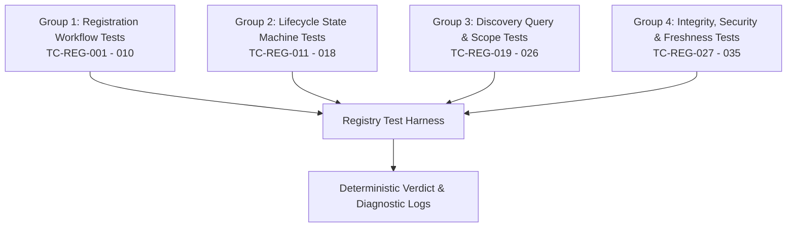

# Capability Registration and Discovery Validation Test Plan

**Document Identifier:** `NLE-PLN-RDV-001`  
**Phase:** Phase 5 — Universal Adapter SDK & Capability System  
**Step:** Step 37 of 100 — Validated Capability Declaration Registry & Discovery Workflow Specification  
**Status:** Approved Quality Assurance Plan  
**Classification:** Verification Test Plan & Acceptance Framework  
**Repository Path:** `docs/adapters/CAPABILITY_REGISTRATION_AND_DISCOVERY_VALIDATION_TEST_PLAN.md`  

---

## 1. Executive Summary & Verification Strategy

### 1.1 Purpose
This test plan defines the formal quality assurance, verification strategy, and design-level test specifications for the Validated Capability Declaration Registry and Discovery subsystem within the NexLudic Engine.

The objectives of this test plan are:
1. Ensure the registration workflow (`NLE-SPC-VCR-001`) deterministically enforces all eligibility gates.
2. Verify that lifecycle state transitions adhere strictly to the authorization matrix in `NLE-POL-REL-001`.
3. Validate that discovery queries (`NLE-CON-CDQ-001`) evaluate version scopes, adapter roles, and verification states with 100% precision.
4. Confirm that stale findings, expired evidence, and security boundaries (`NLE-PLN-CSR-001`) operate without false positives or deceptive green checkmarks.

---

## 2. Test Architecture & Coverage Matrix

| Test Group | Identifier Scope | Test Count | Target Subsystem / Document | Primary Focus |
|:---|:---:|:---:|:---|:---|
| **Group 1: Registration Workflow** | `TC-REG-001` – `010` | 10 | `NLE-SPC-VCR-001`, `NLE-MOD-RRM-001` | Intake gates, hash binding, duplicate submissions, revisions. |
| **Group 2: Lifecycle Transitions** | `TC-REG-011` – `018` | 8 | `NLE-POL-REL-001` | State promotions, quarantine, suspensions, illegal transitions. |
| **Group 3: Discovery Queries** | `TC-REG-019` – `026` | 8 | `NLE-CON-CDQ-001`, `NLE-SPC-DRF-001` | Exact lookup, version scope matching, role filters, pagination. |
| **Group 4: Integrity & Security** | `TC-REG-027` – `035` | 9 | `NLE-PLN-CSR-001` | DoS protection, traversal defense, staleness triggers, anti-cheat. |

---

## 3. Formal Test Case Specifications

### 3.1 Group 1: Registration Workflow Tests

#### `TC-REG-001`: Standard Eligible Declaration Admission (Happy Path)
- **Objective:** Verify that a fully conformant ACD with `VALID` outcome is registered and assigned `ACTIVE` state.
- **Preconditions:** Valid manifest and `ValidationResultPayload` with `overallOutcome: "VALID"` exist in test workspace.
- **Input Fixture:** Manifest declaring 5 canonical capabilities with valid evidence references.
- **Execution:** Submit manifest to registration intake (Stage A $\rightarrow$ J).
- **Expected Outcome:** State: `ACTIVE`. `isDiscoverable: true`. Unique `registryRecordId` assigned. In-memory index populated.
- **Pass/Fail Criteria:** PASS if registration completes in < 50ms and emits zero error diagnostics.
- **Traceability:** `NLE-SPC-VCR-001 Sec 4`.

#### `TC-REG-002`: Manifest SHA-256 Revision Mismatch Rejection
- **Objective:** Detect when on-disk `manifest.json` has changed after validation payload generation.
- **Input Fixture:** `manifest.json` modified by adding 1 byte after `ValidationResultPayload` generated.
- **Expected Outcome:** Gate `ELG-GAT-002` fails. Admission rejected. Outcome: `REJECTED`. Diagnostic: `ERR_MANIFEST_REVISION_MISMATCH`.
- **Pass/Fail Criteria:** PASS if admission is aborted without creating a `RegistryRecord`.
- **Traceability:** `NLE-MOD-RRM-001 Sec 4.1`.

#### `TC-REG-003`: Ineligible Submission with Fatal Validation Outcome
- **Objective:** Ensure declarations with `INVALID` validation outcomes cannot be registered.
- **Input Fixture:** `ValidationResultPayload` having `overallOutcome: "INVALID"` and diagnostic `VLD-STR-001`.
- **Expected Outcome:** Gate `ELG-GAT-001` fails immediately. State: `REJECTED`.
- **Pass/Fail Criteria:** PASS if manifest is barred from active registration.
- **Traceability:** `NLE-POL-REL-001 Sec 2.1`.

#### `TC-REG-004`: Idempotent Duplicate Registration Handling
- **Objective:** Confirm that submitting an identical declaration revision returns existing `registryRecordId` without error.
- **Execution:** Submit identical manifest fixture twice consecutively.
- **Expected Outcome:** First submission creates `RegistryRecord`. Second returns identical `registryRecordId` with status `INFO_ALREADY_REGISTERED`.
- **Pass/Fail Criteria:** PASS if exactly one `RegistryRecord` exists on disk.
- **Traceability:** `NLE-POL-REL-001 Sec 5.2`.

#### `TC-REG-005`: Upgraded Revision Supersession Flow
- **Objective:** Verify that registering an upgraded adapter revision (`1.3.0` over `1.2.0`) transitions the previous record to `SUPERSEDED`.
- **Input Fixture:** Adapter manifest `1.3.0` submitted when `1.2.0` is currently `ACTIVE`.
- **Expected Outcome:** New record becomes `ACTIVE`. Old record transitions to `SUPERSEDED` with `supersededByRecordId` pointing to new record.
- **Pass/Fail Criteria:** PASS if historical record is retained and excluded from default discovery.
- **Traceability:** `NLE-POL-REL-001 Sec 5.2`.

#### `TC-REG-006`: Out-of-Order Older Revision Rejection
- **Objective:** Reject or quarantine a lower adapter revision submitted after a newer revision is active.
- **Input Fixture:** Adapter manifest `1.1.0` submitted when `1.2.0` is already active.
- **Expected Outcome:** Admission rejected or saved as non-active archive. Active `1.2.0` record unaffected.
- **Pass/Fail Criteria:** PASS if older revision does not overwrite active newer revision.
- **Traceability:** `NLE-POL-REL-001 Sec 5.2`.

#### `TC-REG-007`: Admission with Non-Fatal Advisory Warnings
- **Objective:** Verify that declarations with `VALID_WITH_WARNINGS` achieve `ACTIVE_WITH_LIMITATIONS`.
- **Input Fixture:** ACD referencing a deprecated capability with advisory warning `VLD-REF-002`.
- **Expected Outcome:** State: `ACTIVE_WITH_LIMITATIONS`. `isDiscoverable: true`. Match rationale preserves deprecation warning.
- **Pass/Fail Criteria:** PASS if record is discoverable with explicit limitation disclosure.
- **Traceability:** `NLE-POL-REL-001 Sec 3.1`.

#### `TC-REG-008`: Custom Capability Quarantine Flow (`PROPOSED:`)
- **Objective:** Ensure unvetted custom capabilities are quarantined in `PENDING_REVIEW` state.
- **Input Fixture:** ACD declaring custom capability `PROPOSED:custom_laser`. Validation outcome: `REVIEW_REQUIRED`.
- **Expected Outcome:** State: `PENDING_REVIEW`. `isDiscoverable: false`. Quarantined from active discovery.
- **Pass/Fail Criteria:** PASS if excluded from ordinary queries until explicit governance approval.
- **Traceability:** `NLE-POL-REL-001 Sec 3.1`.

#### `TC-REG-009`: Unknown Target Game Scope Rejection
- **Objective:** Reject registration of an adapter targeting a game ID not in the platform game catalog.
- **Input Fixture:** `targetGameId: "game.fictional.unknown_title"`.
- **Expected Outcome:** Gate `ELG-GAT-006` fails. Admission rejected with `ERR_UNKNOWN_TARGET_GAME`.
- **Pass/Fail Criteria:** PASS if registration halts at Stage D.
- **Traceability:** `NLE-POL-REL-001 Sec 2.1`.

#### `TC-REG-010`: Atomic Rollback on Disk Write Failure
- **Objective:** Ensure failure during `reg_*.json` writing does not leave orphaned or corrupted state.
- **Input Fixture:** Test harness simulating simulated disk full / access denied error during Stage F.
- **Expected Outcome:** Registration rolled back. Zero partial state admitted to index. Error logged.
- **Pass/Fail Criteria:** PASS if in-memory index contains zero reference to failed record.
- **Traceability:** `NLE-PLN-CSR-001 Sec 4 Scenario 20`.

---

### 3.2 Group 2: Lifecycle State Machine Tests

#### `TC-REG-011`: Prohibited Self-Promotion Transition
- **Objective:** Verify that an adapter cannot transition itself from `PENDING_REVIEW` to `ACTIVE`.
- **Input Fixture:** Manifest attempting to self-assert `lifecycleState: "ACTIVE"`.
- **Expected Outcome:** Registry ignores manifest-level state; preserves `PENDING_REVIEW`.
- **Pass/Fail Criteria:** PASS if state remains strictly controlled by universal core authority.
- **Traceability:** `NLE-POL-REL-001 Sec 4.1`.

#### `TC-REG-012`: Adapter Suspension Flow
- **Objective:** Confirm user disablement transitions an active record to `SUSPENDED` and purges it from active discovery.
- **Execution:** Invoke administrative suspension on active adapter record.
- **Expected Outcome:** Record state: `SUSPENDED`. Discovery query returns 0 matches for this adapter.
- **Pass/Fail Criteria:** PASS if adapter is hidden from discovery within 10ms of suspension.
- **Traceability:** `NLE-POL-REL-001 Sec 3.1`.

#### `TC-REG-013`: Re-Activation of Suspended Adapter
- **Objective:** Confirm lifting suspension restores record to `ACTIVE` without requiring full re-registration.
- **Execution:** Administrative suspension cleared.
- **Expected Outcome:** Record state restored to `ACTIVE`. Re-indexed in discovery.
- **Pass/Fail Criteria:** PASS if discoverable immediately without altering historical audit IDs.
- **Traceability:** `NLE-POL-REL-001 Sec 4`.

#### `TC-REG-014`: Adapter Withdrawal Lifecycle
- **Objective:** Verify that uninstalling an adapter transitions record to `WITHDRAWN`.
- **Execution:** Delete adapter folder from workspace; trigger registry reconciliation.
- **Expected Outcome:** Record state: `WITHDRAWN`. Historical `reg_*.json` retained in `.audit/`.
- **Pass/Fail Criteria:** PASS if omitted from current queries but present in audit queries.
- **Traceability:** `NLE-POL-REL-001 Sec 4`.

#### `TC-REG-015`: Target Game Patch Invalidation (`TRG-REV-001`)
- **Objective:** Verify that detecting a new game patch transitions affected records to `STALE`.
- **Execution:** Inject game patch event updating game build from `1.5.97` to `1.6.640`.
- **Expected Outcome:** Adapters with `maxVersion: "1.5.97"` transition to `STALE`. Suppressed from discovery.
- **Pass/Fail Criteria:** PASS if stale records are excluded from default compatibility queries.
- **Traceability:** `NLE-SPC-DRF-001 Sec 4.1`.

#### `TC-REG-016`: Successful Revalidation Transition from STALE to ACTIVE
- **Objective:** Verify that executing revalidation over a `STALE` record restores `ACTIVE` status upon passing.
- **Execution:** Run revalidation on `STALE` record; validation succeeds cleanly.
- **Expected Outcome:** State transitions from `STALE` $\rightarrow$ `ACTIVE`. Discovery eligibility restored.
- **Pass/Fail Criteria:** PASS if discoverable with `freshnessStatus: "CURRENT"`.
- **Traceability:** `NLE-POL-REL-001 Sec 4`.

#### `TC-REG-017`: Competing Alternative Adapters Coexistence
- **Objective:** Confirm two valid adapters for the same game/capability can coexist without mutual overwrites.
- **Input Fixture:** `AdapterA` (Host Mod) and `AdapterB` (Live Bridge) declaring identical capability.
- **Expected Outcome:** Both records registered as `ACTIVE`. Discovery returns both as alternative candidates.
- **Pass/Fail Criteria:** PASS if neither adapter overwrites the other.
- **Traceability:** `NLE-POL-REL-001 Sec 5.2`.

#### `TC-REG-018`: Prohibited Revival of Retired Record
- **Objective:** Verify that an archived `RETIRED` record cannot be transitioned directly to `ACTIVE`.
- **Execution:** Submit state change request attempting `RETIRED` $\rightarrow$ `ACTIVE`.
- **Expected Outcome:** Request rejected with `ERR_ILLEGAL_STATE_TRANSITION`. Author must submit new declaration.
- **Pass/Fail Criteria:** PASS if illegal transition is blocked.
- **Traceability:** `NLE-POL-REL-001 Sec 4.1`.

---

### 3.3 Group 3: Discovery Query & Scope Tests

#### `TC-REG-019`: Exact Point Lookup by Registry Record ID
- **Objective:** Retrieve exact registered record in < 10ms using `registryRecordId`.
- **Execution:** Query with `queryMode: "EXACT_LOOKUP"`, supplying specific UUID.
- **Expected Outcome:** Returns single `DiscoveredCapabilityRecord` with complete metadata.
- **Pass/Fail Criteria:** PASS if lookup execution time $\le 10\text{ ms}$.
- **Traceability:** `NLE-CON-CDQ-001 Sec 2.1`.

#### `TC-REG-020`: Version Scope SemVer Range Matching
- **Objective:** Verify candidate is matched only when target game version falls within `[minVersion, maxVersion]`.
- **Input Fixture:** Registered record with scope `1.5.0` to `1.6.0`. Query specifies `targetGameVersion: "1.5.97"`.
- **Expected Outcome:** Match confirmed. Returned with `isExactMatch: true`.
- **Pass/Fail Criteria:** PASS if query with version `"1.6.318"` returns 0 matches for this adapter.
- **Traceability:** `NLE-CON-CDQ-001 Sec 4.1`.

#### `TC-REG-021`: Multi-Capability Conjunction Search (`matchAllCapabilities: true`)
- **Objective:** Verify that conjunction query returns only adapters asserting all requested capabilities.
- **Input Fixture:** Adapter asserting Cap A and Cap B. Query requests Cap A, Cap B, and Cap C.
- **Expected Outcome:** Adapter is excluded from results.
- **Pass/Fail Criteria:** PASS if returned only when all requested capabilities are asserted.
- **Traceability:** `NLE-CON-CDQ-001 Sec 4.2`.

#### `TC-REG-022`: Adapter Role Filtering (`SOURCE` vs `TARGET`)
- **Objective:** Confirm discovery filters candidates by declared `adapterRole`.
- **Input Fixture:** `AdapterA` (Role: `SOURCE`), `AdapterB` (Role: `TARGET`). Query specifies `adapterRole: "TARGET"`.
- **Expected Outcome:** Results contain `AdapterB` only; `AdapterA` is filtered out.
- **Pass/Fail Criteria:** PASS if role filtering operates cleanly.
- **Traceability:** `NLE-CON-CDQ-001 Sec 3.1`.

#### `TC-REG-023`: Verification State Floor Filtering
- **Objective:** Verify `minimumVerificationState` excludes unevidenced capability claims.
- **Input Fixture:** Declared capability with state `DECLARED_ONLY`. Query sets floor to `CONTRACT_VERIFIED`.
- **Expected Outcome:** Record filtered out. Total matches: 0.
- **Pass/Fail Criteria:** PASS if unevidenced claims are excluded when higher confidence is requested.
- **Traceability:** `NLE-CON-CDQ-001 Sec 4.3`.

#### `TC-REG-024`: Clean Handling of Unknown Capability Query
- **Objective:** Ensure querying for non-existent capability ID returns clean empty result without throwing exceptions.
- **Input Fixture:** Query requesting `capabilityIds: ["world.nonexistent.magic"]`.
- **Expected Outcome:** HTTP/IPC 200 OK. `totalMatches: 0`, `results: []`.
- **Pass/Fail Criteria:** PASS if zero crash or unhandled error occurs.
- **Traceability:** `NLE-PLN-CSR-001 Sec 4 Scenario 16`.

#### `TC-REG-025`: Pagination Bounds Enforcement
- **Objective:** Verify discovery enforces limit and offset boundaries.
- **Input Fixture:** Query requesting `limit: 10, offset: 0` on catalog with 25 matching records.
- **Expected Outcome:** Returns 10 records. `pagination.hasMore: true`.
- **Pass/Fail Criteria:** PASS if subsequent query with `offset: 10` returns next 10 records without duplication.
- **Traceability:** `NLE-CON-CDQ-001 Sec 3.1`.

#### `TC-REG-026`: Historical Audit Query Isolation
- **Objective:** Verify historical records (`SUPERSEDED`, `WITHDRAWN`) appear only when explicitly requested.
- **Execution:** Run standard query; verify 0 historical records returned. Run query with `allowedStates: ["SUPERSEDED"]`.
- **Expected Outcome:** First query returns active records only. Second query returns historical records flagged with `freshnessStatus: "HISTORICAL_SNAPSHOT"`.
- **Pass/Fail Criteria:** PASS if historical records never contaminate ordinary discovery results.
- **Traceability:** `NLE-SPC-DRF-001 Sec 3`.

---

### 3.4 Group 4: Integrity, Security, and Freshness Tests

#### `TC-REG-027`: Anti-Cheat Conflict Dominance Rejection (`BLK-SEC-01`)
- **Objective:** Verify rejection of capability declarations claiming memory hooking on anti-cheat games.
- **Input Fixture:** Adapter targeting anti-cheat game declaring `core.interop.memory_bridge`.
- **Expected Outcome:** Gate `ELG-GAT-005` fails. Admission rejected with `ERR_SECURITY_POLICY_VIOLATION`.
- **Pass/Fail Criteria:** PASS if memory manipulation on anti-cheat game is barred unconditionally.
- **Traceability:** `NLE-POL-REL-001 Sec 2.1`, `BLK-SEC-01`.

#### `TC-REG-028`: Windows Medium Integrity Level Boundary Enforcement (`REQ-SEC-001`)
- **Objective:** Confirm registry rejects manifests declaring requirement for Administrator / High IL.
- **Input Fixture:** Manifest containing `"requiredPrivilegeLevel": "ADMINISTRATOR"`.
- **Expected Outcome:** Admission rejected at Gate `ELG-GAT-005`.
- **Pass/Fail Criteria:** PASS if privilege elevation requests are rejected immediately.
- **Traceability:** `DEC-002`, `REQ-SEC-001`.

#### `TC-REG-029`: Filesystem Path Traversal Defense (`DEC-009`)
- **Objective:** Reject manifests or queries referencing paths outside `D:\NexLudic\Projects\`.
- **Input Fixture:** Manifest citing documentation URL `file:///../../Windows/System32/cmd.exe`.
- **Expected Outcome:** Admission rejected with `ERR_PATH_TRAVERSAL_DETECTED`.
- **Pass/Fail Criteria:** PASS if paths outside Volume D project sandbox are blocked.
- **Traceability:** `DEC-009`, `NLE-PLN-CSR-001 Sec 2.1`.

#### `TC-REG-030`: Query ReDoS & Denial-of-Service Defense
- **Objective:** Verify that malicious regex string inputs in query filters do not freeze discovery worker.
- **Input Fixture:** Hostile regex pattern `"((a+)+)+$"` evaluated against long candidate ID.
- **Expected Outcome:** Query completes in < 50ms or times out at 250ms with `ERR_QUERY_TIMEOUT`. Zero system freeze.
- **Pass/Fail Criteria:** PASS if query worker remains responsive.
- **Traceability:** `NLE-CON-CDQ-001 Sec 5`.

#### `TC-REG-031`: HTML / Script Injection Sanitization in UI Output
- **Objective:** Verify that ` items"`.
- **Expected Outcome:** Registration rejects raw script tags (`VLD-SEC-004`) or discovery escapes HTML entities.
- **Pass/Fail Criteria:** PASS if unescaped script tags never appear in discovery payload.
- **Traceability:** `NLE-PLN-CSR-001 Sec 2.1`.

#### `TC-REG-032`: In-Memory Projection Self-Healing after Cache Purge
- **Objective:** Confirm in-memory discovery index can be completely reconstructed from on-disk `reg_*.json`.
- **Execution:** Purge in-memory projection cache entirely; trigger cold start reconciliation.
- **Expected Outcome:** All active declarations re-indexed correctly. Subsequent queries return identical results.
- **Pass/Fail Criteria:** PASS if self-healing restores 100% of active index tuples.
- **Traceability:** `NLE-PLN-CSR-001 Sec 3.2`.

#### `TC-REG-033`: Expired Evidence Downgrade Propagation (`TRG-REV-004`)
- **Objective:** Confirm that when an evidence record expires, the discovered capability reflects downgraded confidence.
- **Execution:** Trigger expiration on `EVD-1001-0001`. Query adapter declaring this capability.
- **Expected Outcome:** Discovery result returns capability with `assignedVerificationState: "UNVERIFIED"`, payload marked `STALE_WARNING`.
- **Pass/Fail Criteria:** PASS if absence of valid evidence is transparently disclosed.
- **Traceability:** `NLE-SPC-DRF-001 Sec 4.1`.

#### `TC-REG-034`: Unauthorized Lifecycle Inspection Denial
- **Objective:** Verify ordinary non-admin callers cannot query internal quarantine records.
- **Execution:** Standard user query requesting `allowedStates: ["PENDING_REVIEW", "REJECTED"]`.
- **Expected Outcome:** Rejected with `ERR_UNAUTHORIZED_LIFECYCLE_QUERY` (HTTP/IPC 403).
- **Pass/Fail Criteria:** PASS if quarantined records remain inaccessible to unauthorized callers.
- **Traceability:** `NLE-PLN-CSR-001 Sec 4 Scenario 17`.

#### `TC-REG-035`: Deterministic Query Repeatability
- **Objective:** Verify that executing an identical query 100 times against an unchanged registry yields identical JSON outputs.
- **Execution:** Execute filtered discovery query 100 times in loop.
- **Expected Outcome:** All 100 emitted payloads have identical SHA-256 hashes (excluding unique `queryId` and timestamp).
- **Pass/Fail Criteria:** PASS if 100% deterministic repeatability is verified.
- **Traceability:** `NLE-SPC-VCR-001 Sec 1.2`.

---

## 4. Traceability and Cross-Reference Anchors

- `NLE-SPC-VCR-001`: Primary Registry Specification.
- `NLE-MOD-RRM-001`: Registry Record Data Schema.
- `NLE-POL-REL-001`: Registration Eligibility & Lifecycle Policy.
- `NLE-CON-CDQ-001`: Discovery Query and Filter Contract.
- `NLE-SPC-DRF-001`: Discovery Result & Freshness Specification.
- `NLE-PLN-CSR-001`: Consistency, Security & Recovery Plan.
