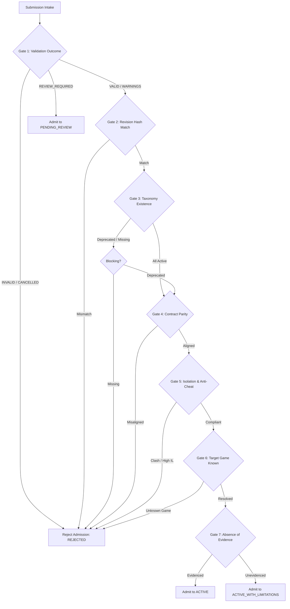
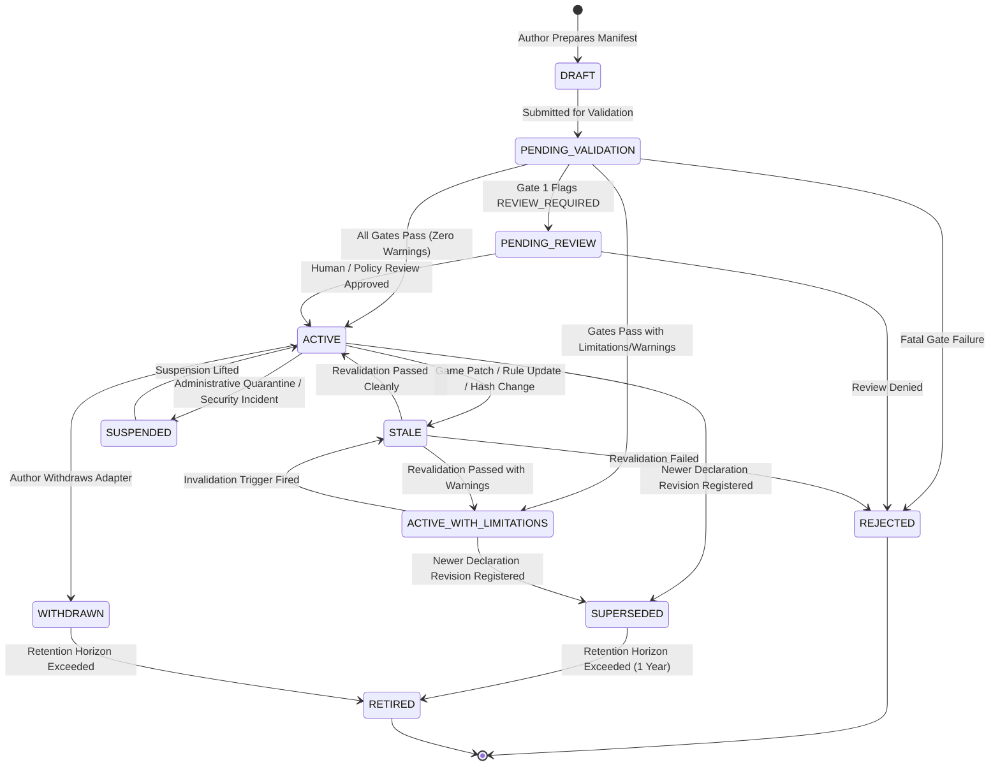
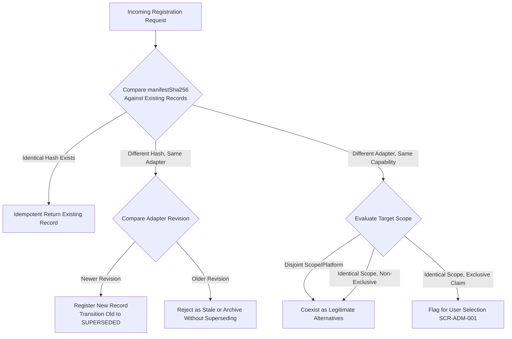

# Capability Registration Eligibility and Lifecycle Policy

**Document Identifier:** `NLE-POL-REL-001`  
**Phase:** Phase 5 — Universal Adapter SDK & Capability System  
**Step:** Step 37 of 100 — Validated Capability Declaration Registry & Discovery Workflow Specification  
**Status:** Approved Platform Policy  
**Classification:** Registration Governance, Lifecycle Transitions & Duplicate Handling  
**Repository Path:** `docs/adapters/CAPABILITY_REGISTRATION_ELIGIBILITY_AND_LIFECYCLE_POLICY.md`  

---

## 1. Executive Summary & Policy Objectives

### 1.1 Purpose
This policy establishes the formal eligibility prerequisites, lifecycle state machine, transition authorities, duplicate resolution rules, and withdrawal protocols for registering Adapter Capability Declarations (`ACD`) within the NexLudic Engine.

### 1.2 Fundamental Invariants
1. **No Self-Activation:** An adapter manifest or author cannot unilaterally promote a declaration to `ACTIVE` status. State promotion requires successful evaluation against the core validation engine (`NLE-SPC-CVC-001`) and compliance with platform governance.
2. **Registration Acceptance Is Not Runtime Authorization:** Registering a declaration merely records that its metadata satisfies structural, semantic, and security criteria. It does not grant execution privileges or certify that the adapter will operate successfully at runtime.
3. **Immutability of Historical Revisions:** A `RegistryRecord` representing an older declaration revision is never overwritten or mutated in place. New revisions supersede previous records, preserving an immutable audit trail.

---

## 2. Registration Eligibility Evaluation Matrix

Before a declaration can be admitted to the registry, the engine evaluates the candidate declaration and its associated `ValidationResultPayload` against seven (7) mandatory eligibility gates:

### 2.1 Eligibility Gates

| Gate ID | Dimension | Evaluation Criteria | Failure Consequence |
|:---|:---|:---|:---|
| **ELG-GAT-001** | **Validation Outcome** | `ValidationResultPayload.overallOutcome` must be `VALID`, `VALID_WITH_WARNINGS`, or `REVIEW_REQUIRED`. | Outright rejection if outcome is `INVALID`, `INCOMPLETE`, `INCOMPATIBLE`, `STALE`, or `CANCELLED`. |
| **ELG-GAT-002** | **Hash Binding** | Computed SHA-256 of candidate `manifest.json` must exactly match `manifestSha256` recorded in validation payload. | Rejection with `ERR_MANIFEST_REVISION_MISMATCH`. Revalidation required. |
| **ELG-GAT-003** | **Taxonomy Active** | All declared capability IDs must exist in `NLE-MOD-CCT-001`. Deprecated capabilities permitted with advisory warning. | Rejection if any capability ID is unlisted or `RETIRED`. |
| **ELG-GAT-004** | **Contract Parity** | `manifestVersion` must be supported by the current Universal Core SDK runtime version. | Rejection with `ERR_UNSUPPORTED_SCHEMA_REVISION`. |
| **ELG-GAT-005** | **Security & Policy** | Must execute `OUT_OF_PROCESS` (`ADR-0002`), require Medium IL (`DEC-002`), and assert zero memory injection on anti-cheat games (`BLK-SEC-01`). | Fatal rejection with `ERR_SECURITY_POLICY_VIOLATION`. |
| **ELG-GAT-006** | **Canonical Target Scope** | `targetGameId` must resolve to a recognized game identity in the platform game catalog. | Rejection with `ERR_UNKNOWN_TARGET_GAME`. |
| **ELG-GAT-007** | **Evidence Quality** | If claims cite evidence, all `EVD-xxxx` records must exist, match game scope, and have valid SHA-256 digests. | If evidence is unevidenced or stale, admitted with `ACTIVE_WITH_LIMITATIONS` (claims downgraded). |

---

## 3. Registry Lifecycle State Machine

The platform establishes nine (9) formal, mutually exclusive lifecycle states for registered capability records:

### 3.1 State Semantics & Access Boundaries

| State | Discoverable in Queries? | Consumable by Pairing Engine? | Description & Transition Authority |
|:---|:---:|:---:|:---|
| `DRAFT` | No | No | Manifest under local development. Not admitted to registry. (Author owned). |
| `PENDING_VALIDATION` | No | No | Manifest queued for execution by `NLE-SPC-CVC-001`. (Validator owned). |
| `PENDING_REVIEW` | No (Quarantine) | No | Manifest contains unvetted custom capabilities (`PROPOSED:`) or sensitive privilege requests. Requires manual or policy approval. (Governance owned). |
| `ACTIVE` | **Yes** | **Yes** | Fully verified, eligible declaration satisfying all gates. Available for compatibility evaluations and mashup planning. |
| `ACTIVE_WITH_LIMITATIONS` | **Yes** | **Yes (Conditional)** | Eligible declaration containing advisory warnings, deprecated references, or unevidenced claims downgraded to `INPUT_UNKNOWN`. |
| `SUSPENDED` | No | No | Temporarily disabled due to detected stability flaws, user disablement, or pending security audit. (User / Platform Admin owned). |
| `STALE` | No (Hidden) | No | Previously active record invalidated by target game patch, rule catalog upgrade, or evidence expiry. Revalidation mandated. |
| `SUPERSEDED` | No (Historical) | No | Replaced by a newer declaration revision for the same adapter and target game. Preserved for audit. |
| `WITHDRAWN` | No (Historical) | No | Voluntarily removed by adapter author or uninstalled from project workspace. |
| `RETIRED` | No (Archive) | No | Historical archive record exceeding active retention horizon. Kept in immutable cold storage. |
| `REJECTED` | No | No | Ineligible submission that failed validation or governance gates. Retained in diagnostic logs only. |

---

## 4. Permitted State Transitions & Authority Matrix

To prevent unauthorized tampering, transitions are strictly guarded by authorized actors:

| Current State | Target State | Permitted Initiator / Actor | Mandatory Precondition |
|:---|:---|:---|:---|
| `PENDING_VALIDATION` | `ACTIVE` | Registry Engine | Gates `ELG-GAT-001` through `007` passed with zero errors/warnings. |
| `PENDING_VALIDATION` | `ACTIVE_WITH_LIMITATIONS` | Registry Engine | Gates passed with non-fatal warnings or unevidenced claims downgraded. |
| `PENDING_VALIDATION` | `PENDING_REVIEW` | Registry Engine | Validation outcome is `REVIEW_REQUIRED`. |
| `PENDING_VALIDATION` | `REJECTED` | Registry Engine | Fatal validation error or gate failure. |
| `PENDING_REVIEW` | `ACTIVE` | Platform Architect / Security Reviewer | Explicit cryptographic sign-off approving custom capabilities. |
| `PENDING_REVIEW` | `REJECTED` | Platform Architect / Security Reviewer | Review rejected due to security or contract risk. |
| `ACTIVE` | `STALE` | Invalidation Trigger (`TRG-REV-001..005`) | Game patch detected, manifest file changed, or rule catalog updated. |
| `ACTIVE` | `SUPERSEDED` | Registry Engine | A newer valid declaration revision (`adapterRevision` higher) is registered. |
| `ACTIVE` | `SUSPENDED` | User / Platform Admin | User disables adapter in UI or crash guard detects instability. |
| `SUSPENDED` | `ACTIVE` | User / Platform Admin | Disablement cleared or issue resolved. |
| `ACTIVE` | `WITHDRAWN` | Adapter Author / Project Owner | Adapter uninstalled from project workspace or explicitly withdrawn. |
| `STALE` | `ACTIVE` | Registry Engine | Revalidation run passes with `VALID` outcome. |
| `SUPERSEDED` | `RETIRED` | Registry Purge Worker | Record age exceeds retention policy (365 days). |

### 4.1 Illegal Transitions
Any attempt to execute transitions not listed in Section 4 is strictly prohibited and immediately aborted with `ERR_ILLEGAL_STATE_TRANSITION`:
- An adapter cannot transition itself from `PENDING_REVIEW` to `ACTIVE`.
- A `WITHDRAWN` or `RETIRED` record cannot transition directly to `ACTIVE`; the author must submit a fresh declaration for intake.
- A `REJECTED` record cannot be revived; a remediated manifest must be submitted anew.

---

## 5. Duplicate Submission and Conflict Resolution Protocol

### 5.1 Duplicate Intake Scenarios

### 5.2 Resolution Handling

| Submission Category | Resolution Protocol | Resulting Registry Action | Diagnostic Emitted |
|:---|:---|:---|:---|
| **Identical Duplicate Submission** | Request has identical `adapterId`, `adapterRevision`, and `manifestSha256` as an existing record. | **Idempotent:** Re-registration is a no-op. Returns existing `registryRecordId`. | `INFO: Declaration already registered with identical revision.` |
| **New Revision (Upgraded Adapter)** | Same `adapterId` and `targetGameId`, but higher `adapterRevision` and different `manifestSha256`. | Validates new manifest. Upon admission, existing record transitions to `SUPERSEDED` (`supersededByRecordId` populated). New record becomes `ACTIVE`. | `INFO: Previous declaration revision superseded.` |
| **Out-of-Order Older Revision** | Manifest with lower `adapterRevision` arrives after a newer revision has already been registered. | Rejected from active registration. Allowed only as historical archive record if explicitly requested. | `WARN: Older declaration revision rejected; newer revision is active.` |
| **Alternative Competing Adapters** | Two different adapters (`AdapterA`, `AdapterB`) declare identical canonical capability for same game. | **Coexistence:** Both records are registered if both pass validation. They represent alternative modding strategies. | None. Both discoverable. Pairing engine chooses based on strategy. |
| **Exclusive Resource Conflict** | Two active adapters claim exclusive control over identical memory addresses or hooking hooks. | Both registered, but compatibility rule `VLD-CNF-004` flags mutual exclusion. UI forces user to select one adapter at project runtime. | `WARN: Competing adapter claims exclusive resource control.` |

---

## 6. Traceability and Cross-Reference Anchors

- `NLE-SPC-VCR-001`: Primary Registry Specification.
- `NLE-MOD-RRM-001`: Registry Record Data Schema.
- `NLE-SPC-CVC-001`: Capability Declaration Validation Specification.
- `NLE-CON-VRD-001`: Diagnostic Record & Validation Payload Schemas.
- `NLE-POL-VRG-001`: Validation Rule Catalog Governance & Reassessment Policy.
- `ADR-0002`: Out-of-Process Adapter Execution Mode.
- `DEC-002`: Standard Windows Medium Integrity Level.
- `BLK-SEC-01`: Platform Anti-Cheat Dominance Guarantee.
