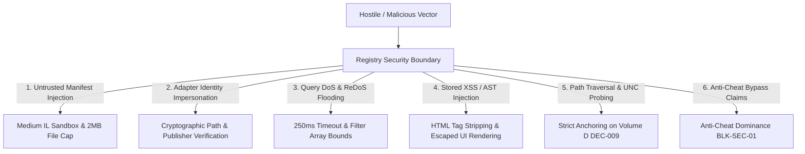

# Capability Registry Consistency, Security, and Recovery Plan

**Document Identifier:** `NLE-PLN-CSR-001`  
**Phase:** Phase 5 — Universal Adapter SDK & Capability System  
**Step:** Step 37 of 100 — Validated Capability Declaration Registry & Discovery Workflow Specification  
**Status:** Approved Architectural Plan  
**Classification:** Security Architecture, Index Consistency & Disaster Recovery  
**Repository Path:** `docs/adapters/CAPABILITY_REGISTRY_CONSISTENCY_SECURITY_AND_RECOVERY_PLAN.md`  

---

## 1. Executive Summary & Security Objectives

### 1.1 Purpose
This specification establishes the security boundaries, access controls, index consistency guarantees, and disaster recovery protocols for the Validated Capability Declaration Registry within the NexLudic Engine.

The registry is an administrative and discovery coordinator; it does not possess elevated permissions, does not execute adapter binaries, and does not grant execution rights. This plan ensures that hostile, corrupted, or out-of-sync adapter declarations cannot compromise the host system, pollute the capability catalog, or deceive the Cross-Game Compatibility Assessment Engine.

---

## 2. Threat Model & Security Boundaries

### 2.1 Defense Matrix

| Threat Vector | Attack Scenario | Enforced Countermeasure |
|:---|:---|:---|
| **Identity Impersonation** | Malicious adapter attempts to register using the canonical ID of an established adapter (`adapter.skyrim.openmw`). | Registry validates adapter folder anchoring and package signing; competing claims over identical adapter ID are rejected. |
| **Self-Authorization** | Manifest author crafts custom metadata claiming `registrationState: "ACTIVE"` without running validation. | Registry assigns lifecycle state internally based strictly on validated payloads (`NLE-CON-VRD-001`). Declared metadata cannot set registry state. |
| **Query ReDoS & DoS** | Hostile query with deeply nested criteria or exponential backtracking regexes designed to freeze discovery worker. | Strict 250ms timeout; DFA-based string matching; array lengths capped (max 50 capabilities, max 20 adapters). |
| **Path Traversal Probing** | Declaration documentation or citation URLs attempt to access `..\..\Windows\System32\` or remote UNC shares. | Strict canonical path verification anchored to `D:\NexLudic\Projects\<id>\Adapters\<adapterId>\` (`DEC-009`). Remote paths rejected. |
| **Privilege Escalation** | Declaration asserts requirement for administrative elevation (High Integrity Level). | Rule `VLD-SEC-002` immediately rejects manifest; registry operates exclusively under Windows Medium IL (`REQ-SEC-001`). |
| **Anti-Cheat Deception** | Declaration claims direct memory hooking on competitive multiplayer games protected by Vanguard or Easy Anti-Cheat. | Anti-cheat dominance rule (`VLD-SEC-001`, `BLK-SEC-01`) rejects registration outright with `INCOMPATIBLE`. |

---

## 3. Source-of-Truth Protection & Index Consistency

To prevent corrupted in-memory projections or partial crashes from destroying ground-truth data, the registry operates under strict transactional invariants:

### 3.1 Unidirectional Ground Truth Flow
$$\texttt{manifest.json} \xrightarrow{\text{Validate}} \texttt{val\_*.json} \xrightarrow{\text{Register}} \texttt{reg\_*.json} \xrightarrow{\text{Project}} \text{In-Memory Discovery Index}$$
- In-memory discovery indexes are **read-only derived views**. They can never write back to or modify `.registry/reg_*.json` or `manifest.json`.
- If an in-memory index becomes corrupted, out-of-sync, or detects a hash divergence, it is immediately discarded and regenerated from disk.

### 3.2 Index Resynchronization & Self-Healing
1. **Cold Start Reconstruction:** Upon application startup, the registry scans `D:\NexLudic\Projects\<id>\Adapters\` for all `reg_*.json` files, verifying that each record's `manifestSha256` matches the current `manifest.json` on disk.
2. **Hash Drift Invalidation:** If a manifest file's on-disk hash differs from `manifestSha256`, the record is marked `STALE` and purged from the active discovery index until revalidation occurs.

---

## 4. Comprehensive Failure Handling & Recovery Scenarios

The platform defines explicit, deterministic recovery procedures for twenty-seven (27) potential failure scenarios across registration, discovery, and lifecycle management:

| # | Scenario Description | Preconditions | Classification | Expected State & Diagnostic | Recovery Action |
|:---:|:---|:---|:---:|:---|:---|
| **1** | Unknown Canonical Capability | ACD references capability ID not in `NLE-MOD-CCT-001`. | Error | Outcome `REJECTED`. Diagnostic: `VLD-REF-001`. | Rejection. Author must use valid canonical ID or prefix custom capability with `PROPOSED:`. |
| **2** | Structural Validation Failure | ACD fails JSON schema syntax or mandatory field checks. | Fatal | Outcome `REJECTED`. Diagnostic: `VLD-STR-001`. | Abort admission. Surface JSON pointer in developer UI for author correction. |
| **3** | Incomplete Semantic Validation | Manifest submitted before Stage D completes. | Error | Outcome `REJECTED`. Diagnostic: `ERR_VALIDATION_INCOMPLETE`. | Reject registration. Enqueue full 11-stage validation run. |
| **4** | Required Approval Unavailable | Manifest asserts `PROPOSED:` capability without review sign-off. | Quarantine | State `PENDING_REVIEW`. Diagnostic: `INFO_REVIEW_PENDING`. | Record quarantined in registry. Hidden from standard discovery queries. |
| **5** | Revision Changes Post-Validation | `manifest.json` edited on disk after validation payload generated. | Error | Outcome `REJECTED`. Diagnostic: `ERR_MANIFEST_REVISION_MISMATCH`. | Reject admission. Force re-run of validation engine. |
| **6** | Repeated Registration Request | Identical manifest and validation payload re-submitted. | Idempotent | State `ACTIVE`. Diagnostic: `INFO_ALREADY_REGISTERED`. | No-op. Return existing `registryRecordId` with HTTP/IPC 200 OK. |
| **7** | Two Registrations Conflict | Two adapters claim exclusive hooking hooks for same game version. | Warning | State `ACTIVE_WITH_LIMITATIONS`. Diagnostic: `VLD-CNF-004`. | Admit both, but flag conflict. UI requires user to choose one active adapter at project runtime. |
| **8** | Out-of-Order Older Revision | Lower adapter revision submitted after newer is active. | Warning | State `REJECTED` or `SUPERSEDED`. Diagnostic: `WARN_OUTDATED_REVISION`. | Prevent regression. Archive older revision without superseding the active record. |
| **9** | Adapter Withdrawn While Registered | Adapter uninstalled from workspace by user. | State Transition | State transitions to `WITHDRAWN`. `isDiscoverable = false`. | Remove from active index. Retain historical record for project audit. |
| **10** | Capability Deprecated in Taxonomy | Canonical taxonomy flags capability as deprecated. | Advisory | State remains `ACTIVE_WITH_LIMITATIONS`. Warning emitted. | Discovery matches append deprecation notice and migration link. |
| **11** | Capability Replaced by Successor | Canonical capability retired; successor identified. | Advisory | State transitions to `STALE`. Migration warning emitted. | Prompt author to upgrade manifest to successor capability. |
| **12** | Declaration Becomes Stale | Evidence record reaches expiration horizon. | Warning | State transitions to `STALE`. Verification state $\rightarrow$ `UNVERIFIED`. | Discovery suppresses record or presents with explicit staleness warning. |
| **13** | Required Dependency Ineligible | Prerequisite capability's adapter is withdrawn. | Error | Dependent record transitions to `ACTIVE_WITH_LIMITATIONS` or `STALE`. | Re-evaluate DAG. Flag missing prerequisite in discovery match rationale. |
| **14** | Supporting Evidence Unavailable | `EVD-xxxx` evidence file missing from registry. | Error | Assigned verification state downgraded to `STRUCTURALLY_CONFORMANT`. | Suppress `EMPIRICALLY_VALIDATED` badge. Preserve explicit unknown. |
| **15** | Query Uses Unsupported Filter | Discovery query supplies invalid filter field. | Error | Query rejected. Diagnostic: `ERR_INVALID_QUERY_FILTER`. | Reject query with schema violation. Caller must correct query payload. |
| **16** | Query Requests Unknown Capability | Search criteria specifies non-existent capability ID. | Clean Result | Query succeeds with 0 matches returned. | Return empty array `results: []` with `totalMatches: 0`. No error. |
| **17** | Caller Lacks Permission | Ordinary user query requests restricted audit logs. | Security | Query rejected. Diagnostic: `ERR_UNAUTHORIZED_LIFECYCLE_QUERY`. | Return HTTP/IPC 403 Forbidden. Conceal internal audit records. |
| **18** | Derived View Incomplete / Stale | In-memory index out of sync with disk `reg_*.json`. | Warning | Discovery returns `freshnessStatus: "PARTIAL"`. | Return available results with partial flag. Trigger asynchronous background index rebuild. |
| **19** | Query Cancelled / Times Out | Exploratory query exceeds 250ms execution limit. | Timeout | Query halts. Emits `freshnessStatus: "PARTIAL"`, `isTruncated: true`. | Return partial results collected within 250ms window. Avoid hanging worker thread. |
| **20** | Multi-Stage Registration Failure | Disk crash during write of `reg_*.json`. | Failure | Transaction rolled back. Zero partial state admitted. | Clean up temporary files. Emit `ERR_REGISTRATION_WRITE_FAILED`. |
| **21** | Update Partially Reflected in Index | Crash occurs after writing record but before indexing. | Recovery | Self-healing on next startup or query. | On query miss, index reconciler scans disk and repairs missing index tuple. |
| **22** | Conflicting Historical State | Audit directory contains corrupt historical records. | Recovery | Isolate corrupt audit file. Active record unaffected. | Log corruption warning in system log. Maintain active registry integrity. |
| **23** | Withdrawn During Active Query | Declaration withdrawn concurrently during query execution. | Race Condition | Atomic snapshot isolation preserves query consistency. | Query returns snapshot state; subsequent query reflects withdrawal. |
| **24** | Broader Support Than Evidenced | Claiming `SUPPORTED` with empty evidence citations. | Conformance | Admitted to `ACTIVE_WITH_LIMITATIONS`. State: `DECLARED_ONLY`. | Rule `VLD-EVD-005` prevents false green checkmarks. |
| **25** | Record Conflicts with Ground Truth | `reg_*.json` references non-existent validation payload. | Inconsistency | Mark record `REJECTED` or `STALE`. | Purge invalid record. Require fresh validation run. |
| **26** | Stale Validation Result Reused | Author links older validation payload to modified manifest. | Error | Rejected at Gate `ELG-GAT-002`. | SHA-256 hash mismatch halts registration. |
| **27** | Upstream Contracts Unverified | Core Phase 4 or Steps 34–36 unverified. | Defensive | Registry runs in provisional mode; logs governance notice. | Mark newly authored records as provisional until formal gate closure. |

---

## 5. Traceability and Cross-Reference Anchors

- `NLE-SPC-VCR-001`: Validated Capability Declaration Registry Specification.
- `NLE-MOD-RRM-001`: Registry Record and Source of Truth Model.
- `NLE-POL-REL-001`: Registration Eligibility & Lifecycle Policy.
- `NLE-CON-CDQ-001`: Discovery Query and Filter Contract.
- `NLE-SPC-DRF-001`: Discovery Result & Freshness Specification.
- `REQ-SEC-001`, `DEC-002`: Windows Medium Integrity Level.
- `DEC-009`: Workspace filesystem anchoring on Volume D.
- `BLK-SEC-01`: Platform Anti-Cheat Dominance Guarantee.
