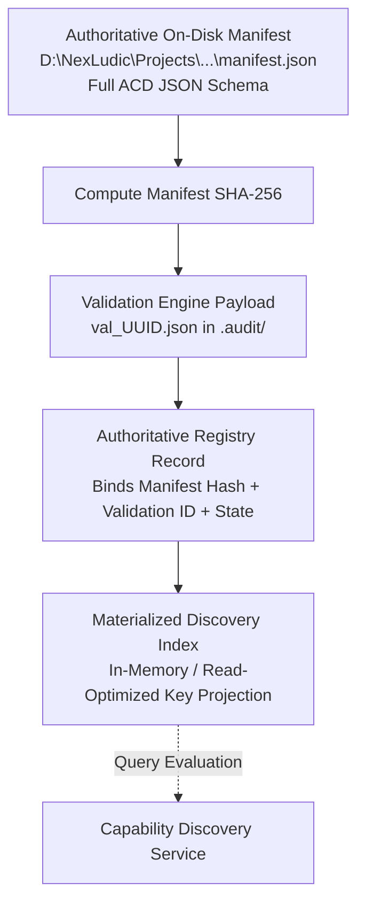

# Capability Registry Record and Source-of-Truth Model Specification

**Document Identifier:** `NLE-MOD-RRM-001`  
**Phase:** Phase 5 — Universal Adapter SDK & Capability System  
**Step:** Step 37 of 100 — Validated Capability Declaration Registry & Discovery Workflow Specification  
**Status:** Approved Architectural Model  
**Classification:** Domain Model & Registry Data Schema  
**Repository Path:** `docs/adapters/CAPABILITY_REGISTRY_RECORD_AND_SOURCE_OF_TRUTH_MODEL.md`  

---

## 1. Executive Summary & Domain Scope

### 1.1 Purpose
This specification defines the formal domain model, data schema, and source-of-truth invariants for registered capability declarations within the NexLudic Engine.

A `RegistryRecord` is an administrative metadata entity maintained by the universal core. It does not replace or duplicate the author's underlying Adapter Capability Declaration (`ACD`, per `NLE-SCH-ACD-001`); rather, it binds an immutable snapshot of that declaration to a specific validation outcome (`ValidationResultPayload`, per `NLE-CON-VRD-001`), assigns lifecycle states, tracks revision history, and exposes optimized query projections for capability discovery.

---

## 2. Declaration Reference vs. Materialized Index Projections

To maintain absolute data integrity without sacrificing query performance, the registry strictly separates the **Authoritative Source Document** from **Materialized Index Projections**:



### 2.1 Separation Matrix

| Dimension | Authoritative Source Document (`ACD`) | Registry Record (`RegistryRecord`) | Materialized Discovery Projection (`IndexEntry`) |
|:---|:---|:---|:---|
| **Storage Location** | `D:\NexLudic\Projects\<id>\Adapters\<adapterId>\manifest.json` | `D:\NexLudic\Projects\<id>\Adapters\<adapterId>\.registry\reg_<id>.json` | Fast in-memory key-value index or read cache |
| **Owner** | Adapter Developer / Modder | Universal Core Registry Subsystem | Discovery Query Worker |
| **Mutability** | Mutable by developer between validations | Immutable once registered; new revisions create new records | Derived, volatile, completely rebuildable |
| **Information Contained** | Full parameter schemas, custom descriptions, condition texts, dependency DAG arrays, evidence citations. | `registryRecordId`, `adapterId`, `manifestSha256`, `validationId`, `lifecycleState`, `registeredAt`, `revisionNumber`. | Flat key tuples: `(canonicalGameId, capabilityId, minVersion, maxVersion, adapterRole, isDiscoverable)`. |
| **Reconciliation Role** | Primary ground truth. | Administrative lifecycle authority. | Query acceleration only. If out-of-sync, purged and rebuilt from Ground Truth. |

---

## 3. Registry Record Data Schema (`NLE-SCH-RRC-001`)

Every registered declaration is modeled as an immutable `RegistryRecord` instance.

### 3.1 Field Specifications

| Field Name | Type | Multiplicity | Description | Example |
|:---|:---:|:---:|:---|:---|
| `registryRecordId` | String (UUIDv4) | `1..1` | Globally unique, immutable identifier for this specific registration event. | `"f47ac10b-58cc-4372-a567-0e02b2c3d479"` |
| `adapterId` | String | `1..1` | Canonical adapter identifier (per `NLE-REQ-MTA-001`). | `"adapter.skyrim.weather_bridge"` |
| `adapterRevision` | String (SemVer) | `1..1` | Semantic version of the adapter publishing the declaration. | `"1.2.0"` |
| `manifestSha256` | String (Hex 64) | `1..1` | Cryptographic SHA-256 digest of the validated manifest file on disk. | `"e3b0c44298fc1c149afbf4c8996fb92427ae41e4649b934ca495991b7852b855"` |
| `manifestVersion` | String (SemVer) | `1..1` | Version of the declaration manifest schema (`NLE-SCH-ACD-001`). | `"1.0.0"` |
| `targetGameId` | String | `1..1` | Canonical game identifier targeted by the adapter. | `"game.bethesda.skyrim_se"` |
| `targetVersionScope` | Object | `1..1` | Supported game versions (`minVersion`, `maxVersion`, `excludedVersions`). | `{"minVersion": "1.5.97", "maxVersion": "1.6.640"}` |
| `validationId` | String (UUIDv4) | `1..1` | Reference to the `ValidationResultPayload` that authorized registration. | `"a1b2c3d4-e5f6-7a8b-9c0d-1e2f3a4b5c6d"` |
| `validationOutcome` | Enum | `1..1` | Overall validation outcome: `VALID`, `VALID_WITH_WARNINGS`, `REVIEW_REQUIRED`. | `"VALID"` |
| `lifecycleState` | Enum | `1..1` | Current registration lifecycle state (`NLE-POL-REL-001`). | `"ACTIVE"` |
| `isDiscoverable` | Boolean | `1..1` | Boolean flag indicating whether the record may be returned in ordinary discovery queries. | `true` |
| `recordRevision` | Integer | `1..1` | Monotonically incrementing integer tracking state transitions of this record. | `1` |
| `registeredAt` | String (ISO 8601) | `1..1` | Timestamp when the record was initially created in the registry. | `"2026-11-18T17:40:00Z"` |
| `updatedAt` | String (ISO 8601) | `1..1` | Timestamp of the most recent lifecycle state update. | `"2026-11-18T17:40:00Z"` |
| `supersededByRecordId` | String (UUIDv4) | `0..1` | If state is `SUPERSEDED`, the `registryRecordId` of the successor record. | `null` |
| `withdrawalReason` | String | `0..1` | Plain-English explanation if state is `WITHDRAWN`, `SUSPENDED`, or `REJECTED`. | `null` |
| `declaredCapabilityIds` | Array[String] | `1..N` | List of canonical capability IDs asserted by this declaration revision. | `["world.environment.weather_sync", "world.time.time_of_day_sync"]` |

### 3.2 Formal JSON Schema Definition

```json
{
  "$schema": "https://json-schema.org/draft/2020-12/schema",
  "$id": "https://schemas.nexludic.internal/v1/capability-registry-record.json",
  "title": "RegistryRecord",
  "description": "Authoritative metadata record representing a registered adapter capability declaration revision.",
  "type": "object",
  "required": [
    "registryRecordId",
    "adapterId",
    "adapterRevision",
    "manifestSha256",
    "manifestVersion",
    "targetGameId",
    "targetVersionScope",
    "validationId",
    "validationOutcome",
    "lifecycleState",
    "isDiscoverable",
    "recordRevision",
    "registeredAt",
    "updatedAt",
    "declaredCapabilityIds"
  ],
  "properties": {
    "registryRecordId": { "type": "string", "format": "uuid" },
    "adapterId": { "type": "string", "pattern": "^[a-z0-9_]+(\\.[a-z0-9_]+)+$" },
    "adapterRevision": { "type": "string", "pattern": "^[0-9]+\\.[0-9]+\\.[0-9]+$" },
    "manifestSha256": { "type": "string", "pattern": "^[a-f0-9]{64}$" },
    "manifestVersion": { "type": "string", "pattern": "^[0-9]+\\.[0-9]+\\.[0-9]+$" },
    "targetGameId": { "type": "string", "pattern": "^[a-z0-9_]+(\\.[a-z0-9_]+)+$" },
    "targetVersionScope": {
      "type": "object",
      "required": ["minVersion", "maxVersion"],
      "properties": {
        "minVersion": { "type": "string" },
        "maxVersion": { "type": "string" },
        "excludedVersions": { "type": "array", "items": { "type": "string" } }
      }
    },
    "validationId": { "type": "string", "format": "uuid" },
    "validationOutcome": {
      "type": "string",
      "enum": ["VALID", "VALID_WITH_WARNINGS", "REVIEW_REQUIRED"]
    },
    "lifecycleState": {
      "type": "string",
      "enum": [
        "ACTIVE",
        "ACTIVE_WITH_LIMITATIONS",
        "PENDING_REVIEW",
        "SUSPENDED",
        "STALE",
        "SUPERSEDED",
        "WITHDRAWN",
        "RETIRED",
        "REJECTED"
      ]
    },
    "isDiscoverable": { "type": "boolean" },
    "recordRevision": { "type": "integer", "minimum": 1 },
    "registeredAt": { "type": "string", "format": "date-time" },
    "updatedAt": { "type": "string", "format": "date-time" },
    "supersededByRecordId": { "type": ["string", "null"], "format": "uuid" },
    "withdrawalReason": { "type": ["string", "null"] },
    "declaredCapabilityIds": {
      "type": "array",
      "minItems": 1,
      "items": { "type": "string", "pattern": "^[a-z0-9_]+(\\.[a-z0-9_]+){2,4}$" }
    }
  },
  "additionalProperties": false
}
```

---

## 4. Revision Integrity & Hash-Binding Invariants

### 4.1 Strict Cryptographic Binding
A `RegistryRecord` is irrevocably bound to the specific binary state of the declaration manifest via its SHA-256 digest (`manifestSha256`):

$$\text{Binding Condition} = \left(\text{SHA256}(\text{manifest.json}) == \texttt{manifestSha256}\right) \land \left(\texttt{validationId.targetSha256} == \texttt{manifestSha256}\right)$$

If an adapter author modifies `manifest.json` on disk:
1. The file watcher or filesystem pre-flight detects that the disk hash diverges from `manifestSha256`.
2. The existing `RegistryRecord` is **NOT** overwritten or mutated.
3. The existing record transitions to `STALE` or `SUPERSEDED` upon re-registration.
4. A new validation run is mandated (`NLE-POL-VRG-001`).
5. A new `RegistryRecord` with a distinct `registryRecordId` and incremented `recordRevision` is registered.

---

## 5. Materialized Index Projections & Reconciliation

### 5.1 In-Memory Discovery Tuple
To serve discovery queries in sub-millisecond time without parsing full JSON files, the registry maintains derived in-memory index projections. Each declared capability produces an indexed lookup tuple:

```typescript
interface CapabilityIndexProjection {
  targetGameId: string;
  capabilityId: string;
  minGameVersion: string;
  maxGameVersion: string;
  adapterId: string;
  adapterRevision: string;
  registryRecordId: string;
  lifecycleState: RegistryLifecycleState;
  isDiscoverable: boolean;
  assignedVerificationState: CapabilityVerificationState;
}
```

### 5.2 Projection Invalidation & Rebuilding
- Projections are ephemeral. They are never written to disk as authoritative state.
- Upon engine launch or cache invalidation, projections are reconstructed by scanning the `.registry/reg_*.json` records in each project adapter workspace on Volume D (`DEC-009`).
- If an index tuple becomes inconsistent with its underlying `RegistryRecord`, the registry worker purges the projection and re-indexes the record.

---

## 6. Traceability and Cross-Reference Anchors

- `NLE-SCH-ACD-001`: Adapter Capability Declaration Schema (Authoritative Source Document).
- `NLE-CON-VRD-001`: Validation Result & Diagnostic Contract.
- `NLE-MOD-CCT-001`: Canonical Capability Taxonomy.
- `NLE-POL-REL-001`: Registration Eligibility & Lifecycle Policy.
- `DEC-009`: Workspace filesystem anchoring (`D:\NexLudic\Projects\<id>\Adapters\<adapterId>\`).
