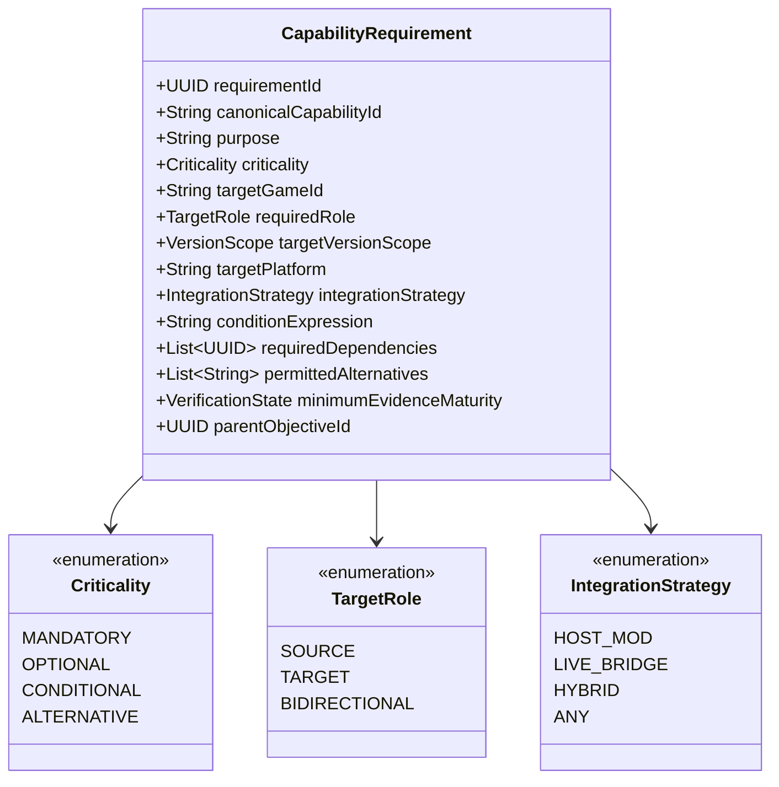

# Capability Requirement Model and Input Contract Specification

**Document Identifier:** `NLE-MOD-CRM-001`  
**Phase:** Phase 5 — Universal Adapter SDK & Capability System  
**Step:** Step 38 of 100 — Capability Matching & Requirement Resolution Specification  
**Status:** Approved Architectural Model  
**Classification:** Domain Model & Input Data Contract  
**Repository Path:** `docs/adapters/CAPABILITY_REQUIREMENT_MODEL_AND_INPUT_CONTRACT.md`  

---

## 1. Executive Summary & Purpose

### 1.1 Purpose
This specification establishes the formal data models and JSON schemas for defining **Capability Requirements** and **Matching Requests** within the NexLudic Engine.

A capability requirement models a discrete functional capability required by a high-level gameplay mashup objective (e.g., "Synchronize player inventory between Game A and Game B", "Render Game A world weather in Game B skybox"). It provides the matching engine with unambiguous technical criteria—including target game scope, SemVer ranges, execution roles, dependency relationships, and criticality classifications—to evaluate candidate adapter declarations without ambiguity or heuristic guesswork.

---

## 2. Capability Requirement Domain Entity

A `CapabilityRequirement` models a single desired capability and its operational boundaries:



### 2.1 Criticality Classification Taxonomy

| Criticality Level | Evaluation Semantics | Unresolved Consequence | Downstream Impact |
|:---|:---|:---|:---|
| `MANDATORY` | Absolute prerequisite for the mashup or feature to function. | The entire requirement resolution and dependent mashup objective evaluate to `UNRESOLVED`. | Blocks mashup deployment and pairing sign-off. |
| `OPTIONAL` | Non-essential enhancement (e.g., cosmetic particle sync, ambient sound replication). | Recorded as `UNRESOLVED_OPTIONAL`. Does **not** block overall mashup feasibility. | Feature gracefully disabled; mashup remains viable. |
| `CONDITIONAL` | Active only when an external environmental or game state condition evaluates to true (e.g., "Only if Game A has DLC X installed"). | If condition is false, evaluates to `NOT_APPLICABLE`. If condition is unknown, evaluates to `UNKNOWN_CONDITION`. | Evaluated dynamically based on local environment profiles. |
| `ALTERNATIVE` | Part of a disjunctive capability set ($\text{Alt}_1 \lor \text{Alt}_2$). Satisfying **any one** approved alternative satisfies the parent requirement. | Requirement remains `UNRESOLVED` only if **all** alternative candidate branches fail. | Enables fallback routes (e.g., memory hook vs. save-game file watcher). |

---

## 3. Formal JSON Schemas

### 3.1 Capability Requirement Schema (`NLE-SCH-CRQ-001`)

```json
{
  "$schema": "https://json-schema.org/draft/2020-12/schema",
  "$id": "https://schemas.nexludic.internal/v1/capability-requirement.json",
  "title": "CapabilityRequirement",
  "description": "Formal specification of a required capability within a NexLudic mashup objective.",
  "type": "object",
  "required": [
    "requirementId",
    "canonicalCapabilityId",
    "purpose",
    "criticality",
    "targetGameId",
    "requiredRole",
    "targetVersionScope",
    "targetPlatform",
    "integrationStrategy"
  ],
  "properties": {
    "requirementId": {
      "type": "string",
      "format": "uuid"
    },
    "canonicalCapabilityId": {
      "type": "string",
      "pattern": "^[a-z0-9_]+(\\.[a-z0-9_]+){2,4}$"
    },
    "purpose": {
      "type": "string",
      "maxLength": 512
    },
    "criticality": {
      "type": "string",
      "enum": ["MANDATORY", "OPTIONAL", "CONDITIONAL", "ALTERNATIVE"]
    },
    "targetGameId": {
      "type": "string",
      "pattern": "^[a-z0-9_]+(\\.[a-z0-9_]+)+$"
    },
    "requiredRole": {
      "type": "string",
      "enum": ["SOURCE", "TARGET", "BIDIRECTIONAL"]
    },
    "targetVersionScope": {
      "type": "object",
      "required": ["minVersion", "maxVersion"],
      "properties": {
        "minVersion": { "type": "string" },
        "maxVersion": { "type": "string" },
        "excludedVersions": {
          "type": "array",
          "items": { "type": "string" }
        }
      }
    },
    "targetPlatform": {
      "type": "string",
      "enum": ["windows-x64", "windows-x86"]
    },
    "requiredEnvironmentProfile": {
      "type": "object",
      "properties": {
        "requiredModLoader": { "type": ["string", "null"] },
        "requiredScriptRuntime": { "type": ["string", "null"] },
        "minimumRamMb": { "type": "integer", "minimum": 0 }
      }
    },
    "integrationStrategy": {
      "type": "string",
      "enum": ["HOST_MOD", "LIVE_BRIDGE", "HYBRID", "ANY"]
    },
    "conditionExpression": {
      "type": ["string", "null"],
      "description": "Boolean expression evaluated against environment facts if criticality is CONDITIONAL."
    },
    "requiredDependencies": {
      "type": "array",
      "items": { "type": "string", "format": "uuid" },
      "description": "List of requirementIds that must be successfully resolved alongside this requirement."
    },
    "permittedAlternatives": {
      "type": "array",
      "items": { "type": "string", "pattern": "^[a-z0-9_]+(\\.[a-z0-9_]+){2,4}$" },
      "description": "Approved canonical capability IDs that may serve as substitutions if criticality is ALTERNATIVE."
    },
    "minimumEvidenceMaturity": {
      "type": "string",
      "enum": [
        "DECLARED_ONLY",
        "STRUCTURALLY_CONFORMANT",
        "CONTRACT_VERIFIED",
        "EVIDENCED_COMPATIBLE",
        "EMPIRICALLY_VALIDATED"
      ],
      "default": "STRUCTURALLY_CONFORMANT"
    },
    "parentObjectiveId": {
      "type": ["string", "null"],
      "format": "uuid"
    }
  },
  "additionalProperties": false
}
```

---

## 4. Capability Matching Request Schema (`NLE-SCH-CMR-001`)

The matching subsystem consumes an overall request payload encapsulating the requirement set and local evaluation context:

```json
{
  "$schema": "https://json-schema.org/draft/2020-12/schema",
  "$id": "https://schemas.nexludic.internal/v1/capability-matching-request.json",
  "title": "CapabilityMatchingRequest",
  "description": "Input payload submitting a set of capability requirements for matching against registered adapter declarations.",
  "type": "object",
  "required": [
    "requestId",
    "parentProjectId",
    "gamePairContext",
    "requirements"
  ],
  "properties": {
    "requestId": { "type": "string", "format": "uuid" },
    "parentProjectId": { "type": "string", "format": "uuid" },
    "evaluatedAt": { "type": "string", "format": "date-time" },
    "gamePairContext": {
      "type": "object",
      "required": ["sourceGame", "targetGame"],
      "properties": {
        "sourceGame": {
          "type": "object",
          "required": ["canonicalGameId", "installedVersion", "platform"],
          "properties": {
            "canonicalGameId": { "type": "string" },
            "installedVersion": { "type": "string" },
            "platform": { "type": "string", "enum": ["windows-x64", "windows-x86"] },
            "installationPath": { "type": "string" }
          }
        },
        "targetGame": {
          "type": "object",
          "required": ["canonicalGameId", "installedVersion", "platform"],
          "properties": {
            "canonicalGameId": { "type": "string" },
            "installedVersion": { "type": "string" },
            "platform": { "type": "string", "enum": ["windows-x64", "windows-x86"] },
            "installationPath": { "type": "string" }
          }
        }
      }
    },
    "requirements": {
      "type": "array",
      "minItems": 1,
      "items": { "$ref": "https://schemas.nexludic.internal/v1/capability-requirement.json" }
    },
    "evaluationOptions": {
      "type": "object",
      "properties": {
        "allowPartialMatches": { "type": "boolean", "default": true },
        "enforceStrictVersionBounds": { "type": "boolean", "default": true },
        "enforceAntiCheatDominance": { "type": "boolean", "default": true },
        "timeoutMs": { "type": "integer", "default": 2000, "maximum": 10000 }
      }
    }
  },
  "additionalProperties": false
}
```

---

## 5. Traceability and Cross-Reference Anchors

- `NLE-SPC-CMR-001`: Primary Capability Matching Specification.
- `NLE-MOD-CCT-001`: Canonical Capability Taxonomy & Domain Model.
- `NLE-MOD-RRM-001`: Registry Record & Discovery Schemas.
- `docs/game-discovery/`: Step 28 Game Version & Environment Mapping rules.
- `DEC-002`, `DEC-009`: Medium IL execution and Volume D project directory anchoring.
