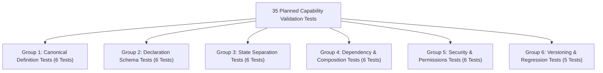

# Capability Schema Security and Validation Test Plan

**Document ID:** `NLE-PLN-CSV-001`  
**Version:** 1.0.0  
**Phase:** 5 of 12 — Universal Adapter SDK & Capability System  
**Step:** 35 of 100 — Canonical Capability Taxonomy & Declaration Schema Specification  
**Classification:** Validation Test Plan & Security Verification Suite  
**Status:** Approved Specification  
**Authoritative Reference:** `NLE-MOD-CCT-001`, `NLE-SCH-CCD-001`, `NLE-SCH-ACD-001`, `NLE-MOD-CDV-001`

---

## 1. Test Architecture & Quality Charter

This document establishes the formal validation test plan for future implementations of the **Canonical Capability Catalog Service**, **Declaration Schema Validator**, and **Dependency Graph Processor**.

In strict compliance with the Phase 5 engineering charter:
- All **35 test specifications** authored below are **planned design-level test specifications**.
- Zero runtime code was implemented during Step 35; no automated test harnesses were executed against live game binaries.

---

## 2. Test Specifications by Group

### 2.1 Group 1: Canonical Definition Schema Tests
- **TC-CAP-DEF-01 (Valid Canonical Definition):** Valid JSON conforming to `NLE-SCH-CCD-001` with active status passes catalog admission; status assigned `ACTIVE`.
- **TC-CAP-DEF-02 (Malformed Identifier Syntax):** Definition with identifier `CAP_INVALID_SYNTAX_01` (underscores instead of hyphens) fails with `ERR-CCD-IDN-01`.
- **TC-CAP-DEF-03 (Invalid Taxonomy Category):** Definition declaring `taxonomyCategory = "UNKNOWN_CAT"` fails with `ERR-CCD-CAT-01`.
- **TC-CAP-DEF-04 (Missing Side-Effect Classification):** Definition omitting `sideEffects` enum fails schema validation with `ERR-CCD-SID-01`.
- **TC-CAP-DEF-05 (Invalid Input JSON Schema):** Definition supplying malformed draft-07 schema in `inputSchema` is rejected with `ERR-CCD-SCH-01`.
- **TC-CAP-DEF-06 (Duplicate Canonical Identifier):** Submitting a new capability definition with an existing `CapabilityId` is rejected with `ERR-CCD-DUP-01`.

### 2.2 Group 2: Adapter Declaration Schema Tests
- **TC-CAP-DEC-01 (Valid Manifest Declaration):** Adapter declaring active capability with valid version range parses successfully; status assigned `StructurallyValid`.
- **TC-CAP-DEC-02 (Unknown Canonical Capability ID):** Declaration referencing `CAP-NONEXISTENT-999` is rejected with `ERR-ACD-CAP-01`.
- **TC-CAP-DEC-03 (Missing Version Scope Bounds):** Declaration omitting `supportedVersionRanges` fails validation with `ERR-ACD-VER-01`.
- **TC-CAP-DEC-04 (Contradictory Support Level):** Declaring `CONDITIONALLY_SUPPORTED` without `partialScopeDescription` fails with `ERR-ACD-PRT-01`.
- **TC-CAP-DEC-05 (Invalid Adapter Role Binding):** Adapter with role `ASSET_TRANSCODER` declaring `CAP-EXT-HOOK-DETOUR` (requires `HOST_MOD_SCAFFOLD`) fails role match check with `ERR-ACD-ROL-01`.
- **TC-CAP-DEC-06 (Malformed Version Range):** Range where `minimumVersion > maximumVersion` (e.g. `2.0 > 1.5`) fails with `ERR-ACD-RNG-01`.

### 2.3 Group 3: Epistemic State Separation Tests
- **TC-CAP-STA-01 (Declared Is Not Verified):** Verifies that an adapter declaration in state `Declared` cannot satisfy a requirement row in `NAV-PRJ-FEA` without evidence.
- **TC-CAP-STA-02 (Structurally Valid != Available):** Verifies that schema-valid declaration on an uninstalled game is marked `Technically Unverified` (`INPUT_UNKNOWN`).
- **TC-CAP-STA-03 (Evidence Requirement for Green Badge):** Verifies that rendering `COVERAGE_SATISFIED` requires evidence state $\ge \text{Tier 2}$.
- **TC-CAP-STA-04 (Contextual Availability Preconditions):** Capability with unfulfilled prerequisite evaluates to `ResourceConstrained` / `PrerequisiteMissing`.
- **TC-CAP-STA-05 (Component Support != Composite Integration):** Verifies report disclaims composite mashup viability even when all individual capabilities are verified.
- **TC-CAP-STA-06 (Unverified Build Hash Warning):** Game binary with unverified PE hash generates `WRN-ADP-VER-03` without failing assessment.

### 2.4 Group 4: Dependency Graph & Composition Tests
- **TC-CAP-DEP-01 (Satisfied Hard Prerequisite):** Capability A depending on B initializes normally when B is active and qualified.
- **TC-CAP-DEP-02 (Cascading Invalidation on Root Failure):** When Root Capability A fails, dependent Capabilities B and C cascade to `UNSUPPORTED`.
- **TC-CAP-DEP-03 (Cycle Detection Rejection):** Declaring $A \to B \to A$ triggers Kahn's algorithm cycle rejection with `ERR-CAP-CYC-01`.
- **TC-CAP-DEP-04 (Mutually Exclusive Rejection):** Binding two capabilities declaring `MUTUALLY_EXCLUSIVE` relationship triggers `ERR-CAP-EXCL-01`.
- **TC-CAP-DEP-05 (Conditional Prerequisite Evaluation):** Verifies Address Library is required only when target build $\ge \text{v1.6.0}$.
- **TC-CAP-DEP-06 (Alternative Path Fallback):** When Primary Telemetry (Shared Memory) is unavailable, engine falls back to Alternative Path (Named Pipes).

### 2.5 Group 5: Security, Permissions & Sandboxing Tests
- **TC-CAP-SEC-01 (Process Elevation Rejection):** Capability declaring `requiredPermissions.processElevation = "UAC_Elevated"` is rejected immediately (`REQ-SEC-001`).
- **TC-CAP-SEC-02 (Anti-Cheat Prohibited Short-Circuit):** Capability requiring memory detours on game with active Vanguard driver emits `BLK-SEC-01`.
- **TC-CAP-SEC-03 (Anti-Self-Authorization):** Verifies adapter worker cannot grant itself filesystem permissions outside Volume D staging directory.
- **TC-CAP-SEC-04 (Untrusted Content AST Stripping):** Capability description containing `` is stripped to safe text.
- **TC-CAP-SEC-05 (Mutation Guarding in Discovery):** Invoking capability declaring `GAME_STATE_MUTATION` during read-only discovery is blocked.
- **TC-CAP-SEC-06 (Execution Timeout Enforcement):** Capability execution exceeding `maxExecutionTimeMs` triggers `TimedOut_OutcomeUnknown`.

### 2.6 Group 6: Versioning, Deprecation & Regression Tests
- **TC-CAP-REG-01 (Non-Breaking Contract Revision Increment):** Editorial update to definition increments `contractRevision` from 1 to 2; existing adapters remain valid.
- **TC-CAP-REG-02 (Breaking Change Rejection on Existing ID):** Attempting to alter parameter types on an existing `CapabilityId` is blocked by schema linter.
- **TC-CAP-REG-03 (Deprecated Capability Migration Hint):** Referencing deprecated capability emits informational migration pointer to replacement.
- **TC-CAP-REG-04 (Historical Trace Preservation):** Verifies historical assessment evaluated under Revision 1 displays original contracts without alteration.
- **TC-CAP-REG-05 (Provisional Capability Namespace Scoping):** Custom capability lacking `PROPOSED:` prefix is rejected by descriptor validator.

