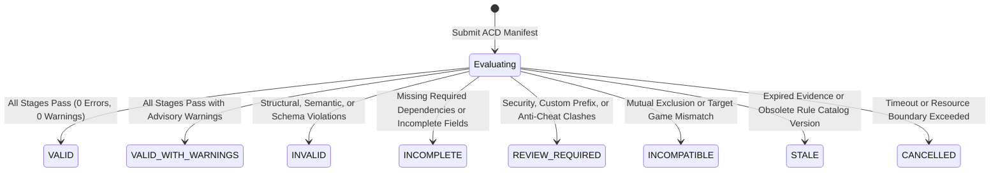
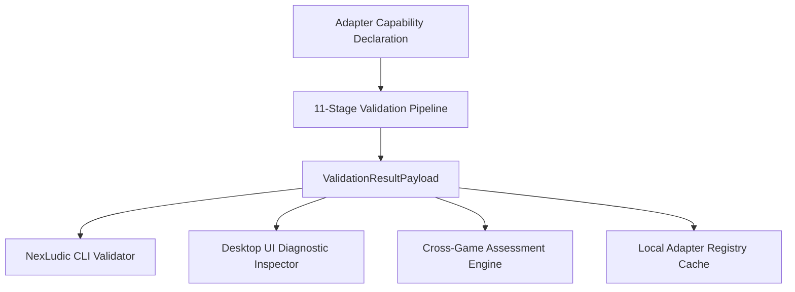

# Capability Validation Result and Diagnostic Contract Specification

**Document Identifier:** `NLE-CON-VRD-001`  
**Phase:** Phase 5 — Universal Adapter SDK & Capability System  
**Step:** Step 36 of 100 — Capability Declaration Validation & Conformance Rules Specification  
**Status:** Approved Architectural Contract  
**Classification:** Universal Core Specification & Diagnostic Protocol  
**Repository Path:** `docs/adapters/CAPABILITY_VALIDATION_RESULT_AND_DIAGNOSTIC_CONTRACT.md`  

---

## 1. Executive Summary & Contract Scope

### 1.1 Purpose
This specification establishes the formal, deterministic data contract for capability declaration validation outcomes and diagnostic reporting within the NexLudic Engine platform. When an adapter author or automated pipeline submits an Adapter Capability Declaration (`ACD`, per `NLE-SCH-ACD-001`) to the universal platform core, the validation engine evaluates the manifest across the 11-stage pipeline defined in `NLE-SPC-CVC-001`.

This document defines:
1. The finite enumeration of validation outcome states.
2. The deterministic resolution hierarchy when multiple issues arise.
3. The exact schema for individual `DiagnosticRecord` objects.
4. The comprehensive machine-readable `ValidationResultPayload` structure.
5. Rules for partial, incremental, and fail-fast validation.
6. The consumer contract for CLI tools, Desktop UI presentation, and the Cross-Game Compatibility Assessment Pipeline (`docs/game-discovery/`).

### 1.2 Anti-Deception & Non-Authorization Invariants
- **Syntactic Soundness is Not Operational Certification:** A validation outcome of `VALID` or `VALID_WITH_WARNINGS` certifies solely that the declaration is syntactically sound, semantically coherent, referentially valid, and structurally conformant. It **never** implies that the adapter runtime binary is benign, functional, authorized, or guaranteed to execute safely.
- **Explicit Unknowns Preserved:** Declarations missing citations or lacking empirical evidence must never be synthesized into a passing verification state. The validator records diagnostic warnings and preserves `INPUT_UNKNOWN` or `UNVERIFIED` statuses.
- **Machine Determinism:** Given identical input declarations, identical rule catalogs, and identical evidence repositories, the validation engine must emit byte-identical diagnostic records and identical outcome states.

---

## 2. Validation Outcome Enumeration & State Semantics

The platform defines exactly eight (8) mutually exclusive overall validation outcomes for an evaluated Adapter Capability Declaration:



### 2.1 Outcome Definitions

| Outcome State | Severity Rank | Description | Platform Consequence |
|:---|:---:|:---|:---|
| `VALID` | 8 (Best) | The declaration satisfies all structural, semantic, reference, dependency, evidence, and security rules without any errors or warnings. | Full admission to capability index. Available for pairing assessment. |
| `VALID_WITH_WARNINGS` | 7 | The declaration passes all mandatory rules, but triggers one or more non-blocking warnings (e.g., deprecated capability reference, near-expiry evidence, sub-optimal memory ceiling). | Admitted to capability index. Warnings surfaced in developer tooling and compatibility UI. |
| `REVIEW_REQUIRED` | 6 | The declaration contains unvetted custom capabilities (`PROPOSED:`), border-line privilege requests, or unverified anti-cheat adjacency. | Quarantine admission. Requires developer acknowledgement or human review before pairing engine activation. |
| `INCOMPLETE` | 5 | The declaration omits prerequisite capability declarations, lacks mandatory version boundaries, or declares capabilities whose dependent nodes cannot be resolved. | Rejected from active pairing. Actionable remediation provided to complete missing elements. |
| `STALE` | 4 | The declaration was previously valid, but relies on expired empirical evidence (`EVD-xxxx`), revoked signatures, or an obsolete rule catalog schema. | Marked stale. Capabilities downgraded to `UNVERIFIED`. Requires re-validation against current catalog. |
| `INCOMPATIBLE` | 3 | The declaration asserts capabilities that directly conflict with declared limitations, violate mutual exclusion rules, or target an unsupported game runtime architecture. | Rejected from pairing. Cannot be reconciled without fundamental declaration refactoring. |
| `INVALID` | 2 | The declaration violates structural JSON schemas, fails identifier regex patterns, asserts invalid SemVer strings, or contains invalid AST tokens. | Immediate rejection. Fatal parsing or schema failure. |
| `CANCELLED` | 1 (Worst) | Validation aborted prematurely due to execution timeout (>5000ms), payload size violation (>2MB), nesting recursion depth (>10), or unhandled parser exception. | Processing halted. Security exception logged. Payload flagged for inspection. |

### 2.2 Outcome Precedence & Conflict Resolution Hierarchy
When a validation run generates multiple diagnostic records across multiple stages, the overall outcome is resolved deterministically by strict severity hierarchy:

$$\text{Final Outcome} = \min_{\text{rank}}(\text{Outcomes of All Generated Diagnostics})$$

1. If any diagnostic has severity `FATAL` $\rightarrow$ Outcome is `CANCELLED` (if resource ceiling exceeded) or `INVALID`.
2. If any diagnostic flags mutual exclusion or target mismatch $\rightarrow$ Outcome is `INCOMPATIBLE`.
3. If any diagnostic flags missing prerequisites or incomplete manifests $\rightarrow$ Outcome is `INCOMPLETE`.
4. If any diagnostic flags unvetted custom proposals or security review gates $\rightarrow$ Outcome is `REVIEW_REQUIRED`.
5. If any diagnostic flags expired evidence or outdated schema revisions without fatal syntax errors $\rightarrow$ Outcome is `STALE`.
6. If any diagnostic has severity `ERROR` $\rightarrow$ Outcome is `INVALID`.
7. If diagnostics contain only `WARNING` $\rightarrow$ Outcome is `VALID_WITH_WARNINGS`.
8. If zero errors and zero warnings $\rightarrow$ Outcome is `VALID`.

---

## 3. Diagnostic Record Data Schema

Every finding produced during validation is represented as a structured `DiagnosticRecord`. Free-form, unformatted error strings are strictly prohibited.

### 3.1 Field Specification

| Field Name | Type | Multiplicity | Description | Example |
|:---|:---:|:---:|:---|:---|
| `diagnosticId` | String | `1..1` | Unique UUID v4 identifying this diagnostic occurrence. | `"d4b8e21a-7b3e-4b9e-9d21-4f1e9c8b7a01"` |
| `ruleId` | String | `1..1` | Catalog identifier of the evaluated rule (per `NLE-CAT-VRC-001`, `NLE-RUL-RVD-001`, etc.). | `"VLD-DEP-003"` |
| `severity` | Enum | `1..1` | Severity level: `FATAL`, `ERROR`, `WARNING`, `INFO`. | `"ERROR"` |
| `stage` | Enum | `1..1` | Pipeline stage where finding occurred (`STAGE_A` through `STAGE_K`). | `"STAGE_F_DEPENDENCY"` |
| `capabilityId` | String | `0..1` | Canonical or custom capability identifier affected (null if manifest-wide). | `"world.environment.weather_sync"` |
| `jsonPath` | String | `1..1` | RFC 6901 JSON pointer to the specific element in the declaration causing the issue. | `"/capabilities/2/dependencies/0"` |
| `errorCode` | String | `1..1` | Standardized alphanumeric machine error token. | `"ERR_CYCLIC_DEPENDENCY"` |
| `message` | String | `1..1` | Plain-English summary explaining the violation unambiguously. | `"Cyclic dependency detected: capability 'A' requires 'B', which depends on 'A'."` |
| `context` | Object | `0..1` | Structured key-value context data enabling deterministic visualization. | `{"cycle": ["cap.A", "cap.B", "cap.A"], "algorithm": "KahnsTopologicalSort"}` |
| `remediation` | Object | `1..1` | Actionable instructions and suggested fix for the adapter developer. | *(See Section 3.2)* |
| `documentationUrl`| String | `1..1` | Markdown or web link to official documentation covering this rule. | `"file:///docs/adapters/CAPABILITY_REFERENCE_VERSION_AND_DEPENDENCY_VALIDATION_RULES.md#vld-dep-003"` |

### 3.2 Remediation Object Schema
To eliminate guesswork for adapter developers, every diagnostic record provides a concrete `remediation` object:

```json
{
  "summary": "Break the dependency cycle between 'cap.A' and 'cap.B'.",
  "recommendedAction": "Change the dependency of 'cap.B' on 'cap.A' to relationshipType 'ENHANCES' or split the shared logic into an independent base capability 'cap.C'.",
  "suggestedPatch": null,
  "isAutoFixable": false
}
```

---

## 4. Comprehensive Validation Result Payload Schema

The top-level output of the validation pipeline is serialized as a single `ValidationResultPayload` document.

### 4.1 JSON Schema Definition (`NLE-SCH-VRP-001`)

```json
{
  "$schema": "https://json-schema.org/draft/2020-12/schema",
  "$id": "https://schemas.nexludic.internal/v1/validation-result-payload.json",
  "title": "ValidationResultPayload",
  "description": "Standardized output payload emitted by the NexLudic Capability Declaration Validation Pipeline.",
  "type": "object",
  "required": [
    "schemaVersion",
    "validationId",
    "evaluatedAt",
    "targetAdapter",
    "overallOutcome",
    "executionMetrics",
    "capabilityVerdicts",
    "diagnostics"
  ],
  "properties": {
    "schemaVersion": {
      "type": "string",
      "const": "1.0.0"
    },
    "validationId": {
      "type": "string",
      "format": "uuid"
    },
    "evaluatedAt": {
      "type": "string",
      "format": "date-time"
    },
    "validatorVersion": {
      "type": "string",
      "pattern": "^[0-9]+\\.[0-9]+\\.[0-9]+$"
    },
    "ruleCatalogVersion": {
      "type": "string",
      "pattern": "^[0-9]+\\.[0-9]+\\.[0-9]+$"
    },
    "targetAdapter": {
      "type": "object",
      "required": ["adapterId", "manifestVersion", "targetGameId", "manifestSha256"],
      "properties": {
        "adapterId": { "type": "string" },
        "manifestVersion": { "type": "string" },
        "targetGameId": { "type": "string" },
        "manifestSha256": { "type": "string", "pattern": "^[a-f0-9]{64}$" }
      }
    },
    "overallOutcome": {
      "type": "string",
      "enum": [
        "VALID",
        "VALID_WITH_WARNINGS",
        "INVALID",
        "INCOMPLETE",
        "REVIEW_REQUIRED",
        "INCOMPATIBLE",
        "STALE",
        "CANCELLED"
      ]
    },
    "executionMetrics": {
      "type": "object",
      "required": [
        "durationMs",
        "rulesEvaluated",
        "rulesPassed",
        "rulesWarned",
        "rulesFailed",
        "rulesSkipped"
      ],
      "properties": {
        "durationMs": { "type": "number", "minimum": 0 },
        "memoryPeakBytes": { "type": "integer", "minimum": 0 },
        "rulesEvaluated": { "type": "integer", "minimum": 0 },
        "rulesPassed": { "type": "integer", "minimum": 0 },
        "rulesWarned": { "type": "integer", "minimum": 0 },
        "rulesFailed": { "type": "integer", "minimum": 0 },
        "rulesSkipped": { "type": "integer", "minimum": 0 }
      }
    },
    "capabilityVerdicts": {
      "type": "array",
      "items": {
        "$ref": "#/$defs/CapabilityVerdict"
      }
    },
    "dependencyEvaluation": {
      "$ref": "#/$defs/DependencyEvaluationSummary"
    },
    "evidenceEvaluation": {
      "$ref": "#/$defs/EvidenceEvaluationSummary"
    },
    "diagnostics": {
      "type": "array",
      "items": {
        "$ref": "#/$defs/DiagnosticRecord"
      }
    }
  },
  "$defs": {
    "CapabilityVerdict": {
      "type": "object",
      "required": ["capabilityId", "status", "assignedVerificationState", "diagnosticCount"],
      "properties": {
        "capabilityId": { "type": "string" },
        "declaredSupportLevel": {
          "type": "string",
          "enum": ["SUPPORTED", "CONDITIONAL", "DEGRADED", "UNSUPPORTED"]
        },
        "status": {
          "type": "string",
          "enum": ["PASSED", "WARNING", "FAILED", "SKIPPED"]
        },
        "assignedVerificationState": {
          "type": "string",
          "enum": [
            "DECLARED_ONLY",
            "STRUCTURALLY_CONFORMANT",
            "CONTRACT_VERIFIED",
            "EVIDENCED_COMPATIBLE",
            "EMPIRICALLY_VALIDATED",
            "UNVERIFIED",
            "DISPROVEN"
          ]
        },
        "diagnosticCount": { "type": "integer", "minimum": 0 }
      }
    },
    "DependencyEvaluationSummary": {
      "type": "object",
      "required": ["hasCycles", "nodeCount", "edgeCount", "topologicalOrder"],
      "properties": {
        "hasCycles": { "type": "boolean" },
        "nodeCount": { "type": "integer" },
        "edgeCount": { "type": "integer" },
        "topologicalOrder": {
          "type": "array",
          "items": { "type": "string" }
        },
        "unresolvedPrerequisites": {
          "type": "array",
          "items": { "type": "string" }
        }
      }
    },
    "EvidenceEvaluationSummary": {
      "type": "object",
      "required": ["totalCitations", "validCitations", "staleCitations", "missingCitations"],
      "properties": {
        "totalCitations": { "type": "integer" },
        "validCitations": { "type": "integer" },
        "staleCitations": { "type": "integer" },
        "missingCitations": { "type": "integer" }
      }
    },
    "DiagnosticRecord": {
      "type": "object",
      "required": [
        "diagnosticId",
        "ruleId",
        "severity",
        "stage",
        "jsonPath",
        "errorCode",
        "message",
        "remediation",
        "documentationUrl"
      ],
      "properties": {
        "diagnosticId": { "type": "string", "format": "uuid" },
        "ruleId": { "type": "string" },
        "severity": { "type": "string", "enum": ["FATAL", "ERROR", "WARNING", "INFO"] },
        "stage": { "type": "string" },
        "capabilityId": { "type": ["string", "null"] },
        "jsonPath": { "type": "string" },
        "errorCode": { "type": "string" },
        "message": { "type": "string" },
        "context": { "type": "object" },
        "remediation": {
          "type": "object",
          "required": ["summary", "recommendedAction", "isAutoFixable"],
          "properties": {
            "summary": { "type": "string" },
            "recommendedAction": { "type": "string" },
            "suggestedPatch": { "type": ["string", "null"] },
            "isAutoFixable": { "type": "boolean" }
          }
        },
        "documentationUrl": { "type": "string" }
      }
    }
  }
}
```

---

## 5. Execution Modes: Fail-Fast vs. Comprehensive Audit

The validation engine supports two distinct operational modes controlled via pipeline configuration:

### 5.1 Comprehensive Audit Mode (Default)
- **Behavior:** The engine executes all 11 stages sequentially, collecting all non-fatal diagnostics across every capability and dependency edge.
- **Use Cases:** Developer IDE linting, CI/CD manifest verification, offline catalog indexing, and full compatibility reporting.
- **Benefits:** Provides a complete diagnostic manifest so the developer can address all errors in a single development turn rather than iterating through successive single failures.

### 5.2 Fail-Fast Mode
- **Behavior:** The engine halts execution immediately upon encountering the first diagnostic with severity `FATAL` or `ERROR` in any stage.
- **Use Cases:** Automated runtime pairing admission, high-throughput batch manifest scanning, and pre-launch integrity gating.
- **Ceiling Rules:** Stages A (Input Safety) and B (Structural Conformance) **always** fail fast if a fatal parsing error, AST corruption, or payload violation occurs, preventing corrupted data from entering semantic and dependency stages.

---

## 6. Consumer Contracts & Integration Surfaces



### 6.1 NexLudic CLI Integration
- Returns exit code `0` for `VALID` and `VALID_WITH_WARNINGS`.
- Returns exit code `1` for `INVALID`, `INCOMPLETE`, `INCOMPATIBLE`, `REVIEW_REQUIRED`, `STALE`.
- Returns exit code `2` for `CANCELLED` (timeout/resource exhaustion).
- Prints human-readable ANSI colored diagnostic cards by default, with `--json` flag emitting raw `ValidationResultPayload`.

### 6.2 Desktop UI Integration (`docs/ui/`)
- Integrates with Adapter Management screens (`SCR-ADM-001`).
- Displays summary status badges (`Valid`, `Warnings`, `Action Required`, `Incompatible`).
- Offers an interactive Diagnostic Drawer displaying grouped diagnostics with one-click copy of JSON pointer paths and remediation instructions.

### 6.3 Cross-Game Assessment Engine Integration (`docs/game-discovery/`)
- Consumes `capabilityVerdicts` and `assignedVerificationState` to populate the compatibility matrix.
- Capabilities marked `STRUCTURALLY_CONFORMANT` or `DECLARED_ONLY` without `EMPIRICALLY_VALIDATED` are treated with conservative caution, preventing unwarranted green checkmarks in mashup evaluations.

---

## 7. Traceability and Cross-Reference Anchors

- `NLE-SPC-CVC-001`: Pipeline architecture defining the 11 validation stages.
- `NLE-CAT-VRC-001`: Structural and semantic rule catalog emitting diagnostic codes.
- `NLE-RUL-RVD-001`: Reference, version, and Kahn DAG dependency rules.
- `NLE-RUL-EDC-001`: Evidence consistency and absence-of-evidence rules.
- `NLE-MOD-CDV-001`: Verification state progression model (`DECLARED_ONLY` $\rightarrow$ `EMPIRICALLY_VALIDATED`).
- `DEC-002`, `DEC-009`: Standard Medium IL execution and directory anchoring.
