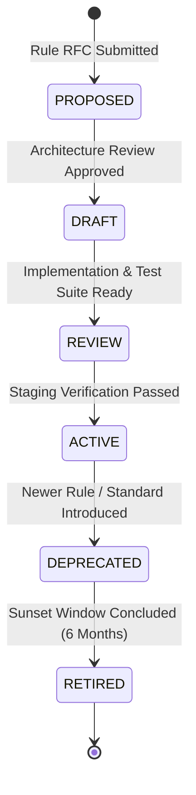
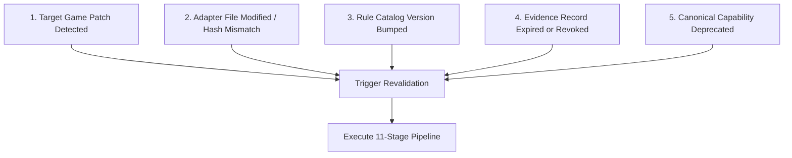

# Capability Validation Rule Governance and Reassessment Policy

**Document Identifier:** `NLE-POL-VRG-001`  
**Phase:** Phase 5 — Universal Adapter SDK & Capability System  
**Step:** Step 36 of 100 — Capability Declaration Validation & Conformance Rules Specification  
**Status:** Approved Platform Policy  
**Classification:** Rule Governance, Catalog Evolution & Revalidation Protocol  
**Repository Path:** `docs/adapters/CAPABILITY_VALIDATION_RULE_GOVERNANCE_AND_REASSESSMENT_POLICY.md`  

---

## 1. Executive Summary & Policy Objectives

### 1.1 Purpose
The NexLudic Engine capability validation pipeline relies on an authoritative rule catalog (`NLE-CAT-VRC-001`, `NLE-RUL-RVD-001`, `NLE-RUL-EDC-001`) to evaluate Adapter Capability Declarations (`ACD`). However, game environments, platform capabilities, and compatibility evidence are not static; game developers release game patches, community modders publish new adapters, and platform security policies evolve.

This policy defines:
1. The formal governance lifecycle for validation rules from inception to retirement.
2. The semantic versioning scheme for the validation rule catalog.
3. The backward compatibility and deprecation migration rules for adapter developers.
4. The deterministic triggers that mandate revalidation of existing adapter declarations.
5. The execution model governing background vs. on-demand reassessment.
6. The historical audit trail requirements preserving explainable validation provenance.

---

## 2. Validation Rule Lifecycle States

Every validation rule implemented in the NexLudic platform progresses through six (6) distinct lifecycle states:

### 2.1 State Definitions & Transition Criteria

| Lifecycle State | Description | Pipeline Impact | Transition Requirement |
|:---|:---|:---|:---|
| `PROPOSED` | A new rule is submitted as a platform enhancement RFC. | Not included in runtime validator. | Formal architectural RFC document. |
| `DRAFT` | Rule logic, error codes, and remediation instructions are authored in catalog specs. | Available only in experimental test harnesses. | Code review by Core SDK & Security teams. |
| `REVIEW` | Rule is deployed to developer preview builds. Evaluates live manifests in non-blocking observation mode. | Emits diagnostics at `INFO` severity only. | 30-day bake period; zero false-positive reports. |
| `ACTIVE` | Official production rule. Fully enforced across all validation stages. | Emits configured severity (`FATAL`, `ERROR`, or `WARNING`). Blocks admission if violated. | Approval by Universal Core Architecture Board. |
| `DEPRECATED` | Rule is superseded by a newer rule or capability standard. Marked for retirement. | Emits `WARNING` severity. Explains migration path to successor rule. | Successor rule active; 6-month deprecation window opened. |
| `RETIRED` | Rule is permanently removed from active evaluation. | Purged from pipeline execution. Diagnostic codes archived for historical audit log parsing. | Deprecation window closed; zero dependent active adapters in registry. |

---

## 3. Rule Catalog Semantic Versioning & Backward Compatibility

The validation rule catalog is versioned independently from the core engine using Semantic Versioning (`MAJOR.MINOR.PATCH`):

$$\text{Rule Catalog Version} = \mathbf{M}.\mathbf{m}.\mathbf{p}$$

### 3.1 Version Semantics

| Version Component | Trigger Criteria | Backward Compatibility Impact | Adapter Author Action |
|:---|:---|:---|:---|
| **MAJOR (M)** | Introducing a new mandatory declaration field, elevating an existing `WARNING` to `ERROR`, or removing a deprecated rule. | **Breaking:** Previously `VALID` manifests may now evaluate to `INVALID` or `INCOMPLETE`. | Manifest must be updated and re-declared. |
| **MINOR (m)** | Adding new optional fields, introducing a new advisory `WARNING` rule, or recognizing new canonical capabilities. | **Non-Breaking:** Existing valid declarations remain `VALID` or become `VALID_WITH_WARNINGS`. | Review new warnings; optional adoption of new capabilities. |
| **PATCH (p)** | Refining regex patterns to reduce false positives, correcting remediation text, or updating documentation links. | **Fully Compatible:** Does not alter validation verdicts. | No developer action required. |

### 3.2 Breaking Change Grace Period Policy
To protect community developers from sudden breaking changes:
1. **Mandatory Warning Precursor:** No rule may be introduced directly as a breaking `ERROR` in a minor release. It must first exist as an active `WARNING` for at least **one full minor release cycle** (or 60 calendar days).
2. **Deprecation Window:** Deprecated rules or canonical capability identifiers must maintain `DEPRECATED` status emitting advisory warnings for a minimum of **six (6) months** prior to permanent retirement.

---

## 4. Deterministic Revalidation Triggers

An adapter that previously achieved `VALID` status cannot remain valid indefinitely without re-assessment. The platform establishes five (5) distinct triggers that automatically invalidate a cached `ValidationResultPayload` and mandate revalidation:

### 4.1 Trigger Taxonomy

| Trigger Identifier | Source Subsystem | Event Condition | Revalidation Urgency |
|:---|:---|:---|:---|
| `TRG-REV-001` | **Game Discovery Subsystem** (`docs/game-discovery/`) | Local game update detected; target game build ID or executable SHA-256 hash changed. | **High (Immediate on next game launch/pairing)** |
| `TRG-REV-002` | **Adapter File Watcher** (`DEC-009`) | ACD JSON file, manifest, or adapter bundle modified; filesystem hash mismatch against cached manifest SHA-256. | **Immediate (On file save / import)** |
| `TRG-REV-003` | **Platform Core Engine** | Validation Rule Catalog updated to a new Major or Minor version. | **Batch Scheduled (Background idle queue)** |
| `TRG-REV-004` | **Evidence Registry** (`NLE-RUL-EDC-001`) | Cited evidence record (`EVD-xxxx`) reaches expiration date, is revoked, or has its verification signature invalidated. | **Medium (Downgrade affected capabilities to STALE/UNVERIFIED)** |
| `TRG-REV-005` | **Taxonomy Governance** (`NLE-MOD-CCT-001`) | Canonical capability definition transitions from `ACTIVE` to `DEPRECATED` or `RETIRED`. | **Low (Flag non-blocking warning on next assessment)** |

---

## 5. Revalidation Execution Model: Background vs. Just-In-Time

To ensure the desktop client remains responsive without causing disk I/O or CPU spikes, revalidation tasks are scheduled across two execution channels:

### 5.1 Just-In-Time (JIT) Synchronous Evaluation
- **Trigger:** User initiates a cross-game pairing assessment, opens the Adapter Management screen (`SCR-ADM-001`), or triggers mashup execution.
- **Behavior:** The engine checks cache freshness. If any trigger (`TRG-REV-001` through `TRG-REV-005`) has fired for the target adapter, a synchronous fail-fast or comprehensive revalidation is executed immediately.
- **SLA:** Must complete within the 5,000ms execution budget (`NLE-SPC-VSR-001`).

### 5.2 Background Idle Asynchronous Queue
- **Trigger:** Core rule catalog version bump (`TRG-REV-003`) or scheduled evidence freshness sweep.
- **Behavior:** Revalidation tasks are enqueued in a low-priority background worker running only when the host system is idle (CPU usage < 25%, battery AC power confirmed).
- **Throttling:** Maximum 1 adapter revalidated per 10 seconds to avoid disk contention on Volume D (`DEC-009`).

---

## 6. Historical Audit Trail & Provenance Retention

Explainability and auditability are foundational tenets of the NexLudic platform. Developers and users must always be able to inspect why an adapter was accepted, warned, or rejected.

### 6.1 Audit Storage Specification
1. **Immutable History Store:** Every executed validation produces a `ValidationResultPayload` (`NLE-CON-VRD-001`) that is saved to the local project audit directory:
   $$\texttt{D:\textbackslash NexLudic\textbackslash Projects\textbackslash<projectId>\textbackslash Adapters\textbackslash<adapterId>\textbackslash.audit\textbackslash val\_<validationId>.json}$$
2. **Retention Policy:** The platform retains the last **ten (10) validation payloads** per adapter, plus the most recent payload for each distinct game build ID.
3. **Diagnostic Diffing:** The Desktop UI provides an automated diffing inspector allowing authors to compare `ValidationResultPayload` instances across consecutive runs, highlighting newly introduced warnings or remediated errors.

---

## 7. Traceability and Cross-Reference Anchors

- `NLE-SPC-CVC-001`: Sequential validation pipeline stages.
- `NLE-CAT-VRC-001`: Authoritative rule catalog subject to this governance policy.
- `NLE-CON-VRD-001`: Validation payload and diagnostic record schemas.
- `NLE-RUL-EDC-001`: Evidence expiration and invalidation rules.
- `docs/game-discovery/`: Game patch detection triggers.
- `DEC-009`: Workspace filesystem anchoring.
