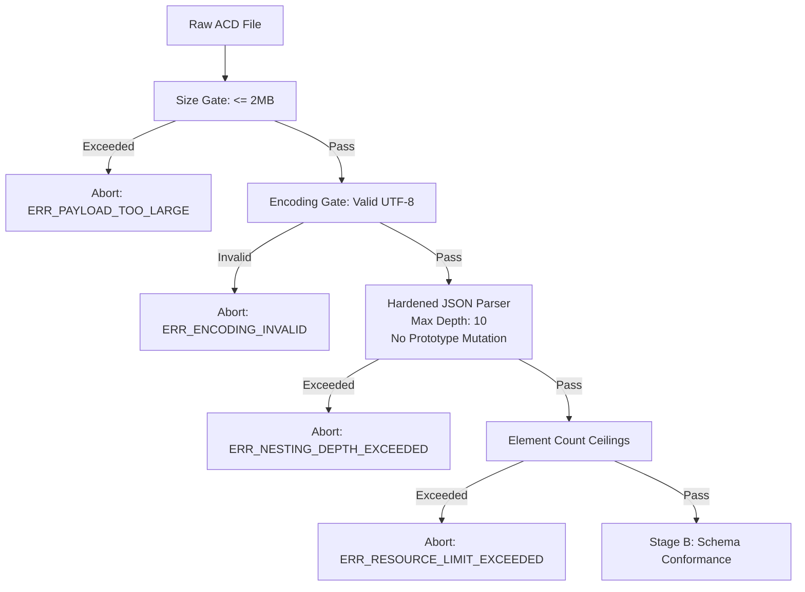
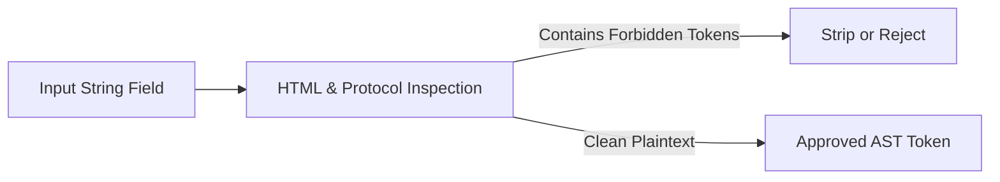
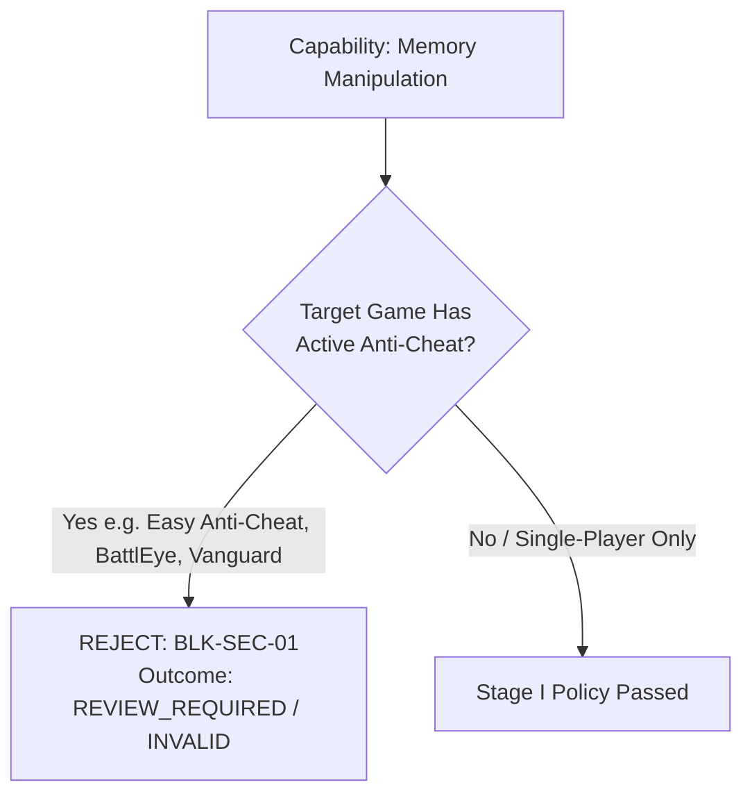

# Capability Validation Security and Resource Boundary Specification

**Document Identifier:** `NLE-SPC-VSR-001`  
**Phase:** Phase 5 — Universal Adapter SDK & Capability System  
**Step:** Step 36 of 100 — Capability Declaration Validation & Conformance Rules Specification  
**Status:** Approved Architectural Specification  
**Classification:** Security Architecture & Sandbox Conformance  
**Repository Path:** `docs/adapters/CAPABILITY_VALIDATION_SECURITY_AND_RESOURCE_BOUNDARY_SPECIFICATION.md`  

---

## 1. Threat Model & Security Objectives

### 1.1 Untrusted Input Environment
Adapter Capability Declarations (`ACD`, per `NLE-SCH-ACD-001`) are author-authored JSON artifacts provided by community developers, third-party publishers, or automated tooling. Consequently, the NexLudic validation engine must treat all incoming capability declarations as **untrusted, hostile input**.

The primary threat vectors addressed by this specification include:
1. **Denial of Service (DoS) via Resource Exhaustion:** Malformed or deeply nested JSON payloads designed to cause stack overflow, unbounded heap allocation, or quadratic parser execution.
2. **ReDoS (Regular Expression Denial of Service):** Maliciously crafted identifier, SemVer, or hash strings intended to trigger exponential catastrophic backtracking in validation regex engines.
3. **Prototype Pollution & Object Injection:** Payloads targeting dynamic language runtimes through special properties (`__proto__`, `constructor`, `prototype`).
4. **Cross-Site Scripting (XSS) & Content Injection in UI:** Malicious payloads embedding raw `<script>`, `<iframe>`, or `javascript:` URI vectors inside free-form description or condition fields, targeting Desktop UI rendering (`docs/ui/`).
5. **Path Traversal & Filesystem Probing:** Relative path manipulations (`../`), UNC paths, symlink redirections, or NTFS Alternate Data Streams (`ADS`) attempting to read unauthorized host files outside the project workspace.
6. **Deceptive Privilege & Anti-Cheat Evasion:** Declarations deceptively asserting support for memory manipulation or process hooking against protected competitive games, risking player account bans.

---

## 2. Hardened Payload & Parsing Boundaries

To prevent resource exhaustion and parser vulnerabilities, the validation engine enforces hard boundaries at Stage A (Input Safety & Structural Pre-flight, per `NLE-SPC-CVC-001`) prior to AST generation or schema validation.

### 2.1 Quantitative Payload Ceilings

| Boundary Dimension | Hard Limit | Enforcement Mechanism | Violation Error Code |
|:---|:---:|:---|:---|
| **Max Manifest File Size** | 2,097,152 bytes (2.0 MB) | Pre-read filesystem size check and streaming byte counter | `ERR_PAYLOAD_TOO_LARGE` |
| **Max Nesting Depth** | 10 levels | Recursive descent depth counter in JSON parser | `ERR_NESTING_DEPTH_EXCEEDED` |
| **Max Capabilities Declared** | 500 per manifest | Array length check on `/capabilities` | `ERR_CAPABILITY_LIMIT_EXCEEDED` |
| **Max Dependencies per Capability** | 50 dependencies | Array length check on `/capabilities/{i}/dependencies` | `ERR_DEPENDENCY_LIMIT_EXCEEDED` |
| **Max Evidence Citations per Capability** | 20 citations | Array length check on `/capabilities/{i}/evidenceCitations` | `ERR_CITATION_LIMIT_EXCEEDED` |
| **Max Identifier Length** | 128 characters | String length check on `capabilityId`, `adapterId` | `ERR_STRING_LENGTH_EXCEEDED` |
| **Max Short Text Length** | 512 characters | String length check on `summary`, `condition` | `ERR_STRING_LENGTH_EXCEEDED` |
| **Max Long Text Length** | 4,096 characters | String length check on `description`, `notes` | `ERR_STRING_LENGTH_EXCEEDED` |
| **Total AST Node Count** | 50,000 nodes | Parser node allocation counter | `ERR_AST_NODE_LIMIT_EXCEEDED` |

### 2.2 Parser Hardening & ReDoS Protection
- **Object Mutation Immunity:** The JSON parser must operate in strict dictionary mode with all prototype mutation keys (`__proto__`, `constructor`, `prototype`) explicitly suppressed or rejected as syntax violations.
- **Strict Linear Regex Engines:** All regular expressions used across Stage B and Stage C (e.g., SemVer `VLD-STR-002`, capability identifier `VLD-STR-004`, SHA-256 hashes) must use deterministic finite automata (DFA) engines or engines with strict backtracking caps (maximum 1,000 steps). Any regex evaluation taking longer than 50 milliseconds is immediately terminated with `ERR_REGEX_TIMEOUT`.

---

## 3. AST Sanitization & UI Content Injection Defense

Adapter declarations contain human-readable string fields (`summary`, `description`, `condition`, `remediation`, `notes`) that are subsequently rendered in the NexLudic Desktop UI (`SCR-ADM-001`, `SCR-CMP-001`). To prevent stored XSS and UI hijacking, Stage A enforces strict content sanitization:

### 3.1 Content Sanitization Rules

1. **Absolute Tag Ban:** Any occurrence of `<script>`, `<iframe>`, `<style>`, `<embed>`, `<object>`, `<applet>`, `<form>`, `<input>`, `<button>`, or `<link>` triggers rule `VLD-SEC-004` (Severity `FATAL`). The manifest is rejected immediately.
2. **Protocol Filtering:** URLs in `documentationUrl` or citation references must strictly match `https://` or internal relative `file:///docs/` schemes. Any URI utilizing `javascript:`, `vbscript:`, `data:`, or `blob:` is rejected with `ERR_DISALLOWED_URI_SCHEME`.
3. **Escaped HTML Rendering:** When the Desktop UI renders string fields, it must render them as raw escaped text or through a constrained Markdown renderer that disables raw HTML parsing (`sanitize: true`).

---

## 4. Runtime Isolation & Zero-Execution Invariants

### 4.1 Pure Static Analysis Invariant
The capability declaration validation pipeline is **strictly a static analysis engine**.
- **Zero Binary Execution:** The validation engine must **never** execute, launch, load, inspect via debuggers, or invoke any adapter binary, script, DLL, or native shared library during validation.
- **Zero Memory Hooking or Process Injection (`REQ-SAFE-001`):** The validator does not interact with running processes, does not inject code, and does not attach API hooks.
- **Zero Dynamic Code Evaluation:** The validator never executes `eval()`, dynamic script interpreters, or reflection-based invocation over adapter declarations.

### 4.2 Windows Medium Integrity Level Boundary (`REQ-SEC-001`)
- The NexLudic validation engine runs entirely under standard user privileges (**Windows Medium Integrity Level**).
- It must never request, require, or inherit elevated administrative privileges (**High Integrity Level / UAC Elevation**).
- Any manifest requiring administrative elevation for adapter execution is rejected at Stage I under rule `VLD-SEC-002`.

### 4.3 Process Resource Caps during Validation
To ensure the host desktop remains completely responsive during validation:
- **Execution Timeout:** The entire validation run across all 11 stages must complete within **5,000 milliseconds (5.0s)**. If the clock expires, execution is aborted with outcome `CANCELLED` and diagnostic `ERR_VALIDATION_TIMEOUT`.
- **Memory Ceiling:** The validation worker process is constrained to a peak resident working set of **128 Megabytes (128 MB)**. Exceeding this boundary triggers immediate termination.

---

## 5. Filesystem Anchoring & Path Traversal Defense (`DEC-009`)

All adapter artifacts, manifests, and declarations must reside strictly within the designated user project workspace:

$$\text{Adapter Root} = \texttt{D:\textbackslash NexLudic\textbackslash Projects\textbackslash<projectId>\textbackslash Adapters\textbackslash<adapterId>\textbackslash}$$

### 5.1 Filesystem Access Rules

| Check Type | Rule Specification | Failure Consequence |
|:---|:---|:---|
| **Root Canonicalization** | The path to the ACD manifest must be resolved to its canonical physical path using `GetFinalPathNameByHandle` (or equivalent) to resolve NTFS reparse points. | If canonical root does not start with `D:\NexLudic\Projects\`, validation is refused. |
| **Path Traversal Sequences** | Paths must not contain relative segments (`..`, `./`), trailing dots, or alternate data stream delimiters (`:`). | Rejected with `ERR_PATH_TRAVERSAL_DETECTED`. |
| **Symlink Redirection Ban** | Symbolic links, directory junctions, and NTFS hard links pointing outside the adapter directory are strictly forbidden. | Rejected with `ERR_UNAUTHORIZED_SYMLINK`. |
| **Network & UNC Paths** | Universal Naming Convention paths (`\\server\share`) and remote drive shares are prohibited. | Rejected with `ERR_REMOTE_PATH_DISALLOWED`. |

---

## 6. Anti-Cheat Dominance & Safe Gaming Policy (`BLK-SEC-01`)

To protect user game accounts from bans in competitive multiplayer games, the validation engine enforces hard anti-cheat dominance at Stage I (Security and Platform Policy Checks):

### 6.1 Policy Rules
1. **Rule `VLD-SEC-001` (Anti-Cheat Conflict):** If the target game profile (per `docs/game-discovery/`) indicates active anti-cheat protection (e.g., Easy Anti-Cheat, BattlEye, Ricochet, Vanguard, VAC), any adapter declaring capabilities in categories:
   - `core.interop.memory_bridge`
   - `core.interop.hooking`
   - `core.interop.process_injection`
   is **immediately rejected** with outcome `INCOMPATIBLE` and severity `FATAL`.
2. **Non-Bypass Guarantee:** The platform provides no override, bypass flag, or developer exemption for anti-cheat conflicts.

---

## 7. Traceability and Cross-Reference Anchors

- `NLE-SPC-CVC-001`: Pipeline architecture and Stage A/I security positioning.
- `NLE-CAT-VRC-001`: Structural rule catalog and error code assignments.
- `NLE-CON-VRD-001`: Diagnostic outcome schemas and `CANCELLED` state definitions.
- `REQ-SEC-001`: Windows Medium Integrity Level execution requirement.
- `REQ-SAFE-001`: Anti-hooking, memory protection, and non-destructive gaming guarantee.
- `BLK-SEC-01`: Platform anti-cheat protection policy.
- `DEC-009`: Workspace filesystem anchoring on Volume D.
