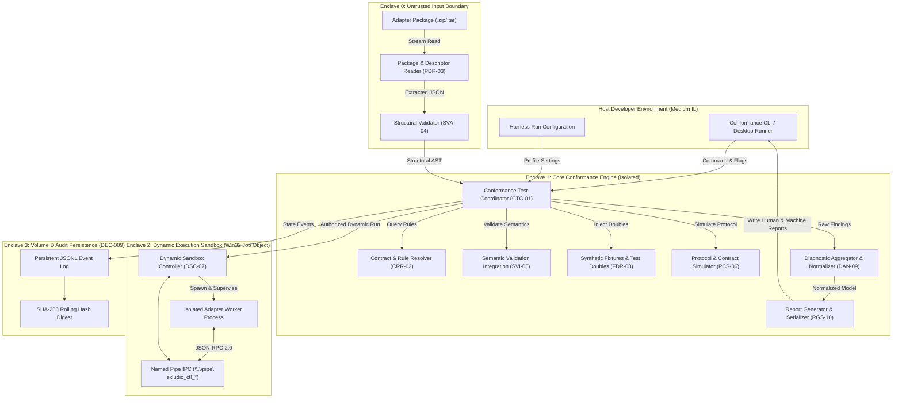

# CONFORMANCE HARNESS ARCHITECTURE AND TRUST BOUNDARIES
**Document ID:** `NLE-ARC-CTB-001`  
**Version:** 1.0.0  
**Phase:** Phase 5 (Universal Adapter SDK & Capability System)  
**Step:** Step 41 of 100  
**Status:** Approved Architectural Standard  
**Authors:** Principal Software Architect, Security Architect, Testing Architect, Distributed-State Designer  
**Classification:** Architectural Blueprint  

---

## 1. PURPOSE AND ARCHITECTURAL SCOPE

### 1.1 Purpose
This specification establishes the modular logical architecture, component boundaries, data flows, and security trust enclaves for the **Universal Adapter SDK Conformance Test Harness** (`CMP-41`). 

The harness is engineered to evaluate third-party and first-party game adapters against NexLudic Engine's approved SDK contracts without exposing the developer's host machine to malware, memory leaks, privilege escalation, or anti-cheat account bans. It coordinates static parsing, protocol simulation, and optional dynamic execution through strict, non-bypassable architectural boundaries.

---

## 2. MERMAID LOGICAL ARCHITECTURE AND TRUST ENCLAVES



---

## 3. LOGICAL COMPONENT SPECIFICATIONS

The harness decomposes into exactly 11 logical components:

### 3.1 Conformance Test Coordinator (`CTC-01`)
- **Primary Responsibility:** Master orchestrator that controls test suite scheduling, enforces execution profile constraints, sequences test phases, and coordinates findings aggregation.
- **Inputs:** Run configuration options, chosen profile (Static, Contract, Dynamic), package path.
- **Outputs:** Conformance execution status, aggregated result payload.
- **Authority:** Enforces that no dynamic tests run unless explicitly authorized.
- **Failure Behavior:** If an internal exception occurs, marks run as `ERROR` and aborts safely.

### 3.2 Approved Contract & Rule Catalog Resolver (`CRR-02`)
- **Primary Responsibility:** Loads and indexes the authoritative JSON Schemas, canonical taxonomy versions, and rule definitions from Steps 34 through 40.
- **Inputs:** SDK contract version requested by adapter descriptor.
- **Outputs:** Resolved schema definitions, version compatibility status.
- **Failure Behavior:** If the requested SDK contract version is unsupported, flags `ERR_VERSION_UNSUPPORTED` and blocks downstream execution.

### 3.3 Adapter Package & Descriptor Reader (`PDR-03`)
- **Primary Responsibility:** Inspects package archives in memory or in a sandboxed directory without executing code. Validates archive integrity, enforces file size caps, and detects path traversal attacks.
- **Inputs:** Compressed adapter archive file.
- **Outputs:** In-memory file stream of `adapter.json`, binary file hashes.
- **Trust Boundary:** Runs in **Enclave 0 (Untrusted Input Boundary)**. Employs defensive parsing with bounded memory buffers ($\le 64\text{ MB}$).

### 3.4 Static Structural Validation Adapter (`SVA-04`)
- **Primary Responsibility:** Evaluates extracted descriptors against formal JSON Schemas (`NLE-SCH-ACD-001`, `NLE-SCH-RRC-001`).
- **Inputs:** Raw descriptor JSON text.
- **Outputs:** Syntax AST, schema validation finding list.
- **Invariants:** Disallows unknown root properties (`additionalProperties: false`).

### 3.5 Semantic Validation Integration Point (`SVI-05`)
- **Primary Responsibility:** Integrates with the Step 36 Capability Declaration Validator (`NLE-SPC-CVC-001`). Executes Kahn DAG cycle checks and canonical capability catalog membership verification.
- **Inputs:** Parsed descriptor AST, Canonical Capability Catalog.
- **Outputs:** Semantic validation diagnostic records.

### 3.6 Protocol & Contract Simulation Engine (`PCS-06`)
- **Primary Responsibility:** Simulates JSON-RPC 2.0 communication, capability matching, and parameter negotiation without spawning external native processes. Feeds synthetic test doubles into the contract logic.
- **Inputs:** Adapter capability declarations, synthetic matching requirements.
- **Outputs:** Simulated protocol interaction traces, matching results, negotiation outcome records.

### 3.7 Dynamic Worker Sandbox Controller (`DSC-07`)
- **Primary Responsibility:** Orchestrates controlled out-of-process worker execution for `CONF-LFC` and `CONF-SEC` dynamic verification. Assigns worker to a Win32 Job Object, enforces Medium IL, monitors timeouts, and drains IPC pipes.
- **Inputs:** Validated adapter binary path, negotiated parameter payload.
- **Outputs:** Worker exit codes, heartbeat latency metrics, lifecycle event logs.
- **Resource Limits:** Hard caps: 512 MB RAM, 1 CPU core, 10s boot timeout, 5s teardown grace.

### 3.8 Synthetic Fixture & Test Double Repository (`FDR-08`)
- **Primary Responsibility:** Houses immutable, synthetic test data fixtures (mock games, conflicting capability requirements, malformed payloads, stale health signals).
- **Invariants:** Contains ZERO real user data, ZERO proprietary game binaries, and ZERO active network endpoints.

### 3.9 Diagnostic Aggregator & Finding Normalizer (`DAN-09`)
- **Primary Responsibility:** Ingests raw assertion failures and warnings from all components, removes duplicates, assigns standardized diagnostic codes (`ERR_*`, `WARN_*`, `CRIT_*`), and computes the suite-level decision.
- **Inputs:** Raw assertion streams from SVA, SVI, PCS, DSC.
- **Outputs:** Normalized diagnostic list, overall conformance status.

### 3.10 Report Generator & Serializer (`RGS-10`)
- **Primary Responsibility:** Formats normalized results into developer-facing artifacts: a human-readable Markdown summary and a machine-readable JSON conformance report (`NLE-SCH-CRR-001`).
- **Outputs:** Rendered report files written to output directory.

### 3.11 Tamper-Evident Evidence & Audit Logger (`TEA-11`)
- **Primary Responsibility:** Records every test stimulus, response timestamp, and state transition to a persistent JSONL log on Volume D (`DEC-009`), anchored by a rolling SHA-256 cryptographic chain.
- **Outputs:** `conformance_audit_<run_id>.jsonl` and `checksum.sha256`.

---

## 4. TRUST ENCLAVE DEFINITIONS AND BOUNDARY CONTROLS

The harness operates across four distinct trust enclaves to isolate potential security threats:

| Enclave ID | Enclave Name | Contained Entities | Trust Level | Privilege & Boundary Restrictions |
| :---: | :--- | :--- | :---: | :--- |
| **Enclave 0** | **Untrusted Input Boundary** | `PDR-03`, `SVA-04`, raw package files | **Zero Trust** | Strictly non-executing. Defensive parsing only. Max memory: 64 MB. Max file read: 256 MB. |
| **Enclave 1** | **Core Conformance Engine** | `CTC-01`, `CRR-02`, `SVI-05`, `PCS-06`, `DAN-09`, `RGS-10` | **Trusted Local** | Standard user permissions (Medium IL). Operates in-memory. Zero network access. |
| **Enclave 2** | **Dynamic Execution Sandbox** | `DSC-07`, Adapter Worker Process | **Restricted Sandbox** | Win32 Job Object; Medium IL; No Admin SIDs; No Child Processes; 512MB RAM cap; Named Pipe only. |
| **Enclave 3** | **Volume D Audit Persistence** | `TEA-11`, Persistent JSONL logs | **Immutable Audit** | File system writes restricted strictly to `D:\NexLudic\Projects\<id>\Adapters\<id>\.audit\`. |

---

## 5. INTERACTION WITH EXISTING NEXLUDIC ENGINE SUBSYSTEMS

```
+--------------------------------------------------------------------------------------------------------+
|                                    NEXLUDIC SUBSYSTEM INTERACTIONS                                     |
|                                                                                                        |
|  1. Step 34 SDK Foundation:                                                                            |
|     - Harness uses SDK contract definitions to validate message headers and framing.                   |
|                                                                                                        |
|  2. Step 36 Capability Declaration Validator:                                                          |
|     - Component SVI-05 directly delegates structural and semantic rule evaluation to CVC-001.          |
|                                                                                                        |
|  3. Step 37 Registry and Discovery:                                                                    |
|     - Harness generates the formal `RegistryRecord` payload upon full conformance pass.                |
|     - Conformance runs NEVER write directly to production registries (operates on mock registry).      |
|                                                                                                        |
|  4. Step 38 Matcher & Step 39 Negotiator:                                                              |
|     - PCS-06 invokes matching and negotiation engines in simulation mode to test adapter responses.    |
|                                                                                                        |
|  5. Step 40 Core Supervisor (CMP-08):                                                                  |
|     - Dynamic controller DSC-07 mirrors CMP-08 process supervision, handshake, and teardown logic.    |
+--------------------------------------------------------------------------------------------------------+
```

---
*End of Blueprint — Document `NLE-ARC-CTB-001`.*
