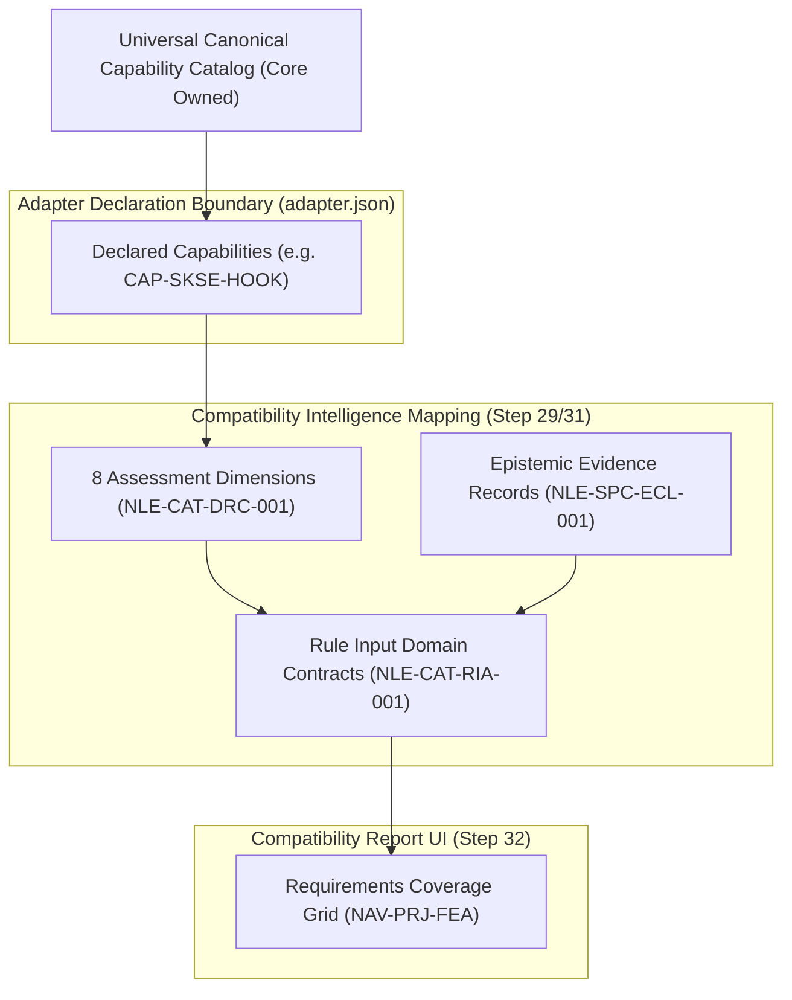
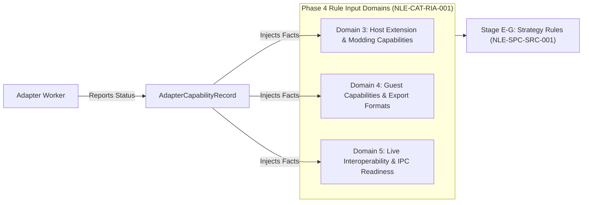

# SDK Capability Contract Integration Specification

**Document ID:** `NLE-SPC-SCI-001`  
**Version:** 1.0.0  
**Phase:** 5 of 12 — Universal Adapter SDK & Capability System  
**Step:** 34 of 100 — Universal Adapter SDK Foundation & Contract Reconciliation Specification  
**Classification:** Capability Contract Integration & Epistemic Mapping Specification  
**Status:** Approved Specification  
**Authoritative Reference:** `NLE-SPC-SDK-001`, `NLE-CAT-RIA-001`, `NLE-CAT-DRC-001`, `NLE-SPC-ECL-001`, `CAPABILITY_MODEL_AND_STATUS_LIFECYCLE.md`

---

## 1. Capability System Architecture & Core Alignment

The capability system connects an adapter’s concrete technical abilities to the engine’s universal compatibility assessment engine. 

To honor **Condition C-01** of the Phase 4 gate review (`NLE-GAT-PH4-001`), the Universal Adapter SDK must consume the `RuleInputDomain` and `CapabilityRequirement` contracts established in `NLE-CAT-RIA-001` and `NLE-CAT-DRC-001`. It must never define a parallel, competing, or disconnected capability vocabulary.



---

## 2. Canonical Capability Ownership & Proposal Lifecycle

### 2.1 Universal Core Ownership
The **Universal Core** retains exclusive authority over the canonical definition of capabilities:
- Every capability has a unique, immutable identifier (`CAP-<DIMENSION>-<DESCRIPTOR>`).
- Every canonical capability belongs to exactly one of the **8 approved compatibility dimensions**.
- Canonical capabilities define standard parameter schemas, pre-conditions, and expected post-conditions.

### 2.2 Adapter Proposed Capabilities
An adapter cannot invent a canonical global capability simply by naming it in `adapter.json`. When an adapter introduces a novel modding feature not yet recognized by the core engine:
1. **Status Assignment:** The capability is registered under the prefix `PROPOSED:<adapterId>:<name>` with validation status `CAPABILITY_PROVISIONAL`.
2. **Evaluation Scope:** The compatibility rule engine treats provisional capabilities as unverified hypotheses (`OUTCOME_INSUFFICIENT_EVIDENCE`), preventing them from fulfilling mandatory user requirements.
3. **Formal Review:** When an adapter author submits their package to the official catalog, the architecture board reviews the proposed capability and elevates it to canonical status if it demonstrates cross-game utility.

---

## 3. The 5 Epistemic Levels: Declaration vs. Verified Support

A central design mandate of NexLudic Engine is preventing unverified claims from being presented as confirmed compatibility. The SDK formalizes **five distinct epistemic levels** of capability maturity:

```
+----------------------------------------------------------------------------------------------------+
|                               THE 5 EPISTEMIC CAPABILITY LEVELS                                    |
+-------+----------------------------------+---------------------------------------------------------+
| Level | Capability State                 | Epistemic Meaning & Verification Evidence               |
+-------+----------------------------------+---------------------------------------------------------+
| L1    | **Declared Capability**          | An untrusted assertion written in `adapter.json`.       |
|       |                                  | Represents author intent; zero empirical validation.    |
+-------+----------------------------------+---------------------------------------------------------+
| L2    | **Admitted / Schema-Valid**      | Syntactically valid JSON; resolves to a canonical ID;   |
|       |                                  | permissions comply with Windows Medium IL.              |
+-------+----------------------------------+---------------------------------------------------------+
| L3    | **Evidence-Backed Capability**   | Supported by Tier 1 (Reproduced) or Tier 2 (Documented) |
|       |                                  | cryptographic evidence records in the catalog.          |
+-------+----------------------------------+---------------------------------------------------------+
| L4    | **Environment-Verified**         | Local game binary hash, mod loader, and runtime SDK     |
|       |                                  | verified on user hardware via Step 27/28 discovery.    |
+-------+----------------------------------+---------------------------------------------------------+
| L5    | **End-to-End Integrated**        | Validated during live test execution or mashup build    |
|       |                                  | in Phase 6/7. Confirmed operational behavior.           |
+-------+----------------------------------+---------------------------------------------------------+
```

### 3.1 Enforcement Invariant
The Compatibility Report (`NAV-PRJ-FEA`, Step 32) is **strictly prohibited from rendering Level 1 (Declared) capabilities as green checkmarks**. Only capabilities reaching **Level 3 (Evidence-Backed)** or **Level 4 (Environment-Verified)** may satisfy user requirement coverage rows (`COVERAGE_SATISFIED`).

---

## 4. Mapping Capabilities to the 8 Assessment Dimensions

Every capability declared by an adapter maps directly to one of the 8 dimensions defined in `NLE-CAT-DRC-001`:

| Assessment Dimension | Example Adapter Capabilities | Typical Adapter Traits Implemented |
|:---|:---|:---|
| **1. ASSET_PIPELINE** | Mesh format transcoding, texture compression, material mapping. | `IAssetExtractableTrait`, `IModScaffoldableTrait` |
| **2. PHYSICS** | Havok collision extraction, PhysX raycast binding, vehicle friction curves. | `IModScaffoldableTrait`, `ITelemetrySourceTrait` |
| **3. MEMORY_HOOKING** | Native C++ DLL loading, function detouring, vtable hooking via SKSE/CET. | `IModScaffoldableTrait` |
| **4. INPUT_CONTROL** | Gamepad axis interception, Win32 raw input remapping, virtual gamepad. | `IInputTargetTrait` |
| **5. TELEMETRY_IPC** | 60 Hz transform streaming, physics state polling, shared memory queues. | `ITelemetrySourceTrait` |
| **6. RENDER_HOOK** | DirectX 11/12 overlay injection, viewport blitting, camera sync. | `IModScaffoldableTrait`, `ITelemetrySourceTrait` |
| **7. AUDIO** | Sound event interception, FMOD/Wwise bank injection, audio sync. | `IModScaffoldableTrait` |
| **8. STATE_SYNC** | Quest state synchronization, inventory mirroring, round timers. | `ITelemetrySourceTrait`, `IInputTargetTrait` |

---

## 5. Input Contract Alignment with Phase 4 (`NLE-CAT-RIA-001`)

To satisfy **Condition C-01**, adapter capability outputs feed deterministically into the 9 input domains of the Compatibility Rule Pipeline:



- When an adapter reports `declaredSupportLevel = "SUPPORTED"` and supplies Tier 2 documentation, the core engine transforms this into input state `INPUT_CONFIRMED_VERIFIED`.
- If an adapter reports missing toolchains or failed preconditions, the core engine injects `INPUT_UNSUPPORTED` or `INPUT_MISSING`, prompting the rule pipeline to halt or downgrade strategy recommendations.

---

## 6. Capability Dependency Graph & Bounded Negotiation

### 6.1 Capability Prerequisites
Capabilities may declare explicit dependencies on other capabilities or external frameworks:
```json
{
  "capabilityId": "CAP-HAVOK-VEHICLE-DRIVE",
  "dimension": "PHYSICS",
  "prerequisites": [
    "CAP-SKSE-DLL-INJECT",
    "FRAMEWORK-SKSE64 >= 2.0.20",
    "TOOL-HAVOK-CONTENT-TOOLS"
  ]
}
```
If a prerequisite capability (e.g., `CAP-SKSE-DLL-INJECT`) is unfulfilled or blocked, all dependent capabilities inherit `COVERAGE_UNSUPPORTED` without executing redundant runtime probes.

### 6.2 Negotiation Boundaries for Subsequent Steps
In later Phase 5 steps (e.g. Step 36/37), the engine negotiates compatible capabilities between Host and Guest adapters:
- **Rule of Symmetry:** If the Guest adapter provides `CAP-TELEMETRY-STREAM-60HZ`, the Host adapter must provide an input sink capable of receiving telemetry at $\ge 60\text{ Hz}$.
- **Rate Mismatch Resolution:** If rates mismatch, the negotiation engine binds a downsampling adapter or marks the requirement `COVERAGE_PARTIAL`.

