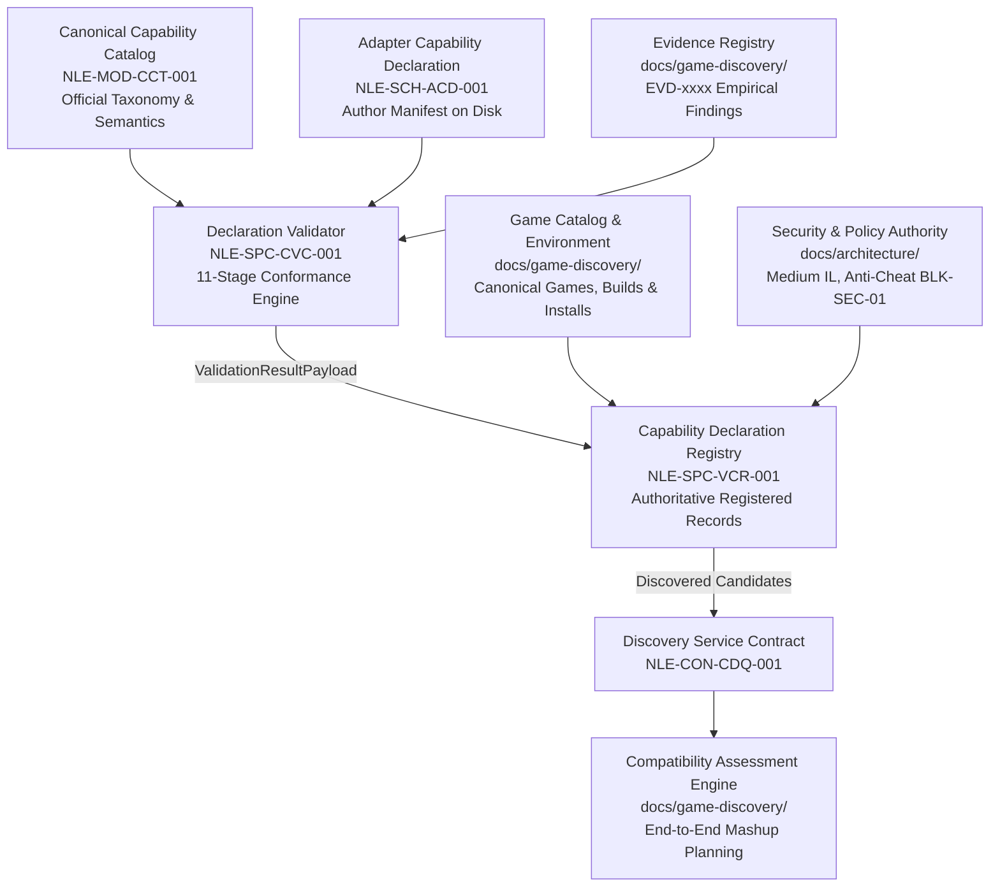
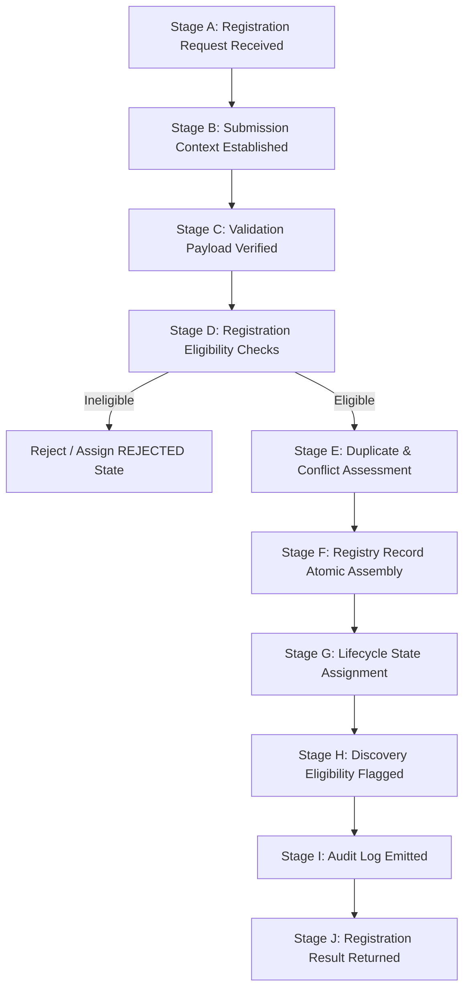

# Validated Capability Declaration Registry Specification

**Document Identifier:** `NLE-SPC-VCR-001`  
**Phase:** Phase 5 — Universal Adapter SDK & Capability System  
**Step:** Step 37 of 100 — Validated Capability Declaration Registry & Discovery Workflow Specification  
**Status:** Approved Architectural Specification  
**Classification:** Universal Core Specification & Registry Protocol  
**Repository Path:** `docs/adapters/VALIDATED_CAPABILITY_DECLARATION_REGISTRY_SPECIFICATION.md`  

---

## 1. Executive Summary & Purpose

### 1.1 Purpose
This specification establishes the authoritative architecture, operational boundaries, and data contracts for the **Validated Capability Declaration Registry** within the NexLudic Engine platform.

The registry is the universal core component responsible for:
1. Maintaining authoritative, immutable records of Adapter Capability Declarations (`ACD`, per `NLE-SCH-ACD-001`) that have undergone formal static validation (`NLE-SPC-CVC-001`, `NLE-CON-VRD-001`).
2. Tracking the registration lifecycle states (`ACTIVE`, `PENDING_REVIEW`, `STALE`, `WITHDRAWN`, etc.) across declaration revisions.
3. Indexing valid declarations by target game, canonical capability, version scope, and execution environment.
4. Exposing a secure, context-aware capability discovery interface to authorized platform consumers (such as the Cross-Game Compatibility Assessment Pipeline and Developer UI).

### 1.2 Anti-Deception & Non-Authorization Invariants
- **Registration Is Not Verification of Runtime Success:** A declaration admitted to the registry certifies solely that an adapter author has published a syntactically conformant, semantically coherent, referentially valid manifest that has been accepted under platform governance. **Registration does NOT prove that the capability functions, does NOT prove runtime availability on the host machine, and does NOT prove end-to-end game interoperability.**
- **Discovery Is Not Execution Authorization:** Discovering an active declaration in response to a query does **NOT** grant permission to load, inject, or execute adapter code. Execution authorization remains strictly governed by separate security policies, sandbox controls (`ADR-0002`), Windows Medium Integrity Level constraints (`DEC-002`), and explicit user consent.
- **Explicit Unknowns Preserved:** Declarations lacking empirical evidence retain their conservative verification states (`DECLARED_ONLY`, `STRUCTURALLY_CONFORMANT`, `INPUT_UNKNOWN`). The registry never manufactures synthetic "supported" verdicts.
- **Separation of Truth:** The registry is an indexing and lifecycle coordinator. It does **not** own canonical capability definitions (owned by Taxonomy `NLE-MOD-CCT-001`), does not own validation logic (owned by Validator `NLE-SPC-CVC-001`), and does not own compatibility assessment (owned by Pairing Engine `docs/game-discovery/`).

---

## 2. Source-of-Truth Architectural Separation

To prevent competing sources of truth, configuration drift, and circular authority, the platform strictly delineates subsystem ownership:

### 2.1 Subsystem Source-of-Truth Matrix

| Subsystem Domain | Authoritative Artifact | Data / Authority Owned | Explicitly Excluded Authority |
|:---|:---|:---|:---|
| **Canonical Capability Catalog** | `NLE-MOD-CCT-001`, `NLE-SCH-CCD-001` | Official taxonomy, canonical capability identifiers (`category.sub.name`), semantic contracts, revisions, deprecation statuses. | Does not track which adapters implement capabilities or their runtime states. |
| **Adapter Manifest / Declaration** | `NLE-SCH-ACD-001`, `manifest.json` | Adapter metadata, author-asserted capabilities, declared version ranges, dependency links, claimed limitations. | Does not validate its own claims; cannot self-authorize registration. |
| **Declaration Validator** | `NLE-SPC-CVC-001`, `NLE-CON-VRD-001` | Static validation execution, rule evaluation (`VLD-*`), diagnostic generation, validation payloads. | Does not store persistent registry records; does not decide discovery visibility. |
| **Evidence & Provenance Registry** | `docs/game-discovery/` | Empirical test records (`EVD-xxxx`), observation logs, tool signatures, evidence lifecycles. | Does not index adapter manifests; does not assess cross-game mashup pairings. |
| **Game Catalog & Environment** | `docs/game-discovery/`, Step 28 | Canonical game IDs, releases, builds, platform architecture, local installation paths, mod loaders. | Does not evaluate adapter code; does not declare adapter capabilities. |
| **Capability Declaration Registry** | `NLE-SPC-VCR-001`, `NLE-MOD-RRM-001` | Registered record identities, revision bindings, lifecycle states (`ACTIVE`, `STALE`), discovery indexing. | **Does not redefine capability semantics; does not grant execution rights; does not execute code.** |
| **Authorization & Security Policy** | `docs/architecture/`, `NLE-SPC-VSR-001` | Medium IL execution boundary, UAC denial (`REQ-SEC-001`), Anti-cheat dominance (`BLK-SEC-01`). | Does not maintain capability metadata or search indices. |
| **Compatibility Assessment System** | `docs/game-discovery/`, Steps 29–32 | Pairwise game compatibility evaluations, strategy selection (Bridge vs. Mod), end-to-end feasibility. | Does not author adapter declarations or manage registry records. |

---

## 3. Registry Responsibilities & Explicit Non-Goals

### 3.1 Core Responsibilities
1. **Intake & Verification of Validation Results:** Ingest validation payloads emitted by `NLE-CON-VRD-001`. Confirm that the payload applies to the exact declaration revision (`manifestSha256`), validator version, and rule catalog.
2. **Lifecycle State Management:** Maintain and transition registry records through their formal lifecycles (`ACTIVE`, `ACTIVE_WITH_LIMITATIONS`, `PENDING_REVIEW`, `STALE`, `SUPERSEDED`, `WITHDRAWN`, `RETIRED`, `REJECTED`).
3. **Multi-Dimensional Indexing:** Index declarations across four primary orthogonal dimensions:
   - Target Game Scope (`canonicalGameId`, SemVer range / build ID).
   - Canonical Capability Scope (`capabilityId`, category).
   - Adapter Identity Scope (`adapterId`, role: `SOURCE` / `TARGET` / `BIDIRECTIONAL`).
   - Environment / Platform Scope (`windows-x64`, runtime requirements).
4. **Context-Aware Discovery Queries:** Serve authorized queries from core subsystems, filtering eligible declarations while suppressing invalid or withdrawn records.
5. **Freshness & Invalidation Tracking:** Listen for invalidation triggers (game patch, manifest edit, evidence expiry, catalog revision) and mark affected registry records as `STALE` or `UNVERIFIED`.
6. **Provenance & Historical Traceability:** Retain audit logs of superseded and withdrawn declarations to support historical explanation and regression analysis.

### 3.2 Explicitly Excluded Responsibilities (Non-Goals)
- **NO Database Implementation:** This specification establishes data contracts and behavioral rules; it does not deploy a SQL/NoSQL database daemon or ORM.
- **NO Runtime Process Execution:** The registry never launches adapter processes, executes scripts, or invokes game hooks.
- **NO Dynamic Capability Negotiation:** Live handshake and session negotiation between running adapters belong to Step 38 (`Runtime Lifecycle`).
- **NO Automated Mashup Planning:** Determining whether two games can successfully combine into a playable mashup belongs to Step 39 (`Capability Composition`).
- **NO User Interface Components:** Rendering registry cards or discovery filters belongs to Desktop UI (`docs/ui/`).

---

## 4. End-to-End Registration Workflow

The registry admits and updates declarations through a ten-stage deterministic workflow:

### 4.1 Workflow Stages

| Stage | Name | Description | Gate / Failure Condition |
|:---:|:---|:---|:---|
| **A** | **Registration Intake** | Accepts declaration manifest file reference and caller context. | File not found, unreadable, or outside Volume D workspace (`DEC-009`). |
| **B** | **Context Establishment** | Resolves target `adapterId`, `targetGameId`, and canonical manifest path. | Unrecognized adapter identity format or missing adapter metadata. |
| **C** | **Validation Verification** | Checks existing `ValidationResultPayload` (`NLE-CON-VRD-001`). Confirms payload hash matches manifest file SHA-256 and rules are current. | Missing validation payload, hash mismatch, or payload has `CANCELLED`/`INVALID` outcome. |
| **D** | **Eligibility Evaluation** | Evaluates Section 5 prerequisites (overall outcome, review status, schema revision). | Validation outcome is `INVALID`, `INCOMPLETE`, or contains unresolved fatal diagnostics. |
| **E** | **Duplicate & Conflict Check** | Inspects registry for identical revisions, competing adapter claims, or mutual exclusions. | Re-submission of identical hash is idempotent; conflicting exclusive claims flagged. |
| **F** | **Atomic Assembly** | Compiles new immutable `RegistryRecord` (`NLE-MOD-RRM-001`) with assigned unique `registryRecordId`. | Incomplete record fields or schema generation error. |
| **G** | **Lifecycle Assignment** | Assigns state: `ACTIVE`, `ACTIVE_WITH_LIMITATIONS`, `PENDING_REVIEW`, or `REJECTED`. | Invalid state transition per policy (`NLE-POL-REL-001`). |
| **H** | **Discovery Flagging** | Computes `isDiscoverable` boolean and populates query index projections. | Ineligible states (`PENDING_REVIEW`, `REJECTED`, `WITHDRAWN`) flagged `isDiscoverable = false`. |
| **I** | **Audit Logging** | Writes immutable registration audit entry to `.audit/` trail. | Filesystem write failure. |
| **J** | **Result Handoff** | Returns structured `RegistrationResult` payload to caller. | N/A (Emits success or structured error). |

---

## 5. Registration Eligibility Baseline

A declaration must satisfy four mandatory criteria to be registered:

1. **Validation Prerequisite:** Must possess a valid `ValidationResultPayload` with `overallOutcome` of:
   - `VALID` $\longrightarrow$ Eligible for `ACTIVE` state.
   - `VALID_WITH_WARNINGS` $\longrightarrow$ Eligible for `ACTIVE_WITH_LIMITATIONS` or `ACTIVE` (with advisory notes).
   - `REVIEW_REQUIRED` $\longrightarrow$ Admitted strictly to `PENDING_REVIEW` state (quarantined from normal discovery).
   - `INVALID`, `INCOMPLETE`, `INCOMPATIBLE`, `STALE`, `CANCELLED` $\longrightarrow$ **INELIGIBLE** for discovery.
2. **Revision Alignment:** The SHA-256 hash of the on-disk manifest must match the `manifestSha256` recorded in the validation payload exactly.
3. **Canonical Reference Integrity:** All referenced canonical capability IDs must exist and not be in `RETIRED` status in `NLE-MOD-CCT-001`.
4. **Security & Anti-Cheat Conformance:** Zero memory hooking or process injection claims against games with active anti-cheat (`BLK-SEC-01`, `VLD-SEC-001`).

---

## 6. Traceability and Cross-Reference Anchors

- `NLE-MOD-CCT-001`: Canonical Capability Taxonomy & Domain Model.
- `NLE-SCH-ACD-001`: Adapter Capability Declaration Schema.
- `NLE-SPC-CVC-001`: Capability Declaration Validation Specification.
- `NLE-CON-VRD-001`: Validation Result & Diagnostic Contract.
- `NLE-SPC-VSR-001`: Security, Sandbox, and Resource Boundary Specification.
- `ADR-0002`: Out-of-Process Adapter Architecture.
- `DEC-002`, `REQ-SEC-001`: Windows Medium Integrity Level.
- `DEC-009`: Workspace filesystem anchoring on Volume D.
- `BLK-SEC-01`: Platform Anti-Cheat Dominance Guarantee.
