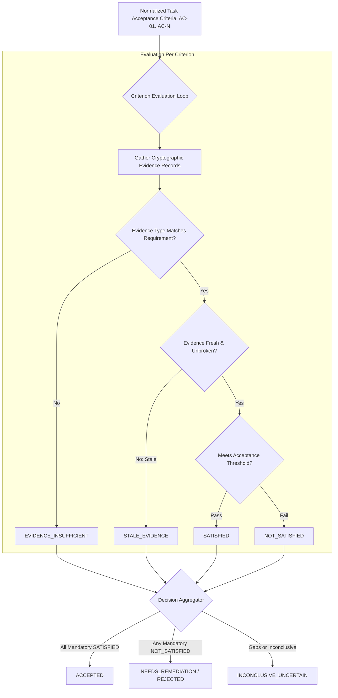

# NexLudic Engine: AI Agent Acceptance Criterion Evaluation & Decision Contract

**Document ID:** `NLE-CON-AAC-001`  
**Phase:** 7 of 12 (AI Coding-Agent Orchestration)  
**Step:** 59 of 100  
**Classification:** Core Acceptance & Decision Contract  
**Status:** IMPLEMENTATION-READY SPECIFICATION  
**Upstream Dependencies:** `NLE-CON-CTI-001` (Task Contract), `NLE-MOD-AOC-001` (Domain Model), `NLE-POL-AVE-001` (Evidence Trust Policy)  
**Downstream Dependents:** `NLE-CON-ATC-002` (Terminal Outcome Contract), Step 60 Phase Gate  

---

## 1. Criterion-Level Evaluation Architecture

In NexLudic Engine, task completion is NOT an omnibus binary decision. Every task contract establishes a set of discrete **Mandatory Acceptance Criteria (`AC-01`, `AC-02`, ...)**. The verification engine evaluates and records an authoritative determination for each criterion individually.



---

## 2. Acceptance Criterion Evaluation Record Schema

For every criterion evaluated, the engine produces an immutable evaluation record:

```json
{
  "$schema": "https://json-schema.org/draft/2020-12/schema",
  "$id": "https://schemas.nexludic.com/v1/orchestration/criterion-evaluation-record.json",
  "title": "NexLudicCriterionEvaluationRecord",
  "type": "object",
  "required": [
    "criterion_id",
    "criterion_statement",
    "is_mandatory",
    "evaluation_outcome",
    "supporting_evidence_ids",
    "evaluated_at",
    "evaluator_identity"
  ],
  "properties": {
    "criterion_id": { "type": "string", "pattern": "^AC-[0-9]{2,}$" },
    "criterion_statement": { "type": "string" },
    "is_mandatory": { "type": "boolean" },
    "evaluation_outcome": {
      "type": "string",
      "enum": [
        "SATISFIED",
        "NOT_SATISFIED",
        "PARTIALLY_SATISFIED",
        "EVIDENCE_INSUFFICIENT",
        "BLOCKED_BY_DEPENDENCY",
        "NOT_EVALUATED",
        "NOT_APPLICABLE_WITH_AUTHORIZATION"
      ]
    },
    "supporting_evidence_ids": {
      "type": "array",
      "items": { "type": "string" }
    },
    "evaluator_identity": { "type": "string" },
    "decision_rationale": { "type": "string" },
    "evaluated_at": { "type": "string", "format": "date-time" }
  },
  "additionalProperties": false
}
```

---

## 3. Decision Rules & Acceptance Prerequisites

### Rule AAC-01: Universal Mandatory Satisfaction
A task can transition to `ACCEPTED` if and only if **100% of mandatory acceptance criteria** evaluate to `SATISFIED`.
- If a single mandatory criterion is `NOT_SATISFIED` or `EVIDENCE_INSUFFICIENT`, the task CANNOT be accepted.
- Success in optional or bonus criteria carries zero weight in overcoming a failed mandatory requirement.

### Rule AAC-02: Non-Compensation Invariant
An agent cannot "compensate" for an unfulfilled criterion by producing extra code, unrelated tests, or extensive narrative explanations. Unfulfilled requirements strictly require remediation.

### Rule AAC-03: Independent Verification Gate for Privileged Tasks
If a task touches security-sensitive files, permission manifests, cryptographic routines, or adapter contracts, verification requires **Tier A or Tier B independent evidence** corroborated by human review (`NLE-CON-HAT-001`). Agent self-verification is legally void for privileged tasks.
