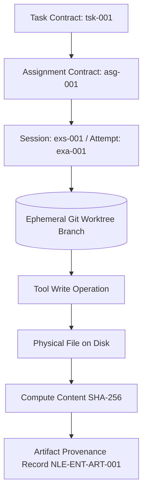

# NexLudic Engine: AI Agent Artifact Provenance, Integrity & Revision Policy

**Document ID:** `NLE-POL-API-001`  
**Phase:** 7 of 12 (AI Coding-Agent Orchestration)  
**Step:** 59 of 100  
**Classification:** Operational Security & Artifact Provenance Policy  
**Status:** IMPLEMENTATION-READY SPECIFICATION  
**Upstream Dependencies:** `NLE-SPC-AOC-001` (Master Spec), `NLE-MOD-AOC-001` (Domain Model)  
**Downstream Dependents:** `NLE-POL-ARD-001` (Diff Reconciliation), `NLE-CON-AAC-001` (Acceptance Contract)  

---

## 1. Provenance Architecture & Cryptographic Integrity

Every artifact submitted by an AI coding agent must possess an **unbroken cryptographic lineage**. An artifact whose origin, authoring attempt, or content digest cannot be verified against the session audit ledger is classified as `UNTRUSTED_ORPHAN` and rejected from consideration.

---

## 2. Artifact Provenance Requirements

For every artifact submitted, the orchestration system compiles a Provenance Metadata Record:
1. **Generating Agent Identity:** AI provider ID (`google-gemini`), model ID (`gemini-2.5-pro`), and candidate assignment ID.
2. **Session & Attempt Lineage:** Parent session UUID and execution attempt integer counter.
3. **Parent Repository Revision:** Git commit SHA from which the ephemeral worktree was branched (`base_commit_sha`).
4. **Tool Execution Lineage:** Sequence ID and invocation UUID of the `fs:write_file` or `git:apply_patch` call that created or modified the file.
5. **Cryptographic Content Digest:** SHA-256 hash computed directly by the supervisor from disk bytes upon session completion.

---

## 3. Handling Untrusted, Corrupted, or Stale Artifacts

### Rule API-01: Hash Mismatch Rejection
If the SHA-256 digest computed from the physical file in the worktree does not match the digest claimed in the agent's submission payload:
- **Action:** The artifact is marked `REJECTED_DIGEST_MISMATCH`.
- **Finding:** Critical defect flagged: agent reported stale or tampered file metadata.

### Rule API-02: Workspace Boundary Enforcement
If an artifact path resolves outside the designated `<workspace_root_path>`:
- **Action:** The artifact is quarantined immediately.
- **Finding:** Critical security violation flagged: unauthorized filesystem path reference (`ERR_PATH_OUT_OF_BOUNDS`).

### Rule API-03: Revision Supersession
When a task undergoes remediation or a second execution attempt (`attempt-2`):
- Outputs from `attempt-1` are sealed in the historical audit ledger.
- A passing check on an artifact from `attempt-1` **NEVER** confers passing status on modified artifacts in `attempt-2`. All verification checks must be re-run against the fresh revision.
