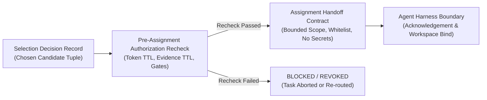

# NexLudic Engine: AI Agent Assignment Authorization & Handoff Contract

**Document ID:** `NLE-CON-AAH-001`  
**Phase:** 7 of 12 (AI Coding-Agent Orchestration)  
**Step:** 55 of 100  
**Classification:** Assignment Authorization & Handoff Contract  
**Status:** IMPLEMENTATION-READY SPECIFICATION  

---

## 1. Assignment Authorization Principles

Candidate selection identifies the *intended* agent; it does **not** authorize execution. 

Before an assignment handoff record is constructed and dispatched to an agent harness, the system must perform a strict **Pre-Assignment Authorization Recheck**. This recheck prevents race conditions, authorization expiration, and stale dependency states that may have emerged while candidate selection was underway.



---

## 2. The Pre-Assignment Authorization Recheck

Immediately prior to generating the `AssignmentRecord`, the orchestration engine verifies:
1. **Task Token Validity:** The task's cryptographic authorization token (`NLE-POL-TIN-001`) has not expired ($t_{\text{current}} < t_{\text{token\_exp}}$) and has not been revoked.
2. **Evidence Freshness:** Conformance evidence for all mandatory capabilities remains active and unexpired.
3. **Environment Integrity:** Target host tool binaries (`dotnet.exe`, `git.exe`) are present, reachable, and operating under Windows Medium IL (`DEC-002`).
4. **Provider Lifecycle State:** Provider and agent remain in state `AVAILABLE` or `APPROVED_FOR_USE`.
5. **Phase Gate Currency:** Upstream phase gates have not been invalidated.

If any check fails, the assignment creation is halted, the selection decision is voided, and a diagnostic alert is emitted.

---

## 3. Assignment Handoff Contract Specification

The assignment handoff contract encapsulates the exact boundaries within which the agent must operate. It enforces the principle of **Least Privilege & Minimum Necessary Context**:

```json
{
  "assignment_id": "asg-4f8a-9c2e-b1f4-7d6e5a4b3c2d",
  "task_id": "c7a8b3f1-9d2e-4b8a-b1f4-8e7c6d5a4b3c",
  "task_version": "1.0.0",
  "assigned_candidate": {
    "provider_id": "prov-anthropic-direct",
    "model_id": "mod-claude-3-7-sonnet",
    "agent_id": "agt-adapter-scaffold-v1",
    "environment_id": "env-desktop-medium-il"
  },
  "task_objective": "Author C# wire protocol serialization wrapper for Orion telemetry conforming to Step 47 data mapping specification.",
  "scope_boundaries": {
    "permitted_path_globs": [
      "docs/adapters/orion/**",
      "src/adapters/orion/wire/**"
    ],
    "prohibited_path_globs": [
      "src/core/**",
      ".git/**",
      "config/**"
    ],
    "max_diff_lines": 500,
    "allow_file_creation": true,
    "allow_file_deletion": false
  },
  "authorized_tool_interfaces": [
    "tool.fs.read",
    "tool.fs.patch",
    "tool.git.diff"
  ],
  "prohibited_tools": [
    "tool.cmd.exec",
    "tool.net.egress"
  ],
  "acceptance_criteria": [
    "AC-01: Serializer passes unit test fixture TestOrionWireRoundtrip()",
    "AC-02: Zero compiler warnings under C# 12 / .NET 9 strict mode",
    "AC-03: Unified diff conforms to 500-line diff ceiling"
  ],
  "explicit_exclusions": [
    "Do not modify core IPC message dispatchers in src/core/",
    "Do not invoke Windows API memory hooks or native kernel calls"
  ],
  "assignment_timestamps": {
    "created_at": "2026-11-19T15:28:30Z",
    "acknowledgement_deadline": "2026-11-19T15:29:30Z",
    "execution_deadline": "2026-11-19T16:28:30Z"
  }
}
```

---

## 4. Agent Acknowledgement & Acceptance Boundaries

### 4.1 Meaning of Acknowledgement
When the assigned agent harness receives the handoff contract, it must return a formal **Assignment Acknowledgement**:
- **Acknowledgement Confirms:**
  1. The harness has received the bounded contract;
  2. The harness validates its tool connectivity within the target workspace;
  3. The harness acknowledges its path whitelists and line ceilings.
- **Acknowledgement DOES NOT Prove:**
  - It does **not** prove task execution has begun;
  - It does **not** prove code will compile;
  - It does **not** prove requirements will be satisfied.

### 4.2 Handling Acknowledgement Failures
1. **Assignment Declined:** If the agent harness returns `DECLINED` (e.g., due to local resource exhaustion or unsupported syntax in prompt), the assignment transitions to `ASSIGNMENT_DECLINED`. The router immediately initiates the fallback workflow (`NLE-POL-AFR-002`).
2. **Acknowledgement Timeout:** If no acknowledgement arrives within the 60-second deadline (`acknowledgement_deadline`), the assignment transitions to `ASSIGNMENT_EXPIRED`. The router does **not** assume the agent started; it issues a cancellation and re-evaluates candidates.
3. **Incompatible Response:** If the agent returns an unparseable response, it is treated as a transient fault and handled under retry policies.
