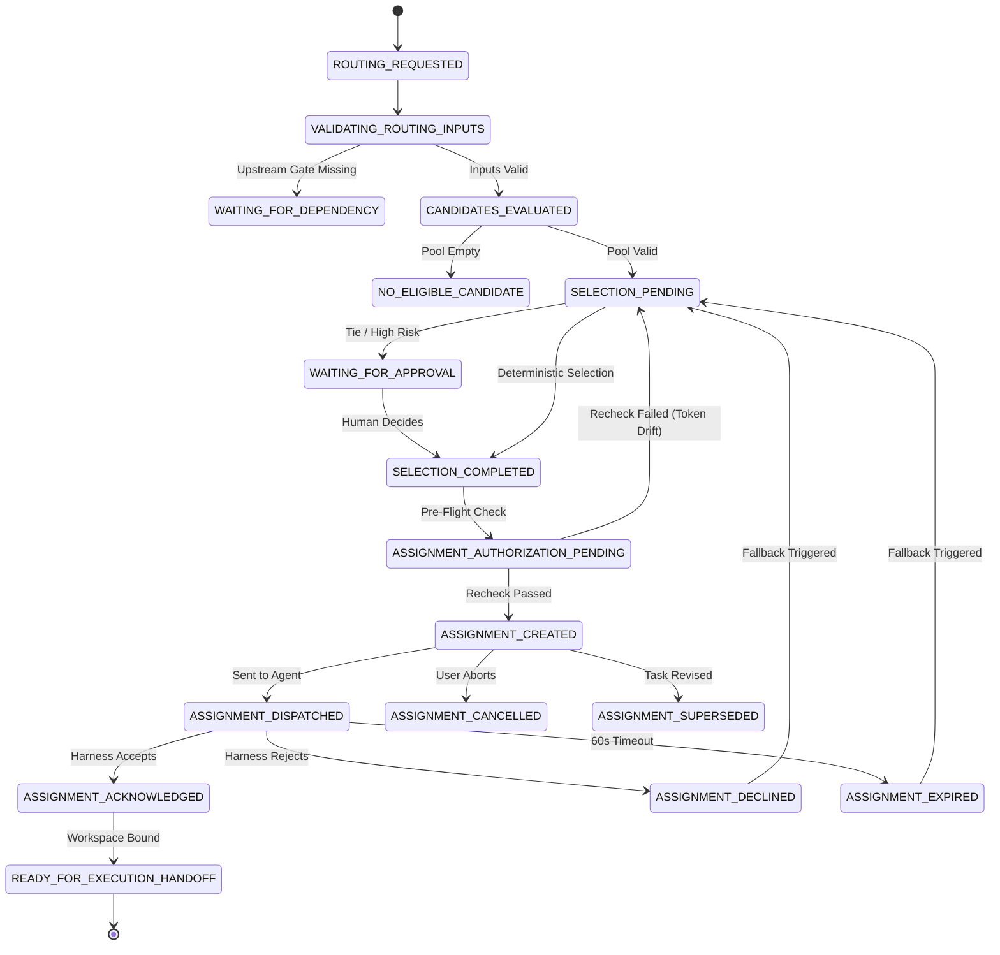

# NexLudic Engine: AI Agent Assignment Lifecycle & State Transition Specification

**Document ID:** `NLE-SPC-AAL-001`  
**Phase:** 7 of 12 (AI Coding-Agent Orchestration)  
**Step:** 55 of 100  
**Classification:** Assignment Lifecycle & State Transition Specification  
**Status:** IMPLEMENTATION-READY SPECIFICATION  

---

## 1. Lifecycle Governance Philosophy

The assignment lifecycle governs the state of a task from the moment routing is initiated until an authorized agent formally accepts the assignment and prepares for execution handoff.

The lifecycle prevents illegal state leaps (e.g., dispatching an unselected candidate, or executing code without acknowledgement) by enforcing a formal **Finite State Machine (FSM)**.

---

## 2. The 16 Formal Assignment Lifecycle States

---

## 3. Detailed State Definitions & Ownership

| State Name | Operational Meaning | Component Owner | Outgoing Legal Transitions |
| :--- | :--- | :--- | :--- |
| **`ROUTING_REQUESTED`** | Routing request ingested; awaiting input validation. | Routing Controller | `VALIDATING_ROUTING_INPUTS`, `ROUTING_FAILED` |
| **`VALIDATING_ROUTING_INPUTS`** | Asserting task contract, tokens, and candidate pool freshness. | Pre-Flight Validator | `CANDIDATES_EVALUATED`, `WAITING_FOR_DEPENDENCY` |
| **`WAITING_FOR_DEPENDENCY`** | Blocked by missing upstream gate (e.g. Step 51 Phase 6). | Gate Auditor | `VALIDATING_ROUTING_INPUTS` (upon gate resolution) |
| **`CANDIDATES_EVALUATED`** | Candidate pool verified; ready for comparison. | Candidate Comparator | `SELECTION_PENDING`, `NO_ELIGIBLE_CANDIDATE` |
| **`SELECTION_PENDING`** | Applying routing strategies and vector comparisons. | Strategy Engine | `SELECTION_COMPLETED`, `WAITING_FOR_APPROVAL` |
| **`WAITING_FOR_APPROVAL`** | Candidate tie or sensitive task awaiting human review. | Human-in-the-Loop Gate | `SELECTION_COMPLETED`, `ROUTING_FAILED` |
| **`SELECTION_COMPLETED`** | Candidate chosen; awaiting authorization recheck. | Selection Engine | `ASSIGNMENT_AUTHORIZATION_PENDING` |
| **`NO_ELIGIBLE_CANDIDATE`** | Zero candidates passed mandatory eligibility predicates. | Selection Engine | `ROUTING_FAILED`, `SELECTION_PENDING` |
| **`ASSIGNMENT_AUTHORIZATION_PENDING`** | Running pre-assignment recheck (token TTL, evidence). | Authorization Gate | `ASSIGNMENT_CREATED`, `SELECTION_PENDING` |
| **`ASSIGNMENT_CREATED`** | Contract record persisted; awaiting dispatch. | Assignment Generator | `ASSIGNMENT_DISPATCHED`, `ASSIGNMENT_CANCELLED` |
| **`ASSIGNMENT_DISPATCHED`** | Contract sent to agent harness; timer running. | Dispatcher Daemon | `ASSIGNMENT_ACKNOWLEDGED`, `ASSIGNMENT_DECLINED`, `ASSIGNMENT_EXPIRED` |
| **`ASSIGNMENT_ACKNOWLEDGED`** | Agent harness verified tool connectivity and scope. | Agent Interface Adapter | `READY_FOR_EXECUTION_HANDOFF` |
| **`ASSIGNMENT_DECLINED`** | Agent refused assignment (resource exhaustion). | Agent Interface Adapter | `SELECTION_PENDING` (Fallback) |
| **`ASSIGNMENT_EXPIRED`** | Acknowledgement deadline elapsed without response. | Timeout Monitor | `SELECTION_PENDING` (Fallback) |
| **`ASSIGNMENT_CANCELLED`** | Task or assignment aborted by user or security policy. | Security Supervisor | `TERMINAL` |
| **`ASSIGNMENT_SUPERSEDED`** | Replaced by a newer task revision assignment. | Versioning Manager | `TERMINAL` |
| **`READY_FOR_EXECUTION_HANDOFF`** | Bounded workspace ready; handoff to Step 56+. | Orchestration Coordinator | Handoff to Execution |

---

## 4. Strictly Prohibited State Transitions

The FSM runtime must actively trap and prevent the following illegal transitions:
1. **`ROUTING_REQUESTED` $\rightarrow$ `ASSIGNMENT_CREATED` (Bypass Selection):** Direct creation of an assignment without candidate evaluation and authorization recheck is blocked.
2. **`NO_ELIGIBLE_CANDIDATE` $\rightarrow$ `ASSIGNMENT_CREATED` (Forced Assignment):** An assignment cannot be generated if zero candidates qualified.
3. **`WAITING_FOR_DEPENDENCY` $\rightarrow$ `SELECTION_PENDING` (Gate Bypass):** An unverified upstream gate cannot be bypassed by initiating selection.
4. **`ASSIGNMENT_DECLINED` $\rightarrow$ `READY_FOR_EXECUTION_HANDOFF` (Ghost Execution):** A declined assignment can never transition to execution.
5. **`ASSIGNMENT_EXPIRED` $\rightarrow$ `ASSIGNMENT_ACKNOWLEDGED` (Late Race Condition):** An acknowledgement received after expiration deadline is rejected; late agent must be terminated.
