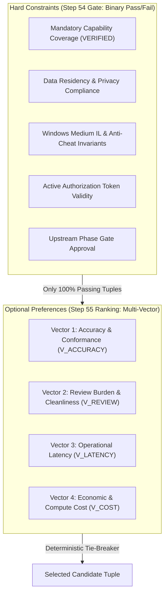
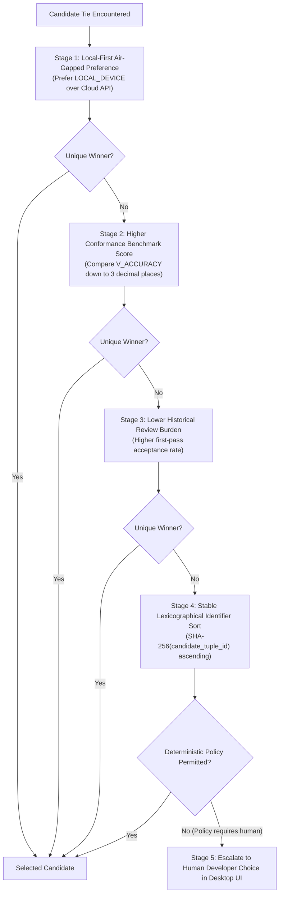

# NexLudic Engine: AI Agent Candidate Comparison & Deterministic Selection Rules

**Document ID:** `NLE-RUL-ASR-001`  
**Phase:** 7 of 12 (AI Coding-Agent Orchestration)  
**Step:** 55 of 100  
**Classification:** Candidate Comparison & Selection Rules  
**Status:** IMPLEMENTATION-READY SPECIFICATION  

---

## 1. Candidate Comparison Philosophy

Candidate selection operates strictly on candidate tuples confirmed **`ELIGIBLE`** by Step 54 (`NLE-RUL-AEM-001`).

Candidate comparison is **not** an alternative eligibility filter. It is an explainable, deterministic procedure for selecting the most suitable candidate among already-qualified peers.

The comparison engine adheres to three core design rules:
1. **Multi-Dimensional Vector Comparison:** Candidates are evaluated across distinct, orthogonal performance vectors rather than collapsed into arbitrary composite pseudo-scores.
2. **Explicit Treatment of Missing Information:** Unknown or missing metrics are explicitly preserved as `UNKNOWN`; they are never defaulted to zero, nor to ideal values.
3. **Deterministic & Reproducible Outcomes:** Given identical candidate pools, task revisions, and policy snapshots, the selection engine must produce identical decisions.

---

## 2. Hard Constraints vs. Optional Preferences



### 2.1 Hard Constraints (Zero-Tolerance)
A candidate failing any hard constraint has already been eliminated in Step 54. If an invalidation trigger occurs during routing, the candidate is immediately disqualified. No preference score can compensate for a hard constraint failure.

### 2.2 Optional Preferences
Preferences are applied *only* to rank confirmed eligible candidates. The primary preference vectors are:
- **`V_ACCURACY` (Empirical Conformance):** Historical test pass rate on relevant domain test fixtures (`NLE-POL-ACD-001`).
- **`V_REVIEW` (Human Review Burden):** Historical percentage of agent diffs merged without developer revision requests.
- **`V_LATENCY` (Operational Speed):** Median time-to-first-token and overall turn completion speed.
- **`V_COST` (Compute/Economic Cost):** Marginal financial cost per 1k tokens or local GPU memory consumption.

---

## 3. Handling Missing, Uncertain, or Incomparable Metrics

In real-world orchestration, telemetry for newly registered models or local daemons may be incomplete. The system enforces strict rules to prevent distorted ranking:

| Metric Type | Observed Value | Handling Rule | Prohibited Assumption |
| :--- | :---: | :--- | :--- |
| **Token Cost** | `UNKNOWN` | Candidate ranked by other vectors; marked `COST_UNKNOWN`. | **DO NOT** assume cost is $0.00 (free). |
| **Latency** | `UNKNOWN` | Neutral ranking; marked `LATENCY_UNMEASURED`. | **DO NOT** assume latency is 0 ms (instant). |
| **Historical Review Rate** | `UNKNOWN` | Neutral baseline (assumed equivalent to cohort median). | **DO NOT** assume perfect 100% acceptance. |
| **Queue Saturation** | `INDETERMINATE` | Probe endpoint once; if timeout, treat as `SATURATED`. | **DO NOT** route unlimited tasks to unprobed endpoints. |

---

## 4. Deterministic Tie-Breaking Hierarchy

When two or more eligible candidates exhibit equivalent or incomparable vector rankings, ties are resolved through a deterministic 5-stage cascade:



1. **Stage 1 (Local-First Air-Gapped Preference):** The system prioritizes local on-device inference (`LOCAL_DEVICE`, `ZERO_RETENTION_AIR_GAPPED`) over remote cloud APIs. This optimizes user privacy and eliminates external network dependencies.
2. **Stage 2 (Empirical Conformance Accuracy):** Compare verifiable conformance test scores (`V_ACCURACY`) from active evidence records.
3. **Stage 3 (Human Review Burden):** Compare historical first-pass acceptance rates (`V_REVIEW`).
4. **Stage 4 (Stable Lexicographical Sort):** Sort candidate tuple identifiers deterministically using $\text{SHA-256}(\text{provider\_id} + \text{model\_id} + \text{agent\_id})$. This guarantees identical execution traces without hidden randomness.
5. **Stage 5 (Human Escalation):** If the governing routing policy prohibits automated tie-breaking for sensitive categories (e.g. `ARCHITECTURE_REVIEW`), the system emits status `TIE_REQUIRING_HUMAN_CHOICE` and presents a selection dialog in the desktop UI.

---

## 5. Formal Selection Decision Record Schema

Every finalized candidate selection produces an explainable, machine-readable record:

```json
{
  "decision_id": "dec-sel-c7a8b3f1-20261119-001",
  "routing_request_id": "rrq-c7a8b3f1-001",
  "task_id": "c7a8b3f1-9d2e-4b8a-b1f4-8e7c6d5a4b3c",
  "task_version": "1.0.0",
  "task_category": "ADAPTER_DEVELOPMENT",
  "timestamp": "2026-11-19T15:28:00Z",
  "routing_policy_applied": {
    "policy_id": "pol-route-adapter-dev-v1",
    "policy_version": "1.0.0",
    "strategy": "CAPABILITY_FIT_ROUTING"
  },
  "candidate_pool_evaluated_count": 3,
  "chosen_candidate": {
    "provider_id": "prov-anthropic-direct",
    "model_id": "mod-claude-3-7-sonnet",
    "agent_id": "agt-adapter-scaffold-v1",
    "environment_id": "env-desktop-medium-il",
    "selection_reason": "Highest verified accuracy on C# wire protocol serialization conformance fixture (V_ACCURACY: 0.98 vs 0.84)."
  },
  "alternative_candidates": [
    {
      "candidate_tuple_id": "prov-local-ollama/mod-qwen-2-5-coder-32b/agt-adapter-scaffold-v1/env-desktop-medium-il",
      "ranking_vector": { "V_ACCURACY": 0.84, "V_LATENCY": 45.2, "V_COST": 0.0, "V_REVIEW": 0.88 },
      "rejection_reason": "Lower empirical accuracy on required wire serialization conformance fixture."
    }
  ],
  "tie_breaker_invoked": false,
  "decision_status": "SELECTED",
  "requires_assignment_authorization_recheck": true
}
```
