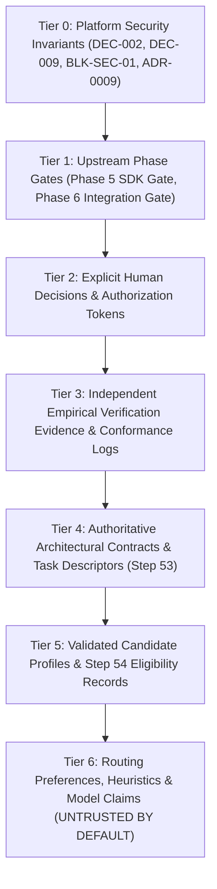
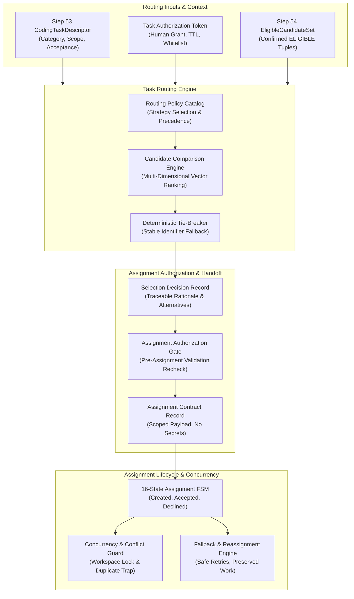

# NexLudic Engine: AI Agent Candidate Selection, Task Routing & Assignment Policy Specification

**Document ID:** `NLE-SPC-ASR-001`  
**Phase:** 7 of 12 (AI Coding-Agent Orchestration)  
**Step:** 55 of 100  
**Classification:** Candidate Selection, Task Routing & Assignment Architecture Specification  
**Status:** IMPLEMENTATION-READY SPECIFICATION  
**Authoritative Scope:** Specification, Architecture, Decision Modeling, Policy, and Verification Catalog Only (No Router Implementation, No AI Provider Calls, No Real Task Assignments, No Code Execution, No Game Tampering)

---

## 1. Executive Summary & Architectural Purpose

The **AI Agent Candidate Selection, Task Routing & Assignment Policy Specification** establishes the authoritative decision-making architecture that governs how NexLudic Engine assigns an authorized engineering task to an eligible AI coding agent.

While Step 53 (`NLE-SPC-TIN-001`) normalizes and authorizes task contracts, and Step 54 (`NLE-SPC-APR-001`) evaluates candidate capability and eligibility through 9 non-negotiable hard predicates, Step 55 governs the downstream transition from **an eligible candidate pool** to a **formally selected, authorized, and bound assignment handoff**.

This specification enforces four fundamental architectural tenets:
1. **The 11-Stage Stratification Principle:** The platform strictly enforces decoupling among 11 distinct operational stages: *Task Validity $\rightarrow$ Task Authorization $\rightarrow$ Candidate Capability $\rightarrow$ Candidate Eligibility $\rightarrow$ Candidate Ranking $\rightarrow$ Candidate Selection $\rightarrow$ Assignment Authorization $\rightarrow$ Assignment Creation $\rightarrow$ Agent Acceptance $\rightarrow$ Execution $\rightarrow$ Verification & Completion*. No stage may be collapsed into or assumed by another.
2. **Eligibility Precedes Preference:** Only candidate tuples confirmed `ELIGIBLE` under Step 54 can enter candidate comparison or ranking. Preference metrics (cost, speed, latency) can never override or bypass a hard eligibility failure.
3. **No Ambient Authority in Assignment:** Creating an assignment record does **not** grant ambient execution rights. The assignment handoff payload is strictly scoped to the task's path whitelists, diff ceilings, and authorized tool interfaces.
4. **Provider Neutrality & Decision Explainability:** Candidate selection is governed by deterministic rules and multi-dimensional preference vectors. The platform strictly rejects universal scalar "pseudo-scores" and ensures every routing decision is fully auditable and reproducible.

---

## 2. Epistemic Hierarchy & Source-of-Truth Governance

The Candidate Selection and Task Routing subsystem operates strictly under the 7-tier epistemic hierarchy established in Step 52 (`NLE-SPC-ACO-001`) and anchored across Steps 53 and 54:

### 2.1 Governance Rules for Task Routing
- **Tier 0 Dominance:** No routing strategy, preference score, or cost-optimization heuristic may route a task to an environment that violates Windows Medium Integrity Level non-elevated bounds (`DEC-002`), performs kernel memory hooking or anti-cheat tampering (`BLK-SEC-01`), or writes outside project workspaces (`DEC-009`, `ADR-0009`).
- **Consuming Step 54 Eligibility Results:** The routing engine consumes only verified `EligibleCandidateSet` pools produced by Step 54 (`NLE-RUL-AEM-001`). The router does not re-evaluate hard capability predicates, does not promote ineligible candidates, and cannot weaken capability requirements because a preferred candidate is unavailable.

---

## 3. Mandatory Upstream Gate & Handoff Audit

Before selecting a candidate or creating an assignment, the routing engine must assert the status of upstream roadmap gates:

### 3.1 Phase 5 Universal Adapter SDK Gate (`NLE-GAT-PH5-001`)
- **Recorded Status:** **`READY WITH CONDITIONS`** (`P5-C01`, `P5-C02`, `P5-C03`).
- **Impact on Routing:** The router actively supports routing `ADAPTER_DEVELOPMENT` tasks fulfilling Condition `P5-C01` (Native Language SDK Bindings) to candidate agents possessing verified `CAP_ADAPTER_WIRE_SERIALIZATION`.

### 3.2 Phase 6 Mashup Designer & Planning Gate Audit
- **Audit Findings:** Step 51 (Phase 6 Readiness Review) is missing from the repository. As audited in Steps 52, 53, and 54, Phase 6 gate status is formally **`UNVERIFIED / MISSING FORMAL SIGN-OFF`**.
- **Impact on Task Routing (`ERR_PRECONDITION_PHASE6_UNVERIFIED`):**  
  > **Hard Invariant:** Any normalized task whose objective is the runtime implementation of a Step 49 Mashup Integration Plan (`ACCEPTED_FOR_PLANNING`) is held in **`BLOCKED_BY_DEPENDENCY`**. The routing engine evaluates candidate sets for diagnostic planning, but the task is strictly blocked from `SELECTION_COMPLETED` and `ASSIGNMENT_CREATED` until Step 51 is formally conducted and approved.

---

## 4. Architectural Organization of the Routing & Assignment Subsystem

The Candidate Selection, Task Routing & Assignment subsystem is organized into 6 decoupled architectural components:

### 4.1 Subsystem Component Responsibilities
1. **Routing Policy Catalog:** Governs available routing strategies (capability-fit, task-category, environment-compatible, privacy-constrained, resource-constrained, single-agent, multi-agent, manual/human-directed) and enforces strategy precedence.
2. **Candidate Comparison Engine:** Compares eligible candidate tuples across multi-dimensional preference vectors (latency, cost, accuracy, review burden) without collapsing them into scalar pseudo-scores.
3. **Deterministic Tie-Breaker:** Resolves equivalent candidate rankings using deterministic, reproducible rules (local-first air-gapped preference, stable identifier sorting) or escalates to human selection.
4. **Assignment Authorization Gate:** Performs a mandatory pre-flight recheck immediately before assignment record creation to ensure authorization tokens, evidence TTLs, and environment configurations have not drifted or expired.
5. **Assignment Contract Generator:** Emits the bounded assignment handoff payload containing task scope, acceptance criteria, path whitelists, and tool interfaces, strictly excluding credentials or unrelated repository files.
6. **Concurrency & Conflict Guard:** Traps duplicate routing requests, enforces assignment uniqueness per task revision, and coordinates with Step 52 workspace isolation policies to prevent concurrent write collisions.

---

## 5. Summary of Step 55 Deliverables Suite

The complete architectural, domain, security, and verification standard for Step 55 is specified across 14 synchronized documents in `docs/ai-orchestration/`:

1. `AI_AGENT_CANDIDATE_SELECTION_TASK_ROUTING_AND_ASSIGNMENT_SPECIFICATION.md` (`NLE-SPC-ASR-001`): Primary specification (this document).
2. `AI_AGENT_ROUTING_AND_ASSIGNMENT_DOMAIN_MODEL.md` (`NLE-MOD-ASR-001`): Formal entity schemas for Routing Request, Routing Policy, Selection Decision, Assignment Record, and JSON Schema Draft 2020-12 (`NLE-SCH-ASR-001`).
3. `AI_AGENT_ROUTING_STRATEGY_CATALOG_AND_POLICY_RULES.md` (`NLE-CAT-ASR-001`): Catalog of 8 routing strategies, strategy precedence rules, task-category applicability, and policy versioning.
4. `AI_AGENT_CANDIDATE_COMPARISON_AND_DETERMINISTIC_SELECTION_RULES.md` (`NLE-RUL-ASR-001`): Multi-dimensional comparison vectors, missing-data handling, deterministic tie-breaking, explainability standards.
5. `AI_AGENT_ASSIGNMENT_AUTHORIZATION_AND_HANDOFF_CONTRACT.md` (`NLE-CON-AAH-001`): Handoff payload specification, authorization recheck, acknowledgement boundaries, execution handoff.
6. `AI_AGENT_ASSIGNMENT_LIFECYCLE_AND_STATE_TRANSITION_SPECIFICATION.md` (`NLE-SPC-AAL-001`): 16-state assignment FSM, legal/prohibited transitions, component ownership.
7. `AI_AGENT_ROUTING_CONCURRENCY_DUPLICATE_AND_CONFLICT_CONTROL_POLICY.md` (`NLE-POL-ACC-001`): Idempotency hashing, assignment uniqueness, concurrent modification traps, workspace conflict prevention.
8. `AI_AGENT_ROUTING_FALLBACK_RETRY_AND_REASSIGNMENT_POLICY.md` (`NLE-POL-AFR-002`): Fallback eligibility, safe retries, reassignment workflows, preservation of partial work.
9. `AI_AGENT_ROUTING_RESOURCE_BUDGET_AND_OPERATIONAL_CONSTRAINTS.md` (`NLE-POL-ARC-001`): Resource and budget ceilings, token bounds, human review capacity, missing-metric rules.
10. `AI_AGENT_ROUTING_PRIVACY_SECURITY_AND_DATA_DISCLOSURE_POLICY.md` (`NLE-SEC-ASR-001`): Task sensitivity routing, external disclosure rules, minimum necessary context, untrusted candidate metadata defense.
11. `AI_AGENT_ROUTING_DIAGNOSTIC_AUDIT_AND_EXPLAINABILITY_CONTRACT.md` (`NLE-CON-ARD-001`): Diagnostic error taxonomy (`ERR_ROUT_*`), decision records, audit event schemas (`NLE-SCH-ARD-001`).
12. `AI_AGENT_ROUTING_SYNTHETIC_SCENARIOS_AND_TEST_PLAN.md` (`NLE-CAT-ARS-001`): 24 synthetic test scenarios (Scenarios A through X) exercising normal routing, failures, concurrency, and security vetoes.
13. `STEP_55_ROUTING_REQUIREMENTS_TRACEABILITY_MATRIX.md` (`NLE-MAT-STP-055`): Bidirectional traceability matrix verifying 28 core routing requirements (`ASR-REQ-001..028`).
14. `STEP_55_COMPLETION_REPORT.md` (`NLE-REP-STP-055`): Milestone audit, verification of 23 acceptance criteria (`AC-01..23`), sign-off verdict.

---

## 6. Strict Stop Boundary & Forward Directives

Step 55 establishes the architectural, policy, and contract framework for candidate selection, task routing, and assignment. It does **not** implement routing code, invoke models, assign tasks to live agents, or execute code.

Execution halts strictly upon completion of Step 55 documentation and QA review. Step 56 (*AI Coding Context Preparation, Repository Indexing & Knowledge Retrieval Specification*) shall remain untouched until explicitly authorized by the project owner.
