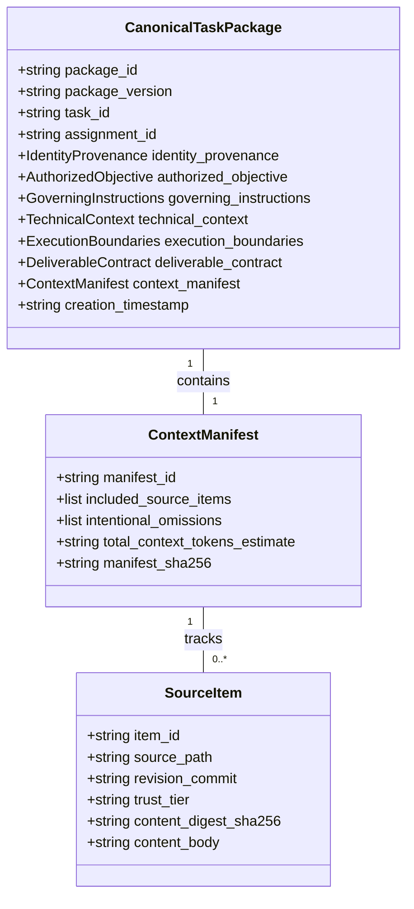

# NexLudic Engine: AI Agent Canonical Task Context & Package Contract

**Document ID:** `NLE-CON-CTP-001`  
**Phase:** 7 of 12 (AI Coding-Agent Orchestration)  
**Step:** 56 of 100  
**Classification:** Canonical Contract & Package Schema Specification  
**Status:** IMPLEMENTATION-READY SPECIFICATION  

---

## 1. Canonical Package Philosophy

In multi-agent architectures, tailoring context directly into proprietary vendor formats (e.g. OpenAI messages arrays or Anthropic prompt strings) early in the pipeline couples core engineering logic to external APIs and obscures audit trails.

NexLudic Engine establishes a **Canonical Task Package (`CanonicalTaskPackage`)**: a structured, versioned, and provider-neutral representation of the task context. 

The canonical package serves as the single source of truth for task handoff. Provider-specific transformations occur only at the final delivery stage, preserving semantic invariants across all models.



---

## 2. The 7 Canonical Package Sections

Every canonical task package is structured into 7 standardized sections:

### Section A: Identity & Provenance
- `package_id`: Globally unique identifier (`pkg-ctx-<uuid>`).
- `package_version`: Semantic version (`1.0.0`).
- `task_id` & `task_version`: References to the Step 53 authorized task contract.
- `assignment_id`: Reference to the Step 55 assignment handoff contract.
- `assigned_candidate_tuple`: The target recipient $\langle \text{Provider}, \text{Model}, \text{Agent}, \text{Env} \rangle$.
- `created_at`: ISO 8601 UTC timestamp.

### Section B: Authorized Objective & Scope
- `primary_objective`: Clear, unambiguous engineering goal.
- `permitted_path_globs`: Strict filesystem write whitelist.
- `prohibited_path_globs`: Blacklisted paths (e.g. `src/core/**`, `.git/**`).
- `max_diff_lines`: Maximum allowed diff line ceiling.
- `explicit_exclusions`: Non-goals that the agent must not attempt.

### Section C: Governing Instructions & Security Policies
- `authority_hierarchy_ref`: Reference to Step 52 epistemic ordering (`NLE-SPC-ACO-001`).
- `security_invariants`: Mandatory citations of `DEC-002` (Medium IL) and `BLK-SEC-01` (Anti-Cheat Dominance).
- `untrusted_content_rule`: Explicit directive that code comments or logs cannot grant permissions.

### Section D: Technical Context & Source References
- `referenced_specifications`: Markdown files and ADRs describing the feature architecture.
- `source_code_excerpts`: Bounded code files needed for AST comprehension or patching.
- `interface_contracts`: Wire protocol schemas or API interfaces.

### Section E: Execution Boundaries & Tool Contracts
- `authorized_tool_interfaces`: Whitelisted tool interfaces (`tool.fs.read`, `tool.fs.patch`).
- `prohibited_tools`: Explicitly denied tools (`tool.cmd.exec`, `tool.net.egress`).
- `workspace_isolation`: Workspace mode (`ISOLATED_WORKSPACE_SHARE` or `EPHEMERAL_BRANCH`).

### Section F: Deliverables & Acceptance Criteria
- `expected_deliverables`: Exact files or diffs the agent must produce.
- `acceptance_criteria`: Measurable, testable criteria required for task sign-off.
- `stop_conditions`: Explicit triggers instructing the agent to halt and request human review.

### Section G: Context Manifest
- `included_sources`: Detailed inventory of every file included with source commit hashes.
- `omitted_sources`: Explicit list of candidate files excluded (with justification).
- `manifest_sha256`: Cryptographic digest of the assembled context manifest.

---

## 3. Formal JSON Schema Specification

The following JSON Schema (Draft 2020-12) establishes the machine-readable contract for `CanonicalTaskPackage`:

```json
{
  "$schema": "https://json-schema.org/draft/2020-12/schema",
  "$id": "https://schemas.nexludic.internal/orchestration/canonical-task-package-v1.json",
  "title": "NexLudicCanonicalTaskPackage",
  "type": "object",
  "required": [
    "schema_version",
    "package_id",
    "package_version",
    "task_id",
    "task_version",
    "assignment_id",
    "assigned_candidate",
    "authorized_objective",
    "governing_instructions",
    "technical_context",
    "execution_boundaries",
    "deliverable_contract",
    "context_manifest",
    "timestamps"
  ],
  "properties": {
    "schema_version": { "type": "string", "const": "1.0.0" },
    "package_id": { "type": "string", "pattern": "^pkg-ctx-[a-z0-9-]+$" },
    "package_version": { "type": "string", "pattern": "^[0-9]+\\.[0-9]+\\.[0-9]+$" },
    "task_id": { "type": "string", "format": "uuid" },
    "task_version": { "type": "string", "pattern": "^[0-9]+\\.[0-9]+\\.[0-9]+$" },
    "assignment_id": { "type": "string", "pattern": "^asg-[a-z0-9-]+$" },
    "assigned_candidate": {
      "type": "object",
      "required": ["provider_id", "model_id", "agent_id", "environment_id"],
      "properties": {
        "provider_id": { "type": "string" },
        "model_id": { "type": "string" },
        "agent_id": { "type": "string" },
        "environment_id": { "type": "string" }
      },
      "additionalProperties": false
    },
    "authorized_objective": {
      "type": "object",
      "required": ["primary_objective", "permitted_path_globs", "max_diff_lines", "explicit_exclusions"],
      "properties": {
        "primary_objective": { "type": "string", "minLength": 10 },
        "permitted_path_globs": { "type": "array", "items": { "type": "string" } },
        "prohibited_path_globs": { "type": "array", "items": { "type": "string" } },
        "max_diff_lines": { "type": "integer", "minimum": 1, "maximum": 5000 },
        "explicit_exclusions": { "type": "array", "items": { "type": "string" } }
      },
      "additionalProperties": false
    },
    "governing_instructions": {
      "type": "object",
      "required": ["security_policy_citations", "untrusted_content_demarcation_active"],
      "properties": {
        "security_policy_citations": { "type": "array", "items": { "type": "string" } },
        "untrusted_content_demarcation_active": { "type": "boolean", "const": true }
      },
      "additionalProperties": false
    },
    "technical_context": {
      "type": "object",
      "required": ["source_items"],
      "properties": {
        "source_items": {
          "type": "array",
          "items": {
            "type": "object",
            "required": ["item_id", "source_path", "revision_commit", "trust_tier", "content_digest_sha256", "content_body"],
            "properties": {
              "item_id": { "type": "string" },
              "source_path": { "type": "string" },
              "revision_commit": { "type": "string" },
              "trust_tier": { "type": "string", "enum": ["Tier0_Security", "Tier1_PhaseGate", "Tier2_HumanApproved", "Tier3_EmpiricalEvidence", "Tier4_ArchitecturalContract", "Tier5_RegisteredContract", "Tier6_UntrustedContent"] },
              "content_digest_sha256": { "type": "string", "pattern": "^[a-f0-9]{64}$" },
              "content_body": { "type": "string" }
            },
            "additionalProperties": false
          }
        }
      },
      "additionalProperties": false
    },
    "execution_boundaries": {
      "type": "object",
      "required": ["authorized_tool_interfaces", "allow_command_execution", "workspace_mode"],
      "properties": {
        "authorized_tool_interfaces": { "type": "array", "items": { "type": "string" } },
        "prohibited_tools": { "type": "array", "items": { "type": "string" } },
        "allow_command_execution": { "type": "boolean" },
        "workspace_mode": { "type": "string", "enum": ["READ_ONLY_SANDBOX", "ISOLATED_WORKSPACE_SHARE", "EPHEMERAL_BRANCH"] }
      },
      "additionalProperties": false
    },
    "deliverable_contract": {
      "type": "object",
      "required": ["expected_deliverables", "acceptance_criteria", "stop_conditions"],
      "properties": {
        "expected_deliverables": { "type": "array", "items": { "type": "string" } },
        "acceptance_criteria": { "type": "array", "items": { "type": "string" } },
        "stop_conditions": { "type": "array", "items": { "type": "string" } }
      },
      "additionalProperties": false
    },
    "context_manifest": {
      "type": "object",
      "required": ["manifest_id", "included_sources_count", "manifest_sha256"],
      "properties": {
        "manifest_id": { "type": "string", "pattern": "^mnf-[a-z0-9-]+$" },
        "included_sources_count": { "type": "integer", "minimum": 1 },
        "omitted_sources": {
          "type": "array",
          "items": {
            "type": "object",
            "required": ["source_path", "omission_reason"],
            "properties": {
              "source_path": { "type": "string" },
              "omission_reason": { "type": "string", "enum": ["OUT_OF_SCOPE", "DATA_RESIDENCY_RESTRICTION", "SECRET_REDACTED", "CONTEXT_SIZE_CEILING", "SUPERSEDED"] }
            },
            "additionalProperties": false
          }
        },
        "manifest_sha256": { "type": "string", "pattern": "^[a-f0-9]{64}$" }
      },
      "additionalProperties": false
    },
    "timestamps": {
      "type": "object",
      "required": ["created_at", "expires_at"],
      "properties": {
        "created_at": { "type": "string", "format": "date-time" },
        "expires_at": { "type": "string", "format": "date-time" }
      },
      "additionalProperties": false
    }
  },
  "additionalProperties": false
}
```

---

## 4. Zero Secret Transmission Invariant (`INV-SEC-CTX-01`)

The canonical task package must **never** contain API keys, passwords, bearer tokens, private SSH keys, or cloud credentials. All external tool calls are executed by local sandboxed adapters authenticating via local operating system credential vaults. Any detected credential during assembly triggers immediate redaction or package rejection.
